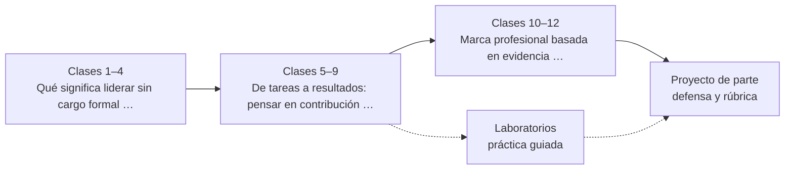

# Parte 00 — De profesional a líder

<!-- parte:inicio -->

> ← Inicio del programa · [Temario](../../SYLLABUS.md) · [Parte 01 — Pensamiento crítico y toma de decisiones](../01-critical-thinking-and-decisions/README.md) →

*Responder por un resultado antes de tener un cargo*

**Etapa:** 1 — Autoliderazgo y fundamentos ejecutivos  
**Duración:** 12 clases · 30 horas  
**Resultado de salida:** Pasar de ejecutar tareas a asumir responsabilidad por resultados, criterio, credibilidad e impacto.

🟢 [Ver las 6 etapas](../../SYLLABUS.md) · 12 clases (001–012) · 4 laboratorios · [proyecto de parte](project.md)

## 🎯 De qué trata esta parte

Esta parte es la puerta de entrada. El programa entero parte de una idea incómoda: el liderazgo no empieza con el título, empieza cuando alguien responde por un resultado que no era estrictamente suyo. Quien espera el cargo para liderar llega al cargo sin evidencia.

El eje es la **responsabilidad demostrable**: pasar de ejecutar tareas a cuidar resultados, y de pedir confianza a producirla con registros. Termina con un sistema personal de ejecución que sostiene el resto del programa.

## 🧱 Con qué hay que llegar

Nada previo: es la puerta de entrada del programa. Solo se necesita un trabajo o proyecto real sobre el cual practicar.

## 📚 Resultados de la parte

Al terminar esta parte podrás:

1. **Distinguir** autoridad formal, influencia y responsabilidad, y actuar sobre las dos últimas sin esperar la primera.
2. **Construir** credibilidad con evidencia verificable en lugar de percepción.
3. **Gobernar** atención, energía y prioridades con un sistema propio y revisable.
4. **Reunir** un registro de fortalezas, brechas y reputación que evolucione con el rol.

## 🗺️ Mapa de la parte

## 🧭 Cómo se encadenan las 12 clases

Las clases **1 a 4** fijan el terreno: qué es liderar sin cargo, qué significa responder por un resultado, cómo se gana credibilidad y dónde están los límites éticos del poder.

Las clases **5 a 9** convierten esa postura en método: contribución, prioridades, sistema de ejecución, energía y aprendizaje deliberado.

Las clases **10 a 12** consolidan: la reputación como evidencia, el mapa de fortalezas y riesgos propios, y el capstone que integra todo en un sistema operativo de liderazgo.

## 📘 Las 12 clases

| # | Clase | Qué se trabaja | Entregable | Min |
|---:|---|---|---|---:|
| 001 | [Qué significa liderar sin cargo formal](classes/001-que-significa-liderar-sin-cargo-formal/README.md) | influencia sin autoridad, legitimidad, iniciativa | [people-decision-brief](../../templates/people-decision-brief.md) | 150 |
| 002 | [Responsabilidad, ownership y accountability](classes/002-responsabilidad-ownership-y-accountability/README.md) | ownership, accountability, responsabilidad | [leadership-decision-brief](../../templates/leadership-decision-brief.md) | 150 |
| 003 | [Credibilidad y confianza profesional](classes/003-credibilidad-y-confianza-profesional/README.md) | credibilidad, confianza, competencia | [risk-governance-brief](../../templates/risk-governance-brief.md) | 150 |
| 004 | [Ética, integridad y límites del poder](classes/004-etica-integridad-y-limites-del-poder/README.md) | integridad, conflicto de interés, asimetría de poder | [leadership-decision-brief](../../templates/leadership-decision-brief.md) | 150 |
| 005 | [De tareas a resultados: pensar en contribución](classes/005-de-tareas-a-resultados-pensar-en-contribucion/README.md) | actividad, output, outcome | [leadership-decision-brief](../../templates/leadership-decision-brief.md) | 150 |
| 006 | [Prioridades y gestión de atención](classes/006-prioridades-y-gestion-de-atencion/README.md) | prioridad, urgencia, importancia | [leadership-decision-brief](../../templates/leadership-decision-brief.md) | 150 |
| 007 | [Sistema personal de ejecución](classes/007-sistema-personal-de-ejecucion/README.md) | captura, next action, calendario | [leadership-decision-brief](../../templates/leadership-decision-brief.md) | 150 |
| 008 | [Gestión de energía y sostenibilidad personal](classes/008-gestion-de-energia-y-sostenibilidad-personal/README.md) | carga, recuperación, fatiga decisional | [risk-governance-brief](../../templates/risk-governance-brief.md) | 150 |
| 009 | [Aprendizaje deliberado y actualización continua](classes/009-aprendizaje-deliberado-y-actualizacion-continua/README.md) | competencia, brecha, práctica deliberada | [leadership-decision-brief](../../templates/leadership-decision-brief.md) | 150 |
| 010 | [Marca profesional basada en evidencia](classes/010-marca-profesional-basada-en-evidencia/README.md) | reputación, posicionamiento profesional, prueba de trabajo | [commercial-decision-brief](../../templates/commercial-decision-brief.md) | 150 |
| 011 | [Mapa de fortalezas, brechas y riesgos personales](classes/011-mapa-de-fortalezas-brechas-y-riesgos-personales/README.md) | fortaleza, brecha, riesgo personal | [risk-governance-brief](../../templates/risk-governance-brief.md) | 150 |
| 012 | [Capstone: tu sistema operativo de liderazgo](classes/012-capstone-tu-sistema-operativo-de-liderazgo/README.md) | principio operativo, cadencia, decision journal | [leadership-decision-brief](../../templates/leadership-decision-brief.md) | 150 |

## ⚠️ Riesgos característicos

- Esperar el cargo para asumir responsabilidad.
- Confundir visibilidad con credibilidad.
- Gestionar el tiempo y no la atención ni la energía.
- Tratar la marca personal como relato y no como registro de hechos.

## 🔤 Glosario de la parte

57 conceptos definidos en las clases, con la definición operacional que usa cada una.

| Concepto | Definición operacional |
|---|---|
| **accountability** | obligación explícita de explicar resultado, decisiones y desviaciones. |
| **actividad** | acción realizada que consume tiempo o recursos. |
| **alineamiento** | grado en que personas distintas entienden el mismo resultado, prioridades y restricciones. |
| **asimetría de poder** | diferencia de capacidad para premiar, castigar o bloquear opciones. |
| **autoridad** | capacidad formal o acordada para decidir y comprometer recursos. |
| **backlog** | trabajo no iniciado y ordenado por decisión, no por acumulación. |
| **brecha** | distancia entre desempeño actual y estándar objetivo. |
| **cadencia** | ritmo periódico de revisión y coordinación. |
| **calendario** | compromisos ligados a una fecha u hora real. |
| **capital relacional** | confianza y acceso construidos mediante relaciones recíprocas. |
| **captura** | registro único y confiable de compromisos antes de que dependan de memoria. |
| **carga** | demanda física, cognitiva y emocional acumulada. |
| **competencia** | capacidad demostrada para producir un resultado. |
| **complementariedad** | uso deliberado de otras personas o sistemas para cubrir límites. |
| **confianza** | disposición a aceptar vulnerabilidad porque se espera una conducta razonablemente fiable. |
| **conflicto de interés** | situación donde un interés secundario puede sesgar una obligación principal. |
| **consistencia** | coherencia entre compromisos, decisiones y comportamiento a lo largo del tiempo. |
| **contribución** | parte del outcome que tu rol puede influir de forma defendible. |
| **credibilidad** | juicio de que una persona es competente y fiable en un dominio. |
| **deber de cuidado** | obligación de considerar daños previsibles a personas y organización. |
| **decision journal** | registro de contexto, supuestos, opciones y resultado esperado. |
| **derailer** | conducta que bajo presión puede sabotear una trayectoria de liderazgo. |
| **escalamiento** | acto de elevar una decisión cuando excede autoridad, riesgo o impacto propio. |
| **fatiga decisional** | deterioro del juicio tras decisiones repetidas o prolongadas. |
| **fortaleza** | capacidad que produce desempeño superior de forma relativamente consistente. |
| **handoff** | transferencia de trabajo o información entre responsables con criterios de aceptación. |
| **importancia** | impacto potencial sobre objetivos, riesgo o valor. |
| **influencia sin autoridad** | capacidad de mover una decisión mediante credibilidad, evidencia y relación, no por poder formal. |
| **iniciativa** | acción que reduce una brecha sin esperar instrucciones detalladas. |
| **integridad** | coherencia sostenida entre principios declarados y conducta observable. |
| **legitimidad** | permiso social y profesional que otros conceden porque perciben competencia e intención confiable. |
| **línea roja** | condición que no se cruza aunque exista presión por resultado. |
| **next action** | próxima acción física o cognitiva suficientemente concreta para iniciar. |
| **outcome** | cambio observable en comportamiento, desempeño o condición del sistema. |
| **output** | producto inmediato de una actividad, como un informe o entrega. |
| **ownership** | disposición de proteger el resultado end-to-end incluso cuando parte del trabajo está fuera de tu control directo. |
| **posicionamiento profesional** | problema y tipo de valor con los que deseas ser asociado. |
| **principio operativo** | regla explícita que orienta decisiones repetidas. |
| **prioridad** | elección que desplaza otras demandas y recibe recursos preferentes. |
| **prueba de trabajo** | artefacto observable que demuestra criterio o ejecución. |
| **práctica deliberada** | entrenamiento focalizado sobre errores concretos con feedback. |
| **recuperación** | periodo y práctica que restaura capacidad funcional. |
| **reputación** | creencia acumulada de terceros sobre tu conducta y capacidad. |
| **responsabilidad** | deber asociado a una tarea o rol específico. |
| **revisión** | ritual para limpiar, reordenar y cerrar compromisos. |
| **riesgo personal** | patrón propio que puede dañar decisiones, relaciones o continuidad. |
| **ritmo sostenible** | velocidad que puede mantenerse sin degradación crónica. |
| **señal** | indicio que reduce incertidumbre sobre una capacidad. |
| **señal de saturación** | indicador temprano de que demanda supera capacidad de recuperación. |
| **sistema de feedback** | mecanismo recurrente para detectar brechas de conducta y resultado. |
| **stakeholder map** | mapa de relaciones cuya confianza o decisión afecta resultados. |
| **switching cost** | pérdida de eficiencia al alternar contextos. |
| **transferencia** | capacidad de aplicar lo aprendido en un contexto nuevo. |
| **transparencia** | declaración honesta de supuestos, límites, errores y conflictos relevantes. |
| **urgencia** | ventana temporal cuyo cierre aumenta el costo de esperar. |
| **valor** | beneficio útil para un stakeholder respecto del costo y riesgo incurridos. |
| **WIP** | trabajo en progreso simultáneo que consume capacidad antes de producir resultados. |

## 📦 Qué queda como evidencia

- Un registro de evidencia reputacional con hechos corroborables.
- Un sistema personal de ejecución con revisión semanal.
- Un mapa de fortalezas, brechas y riesgos propios.
- El capstone: tu sistema operativo de liderazgo.

## 🔗 Cómo se conecta

Alimenta la parte 01, que lleva esa responsabilidad a la calidad de las decisiones, y la parte 02, donde la credibilidad se ejerce al comunicar. Cada artefacto de esta parte se reutiliza en el portafolio final.

## 🧪 Cómo se trabaja

Son **12 clases de 150 minutos** —30 horas— con **4 laboratorios** y un proyecto integrador. Cada clase trae su propósito, sus conceptos, un caso, práctica, errores frecuentes, preguntas de comprobación, entregable y fuentes, y se evalúa con su `assessment.md`. Los laboratorios se resuelven con datos propios o sintéticos, nunca con datos reales de terceros, y la parte se cierra con el proyecto y su defensa. Las reglas de recorrido están en [la guía de navegación](../../docs/NAVIGATION.md).

<!-- parte:fin -->

## Laboratorios

- [Lab 01 — Auditoría personal de liderazgo](labs/lab-01.md)
- [Lab 02 — Agenda ejecutiva semanal](labs/lab-02.md)
- [Lab 03 — Mapa de stakeholders personales](labs/lab-03.md)
- [Lab 04 — Plan de 90 días de transición a líder](labs/lab-04.md)

## Proyecto de parte

Diseñar y defender un Personal Leadership Operating System con métricas, hábitos y evidencias.

## Bibliografía rectora

- Peter F. Drucker — *The Effective Executive* (Ejecución y liderazgo personal)
- Peter F. Drucker — *Management: Tasks, Responsibilities, Practices* (Management)
- Stephen R. Covey — *The 7 Habits of Highly Effective People* (Autoliderazgo)
- Andrew S. Grove — *High Output Management* (Management)
- James Clear — *Atomic Habits* (Hábitos)

## Criterio de aprobación

80/100 y entrega del proyecto integrador.
