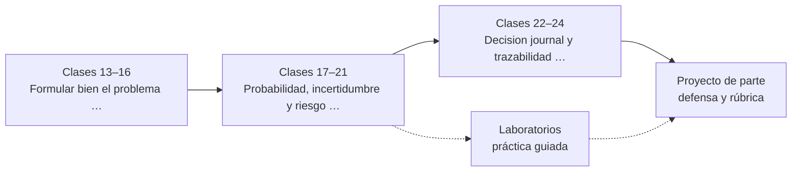

# Parte 01 — Pensamiento crítico y toma de decisiones

<!-- parte:inicio -->

> ← [Parte 00 — De profesional a líder](../00-professional-to-leader/README.md) · [Temario](../../SYLLABUS.md) · [Parte 02 — Comunicación, influencia y presencia ejecutiva](../02-communication-influence-negotiation-basics/README.md) →

*Decidir bien cuando la información es incompleta*

**Etapa:** 1 — Autoliderazgo y fundamentos ejecutivos  
**Duración:** 12 clases · 30 horas  
**Resultado de salida:** Decidir con información incompleta, explicitar supuestos y aprender de resultados.

🟢 [Ver las 6 etapas](../../SYLLABUS.md) · 12 clases (013–024) · 4 laboratorios · [proyecto de parte](project.md)

## 🎯 De qué trata esta parte

Casi todas las decisiones ejecutivas se toman sin los datos que se querrían tener. La diferencia entre un buen y un mal decisor no es la información disponible sino cómo trata lo que no sabe. Esta parte entrena esa disciplina.

El eje es **separar lo que se sabe de lo que se supone** y dejar rastro de la decisión. Se evalúa el proceso, no solo el resultado: una buena decisión puede salir mal y una mala puede salir bien.

## 🧱 Con qué hay que llegar

| Parte | Qué aporta |
|---|---|
| [00 — De profesional a líder](../00-professional-to-leader/README.md) | Responsabilidad por resultados y un sistema personal de ejecución. |

Cada clase supone la anterior: el orden importa, y saltarse una deja sin base a las que vienen después.

## 📚 Resultados de la parte

Al terminar esta parte podrás:

1. **Formular** un problema de modo que pueda decidirse y no solo discutirse.
2. **Separar** hechos, opiniones, hipótesis y supuestos.
3. **Reconocer** sesgos propios y ajenos, incluida la influencia indebida.
4. **Comparar** alternativas con costo de oportunidad, efectos de segundo orden y reversibilidad.
5. **Registrar** decisiones y aprender de ellas con un After Action Review.

## 🗺️ Mapa de la parte

## 🧭 Cómo se encadenan las 12 clases

Las clases **13 a 16** ordenan el pensamiento: el problema, la evidencia, el sistema y los sesgos que lo deforman.

Las clases **17 a 21** dan las herramientas de la incertidumbre: probabilidad, trade-offs, causa raíz, efectos de segundo orden y escenarios.

Las clases **22 a 24** crean el hábito: decision journal, After Action Review y el capstone de un comité de decisión.

## 📘 Las 12 clases

| # | Clase | Qué se trabaja | Entregable | Min |
|---:|---|---|---|---:|
| 013 | [Formular bien el problema](classes/013-formular-bien-el-problema/README.md) | síntoma, problema, causa | [leadership-decision-brief](../../templates/leadership-decision-brief.md) | 150 |
| 014 | [Hechos, opiniones, hipótesis y supuestos](classes/014-hechos-opiniones-hipotesis-y-supuestos/README.md) | hecho, opinión, hipótesis | [leadership-decision-brief](../../templates/leadership-decision-brief.md) | 150 |
| 015 | [Pensamiento sistémico para líderes](classes/015-pensamiento-sistemico-para-lideres/README.md) | sistema, feedback loop, stock | [leadership-decision-brief](../../templates/leadership-decision-brief.md) | 150 |
| 016 | [Sesgos cognitivos en decisiones](classes/016-sesgos-cognitivos-en-decisiones/README.md) | sesgo de confirmación, anclaje, disponibilidad | [leadership-decision-brief](../../templates/leadership-decision-brief.md) | 150 |
| 017 | [Probabilidad, incertidumbre y riesgo](classes/017-probabilidad-incertidumbre-y-riesgo/README.md) | incertidumbre, probabilidad, impacto | [risk-governance-brief](../../templates/risk-governance-brief.md) | 150 |
| 018 | [Trade-offs y costo de oportunidad](classes/018-trade-offs-y-costo-de-oportunidad/README.md) | trade-off, coste de oportunidad, restricción | [leadership-decision-brief](../../templates/leadership-decision-brief.md) | 150 |
| 019 | [Análisis de causa raíz](classes/019-analisis-de-causa-raiz/README.md) | causa raíz, causa contribuyente, 5 porqués | [leadership-decision-brief](../../templates/leadership-decision-brief.md) | 150 |
| 020 | [Efectos de segundo orden](classes/020-efectos-de-segundo-orden/README.md) | primer orden, segundo orden, incentivo | [leadership-decision-brief](../../templates/leadership-decision-brief.md) | 150 |
| 021 | [Escenarios y decisiones reversibles](classes/021-escenarios-y-decisiones-reversibles/README.md) | reversibilidad, opción, experimento | [leadership-decision-brief](../../templates/leadership-decision-brief.md) | 150 |
| 022 | [Decision journal y trazabilidad](classes/022-decision-journal-y-trazabilidad/README.md) | decision journal, supuesto crítico, forecast | [leadership-decision-brief](../../templates/leadership-decision-brief.md) | 150 |
| 023 | [After Action Review y aprendizaje](classes/023-after-action-review-y-aprendizaje/README.md) | AAR, baseline, desviación | [leadership-decision-brief](../../templates/leadership-decision-brief.md) | 150 |
| 024 | [Capstone: comité de decisión bajo incertidumbre](classes/024-capstone-comite-de-decision-bajo-incertidumbre/README.md) | decision brief, red team, riesgo residual | [leadership-decision-brief](../../templates/leadership-decision-brief.md) | 150 |

## ⚠️ Riesgos característicos

- Decidir sobre el problema mal formulado.
- Juzgar la decisión por su resultado y no por su proceso.
- Aceptar una afirmación por quién la dice y no por su evidencia.
- No dejar registro y reescribir la historia después.

## 🔤 Glosario de la parte

59 conceptos definidos en las clases, con la definición operacional que usa cada una.

| Concepto | Definición operacional |
|---|---|
| **5 porqués** | heurística de profundización causal, no prueba de causalidad. |
| **AAR** | revisión estructurada posterior a una acción para comparar intención, resultado y aprendizaje. |
| **acción correctiva** | cambio concreto con responsable y fecha. |
| **anclaje** | influencia excesiva de un valor inicial sobre estimaciones posteriores. |
| **apalancamiento** | punto donde una intervención relativamente pequeña cambia estructura del sistema. |
| **baseline** | resultado esperado antes de actuar. |
| **causa** | condición que contribuye a producir el problema. |
| **causa contribuyente** | factor que aumenta riesgo sin ser suficiente por sí solo. |
| **causa raíz** | condición cuya modificación reduce significativamente probabilidad o severidad de recurrencia. |
| **commitment** | acto de cerrar debate y asignar ejecución tras decidir. |
| **contrafactual** | pregunta sobre qué habría ocurrido si la condición estuviera ausente. |
| **coste de oportunidad** | valor de la mejor alternativa no elegida. |
| **criterio de decisión** | regla explícita usada para comparar alternativas. |
| **criterio de éxito** | condición observable que define una mejora suficiente. |
| **decision brief** | documento breve que presenta problema, opciones, evidencia, recomendación y riesgo. |
| **decision journal** | registro contemporáneo del razonamiento antes de conocer el resultado. |
| **demora** | tiempo entre acción y efecto que puede distorsionar aprendizaje. |
| **desviación** | diferencia entre esperado y observado. |
| **disponibilidad** | sobreponderación de ejemplos fáciles de recordar. |
| **escenario** | estado futuro coherente usado para probar robustez. |
| **exceso de confianza** | intervalos de certeza demasiado estrechos respecto del error real. |
| **experimento** | intervención diseñada para producir evidencia antes de escalar. |
| **externalidad** | costo o beneficio desplazado hacia otro actor. |
| **feedback loop** | circuito donde un efecto vuelve a influir en su causa. |
| **forecast** | predicción explícita con horizonte y rango. |
| **frontera eficiente** | conjunto de combinaciones donde mejorar una dimensión empeora otra. |
| **hecho** | observación o registro verificable dentro de una fuente y periodo. |
| **hipótesis** | explicación provisional que puede contrastarse. |
| **impacto** | consecuencia si el evento ocurre. |
| **incentivo** | estructura que cambia el atractivo relativo de conductas. |
| **incertidumbre** | falta de conocimiento completo sobre estados o resultados futuros. |
| **inferencia** | conclusión derivada de observaciones mediante una regla de razonamiento. |
| **irreversibilidad** | grado en que recuperar la opción descartada es costoso o imposible. |
| **Ishikawa** | mapa de categorías de posibles causas. |
| **learning loop** | ciclo donde evidencia modifica práctica futura. |
| **opción** | facultad de actuar más tarde sin obligación de hacerlo. |
| **opinión** | juicio o preferencia de una persona. |
| **outcome bias** | tendencia a juzgar una decisión solo por su desenlace. |
| **path dependence** | dependencia futura creada por decisiones previas. |
| **primer orden** | efecto directo e inmediato de una acción. |
| **probabilidad** | grado cuantificado de creencia o frecuencia esperada de un evento. |
| **problema** | brecha relevante entre estado actual y resultado esperado. |
| **red team** | rol encargado de desafiar supuestos y vulnerabilidades. |
| **restricción** | límite que una solución debe respetar. |
| **resultado** | lo que efectivamente ocurrió. |
| **reversibilidad** | capacidad de volver atrás con costo y tiempo aceptables. |
| **riesgo** | exposición combinada a probabilidad y consecuencia. |
| **riesgo residual** | exposición que permanece después de controles. |
| **segundo orden** | consecuencia producida por la reacción del sistema al primer efecto. |
| **sesgo de confirmación** | tendencia a buscar o valorar más evidencia compatible con una creencia previa. |
| **sesgo retrospectivo** | percepción posterior de que un resultado era más predecible de lo que realmente fue. |
| **sistema** | conjunto de elementos interdependientes cuyo comportamiento emerge de relaciones. |
| **stock** | acumulación que cambia con entradas y salidas. |
| **supuesto** | condición aceptada temporalmente para avanzar. |
| **supuesto crítico** | creencia cuya falsedad cambia la elección. |
| **síntoma** | manifestación observable de una condición subyacente. |
| **trade-off** | elección donde mejorar una dimensión sacrifica otra. |
| **trigger** | condición observable que activa una acción previamente acordada. |
| **valor esperado** | promedio ponderado de resultados por sus probabilidades. |

## 📦 Qué queda como evidencia

- Un decision journal con al menos cinco decisiones.
- Una tabla de hechos, supuestos y datos faltantes.
- Un análisis de causa raíz y de segundo orden.
- El capstone: decisión de comité bajo incertidumbre.

## 🔗 Cómo se conecta

Es la base de toda decisión posterior: la parte 02 la usa para comunicar decisiones, la 08 para medir, la 13 para elegir estrategia y la 17 para gobernar.

## 🧪 Cómo se trabaja

Son **12 clases de 150 minutos** —30 horas— con **4 laboratorios** y un proyecto integrador. Cada clase trae su propósito, sus conceptos, un caso, práctica, errores frecuentes, preguntas de comprobación, entregable y fuentes, y se evalúa con su `assessment.md`. Los laboratorios se resuelven con datos propios o sintéticos, nunca con datos reales de terceros, y la parte se cierra con el proyecto y su defensa. Las reglas de recorrido están en [la guía de navegación](../../docs/NAVIGATION.md).

<!-- parte:fin -->

## Laboratorios

- [Lab 01 — Decision journal](labs/lab-01.md)
- [Lab 02 — Pre-mortem ejecutivo](labs/lab-02.md)
- [Lab 03 — Árbol de decisión](labs/lab-03.md)
- [Lab 04 — War room de decisión](labs/lab-04.md)

## Proyecto de parte

Resolver un caso ambiguo de negocio y defender la decisión ante un comité.

## Bibliografía rectora

- Daniel Kahneman — *Thinking, Fast and Slow* (Decisiones)
- Gary Klein — *Sources of Power* (Decisiones)
- Richard Rumelt — *Good Strategy/Bad Strategy* (Estrategia)
- Peter M. Senge — *The Fifth Discipline* (Pensamiento sistémico)
- Annie Duke — *Thinking in Bets* (Decisiones)

## Criterio de aprobación

80/100 y entrega del proyecto integrador.
