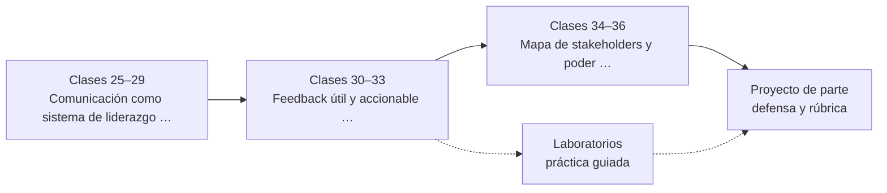

# Parte 02 — Comunicación, influencia y presencia ejecutiva

<!-- parte:inicio -->

> ← [Parte 01 — Pensamiento crítico y toma de decisiones](../01-critical-thinking-and-decisions/README.md) · [Temario](../../SYLLABUS.md) · [Parte 03 — Inteligencia emocional, resiliencia y liderazgo adaptativo](../03-emotional-intelligence-resilience-adaptive-leadership/README.md) →

*Hacerse entender, persuadir con ética y sostener la conversación difícil*

**Etapa:** 1 — Autoliderazgo y fundamentos ejecutivos  
**Duración:** 12 clases · 30 horas  
**Resultado de salida:** Comunicar ideas difíciles con claridad, escuchar, persuadir y sostener conversaciones de alta tensión.

🟢 [Ver las 6 etapas](../../SYLLABUS.md) · 12 clases (025–036) · 4 laboratorios · [proyecto de parte](project.md)

## 🎯 De qué trata esta parte

Un ejecutivo trabaja casi por completo con lenguaje. Una decisión excelente mal comunicada no se ejecuta, y una mala bien comunicada sí. Esta parte trata la comunicación como un **sistema de liderazgo**, no como una habilidad blanda.

El eje es que **los hechos no cambian entre audiencias; cambian el orden, el detalle y el lenguaje**. Incluye escucha, escritura, presentación, feedback, conflicto, mapa de interesados y presencia.

## 🧱 Con qué hay que llegar

| Parte | Qué aporta |
|---|---|
| [00 — De profesional a líder](../00-professional-to-leader/README.md) | Credibilidad y responsabilidad por lo que se dice. |
| [01 — Pensamiento crítico y toma de decisiones](../01-critical-thinking-and-decisions/README.md) | Decisiones con supuestos explícitos que luego hay que comunicar. |

Cada clase supone la anterior: el orden importa, y saltarse una deja sin base a las que vienen después.

## 📚 Resultados de la parte

Al terminar esta parte podrás:

1. **Estructurar** un mensaje para que la audiencia decida.
2. **Escuchar** y preguntar para obtener información que nadie ofrece.
3. **Conducir** feedback, conversaciones difíciles y conflicto productivo.
4. **Mapear** interesados por poder, legitimidad y urgencia.
5. **Comunicar** una decisión impopular sin perder la confianza.

## 🗺️ Mapa de la parte

## 🧭 Cómo se encadenan las 12 clases

Las clases **25 a 29** construyen el oficio: sistema de comunicación, escucha, escritura, presentaciones y relato.

Las clases **30 a 33** cubren la interacción con personas: feedback, conversación difícil, conflicto y persuasión ética.

Las clases **34 a 36** amplían al entorno: interesados y legitimidad, presencia ejecutiva y el capstone de comunicar una decisión impopular.

## 📘 Las 12 clases

| # | Clase | Qué se trabaja | Entregable | Min |
|---:|---|---|---|---:|
| 025 | [Comunicación como sistema de liderazgo](classes/025-comunicacion-como-sistema-de-liderazgo/README.md) | mensaje, canal, ruido | [leadership-decision-brief](../../templates/leadership-decision-brief.md) | 150 |
| 026 | [Escucha activa y preguntas de calidad](classes/026-escucha-activa-y-preguntas-de-calidad/README.md) | pregunta abierta, paráfrasis, inferencia | [operating-improvement-brief](../../templates/operating-improvement-brief.md) | 150 |
| 027 | [Escritura ejecutiva: claridad y síntesis](classes/027-escritura-ejecutiva-claridad-y-sintesis/README.md) | bottom line, pirámide, MECE | [leadership-decision-brief](../../templates/leadership-decision-brief.md) | 150 |
| 028 | [Presentaciones para decisiones](classes/028-presentaciones-para-decisiones/README.md) | decision ask, storyline, slide headline | [leadership-decision-brief](../../templates/leadership-decision-brief.md) | 150 |
| 029 | [Storytelling empresarial](classes/029-storytelling-empresarial/README.md) | protagonista, conflicto, narrativa | [risk-governance-brief](../../templates/risk-governance-brief.md) | 150 |
| 030 | [Feedback útil y accionable](classes/030-feedback-util-y-accionable/README.md) | observación, impacto, feedforward | [people-decision-brief](../../templates/people-decision-brief.md) | 150 |
| 031 | [Conversaciones difíciles](classes/031-conversaciones-dificiles/README.md) | hechos, intención atribuida, contribución | [leadership-decision-brief](../../templates/leadership-decision-brief.md) | 150 |
| 032 | [Conflicto productivo](classes/032-conflicto-productivo/README.md) | conflicto de tarea, conflicto relacional, disenso | [leadership-decision-brief](../../templates/leadership-decision-brief.md) | 150 |
| 033 | [Persuasión ética e influencia](classes/033-persuasion-etica-e-influencia/README.md) | reciprocidad, prueba social, autoridad | [risk-governance-brief](../../templates/risk-governance-brief.md) | 150 |
| 034 | [Mapa de stakeholders y poder](classes/034-mapa-de-stakeholders-y-poder/README.md) | stakeholder, poder, interés | [leadership-decision-brief](../../templates/leadership-decision-brief.md) | 150 |
| 035 | [Presencia ejecutiva](classes/035-presencia-ejecutiva/README.md) | gravitas, claridad, composure | [risk-governance-brief](../../templates/risk-governance-brief.md) | 150 |
| 036 | [Capstone: comunicar una decisión impopular](classes/036-capstone-comunicar-una-decision-impopular/README.md) | decisión impopular, criterio, impacto humano | [leadership-decision-brief](../../templates/leadership-decision-brief.md) | 150 |

## ⚠️ Riesgos característicos

- Cambiar los hechos según la audiencia.
- Confundir persuasión con manipulación.
- Evitar la conversación difícil hasta que es una crisis.
- Tratar la presencia como imagen y no como claridad y criterio.

## 🔤 Glosario de la parte

59 conceptos definidos en las clases, con la definición operacional que usa cada una.

| Concepto | Definición operacional |
|---|---|
| **adaptabilidad** | ajuste consciente de estilo al contexto sin perder autenticidad. |
| **appendix** | detalle que soporta sin bloquear el flujo principal. |
| **autoridad** | señal de expertise o legitimidad que influye en confianza. |
| **bottom line** | conclusión o petición presentada antes del detalle. |
| **cadencia** | ritmo recurrente de comunicación que reduce incertidumbre. |
| **canal** | medio con distinta riqueza, velocidad y persistencia. |
| **claim** | afirmación que requiere sustento. |
| **claridad** | capacidad de expresar prioridades y razonamiento sin ruido. |
| **closed loop** | cierre donde receptor confirma comprensión y acción. |
| **coerción** | presión que reduce de manera impropia la libertad real de elección. |
| **commitment** | apoyo a la ejecución después de una decisión legítima. |
| **composure** | regulación visible de respuesta emocional. |
| **conflicto** | tensión entre estado actual, objetivo y restricción. |
| **conflicto de tarea** | desacuerdo sobre contenido, prioridades o método. |
| **conflicto relacional** | tensión centrada en identidad, respeto o intención. |
| **consistencia** | coherencia entre mensaje, políticas y acciones posteriores. |
| **contribución** | parte propia del patrón aunque no sea culpa equivalente. |
| **credibilidad** | confianza basada en competencia y consistencia. |
| **criterio** | regla usada para comparar alternativas. |
| **decision ask** | acción concreta solicitada a la audiencia. |
| **decisión impopular** | elección legítima que impone costos a parte de los stakeholders. |
| **disenso** | expresión explícita de una alternativa o objeción. |
| **escasez** | mayor valor percibido cuando una opción parece limitada. |
| **especificidad** | nivel de detalle que permite reconocer y reproducir/corregir. |
| **estrategia de engagement** | forma y frecuencia de involucramiento proporcional. |
| **feedforward** | orientación sobre conducta futura. |
| **gravitas** | percepción de juicio y estabilidad bajo presión. |
| **hechos** | eventos observables que las partes pueden verificar. |
| **humble inquiry** | preguntar desde curiosidad genuina sin usar la pregunta como afirmación disfrazada. |
| **identidad** | historia sobre quién soy que se activa en el conflicto. |
| **impacto** | consecuencia concreta sobre trabajo, persona o stakeholder. |
| **impacto humano** | efecto sobre carga, seguridad, rol, identidad o confianza. |
| **inferencia** | significado añadido por el oyente más allá de lo dicho. |
| **intención atribuida** | explicación sobre motivos ajenos que puede ser incorrecta. |
| **interés** | grado en que el resultado importa al stakeholder. |
| **legitimidad** | validez reconocida de su reclamo o rol. |
| **MECE** | agrupación razonablemente no solapada y colectivamente suficiente. |
| **mensaje** | contenido que intenta modificar comprensión o acción. |
| **narrativa** | secuencia causal que da sentido a hechos dispersos. |
| **norma de conflicto** | regla compartida sobre cómo se debate y se cierra. |
| **objetivo conversacional** | resultado razonable de comprensión, decisión o límite. |
| **observación** | descripción de conducta o resultado sin atribuir intención. |
| **paráfrasis** | reexpresión del contenido para comprobar comprensión. |
| **pirámide** | estructura jerárquica de idea principal, argumentos y evidencia. |
| **poder** | capacidad de habilitar, bloquear o alterar recursos y legitimidad. |
| **pregunta abierta** | invita explicación sin restringir a sí/no. |
| **protagonista** | stakeholder cuya situación permite comprender el problema. |
| **prueba** | datos o evidencia que impiden que la historia sea solo persuasión. |
| **prueba social** | uso de conducta de otros como señal de qué es apropiado. |
| **Q&A** | espacio de aclaración que no reabre una decisión cerrada salvo nueva evidencia. |
| **reciprocidad** | tendencia a corresponder beneficios o concesiones. |
| **resolución** | acción o decisión que cambia la trayectoria. |
| **ruido** | interferencia que altera significado o atención. |
| **severidad** | grado de riesgo o daño que determina urgencia y formalidad. |
| **silencio** | espacio que permite elaboración y reduce respuesta automática. |
| **slide headline** | título que expresa el punto, no solo el tema. |
| **stakeholder** | persona o grupo afectado o con capacidad de afectar la decisión. |
| **storyline** | secuencia lógica que conecta problema con recomendación. |
| **visual evidence** | gráfico o tabla elegido para sostener una afirmación. |

## 📦 Qué queda como evidencia

- Un memo ejecutivo de una página.
- Un mapa de interesados con poder, legitimidad y urgencia.
- Una conversación difícil preparada y reflexionada.
- El capstone: comunicación de una decisión impopular.

## 🔗 Cómo se conecta

Alimenta la parte 04 (liderar equipos), la 16 (comunicación del CEO) y las crisis de la parte 15. La vocería y la gestión de reputación se profundizan en las clases 190, 200 y 286.

## 🧪 Cómo se trabaja

Son **12 clases de 150 minutos** —30 horas— con **4 laboratorios** y un proyecto integrador. Cada clase trae su propósito, sus conceptos, un caso, práctica, errores frecuentes, preguntas de comprobación, entregable y fuentes, y se evalúa con su `assessment.md`. Los laboratorios se resuelven con datos propios o sintéticos, nunca con datos reales de terceros, y la parte se cierra con el proyecto y su defensa. Las reglas de recorrido están en [la guía de navegación](../../docs/NAVIGATION.md).

<!-- parte:fin -->

## Laboratorios

- [Lab 01 — Memo de una página](labs/lab-01.md)
- [Lab 02 — Feedback SBI/COIN](labs/lab-02.md)
- [Lab 03 — Presentación de cinco minutos](labs/lab-03.md)
- [Lab 04 — Simulación de conversación difícil](labs/lab-04.md)

## Proyecto de parte

Preparar un memo y una presentación ejecutiva para alinear stakeholders en conflicto.

## Bibliografía rectora

- Dale Carnegie — *How to Win Friends and Influence People* (Comunicación)
- Amy Cuddy — *Presence* (Presencia)
- Chip Heath & Dan Heath — *Made to Stick* (Comunicación)
- Robert B. Cialdini — *Influence* (Persuasión)
- Roger Fisher, William Ury & Bruce Patton — *Getting to Yes* (Negociación)

## Criterio de aprobación

80/100 y entrega del proyecto integrador.
