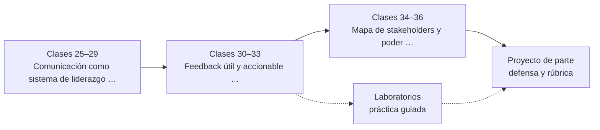

# Parte 02 — Comunicación, influencia y presencia ejecutiva

<!-- parte:inicio -->

> ← [Parte 01 — Pensamiento crítico y toma de decisiones](../01-critical-thinking-and-decisions/README.md) · [Temario](../../SYLLABUS.md) · [Parte 03 — Inteligencia emocional, resiliencia y liderazgo adaptativo](../03-emotional-intelligence-resilience-adaptive-leadership/README.md) →

*Hacerse entender, persuadir con ética y sostener la conversación difícil*

**Etapa:** 1 — Autoliderazgo y fundamentos ejecutivos  
**Duración:** 12 clases · 30 horas  
**Resultado de salida:** Comunicar ideas difíciles con claridad, escuchar, persuadir y sostener conversaciones de alta tensión.

🟢 [Ver las 6 etapas](../../SYLLABUS.md) · 12 clases (025–036) · 4 laboratorios · [proyecto de parte](project.md)

## 🎯 De qué trata esta parte

Un ejecutivo trabaja casi por completo con lenguaje. Una decisión excelente mal comunicada no se ejecuta, y una mala bien comunicada sí. Esta parte trata la comunicación como un **sistema de liderazgo**, no como una habilidad blanda.

El eje es que **los hechos no cambian entre audiencias; cambian el orden, el detalle y el lenguaje**. Incluye escucha, escritura, presentación, feedback, conflicto, mapa de interesados y presencia.

## 🧱 Con qué hay que llegar

| Parte | Qué aporta |
|---|---|
| [00 — De profesional a líder](../00-professional-to-leader/README.md) | Credibilidad y responsabilidad por lo que se dice. |
| [01 — Pensamiento crítico y toma de decisiones](../01-critical-thinking-and-decisions/README.md) | Decisiones con supuestos explícitos que luego hay que comunicar. |

Cada clase supone la anterior: el orden importa, y saltarse una deja sin base a las que vienen después.

## 📚 Resultados de la parte

Al terminar esta parte podrás:

1. **Estructurar** un mensaje para que la audiencia decida.
2. **Escuchar** y preguntar para obtener información que nadie ofrece.
3. **Conducir** feedback, conversaciones difíciles y conflicto productivo.
4. **Mapear** interesados por poder, legitimidad y urgencia.
5. **Comunicar** una decisión impopular sin perder la confianza.

## 🗺️ Mapa de la parte

## 🧭 Cómo se encadenan las 12 clases

Las clases **25 a 29** construyen el oficio: sistema de comunicación, escucha, escritura, presentaciones y relato.

Las clases **30 a 33** cubren la interacción con personas: feedback, conversación difícil, conflicto y persuasión ética.

Las clases **34 a 36** amplían al entorno: interesados y legitimidad, presencia ejecutiva y el capstone de comunicar una decisión impopular.

## 📘 Las 12 clases

| # | Clase | Qué se trabaja | Entregable | Min |
|---:|---|---|---|---:|
| 025 | [Comunicación como sistema de liderazgo](classes/025-comunicacion-como-sistema-de-liderazgo/README.md) | Sistema de comunicación, Incertidumbre, Equivocidad | [leadership-decision-brief](../../templates/leadership-decision-brief.md) | 150 |
| 026 | [Escucha activa y preguntas de calidad](classes/026-escucha-activa-y-preguntas-de-calidad/README.md) | Indagación humilde, Indagación diagnóstica, Indagación confrontacional | [operating-improvement-brief](../../templates/operating-improvement-brief.md) | 150 |
| 027 | [Escritura ejecutiva: claridad y síntesis](classes/027-escritura-ejecutiva-claridad-y-sintesis/README.md) | Principio de la pirámide, Respuesta primero, Línea clave | [leadership-decision-brief](../../templates/leadership-decision-brief.md) | 150 |
| 028 | [Presentaciones para decisiones](classes/028-presentaciones-para-decisiones/README.md) | Presentación para decidir, Título afirmación, Decisión pedida | [leadership-decision-brief](../../templates/leadership-decision-brief.md) | 150 |
| 029 | [Storytelling empresarial](classes/029-storytelling-empresarial/README.md) | Idea simple, Idea inesperada, Idea concreta | [risk-governance-brief](../../templates/risk-governance-brief.md) | 150 |
| 030 | [Feedback útil y accionable](classes/030-feedback-util-y-accionable/README.md) | Intervención de feedback, Nivel de feedback, Feedback de tarea | [people-decision-brief](../../templates/people-decision-brief.md) | 150 |
| 031 | [Conversaciones difíciles](classes/031-conversaciones-dificiles/README.md) | Conversación difícil, Camino a la acción, Hecho | [leadership-decision-brief](../../templates/leadership-decision-brief.md) | 150 |
| 032 | [Conflicto productivo](classes/032-conflicto-productivo/README.md) | Conflicto de tarea, Conflicto de relación, Seguridad psicológica | [leadership-decision-brief](../../templates/leadership-decision-brief.md) | 150 |
| 033 | [Persuasión ética e influencia](classes/033-persuasion-etica-e-influencia/README.md) | Persuasión, Manipulación, Coerción | [risk-governance-brief](../../templates/risk-governance-brief.md) | 150 |
| 034 | [Mapa de stakeholders y poder](classes/034-mapa-de-stakeholders-y-poder/README.md) | Interesado (stakeholder), Poder, Legitimidad | [stakeholder-legitimacy-map](../../templates/stakeholder-legitimacy-map.md) | 150 |
| 035 | [Presencia ejecutiva](classes/035-presencia-ejecutiva/README.md) | Presencia ejecutiva, Imagen profesional, Apariencia | [risk-governance-brief](../../templates/risk-governance-brief.md) | 150 |
| 036 | [Capstone: comunicar una decisión impopular](classes/036-capstone-comunicar-una-decision-impopular/README.md) | Justicia distributiva, Justicia procedimental, Justicia interpersonal | [leadership-decision-brief](../../templates/leadership-decision-brief.md) | 150 |

## ⚠️ Riesgos característicos

- Cambiar los hechos según la audiencia.
- Confundir persuasión con manipulación.
- Evitar la conversación difícil hasta que es una crisis.
- Tratar la presencia como imagen y no como claridad y criterio.

## 🔤 Glosario de la parte

76 conceptos definidos en las clases, con la definición operacional que usa cada una.

| Concepto | Definición operacional |
|---|---|
| **Agrupación lógica** | Ideas de un mismo tipo, sin solaparse y sin omitir lo importante. |
| **Apariencia** | Lo perceptible a primera vista, incluida información que la persona no elige ni controla. |
| **Autoridad, simpatía y escasez** | Los otros tres principios descritos por Cialdini (2016). |
| **Camino a la acción** | Secuencia interna: ver y oír, contar una historia, sentir y actuar (Patterson et al., 2012). |
| **Coerción** | Influencia que condiciona la decisión con una amenaza (criterio de la clase). |
| **Coherencia y compromiso** | Tendencia a actuar de acuerdo con compromisos previos (Cialdini, 2016). |
| **Competencia** | Capacidad demostrada para realizar una tarea o responder por un resultado. |
| **Comunicación no verbal** | Postura, gestos, mirada, movimiento y uso del espacio que acompañan el mensaje (Hall, Horgan y Murphy, 2019). |
| **Conflicto de relación** | Incompatibilidad entre personas, con tensión y fricción afectiva (Jehn, 1995). |
| **Conflicto de tarea** | Desacuerdo sobre el contenido del trabajo: ideas, criterios, opiniones (Jehn, 1995). |
| **Contagio emocional del líder** | Efecto del estado de ánimo y la conducta del líder sobre el de su equipo, descrito por Goleman, Boyatzis y McKee (2002). |
| **Contraste «es / podría ser»** | Distancia entre la situación actual y la deseada que impulsa el cambio (Duarte, 2010). |
| **Conversación de aprendizaje** | Postura de curiosidad: se busca entender cómo vio el otro la situación. |
| **Conversación difícil** | Conversación donde hay mucho en juego, opiniones opuestas y emociones fuertes (Patterson et al., 2012). |
| **Decisión impopular** | Decisión legítima que perjudica a personas que no la desean. |
| **Decisión pedida** | Lo que se solicita al grupo: aprobar, elegir, financiar o desestimar. |
| **Disparador de identidad** | Reacción a lo que el feedback dice de quien lo recibe (Stone y Heen, 2014). |
| **Disparador de relación** | Reacción a quien da el feedback (Stone y Heen, 2014). |
| **Disparador de verdad** | Reacción al contenido del feedback: lo siento incorrecto o injusto (Stone y Heen, 2014). |
| **Equivocidad** | Existencia de varias interpretaciones posibles de una misma situación (Daft y Lengel, 1986). |
| **Escucha activa** | Atender para comprender, no para responder, y comprobar la comprensión resumiendo con las palabras del otro. |
| **Evidencia mínima** | Los datos estrictamente necesarios para sostener una afirmación. |
| **Feedback de tarea** | Información sobre qué se logró o faltó en una tarea concreta. |
| **Feedback de yo** | Juicio sobre la persona, ajeno a la tarea. |
| **Hecho** | Lo que se puede observar y registrar sin interpretar: qué se dijo, qué se hizo, cuándo. |
| **Historia** | Relato de personas que actúan ante una dificultad y obtienen un resultado. |
| **Idea concreta** | Mensaje expresado en detalles perceptibles, no en abstracciones. |
| **Idea creíble** | Mensaje respaldado por evidencia que la audiencia puede comprobar. |
| **Idea emocional** | Mensaje que conecta con algo que le importa a la audiencia. |
| **Idea inesperada** | Mensaje que rompe una expectativa y genera curiosidad. |
| **Idea simple** | Mensaje reducido a su esencia, que prioriza lo central (Heath y Heath, 2007). |
| **Imagen profesional** | Presentación visual, conductual y contextual elegida para facilitar un propósito de trabajo. |
| **Incertidumbre** | Ausencia de información (Daft y Lengel, 1986). |
| **Indagación confrontacional** | Introduce una idea del que pregunta, formulada como pregunta. |
| **Indagación de proceso** | Pregunta por la conversación misma. |
| **Indagación diagnóstica** | Dirige la atención del otro hacia sus emociones, motivos o causas. |
| **Indagación humilde** | El arte de hacer salir al otro con preguntas a las que no se conoce la respuesta, desde un interés genuino en la persona (Schein, 2013). |
| **Interesado (stakeholder)** | Según Freeman (1984), cualquier grupo o individuo que puede afectar o ser afectado por el logro de los objetivos de la organización. |
| **Intervención de feedback** | Información sobre el desempeño de alguien que ofrece otra persona, para cambiar su conducta (Kluger y DeNisi, 1996). |
| **Interés** | La necesidad o preocupación que explica la posición (Fisher, Ury y Patton, 1983). |
| **Justicia distributiva** | Percepción de justicia del resultado: lo que cada uno recibe o pierde (Colquitt et al., 2001). |
| **Justicia informacional** | Percepción de la calidad de las explicaciones: veracidad, razones y oportunidad (Colquitt et al., 2001). |
| **Justicia interpersonal** | Percepción del trato recibido: respeto y dignidad (Colquitt et al., 2001). |
| **Justicia procedimental** | Percepción de justicia del proceso por el que se decidió (Colquitt et al., 2001). |
| **Las tres conversaciones** | Qué ocurrió, los sentimientos y la identidad (Stone, Patton y Heen, 1999). |
| **Latente, expectante, definitivo** | Según tenga uno, dos o los tres atributos. Cada grupo tiene subtipos con nombre propio. |
| **Legitimidad** | Percepción generalizada de que las acciones de un actor son deseables o apropiadas dentro de un sistema socialmente construido de normas, valores y creencias. |
| **Línea clave** | Cada una de las ideas del segundo nivel que sostienen la respuesta. |
| **Manipulación** | Influencia que oculta su propósito o explota una debilidad (criterio de la clase). |
| **Mensaje central** | Una frase verificable que sostiene toda la comunicación (criterio de la clase). |
| **Narrativa de cambio** | Recorrido que contrasta la situación actual con la posible para mover a la acción (Duarte, 2010). |
| **Nivel de feedback** | Aspecto al que se dirige la atención: la tarea, el proceso o el yo (Kluger y DeNisi, 1996). |
| **Objeción anticipada** | Reparo previsible de la audiencia, respondido antes de que se formule. |
| **Persuasión** | Influencia que expone su propósito y deja decidir (criterio de la clase). |
| **Poder** | Capacidad de un actor de lograr que otro haga algo que de otro modo no haría, mediante recursos coercitivos, utilitarios o normativos. |
| **Posición** | Lo que una parte exige. |
| **Presencia ejecutiva** | Capacidad de transmitir claridad, estabilidad y criterio bajo atención (criterio de la clase). |
| **Presentación para decidir** | Exposición cuyo objetivo es obtener una decisión concreta de un grupo. |
| **Principio de la pirámide** | Organizar un texto de arriba abajo: la idea principal primero, luego las ideas que la sostienen, luego los datos (Minto, 2005). |
| **Prominencia (salience)** | Grado en que los directivos dan prioridad a los reclamos de un actor. |
| **Propósito común** | Meta que ambas partes comparten en la conversación. |
| **Prueba social** | Tendencia a seguir lo que hacen otros (Cialdini, 2016). |
| **Prueba «¿y entonces?»** | Comprobación hacia arriba: ¿lo que dicen las ideas de abajo permite concluir la de arriba?. |
| **Reciprocidad** | Tendencia a devolver lo recibido (Cialdini, 2016). |
| **Reputación** | Juicio acumulado a lo largo del tiempo sobre conducta, decisiones y resultados. |
| **Respuesta primero** | Presentar la recomendación o conclusión al inicio y no al final. |
| **Retroalimentación** | Respuesta del receptor que permite comprobar si el mensaje se entendió como se quiso. |
| **Riqueza del canal** | Capacidad de un medio para transmitir información: retroalimentación inmediata, varias señales, lenguaje natural y foco personal. |
| **Secuencia del anuncio** | Orden de las audiencias, canales y mensajes. |
| **Seguridad psicológica** | Creencia compartida de que el equipo es seguro para correr riesgos interpersonales (Edmondson, 2018). |
| **Separar personas y problema** | Tratar el desacuerdo como un problema compartido, no como una disputa entre personas. |
| **Sistema de comunicación** | Conjunto de audiencias, mensajes, canales, ritmos y mecanismos de retroalimentación que una organización o un líder diseña (criterio de la clase). |
| **Situación, complicación y pregunta** | Introducción que recuerda lo que el lector ya sabe, lo que cambió y la pregunta que el texto contesta. |
| **Solución prematura** | Ofrecer respuestas antes de haber entendido el problema. |
| **Título afirmación** | Título que enuncia la conclusión de la lámina en forma de oración. |
| **Urgencia** | Grado en que el reclamo exige atención inmediata: sensibilidad al tiempo y criticidad para el actor. |

## 📦 Qué queda como evidencia

- Un memo ejecutivo de una página.
- Un mapa de interesados con poder, legitimidad y urgencia.
- Una conversación difícil preparada y reflexionada.
- El capstone: comunicación de una decisión impopular.

## 🔗 Cómo se conecta

Alimenta la parte 04 (liderar equipos), la 16 (comunicación del CEO) y las crisis de la parte 15. La vocería y la gestión de reputación se profundizan en las clases 190, 200 y 286.

## 🧪 Cómo se trabaja

Son **12 clases de 150 minutos** —30 horas— con **4 laboratorios** y un proyecto integrador. Cada clase trae su propósito, sus conceptos, un caso, práctica, errores frecuentes, preguntas de comprobación, entregable y fuentes, y se evalúa con su `assessment.md`. Los laboratorios se resuelven con datos propios o sintéticos, nunca con datos reales de terceros, y la parte se cierra con el proyecto y su defensa. Las reglas de recorrido están en [la guía de navegación](../../docs/NAVIGATION.md).

<!-- parte:fin -->

## Laboratorios

- [Lab 01 — Memo de una página](labs/lab-01.md)
- [Lab 02 — Feedback SBI/COIN](labs/lab-02.md)
- [Lab 03 — Presentación de cinco minutos](labs/lab-03.md)
- [Lab 04 — Simulación de conversación difícil](labs/lab-04.md)

## Proyecto de parte

Preparar un memo y una presentación ejecutiva para alinear stakeholders en conflicto.

## Bibliografía rectora

- Dale Carnegie — *How to Win Friends and Influence People* (Comunicación)
- Amy Cuddy — *Presence* (Presencia)
- Chip Heath & Dan Heath — *Made to Stick* (Comunicación)
- Robert B. Cialdini — *Influence* (Persuasión)
- Roger Fisher, William Ury & Bruce Patton — *Getting to Yes* (Negociación)

## Criterio de aprobación

80/100 y entrega del proyecto integrador.
