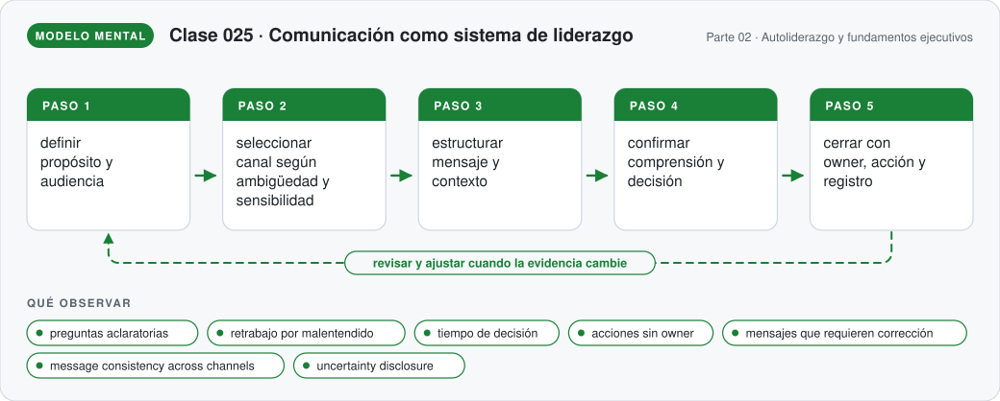

# Clase 025 — Comunicación como sistema de liderazgo

<!-- nav:inicio -->
> **Parte 02 · Comunicación, influencia y presencia ejecutiva** — clase 1 de 12 · [índice de la parte](../../README.md) · [temario](../../../../SYLLABUS.md)
<!-- nav:fin -->

**Parte:** 02 — Comunicación, influencia y presencia ejecutiva  
**Nivel:** Etapa 1 — Profesional → Líder  
**Duración sugerida:** 150–180 minutos · **Estándar:** deep-class-v2

## 🎯 Propósito

Cuando algo no se hace, casi siempre se dice que «faltó comunicación». Pero rara vez se pregunta cuál: ¿no se dijo?, ¿se dijo por un canal que nadie lee?, ¿se dijo de manera que admitía dos lecturas?, ¿nadie comprobó que se hubiera entendido? Esta clase trata la comunicación como un **sistema** con partes que se diseñan —audiencias, mensaje, canal, ritmo y retroalimentación— y no como un talento personal.

Al terminar sabrás elegir el canal según la naturaleza del mensaje, preparar un mismo hecho para una audiencia interna y otra externa sin cambiar su contenido, y comprobar que el mensaje llegó. La base teórica es la de Daft y Lengel sobre incertidumbre, equivocidad y riqueza del canal.

## 📚 Resultados de aprendizaje

Al finalizar podrás:

1. **Distinguir** incertidumbre y equivocidad, y decir qué tipo de canal pide cada una.
2. **Elegir** un canal para un mensaje concreto y justificar la elección.
3. **Adaptar** un mismo hecho a una audiencia interna y a una externa sin cambiar sus datos.
4. **Estructurar** un mensaje con lo que se sabe, lo que no, lo que se hace y cuándo habrá novedades.
5. **Comprobar** que un mensaje llegó, sin asumirlo.

## 🧭 Agenda

| Tramo | Qué se hace |
|---|---|
| 0–20 min | Recuperación: recuerda un mensaje tuyo que se entendió mal; ¿qué canal usaste y qué ambigüedad tenía? |
| 20–60 min | Incertidumbre, equivocidad y riqueza del canal, con el diagrama de la clase. |
| 60–100 min | Ejemplo trabajado: cinco mensajes de una reorganización y su canal. |
| 100–135 min | Caso ejecutivo: un mismo hecho para empleados y para clientes. |
| 135–150 min | Límites de la teoría y entregable. |

## 🧩 Conceptos centrales

| Concepto | Definición | Cómo se reconoce |
|---|---|---|
| **Sistema de comunicación** | Conjunto de audiencias, mensajes, canales, ritmos y mecanismos de retroalimentación que una organización o un líder diseña (criterio de la clase). | Se puede decir quién recibe qué, por dónde y cuándo. |
| **Incertidumbre** | Ausencia de información (Daft y Lengel, 1986). | Se resuelve con datos: falta saber algo concreto. |
| **Equivocidad** | Existencia de varias interpretaciones posibles de una misma situación (Daft y Lengel, 1986). | Los datos no bastan: hay que acordar qué significan. |
| **Riqueza del canal** | Capacidad de un medio para transmitir información: retroalimentación inmediata, varias señales, lenguaje natural y foco personal. | La conversación presencial es más rica que un informe. |
| **Mensaje central** | Una frase verificable que sostiene toda la comunicación (criterio de la clase). | Se puede comprobar con hechos. |
| **Retroalimentación** | Respuesta del receptor que permite comprobar si el mensaje se entendió como se quiso. | Alguien lo repite con sus palabras o pregunta. |
| **Contagio emocional del líder** | Efecto del estado de ánimo y la conducta del líder sobre el de su equipo, descrito por Goleman, Boyatzis y McKee (2002). | El tono transmite antes que el contenido. |

## 🧠 Modelo mental

**Cómo leer el diagrama.** La diagonal verde es la zona de ajuste: un mensaje sin ambigüedad cabe en un canal pobre (informe, correo); uno equívoco necesita un canal rico (conversación). Las esquinas opuestas son desajustes: usar una reunión larga para algo simple desperdicia tiempo; usar un correo para una noticia ambigua produce malentendidos.

## 📖 Desarrollo

### 1. Comunicar es un sistema, no un acto

Un mensaje enviado no es un mensaje comunicado. En una organización, comunicar implica decidir **a quién** se dirige, **qué** se dice, **por dónde**, **con qué frecuencia** y **cómo se sabrá** que llegó. Cada decisión puede fallar por separado: un buen mensaje por un canal que nadie mira, un buen canal con un mensaje ambiguo, un buen mensaje sin forma de comprobar su efecto. Tratarlo como sistema obliga a revisar cada parte antes de culpar al receptor.

### 2. Incertidumbre y equivocidad

Daft y Lengel distinguen dos problemas de información. La **incertidumbre** es falta de datos: no sabemos cuánto vendimos. Se resuelve con más información. La **equivocidad** es abundancia de interpretaciones: sabemos cuánto vendimos, pero no acordamos si es bueno o malo. Más datos no la resuelve; hace falta conversar, comparar lecturas y llegar a un sentido compartido.

La distinción tiene un uso inmediato: antes de enviar algo, pregúntate si el receptor necesita un dato o un significado. Un dato se manda; un significado se construye.

### 3. Riqueza del canal

Los autores proponen que un medio es más **rico** cuanto más permite: retroalimentación inmediata, transmisión de varias señales (tono, gestos, palabras), uso de lenguaje natural y foco personal. La conversación presencial y la videollamada son ricas; el informe y el tablero son pobres. Su hipótesis central es que las organizaciones procesan mejor la información cuando **ajustan** la riqueza del canal a la naturaleza del mensaje: canales pobres para lo claro, ricos para lo equívoco.

### 4. Un hecho, dos audiencias

Un líder comunica hacia dentro (equipos, pares, directorio) y hacia fuera (clientes, medios, autoridades, inversionistas). La regla común es que **los hechos no cambian entre audiencias; cambian el detalle, el orden y el lenguaje**. Hacia dentro importa qué se pide a cada área; hacia fuera, qué cambia para el cliente.

| Situación | Hacia dentro | Hacia fuera | Error típico |
|---|---|---|---|
| Un incidente con clientes | Qué ocurrió, quién decide, qué se pide a cada área. | Qué pasó, a quién afecta y qué se hace. | Que los empleados lo sepan por la prensa. |
| Un cambio organizacional | Razones, criterios, cronograma y apoyo. | Impacto para clientes y continuidad. | Mensajes que se contradicen. |
| Una mala noticia | Qué sabemos, qué no, quién investiga. | La misma estructura con menos detalle operativo. | Optimismo externo contradicho por la realidad interna. |

### 5. Qué sabemos, qué no sabemos, qué hacemos, cuándo informamos

Una estructura que funciona para declaraciones y mensajes difíciles tiene cuatro partes: **qué sabemos, qué no sabemos todavía, qué estamos haciendo y cuándo informaremos de nuevo**. Admitir la incertidumbre con una fecha de actualización es más creíble que una certeza que luego se corrige. Un dato relevante que existe y se retiene pasa de error a ocultamiento en cuanto se descubre.

### 6. El tono antes que el contenido

Goleman, Boyatzis y McKee sostienen que el estado de ánimo y la conducta de un líder se transmiten al equipo, y que esa transmisión ocurre antes de que se procese el contenido. Un anuncio con datos correctos y un tono de impaciencia o desdén produce una lectura distinta a la que el líder buscaba. Para quien dirige esto es una responsabilidad: antes de comunicar algo difícil, regula tu propio estado.

### 7. Comprobar que llegó

La retroalimentación es la parte que más se omite. Tres formas simples de cerrarla: pedir que alguien **repita con sus palabras** lo que entendió; **medir una conducta** que debería cambiar tras el mensaje; y abrir un **canal de preguntas** con una fecha de respuesta. Si el mensaje es importante, la comprobación es parte del mensaje.

## 📚 Lectura comparada

| Obra | Qué aporta | Qué no resuelve | Pregunta para contrastar |
|---|---|---|---|
| Daft y Lengel (1986) | Incertidumbre, equivocidad y ajuste del canal. | No considera hábitos ni normas sociales de uso. | ¿Tu último canal correspondía al tipo de mensaje? |
| Goleman, Boyatzis y McKee (2002) | El efecto del tono del líder. | No dice cómo estructurar el contenido. | ¿Qué estado transmitías al comunicar? |
| Heath y Heath (2007) | Cómo hacer un mensaje simple y recordable. | No elige canal. | ¿Cuál es tu mensaje en una frase? |
| Stone, Patton y Heen (1999) | Cómo conducir la parte difícil de un mensaje. | No cubre comunicación masiva. | ¿Qué evitas decir y por qué? |
| Minto (2005) | Estructura de un mensaje escrito para decidir. | No cubre el canal oral. | ¿Dónde está la respuesta en tu mensaje? |

## 🧮 Ejemplo trabajado

**Situación (hipotética).** Una empresa de 400 personas fusiona dos áreas. Hay cinco mensajes que comunicar. Clasifiquemos cada uno y elijamos el canal.

| Mensaje | ¿Incertidumbre o equivocidad? | Canal | Por qué |
|---|---|---|---|
| Nueva ubicación de escritorios | Incertidumbre (falta un dato) | Correo con plano | Es un dato; no admite lecturas. |
| Los cargos de jefatura que se fusionan | Equivocidad alta | Conversación con cada persona afectada, antes del anuncio general | Hay varias lecturas posibles y personas con mucho en juego. |
| Cambio de herramienta de reportes | Incertidumbre con algo de equivocidad | Taller corto con demostración y preguntas | Requiere ver y preguntar. |
| Por qué se fusionan las áreas | Equivocidad | Reunión abierta con la gerencia y espacio para preguntas | Hay que construir un sentido compartido. |
| Calendario de la integración | Incertidumbre | Documento publicado y actualizado | Es un dato que cambia. |

**Qué muestra.** (1) El mismo proceso exige canales distintos según el tipo de mensaje. (2) Lo equívoco se conversa **antes** de publicarse. (3) Después de una conversación rica conviene dejar registro escrito, porque el canal rico aclara y el pobre deja constancia. (4) Para cada mensaje se define cómo se comprobará que llegó: por ejemplo, tres preguntas frecuentes registradas y respondidas en una semana.

## 🔀 Comparación y límites

**Interna frente a externa.** Hacia dentro se puede ser más detallado y operativo; hacia fuera se protege la información sensible, pero **sin contradecir** lo que se dice dentro: las audiencias se comunican entre sí.

**Límites de la teoría.** La teoría de la riqueza del canal ha sido discutida: la elección real de un canal también depende del hábito, de las normas del grupo, de la disponibilidad y de la distancia, y los medios nuevos se usan de maneras que la teoría original no previó. Úsala como criterio de partida, no como regla. Y recuerda que ningún canal salva un mensaje cuyo contenido los hechos contradicen.

## 🪜 De profesional a owner

| Nivel | Cómo comunica |
|---|---|
| **Profesional** | Elige el canal para que su mensaje se entienda a la primera y pide confirmación. |
| **Jefe / Team Lead** | Conversa lo equívoco con su equipo antes de publicarlo y deja registro de lo acordado. |
| **Gerente** | Diseña el ritmo y los canales de su área y verifica la coherencia con el resto. |
| **CEO / Director** | Mantiene un hecho único ante todas las audiencias y gobierna el tono con que se comunica. |
| **Founder / Owner** | Su comunicación a socios, clientes y equipo es parte del producto: define la información que comparte y cómo comprueba que la entendieron. |

## 🏢 Caso ejecutivo

Tras una auditoría interna, una empresa de salud descubre que un proceso de facturación lleva meses generando cobros duplicados a un 3 % de sus pacientes. Aún no se sabe la cifra exacta. Hay que informar a los empleados de facturación, a la gerencia, a los pacientes afectados y a la autoridad sanitaria. La gerente comercial quiere esperar a tener la cifra exacta; el director de operaciones quiere informar de inmediato.

Entrega un **plan de comunicación** que contenga: (a) el hecho central en una frase verificable; (b) para cada audiencia, si el mensaje es de incertidumbre o de equivocidad y el canal elegido; (c) el mensaje con la estructura *qué sabemos, qué no, qué hacemos, cuándo informamos*; (d) cómo comprobarás que cada audiencia entendió; (e) qué dato cambiaría tu decisión de esperar o informar.

## 🧪 Práctica

1. Toma tres mensajes de tu semana y clasifícalos: incertidumbre o equivocidad. ¿El canal que usaste correspondía?
2. Reescribe un comunicado para dos audiencias sin cambiar ningún dato y marca qué cambió.
3. Redacta un mensaje difícil con la estructura de cuatro partes.
4. Define cómo comprobarás que llegó un mensaje importante.
5. Escribe en una línea el estado con que quieres transmitirlo y qué harás antes para lograrlo.

## ⚠️ Errores frecuentes

| Error | Por qué ocurre | Cómo corregirlo |
|---|---|---|
| Resolver una equivocidad con más datos | Se cree que informar basta | Conversar y construir un sentido compartido. |
| Anunciar por escrito algo sensible | Es más cómodo | Hablar antes con los más afectados. |
| Convocar una reunión para un dato | Se confunde riqueza con importancia | Mandar el dato y reservar las reuniones. |
| Mensajes distintos por audiencia | Cada área comunica por su cuenta | Escribir el hecho central y revisarlo. |
| No comprobar la recepción | Se asume que «ya lo saben» | Pedir que lo repitan o medir una conducta. |
| Ocultar la incertidumbre | Se quiere dar seguridad | Decir qué se sabe, qué no y cuándo habrá novedades. |

## ❓ Preguntas de comprobación

1. ¿Qué diferencia hay entre incertidumbre y equivocidad según Daft y Lengel?
2. ¿Por qué una reunión es mejor que un correo para un mensaje equívoco?
3. ¿Qué cuatro rasgos hacen más rico a un canal?
4. Un mensaje ya decidido y sin ambigüedad: ¿qué canal conviene y qué error se evita?
5. ¿Qué estructura de cuatro partes ordena un mensaje difícil?
6. ¿Qué dicen Goleman, Boyatzis y McKee sobre el tono del líder?
7. Nombra dos formas de comprobar que un mensaje llegó.

Claves de respuesta

1. La incertidumbre es falta de datos y se resuelve con información; la equivocidad es la existencia de varias interpretaciones y se resuelve conversando.
2. Porque permite retroalimentación inmediata y señales múltiples para construir un sentido compartido.
3. Retroalimentación inmediata, varias señales, lenguaje natural y foco personal.
4. Un canal pobre (correo, documento); se evita gastar tiempo de reunión en un dato.
5. Qué sabemos, qué no sabemos, qué hacemos y cuándo informaremos.
6. Que el estado de ánimo y la conducta del líder se transmiten al equipo antes que el contenido.
7. Pedir que lo repitan con sus palabras, medir una conducta esperada o abrir un canal de preguntas con respuesta fechada.

## 📥 Entregable

Guarda en `portfolio/025-comunicacion-como-sistema-de-liderazgo/`:

- `leadership-decision-brief.md` (plantilla [Leadership Decision Brief](../../../../templates/leadership-decision-brief.md)) con el plan de comunicación del caso ejecutivo;
- `reading-note.md` con una tensión entre dos fuentes y su efecto en tu elección de canal;
- `decision-journal.md` con la decisión de esperar o informar y el dato que la cambiaría.

## 📗 Fuentes y verificación

- Richard L. Daft & Robert H. Lengel — *Organizational Information Requirements, Media Richness and Structural Design* (Management Science, 1986). **Uso en esta clase:** incertidumbre, equivocidad y ajuste entre canal y mensaje. Lectura selectiva sobre **comunicación como sistema de liderazgo**. **Localizador:** [DOI 10.1287/mnsc.32.5.554](https://doi.org/10.1287/mnsc.32.5.554).
- Daniel Goleman, Richard Boyatzis & Annie McKee — *Primal Leadership* (Harvard Business School Press, 2002). **Uso en esta clase:** el estado de ánimo del líder y su efecto en el equipo. Lectura selectiva sobre **comunicación como sistema de liderazgo**. **Localizador:** [ISBN-13 9781578514861](https://openlibrary.org/isbn/9781578514861).
- Chip Heath & Dan Heath — *Made to Stick* (Penguin Random House, 2007). **Uso en esta clase:** cómo hacer un mensaje simple y recordable. Lectura selectiva sobre **comunicación como sistema de liderazgo**. **Localizador:** [ISBN-13 9781905211562](https://openlibrary.org/isbn/9781905211562).
- Douglas Stone, Bruce Patton & Sheila Heen — *Difficult Conversations* (Random House Audio, 1999). **Uso en esta clase:** conducir la parte difícil de un mensaje. Lectura selectiva sobre **comunicación como sistema de liderazgo**. **Localizador:** [ISBN-13 9780553525687](https://openlibrary.org/isbn/9780553525687).
- Barbara Minto — *The Pyramid Principle* (Financial Times/ Prentice Hall, 2005). **Uso en esta clase:** estructura de un mensaje escrito para decidir. Lectura selectiva sobre **comunicación como sistema de liderazgo**. **Localizador:** [ISBN-13 9781405822145](https://openlibrary.org/isbn/9781405822145).

> **Regla de fuentes para Comunicación como sistema de liderazgo:** las obras anteriores estructuran las perspectivas de esta materia; cualquier norma, ley o estándar vivo mencionado debe comprobarse nuevamente en su fuente primaria vigente. Los ejemplos y casos son hipotéticos y no describen a ninguna empresa real. El desarrollo es original y no reproduce capítulos protegidos.

<!-- pie:inicio -->
---

| Anterior | Índice | Siguiente |
|---|---|---|
| [← 024 · Capstone: comité de decisión bajo incertidumbre](../../../01-critical-thinking-and-decisions/classes/024-capstone-comite-de-decision-bajo-incertidumbre/README.md) | [Parte 02](../../README.md) · [Programa](../../../../SYLLABUS.md) | [026 · Escucha activa y preguntas de calidad →](../026-escucha-activa-y-preguntas-de-calidad/README.md) |
<!-- pie:fin -->
