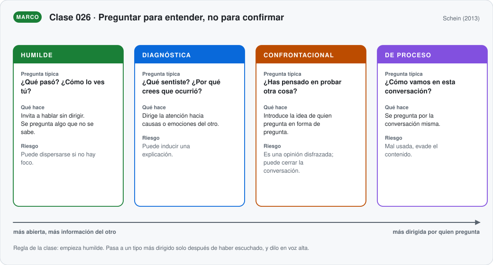

# Clase 026 — Escucha activa y preguntas de calidad

<!-- nav:inicio -->
> **Parte 02 · Comunicación, influencia y presencia ejecutiva** — clase 2 de 12 · [índice de la parte](../../README.md) · [temario](../../../../SYLLABUS.md)
<!-- nav:fin -->

**Parte:** 02 — Comunicación, influencia y presencia ejecutiva  
**Nivel:** Etapa 1 — Profesional → Líder  
**Duración sugerida:** 150–180 minutos · **Estándar:** deep-class-v2

## 🎯 Propósito

La mayoría de los directivos cree que escucha, y la mayoría hace otra cosa: espera su turno, prepara la respuesta o escucha lo que confirma lo que ya pensaba. Quien lidera depende de información que nadie le ofrece espontáneamente, porque quien la tiene sabe que al jefe no siempre le gusta oírla. Escuchar bien es, antes que una cortesía, una **herramienta para obtener esa información**.

Esta clase enseña a preguntar para entender y no para confirmar. Su base es la indagación humilde de Edgar Schein y su clasificación de tipos de pregunta, complementada con las observaciones de Stone, Patton y Heen sobre lo que impide escuchar. Al terminar sabrás elegir qué tipo de pregunta hacer, en qué orden y cómo comprobar que entendiste.

## 📚 Resultados de aprendizaje

Al finalizar podrás:

1. **Definir** indagación humilde y distinguirla de las otras tres formas de preguntar.
2. **Reconocer** cuándo una pregunta es en realidad una opinión disfrazada.
3. **Formular** preguntas abiertas que obtengan hechos, y comprobar tu comprensión resumiendo.
4. **Detectar** tus propios obstáculos para escuchar: juicio, solución prematura, defensa.
5. **Conducir** una conversación de diagnóstico de un problema de trabajo sin imponer tu interpretación.

## 🧭 Agenda

| Tramo | Qué se hace |
|---|---|
| 0–20 min | Recuperación: recuerda una conversación donde hablaste más de lo que querías; ¿qué te impidió preguntar? |
| 20–60 min | Los cuatro tipos de pregunta y el diagrama de la clase. |
| 60–100 min | Ejemplo trabajado: la misma conversación con preguntas dirigidas y con preguntas humildes. |
| 100–135 min | Caso ejecutivo: una reunión de diagnóstico con un equipo que no habla. |
| 135–150 min | Límites del enfoque y entregable. |

## 🧩 Conceptos centrales

| Concepto | Definición | Cómo se reconoce |
|---|---|---|
| **Indagación humilde** | El arte de hacer salir al otro con preguntas a las que no se conoce la respuesta, desde un interés genuino en la persona (Schein, 2013). | La pregunta no lleva una respuesta ya decidida. |
| **Indagación diagnóstica** | Dirige la atención del otro hacia sus emociones, motivos o causas. | «¿Por qué crees que ocurrió?» |
| **Indagación confrontacional** | Introduce una idea del que pregunta, formulada como pregunta. | «¿Has pensado en hacerlo de otra forma?» |
| **Indagación de proceso** | Pregunta por la conversación misma. | «¿Cómo vamos en esta reunión?» |
| **Escucha activa** | Atender para comprender, no para responder, y comprobar la comprensión resumiendo con las palabras del otro. | Se puede resumir lo dicho y el otro lo confirma. |
| **Solución prematura** | Ofrecer respuestas antes de haber entendido el problema. | La conversación se cierra con un consejo no pedido. |

## 🧠 Modelo mental

**Cómo leer el diagrama.** De izquierda a derecha aumenta el control que ejerce quien pregunta. La clase propone empezar por la izquierda, y pasar a un tipo más dirigido solo después de haber escuchado y **avisándolo**: «tengo una idea, ¿quieres oírla?». Una pregunta confrontacional no es mala; es una opinión, y conviene llamarla así.

## 📖 Desarrollo

### 1. Por qué no escuchamos

Stone, Patton y Heen observan que en una conversación difícil solemos escuchar con una conversación interna paralela: preparamos la defensa, juzgamos o buscamos al culpable. Esa atención dividida deja de captar lo que el otro dice. A ello se suma la **posición**: quien tiene más poder recibe menos información verdadera porque los demás filtran lo que dicen. Escuchar con poder exige más esfuerzo, no menos.

### 2. La indagación humilde

Schein la define como una forma de preguntar que nace de la **curiosidad** y de la conciencia de que no sabemos qué pasa en la cabeza del otro. Es *humilde* porque reconoce la dependencia: para actuar bien necesitamos información que solo el otro tiene. La pregunta humilde no contiene la respuesta que se espera. Compare «¿No cree que deberíamos entregar el viernes?» —que sugiere— con «¿Qué necesitaría para entregar el viernes?» —que invita—.

### 3. Los cuatro tipos de pregunta

Schein distingue cuatro formas de preguntar, según cuánto dirige quien pregunta la atención del otro. La **humilde** abre sin dirigir. La **diagnóstica** orienta hacia las emociones o las causas del otro. La **confrontacional** introduce la idea propia en forma de pregunta. La **de proceso** pregunta por la marcha de la conversación. No son buenas o malas: cada una tiene un momento y un riesgo, y la clase pide ser consciente de cuál se usa.

### 4. Escuchar es comprobar

La escucha activa incluye un acto verificable: **resumir** con las palabras del otro y preguntar «¿entendí bien?». Resumir tiene dos efectos: el otro se siente oído y el que escucha detecta lo que no entendió. Un buen resumen no repite palabra por palabra ni agrega interpretación: devuelve el contenido y, si es pertinente, la emoción.

### 5. Preguntas de calidad

Una pregunta de calidad es **abierta** (no se responde con sí o no), **específica** (pide un ejemplo, una secuencia o una cifra) y **sin carga** (no insinúa juicio). Funciona mejor al pedir hechos —«cuéntame la última vez que ocurrió»— que opiniones generales —«¿qué piensas de la comunicación?»—. Evita el «por qué» acusatorio y reemplázalo por «¿qué llevó a…?».

### 6. Silencio, ritmo y poder

El silencio tras una pregunta no es un vacío; es el tiempo que la otra persona necesita para pensar y decidir si dice lo que realmente piensa. Un líder que llena el silencio con su propia respuesta enseña que preguntar es una formalidad. Contar hasta cinco antes de hablar de nuevo cambia la calidad de la información que llega.

### 7. Qué hacer con lo que oyes

Escuchar crea una expectativa: que algo ocurrirá con lo dicho. Cierra el circuito: agradece, resume lo que haces y lo que no, y vuelve con una fecha. Si no puedes actuar sobre algo, dilo; el silencio posterior se interpreta como indiferencia y desalienta la próxima respuesta honesta.

## 📚 Lectura comparada

| Obra | Qué aporta | Qué no resuelve | Pregunta para contrastar |
|---|---|---|---|
| Schein (2013) | Indagación humilde y los cuatro tipos de pregunta. | No es una técnica para negociar. | ¿Cuál fue tu última pregunta y de qué tipo era? |
| Stone, Patton y Heen (1999) | Obstáculos internos para escuchar y la conversación sobre identidad. | No clasifica preguntas. | ¿Qué conversación interna tenías mientras el otro hablaba? |
| Patterson et al. (2012) | Crear seguridad para que el otro hable. | No profundiza en la pregunta. | ¿Qué hace que alguien no diga lo que piensa ante ti? |
| Goleman, Boyatzis y McKee (2002) | Empatía como parte del liderazgo. | No da un método de preguntas. | ¿Qué emoción acompañaba lo que dijo? |
| Fisher, Ury y Patton (1983) | Preguntar por intereses y no por posiciones. | Parte de la negociación. | ¿Qué interés hay detrás de lo que te piden? |

## 🧮 Ejemplo trabajado

**Situación (hipotética).** Una gerente quiere entender por qué se atrasan las entregas de un equipo de soporte. Compara dos versiones de la misma conversación.

| Versión | Preguntas | Qué obtiene |
|---|---|---|
| **Dirigida** | «¿No cree que el equipo no se organiza bien?» «¿Por qué no usan el sistema nuevo?» | Respuestas defensivas: «sí, estamos mejorando». Ningún hecho nuevo. |
| **Humilde** | «Cuénteme la última entrega que se atrasó: ¿qué pasó primero?» «¿Qué necesitaría el equipo para llegar a tiempo?» | Descubre que los pedidos llegan incompletos de ventas y que se pierde un día en reclamar los datos. |

**El resumen.** La gerente dice: «Entiendo que el atraso empieza porque los pedidos llegan sin la dirección completa y recuperarla toma un día. ¿Entendí bien?». El líder del equipo corrige: «También hay pedidos que cambian después». La gerente anota ese segundo dato.

**Qué muestra.** (1) Una pregunta humilde obtuvo un hecho que una dirigida no habría obtenido. (2) El resumen reveló un dato adicional. (3) Hasta aquí la gerente aún no propone solución: el diagnóstico lo sostienen los hechos, no su hipótesis inicial.

## 🔀 Comparación y límites

**Escuchar frente a dar la razón.** Escuchar no es aceptar. Comprender la posición del otro no implica compartirla ni obliga a actuar sobre ella.

**Límites.** Los tipos de pregunta de Schein son una clasificación de trabajo derivada de su experiencia en consultoría, no el resultado de una medición. Preguntar sin interés genuino se percibe y produce el efecto contrario. Y hay situaciones —una emergencia, una decisión que debe tomarse ya— donde conviene dirigir en lugar de indagar.

## 🪜 De profesional a owner

| Nivel | Cómo escucha |
|---|---|
| **Profesional** | Pregunta antes de proponer y resume para confirmar que entendió. |
| **Jefe / Team Lead** | Abre cada conversación con preguntas humildes y cuida que su cargo no corte la información. |
| **Gerente** | Escucha a clientes, equipos y pares para detectar problemas antes de que escalen. |
| **CEO / Director** | Crea cauces para oír lo que su posición filtra y cierra el circuito con acciones visibles. |
| **Founder / Owner** | Escucha a clientes y socios como principal fuente de aprendizaje y contrasta su convicción con los hechos que oye. |

## 🏢 Caso ejecutivo

Una directora asume un área de operaciones donde se atrasan los cierres mensuales. En la primera reunión, el equipo permanece callado; el jefe de contabilidad dice que «todo está bajo control». Los reportes muestran tres cierres tardíos en seis meses. La directora siente la tentación de asignar un plan de mejora de inmediato.

Entrega un **plan de conversación diagnóstica** que contenga: (a) las cinco primeras preguntas, clasificadas por tipo y con su propósito; (b) cómo crearás seguridad para que el equipo hable; (c) cómo resumirás para comprobar que entiendes; (d) qué hechos buscarás antes de proponer una solución; (e) cómo cerrarás el circuito con el equipo.

## 🧪 Práctica

1. Graba o recuerda una conversación reciente y marca cada pregunta que hiciste: ¿de qué tipo era?
2. Convierte tres preguntas dirigidas en preguntas humildes.
3. Practica un resumen de tres frases para una conversación de hoy y pregunta «¿entendí bien?».
4. Identifica tu obstáculo principal para escuchar: juicio, solución prematura o defensa.
5. Diseña cómo cerrarás el circuito con alguien que te dio información incómoda.

## ⚠️ Errores frecuentes

| Error | Por qué ocurre | Cómo corregirlo |
|---|---|---|
| Preguntar con la respuesta decidida | Se busca confirmar la idea | Preguntar algo que de verdad no se sabe. |
| Llenar el silencio | Incomoda | Contar hasta cinco antes de hablar. |
| Dar consejo no pedido | Se quiere ayudar rápido | Preguntar si quiere un consejo antes de darlo. |
| Resumir con interpretación propia | Se mezcla escuchar con juzgar | Usar las palabras del otro. |
| Un «por qué» acusatorio | Parece una pregunta neutra | Sustituir por «¿qué llevó a…?». |
| No cerrar el circuito | Se olvida el seguimiento | Agradecer, informar lo que se hace y volver con una fecha. |

## ❓ Preguntas de comprobación

1. ¿Cómo define Schein la indagación humilde y por qué se llama «humilde»?
2. ¿Cuáles son los cuatro tipos de pregunta y en qué se diferencian por el control de quien pregunta?
3. ¿Por qué una pregunta confrontacional es una opinión disfrazada y cómo se declara?
4. ¿Qué diferencia hay entre un buen resumen y repetir lo dicho?
5. ¿Por qué quien tiene más poder recibe menos información verdadera?
6. Transforma «¿No cree que deberíamos entregar el viernes?» en una pregunta humilde.
7. ¿Qué debes hacer con la información que te dieron?

Claves de respuesta

1. El arte de hacer salir al otro con preguntas a las que no se conoce la respuesta; es humilde porque reconoce que necesitamos información que solo el otro tiene.
2. Humilde, diagnóstica, confrontacional y de proceso; de más abierta a más dirigida por quien pregunta.
3. Porque introduce la idea propia en forma de pregunta; se declara diciendo «tengo una idea, ¿quieres oírla?».
4. Un buen resumen devuelve el contenido (y la emoción) con las palabras del otro y comprueba la comprensión; no agrega interpretación.
5. Porque los demás filtran lo que dicen, y escuchar con poder exige un esfuerzo mayor.
6. Por ejemplo: «¿Qué necesitaría el equipo para entregar el viernes?».
7. Agradecer, informar lo que se hará y lo que no, y volver con una fecha.

## 📥 Entregable

Guarda en `portfolio/026-escucha-activa-y-preguntas-de-calidad/`:

- `operating-improvement-brief.md` (plantilla [Operating Improvement Brief](../../../../templates/operating-improvement-brief.md)) con el plan de conversación diagnóstica del caso;
- `reading-note.md` con una diferencia entre Schein y Stone, Patton y Heen y su efecto en tu plan;
- `decision-journal.md` con las preguntas que cambiaste y qué hechos obtuviste.

## 📗 Fuentes y verificación

- Edgar H. Schein — *Humble Inquiry* (ReadHowYouWant.com, Limited, 2013). **Uso en esta clase:** indagación humilde y los cuatro tipos de pregunta. Lectura selectiva sobre **escucha activa y preguntas de calidad**. **Localizador:** [ISBN-13 9780369308443](https://openlibrary.org/isbn/9780369308443).
- Douglas Stone, Bruce Patton & Sheila Heen — *Difficult Conversations* (Random House Audio, 1999). **Uso en esta clase:** obstáculos para escuchar y la conversación interna paralela. Lectura selectiva sobre **escucha activa y preguntas de calidad**. **Localizador:** [ISBN-13 9780553525687](https://openlibrary.org/isbn/9780553525687).
- Kerry Patterson et al. — *Crucial Conversations* (McGraw Hill, 2012). **Uso en esta clase:** crear seguridad para que el otro hable. Lectura selectiva sobre **escucha activa y preguntas de calidad**. **Localizador:** [ISBN-13 9781259005213](https://openlibrary.org/isbn/9781259005213).
- Daniel Goleman, Richard Boyatzis & Annie McKee — *Primal Leadership* (Harvard Business School Press, 2002). **Uso en esta clase:** empatía como parte del liderazgo. Lectura selectiva sobre **escucha activa y preguntas de calidad**. **Localizador:** [ISBN-13 9781578514861](https://openlibrary.org/isbn/9781578514861).
- Roger Fisher, William Ury & Bruce Patton — *Getting to Yes* (Hutchinson, 1983). **Uso en esta clase:** preguntar por intereses y no por posiciones. Lectura selectiva sobre **escucha activa y preguntas de calidad**. **Localizador:** [ISBN-13 9780091493714](https://openlibrary.org/isbn/9780091493714).

> **Regla de fuentes para Escucha activa y preguntas de calidad:** las obras anteriores estructuran las perspectivas de esta materia; cualquier norma, ley o estándar vivo mencionado debe comprobarse nuevamente en su fuente primaria vigente. Los ejemplos y casos son hipotéticos y no describen a ninguna empresa real. El desarrollo es original y no reproduce capítulos protegidos.

<!-- pie:inicio -->
---

| Anterior | Índice | Siguiente |
|---|---|---|
| [← 025 · Comunicación como sistema de liderazgo](../025-comunicacion-como-sistema-de-liderazgo/README.md) | [Parte 02](../../README.md) · [Programa](../../../../SYLLABUS.md) | [027 · Escritura ejecutiva: claridad y síntesis →](../027-escritura-ejecutiva-claridad-y-sintesis/README.md) |
<!-- pie:fin -->
