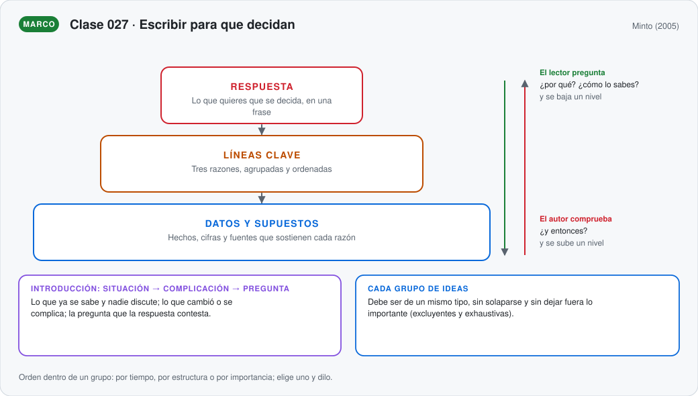

# Clase 027 — Escritura ejecutiva: claridad y síntesis

<!-- nav:inicio -->
> **Parte 02 · Comunicación, influencia y presencia ejecutiva** — clase 3 de 12 · [índice de la parte](../../README.md) · [temario](../../../../SYLLABUS.md)
<!-- nav:fin -->

**Parte:** 02 — Comunicación, influencia y presencia ejecutiva  
**Nivel:** Etapa 1 — Profesional → Líder  
**Duración sugerida:** 150–180 minutos · **Estándar:** deep-class-v2

## 🎯 Propósito

Un directivo recibe decenas de documentos por semana y lee la mayoría en minutos. Quien escribe para él enfrenta una pregunta práctica: ¿cómo logro que, leyendo poco, entienda lo que necesito y pueda decidir? La respuesta más extendida en la escritura de consultoría y gestión es la que formuló Barbara Minto: **empezar por la conclusión**, sostenerla con razones ordenadas y apoyar cada razón con datos.

Esta clase enseña ese método y a comprobar si un texto lo cumple. Al terminar sabrás estructurar un memo con la respuesta primero, agrupar ideas de forma que no se solapen ni dejen vacíos, y revisar tu texto como lo leería quien debe decidir.

## 📚 Resultados de aprendizaje

Al finalizar podrás:

1. **Construir** una pirámide de ideas con respuesta, líneas clave y datos de apoyo.
2. **Redactar** una introducción con situación, complicación y pregunta.
3. **Agrupar** ideas de modo que sean excluyentes entre sí y completas en conjunto.
4. **Comprobar** la lógica con las preguntas «¿por qué?» hacia abajo y «¿y entonces?» hacia arriba.
5. **Reducir** un documento a lo necesario para decidir sin perder los datos de respaldo.

## 🧭 Agenda

| Tramo | Qué se hace |
|---|---|
| 0–20 min | Recuperación: toma un documento tuyo reciente y subraya dónde está la conclusión. |
| 20–60 min | La pirámide, la introducción y los grupos de ideas. |
| 60–105 min | Ejemplo trabajado: un memo desordenado reescrito con la respuesta primero. |
| 105–140 min | Caso ejecutivo: un memo para una decisión de inversión. |
| 140–170 min | Límites del método y entregable. |

## 🧩 Conceptos centrales

| Concepto | Definición | Cómo se reconoce |
|---|---|---|
| **Principio de la pirámide** | Organizar un texto de arriba abajo: la idea principal primero, luego las ideas que la sostienen, luego los datos (Minto, 2005). | Quien lee solo el primer párrafo conoce la conclusión. |
| **Respuesta primero** | Presentar la recomendación o conclusión al inicio y no al final. | La conclusión aparece en las dos primeras frases. |
| **Línea clave** | Cada una de las ideas del segundo nivel que sostienen la respuesta. | Responde «¿por qué?» o «¿cómo?» a la respuesta. |
| **Situación, complicación y pregunta** | Introducción que recuerda lo que el lector ya sabe, lo que cambió y la pregunta que el texto contesta. | El lector reconoce el contexto antes de leer la respuesta. |
| **Agrupación lógica** | Ideas de un mismo tipo, sin solaparse y sin omitir lo importante. | Cada grupo se puede nombrar con una sola etiqueta. |
| **Prueba «¿y entonces?»** | Comprobación hacia arriba: ¿lo que dicen las ideas de abajo permite concluir la de arriba? | Las ideas se resumen en una frase superior. |

## 🧠 Modelo mental

**Cómo leer el diagrama.** Arriba va lo que debe decidirse. Debajo, las razones que lo sostienen, agrupadas y ordenadas. Al final, los datos que respaldan cada razón. A la derecha, las dos pruebas: el **lector** pregunta «¿por qué?» y baja un nivel; el **autor** comprueba «¿y entonces?» y sube. Si una prueba falla, hay un hueco o una repetición en el texto.

## 📖 Desarrollo

### 1. Por qué la respuesta primero

Minto parte de una observación sobre cómo lee quien decide: necesita saber primero **qué se le pide** para interpretar todo lo demás. Un documento que sigue el orden en que se pensó el trabajo —antecedentes, análisis, conclusión— obliga al lector a retener datos sin saber para qué sirven. La pirámide invierte el orden: la conclusión al inicio, y el resto como respuesta a las dudas que esa conclusión provoca.

### 2. La introducción: situación, complicación, pregunta

Antes de la respuesta, una introducción breve ubica al lector. Expone la **situación** (algo que el lector sabe y acepta), la **complicación** (el cambio o el problema que hace necesario decidir) y la **pregunta** que surge de ambos. La respuesta del documento es la respuesta a esa pregunta. Con esta estructura el lector no necesita reconstruir por qué se le escribe.

### 3. Agrupar sin solapar ni omitir

Las ideas del mismo nivel deben pertenecer a **una misma categoría** y poder resumirse con una etiqueta común (tres causas, tres alternativas, tres pasos). Dentro de cada grupo se evita repetir y se busca no dejar nada importante afuera. Esa disciplina de que los grupos no se solapen y cubran el asunto se conoce en la práctica de consultoría como la exigencia de ser excluyentes y exhaustivos.

### 4. Ordenar dentro de cada grupo

Un grupo de ideas se ordena por **tiempo** (primero esto, luego aquello), por **estructura** (partes de un todo) o por **importancia** (de mayor a menor). Elige un criterio y dilo: el lector entiende mejor un orden que reconoce.

### 5. Las dos pruebas

El **lector** sube y baja la pirámide con preguntas: ante una afirmación, pregunta «¿por qué?» o «¿cómo lo sabes?», y la respuesta debe estar en el nivel inferior. El **autor** comprueba hacia arriba con «¿y entonces?»: las ideas de un grupo, juntas, deben concluir la idea que las encabeza. Un texto que no pasa estas pruebas tiene saltos lógicos o repeticiones.

### 6. Lo que el ejecutivo no necesita leer

Escribir con claridad incluye decidir qué sacar. Los pasos del análisis que no cambian la decisión, las alternativas descartadas con detalle y los datos sin conexión con una razón pertenecen a un anexo. El cuerpo contiene lo necesario para decidir; el anexo contiene lo necesario para verificar.

### 7. Frases, párrafos y formato

La claridad de la estructura se completa con la de la frase: sujeto y verbo cerca, una idea por frase, verbos en lugar de sustantivos abstractos («decidimos» en lugar de «se tomó la decisión»), cifras con unidad y fecha. Un párrafo trata una idea y empieza con ella. Los títulos son afirmaciones que resumen el contenido y permiten leer el documento solo por sus títulos.

## 📚 Lectura comparada

| Obra | Qué aporta | Qué no resuelve | Pregunta para contrastar |
|---|---|---|---|
| Minto (2005) | La pirámide, la introducción y las pruebas lógicas. | No cubre la presentación oral. | ¿Dónde está la respuesta en tu último documento? |
| Heath y Heath (2007) | Cómo hacer una idea recordable. | No garantiza lógica. | ¿Tu mensaje central cabe en una frase? |
| Duarte (2010) | Cómo hacer una narrativa de cambio. | No es un método de documentos. | ¿Qué cambio propone tu texto? |
| Stone, Patton y Heen (1999) | Cómo decir lo difícil por escrito. | No estructura el texto. | ¿Qué omites por incomodidad? |
| Goleman, Boyatzis y McKee (2002) | El efecto emocional de lo que se escribe. | No trata de estructura. | ¿Qué tono transmite tu memo? |

## 🧮 Ejemplo trabajado

**Situación (hipotética).** Un analista escribió un memo de una página para el comité. Su primer borrador comienza con los antecedentes del contrato, sigue con el análisis de tres ofertas y termina diciendo «por lo tanto, recomendamos renovar con el proveedor actual». Reescribámoslo.

**Versión con pirámide.**

- **Introducción.** *Situación:* el contrato con el proveedor de transporte vence el 30 de marzo. *Complicación:* dos proveedores nuevos ofrecen tarifas menores. *Pregunta:* ¿renovamos con el actual o cambiamos?
- **Respuesta.** Recomendamos renovar con el proveedor actual por 36 meses.
- **Línea 1: es 8 % más barato en tres años.** Datos: costo de transición del cambio, cifras de las tres ofertas, supuestos de volumen.
- **Línea 2: tiene menos riesgo operacional.** Datos: porcentaje de entregas a tiempo de los últimos 12 meses, dependencia de sistemas.
- **Línea 3: la negociación aún puede mejorar la tarifa.** Datos: oferta preliminar del proveedor y plazo de respuesta.

**Pruebas.** *¿Por qué renovar?* Porque cuesta menos, arriesga menos y hay margen de negociación. *¿Y entonces?* Las tres líneas, juntas, concluyen la recomendación. *¿Solapan?* No: costo, riesgo y negociación son categorías distintas.

**Qué muestra.** (1) El lector sabe qué decidir desde el primer párrafo. (2) Cada razón se puede discutir por separado. (3) Los detalles del análisis pasan a un anexo. (4) El memo ocupa menos y se entiende mejor.

## 🔀 Comparación y límites

**Respuesta primero frente a suspenso.** Ocultar la conclusión hasta el final solo conviene cuando se espera una reacción defensiva fuerte y se necesita preparar al lector. Aun entonces, la introducción debe decir de qué se trata.

**Límites del método.** La pirámide supone un lector que debe decidir y que confía en que el autor ya hizo el análisis. En un documento exploratorio —que aún no tiene conclusión— no hay respuesta que poner arriba: se escribe la pregunta y lo que se sabe. Y una estructura impecable no corrige un análisis equivocado: la claridad hace visibles los errores, no los elimina.

## 🪜 De profesional a owner

| Nivel | Cómo escribe |
|---|---|
| **Profesional** | Pone su conclusión al inicio y la respalda con los datos esenciales. |
| **Jefe / Team Lead** | Escribe actualizaciones que dicen qué se necesita de otros y para cuándo. |
| **Gerente** | Produce memos para decidir con alternativas, recomendación y costo. |
| **CEO / Director** | Escribe pocas páginas que reducen la incertidumbre del directorio y prepara los anexos para verificar. |
| **Founder / Owner** | Escribe a inversionistas, bancos y clientes: la claridad de lo que pide determina si lo obtiene. |

## 🏢 Caso ejecutivo

Una gerente debe proponer al comité de inversiones la compra de una máquina que reduce costos pero exige 18 meses de recuperación. Hay tres alternativas: comprar, arrendar o postergar. Sus supuestos de demanda son inciertos. Le piden un memo de dos páginas para la sesión del jueves.

Entrega un **memo ejecutivo** que contenga: (a) introducción con situación, complicación y pregunta; (b) la recomendación en una frase; (c) tres líneas clave sin solaparse; (d) los datos y supuestos de cada línea, con fuente; (e) los riesgos y lo que cambiaría la recomendación; (f) un anexo con lo que no cabe en las dos páginas.

## 🧪 Práctica

1. Reescribe el primer párrafo de un documento tuyo poniendo la respuesta primero.
2. Dibuja la pirámide de un memo y aplica las dos pruebas.
3. Agrupa diez ideas de un problema real en tres grupos sin solaparse.
4. Reduce un documento de cuatro páginas a dos y decide qué va al anexo.
5. Reescribe cinco títulos de tu documento como afirmaciones.

## ⚠️ Errores frecuentes

| Error | Por qué ocurre | Cómo corregirlo |
|---|---|---|
| La conclusión al final | Se escribe en el orden en que se pensó | Empezar por la respuesta y reordenar. |
| Grupos que se solapan | No se definió la categoría | Nombrar cada grupo con una etiqueta única. |
| Lista de datos sin razón | Se vuelcan los hallazgos | Cada dato respalda una línea clave. |
| Títulos que son temas | Se escribe «Antecedentes» | Títulos como afirmaciones. |
| Anexo ausente | Se teme omitir | Mover lo verificable al anexo. |
| Tono defensivo | Se anticipa la crítica | Declarar los riesgos y lo que se desconoce. |

## ❓ Preguntas de comprobación

1. ¿Qué dice el principio de la pirámide y por qué beneficia al lector que decide?
2. ¿Qué tres elementos tiene la introducción?
3. ¿Qué significa que las ideas de un grupo sean excluyentes y exhaustivas?
4. ¿Qué preguntas hacen el lector y el autor para probar la lógica?
5. ¿Qué criterios hay para ordenar las ideas dentro de un grupo?
6. ¿Qué pertenece al anexo y qué al cuerpo?
7. ¿Cuándo no hay una respuesta que poner arriba?

Claves de respuesta

1. Organizar de arriba abajo: la idea principal primero, luego las ideas que la sostienen y luego los datos; permite al lector saber qué se le pide y leer poco.
2. Situación, complicación y pregunta.
3. Que no se repitan ni solapen y que juntas cubran lo importante del asunto.
4. El lector pregunta «¿por qué?» o «¿cómo lo sabes?» hacia abajo; el autor comprueba «¿y entonces?» hacia arriba.
5. Por tiempo, por estructura o por importancia.
6. Al cuerpo, lo necesario para decidir; al anexo, lo necesario para verificar.
7. En un documento exploratorio, donde aún no existe una conclusión.

## 📥 Entregable

Guarda en `portfolio/027-escritura-ejecutiva-claridad-y-sintesis/`:

- `leadership-decision-brief.md` (plantilla [Leadership Decision Brief](../../../../templates/leadership-decision-brief.md)) con el memo del caso ejecutivo;
- `reading-note.md` con una tensión entre Minto y otra fuente y su efecto en tu memo;
- `decision-journal.md` con la reordenación que hiciste y qué moviste al anexo.

## 📗 Fuentes y verificación

- Barbara Minto — *The Pyramid Principle* (Financial Times/ Prentice Hall, 2005). **Uso en esta clase:** el principio de la pirámide, la introducción y las pruebas lógicas. Lectura selectiva sobre **escritura ejecutiva: claridad y síntesis**. **Localizador:** [ISBN-13 9781405822145](https://openlibrary.org/isbn/9781405822145).
- Chip Heath & Dan Heath — *Made to Stick* (Penguin Random House, 2007). **Uso en esta clase:** cómo hacer una idea simple y recordable. Lectura selectiva sobre **escritura ejecutiva: claridad y síntesis**. **Localizador:** [ISBN-13 9781905211562](https://openlibrary.org/isbn/9781905211562).
- Nancy Duarte — *Resonate* (John Wiley & Sons, Incorporated, 2010). **Uso en esta clase:** cómo construir una narrativa de cambio. Lectura selectiva sobre **escritura ejecutiva: claridad y síntesis**. **Localizador:** [ISBN-13 9781118014875](https://openlibrary.org/isbn/9781118014875).
- Douglas Stone, Bruce Patton & Sheila Heen — *Difficult Conversations* (Random House Audio, 1999). **Uso en esta clase:** decir lo difícil con claridad. Lectura selectiva sobre **escritura ejecutiva: claridad y síntesis**. **Localizador:** [ISBN-13 9780553525687](https://openlibrary.org/isbn/9780553525687).
- Daniel Goleman, Richard Boyatzis & Annie McKee — *Primal Leadership* (Harvard Business School Press, 2002). **Uso en esta clase:** el efecto emocional de lo que se comunica. Lectura selectiva sobre **escritura ejecutiva: claridad y síntesis**. **Localizador:** [ISBN-13 9781578514861](https://openlibrary.org/isbn/9781578514861).

> **Regla de fuentes para Escritura ejecutiva:** las obras anteriores estructuran las perspectivas de esta materia; cualquier norma, ley o estándar vivo mencionado debe comprobarse nuevamente en su fuente primaria vigente. Los ejemplos y casos son hipotéticos, con cifras ilustrativas. El desarrollo es original y no reproduce capítulos protegidos.

<!-- pie:inicio -->
---

| Anterior | Índice | Siguiente |
|---|---|---|
| [← 026 · Escucha activa y preguntas de calidad](../026-escucha-activa-y-preguntas-de-calidad/README.md) | [Parte 02](../../README.md) · [Programa](../../../../SYLLABUS.md) | [028 · Presentaciones para decisiones →](../028-presentaciones-para-decisiones/README.md) |
<!-- pie:fin -->
