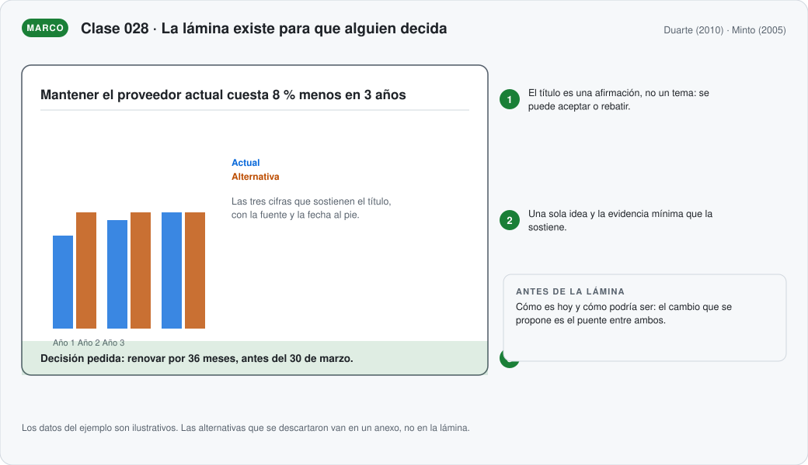

# Clase 028 — Presentaciones para decisiones

<!-- nav:inicio -->
> **Parte 02 · Comunicación, influencia y presencia ejecutiva** — clase 4 de 12 · [índice de la parte](../../README.md) · [temario](../../../../SYLLABUS.md)
<!-- nav:fin -->

**Parte:** 02 — Comunicación, influencia y presencia ejecutiva  
**Nivel:** Etapa 1 — Profesional → Líder  
**Duración sugerida:** 150–180 minutos · **Estándar:** deep-class-v2

## 🎯 Propósito

Muchas presentaciones de gestión informan y pocas deciden. Se muestran resultados, se recorren análisis y la sala termina con la sensación de haber visto mucho sin saber qué se esperaba de ella. Una presentación para decidir tiene otro propósito: **llevar a un grupo desde una situación actual hasta una decisión concreta**, con la evidencia mínima necesaria y la petición explícita al final.

Esta clase enseña a construir ese tipo de presentación combinando dos aportes: la estructura de respuesta primero de Minto y la idea de Duarte de que una presentación persuasiva recorre la distancia entre lo que **es** y lo que **podría ser**. Al terminar sabrás diseñar láminas cuyo título sea una afirmación, preparar la petición de decisión y anticipar las objeciones.

## 📚 Resultados de aprendizaje

Al finalizar podrás:

1. **Definir** la decisión que se pide y quién la toma antes de diseñar una sola lámina.
2. **Escribir** títulos que sean afirmaciones comprobables, no temas.
3. **Elegir** la evidencia mínima que sostiene cada afirmación y descartar el resto.
4. **Construir** el contraste entre la situación actual y la posible como puente hacia la decisión.
5. **Anticipar** las tres objeciones más fuertes y preparar la respuesta.

## 🧭 Agenda

| Tramo | Qué se hace |
|---|---|
| 0–20 min | Recuperación: ¿qué se decidió en la última reunión a la que asististe y quién lo decidió? |
| 20–60 min | La anatomía de una lámina de decisión y el contraste «es / podría ser». |
| 60–105 min | Ejemplo trabajado: de una presentación informativa a una de decisión. |
| 105–140 min | Caso ejecutivo: pedir un presupuesto adicional a un comité. |
| 140–170 min | Límites y entregable. |

## 🧩 Conceptos centrales

| Concepto | Definición | Cómo se reconoce |
|---|---|---|
| **Presentación para decidir** | Exposición cuyo objetivo es obtener una decisión concreta de un grupo. | Termina con una petición clara y una fecha. |
| **Título afirmación** | Título que enuncia la conclusión de la lámina en forma de oración. | Se puede aceptar o rebatir. |
| **Decisión pedida** | Lo que se solicita al grupo: aprobar, elegir, financiar o desestimar. | Se puede responder con sí, no o una condición. |
| **Contraste «es / podría ser»** | Distancia entre la situación actual y la deseada que impulsa el cambio (Duarte, 2010). | La audiencia ve qué se gana al decidir. |
| **Evidencia mínima** | Los datos estrictamente necesarios para sostener una afirmación. | Quitar un dato haría dudosa la afirmación. |
| **Objeción anticipada** | Reparo previsible de la audiencia, respondido antes de que se formule. | Aparece en el guion con su respuesta. |

## 🧠 Modelo mental

**Cómo leer el diagrama.** Cada lámina de decisión tiene tres partes visibles: un título que afirma, la evidencia que lo respalda y, al pie, la decisión que se pide. Entre una lámina y otra, el recorrido va de «cómo es hoy» a «cómo podría ser». Si una lámina no sirve para ninguna de las tres cosas, sobra.

## 📖 Desarrollo

### 1. Empieza por la decisión, no por las láminas

Antes de abrir el programa de diapositivas, responde tres preguntas: **¿qué decisión pido?**, **¿quién la toma?** y **¿qué necesita saber para tomarla?** Si no puedes responder la primera en una frase, tu presentación aún informa. La respuesta fija el contenido: lo que no ayuda a decidir se queda fuera o va a un anexo.

### 2. Respuesta primero

Siguiendo el principio de Minto, la presentación comienza con la recomendación y la petición, y continúa con las razones. Quien decide sabe desde el inicio qué se le pide y escucha el resto con esa pregunta en mente. Si se espera resistencia, se puede preparar el contexto, pero sin ocultar la dirección.

### 3. Lo que es y lo que podría ser

Duarte propone que una presentación que mueve a la acción construye una **tensión** entre dos estados: cómo es la situación hoy y cómo podría ser si se decide. La audiencia es conducida a ver esa distancia y a considerar la decisión como el puente. Alternar ambos estados mantiene el interés y da sentido a cada dato: sirve para mostrar qué se pierde si no se decide.

### 4. Títulos que afirman

Un título como «Resultados del tercer trimestre» es un tema. «Los costos de transporte subieron 12 % y explican el 70 % de la caída del margen» es una afirmación: se puede discutir con datos. Escribir los títulos de todas las láminas y leerlos en secuencia debería contar la historia completa de la presentación.

### 5. Evidencia mínima y diseño sobrio

Cada afirmación se sostiene con el dato que la hace creíble y nada más. Un gráfico por lámina, con el mensaje resaltado y sin elementos que no aporten. Cifras con unidad, período y fuente. La densidad de una lámina de decisión es menor que la de un documento: lo que se entrega por escrito no se lee en voz alta.

### 6. Anticipar objeciones

Una presentación para decidir pasa por la prueba de las objeciones. Las tres más frecuentes: **el costo** (¿cuánto y por qué ahora?), **el riesgo** (¿qué puede salir mal y qué hacemos?) y **la alternativa** (¿por qué no otra cosa?). Prepara la respuesta con un dato y decide si va en la presentación o en el anexo. Presentar la alternativa descartada y por qué se descartó evita que la discusión empiece desde cero.

### 7. Los últimos cinco minutos

La petición se repite al cierre con la fecha de decisión y lo que ocurre con cada respuesta: si se aprueba, qué sigue; si no, qué alternativa hay. Termina con la lámina de decisión, no con una de agradecimiento: quien decide debe tener delante lo que debe resolver mientras discute.

## 📚 Lectura comparada

| Obra | Qué aporta | Qué no resuelve | Pregunta para contrastar |
|---|---|---|---|
| Duarte (2010) | El contraste entre lo actual y lo posible y la presentación como viaje de la audiencia. | No es una guía de análisis. | ¿Qué distancia muestra tu presentación? |
| Minto (2005) | Respuesta primero y razones agrupadas. | No trata del diseño visual. | ¿Qué decisión pides en la primera lámina? |
| Heath y Heath (2007) | Un mensaje simple y concreto. | No estructura la presentación. | ¿Qué recordará la sala mañana? |
| Cialdini (2016) | Cómo se influye en una decisión y dónde está la frontera ética. | No es un método de presentación. | ¿Qué palanca usas y puedes declararla? |
| Goleman, Boyatzis y McKee (2002) | El efecto del estado del presentador. | No da una estructura. | ¿Cómo llegas a la sala? |

## 🧮 Ejemplo trabajado

**Situación (hipotética, con cifras ilustrativas).** Una jefa de logística prepara su presentación al comité sobre cambiar de proveedor de transporte. Su borrador tiene 24 láminas: historia de la empresa, descripción de los tres proveedores, tablas de tarifas y, en la lámina 22, una recomendación.

| Problema del borrador | Versión para decidir |
|---|---|
| Empieza con la historia del área | Empieza con la decisión: «Pedimos aprobar la renovación con el proveedor actual antes del 30 de marzo». |
| Títulos como «Análisis de tarifas» | «Mantener al proveedor actual cuesta 8 % menos en 3 años». |
| Tres tablas de tarifas | Un gráfico con los tres costos acumulados y la diferencia resaltada. |
| Las alternativas aparecen en notas | Una lámina «Por qué no cambiar»: el costo de transición supera el ahorro de los dos primeros años. |
| Cierra con «Gracias» | Cierra con la decisión pedida, la fecha y lo que ocurre si se aprueba o no. |

**Resultado.** La presentación pasa de 24 a 7 láminas más un anexo. La primera lámina dice qué se pide, y las tres siguientes responden las objeciones de costo, riesgo y alternativa.

**Qué muestra.** (1) Cambiar el orden y los títulos ya mejora la decisión. (2) El anexo conserva el detalle para quien quiera verificar. (3) Cada lámina tiene un propósito para la decisión.

## 🔀 Comparación y límites

**Presentar para informar frente a presentar para decidir.** Informar requiere completitud; decidir requiere selección. Ambos son legítimos, pero se confunden. Si la reunión es de información, dilo; si es de decisión, no la conviertas en una cuenta de lo que hiciste.

**Límites.** Estas estructuras son una guía derivada de la práctica de comunicación y de consultoría; su eficacia depende de la audiencia y de la cultura de la organización. Una presentación bien construida no compensa una recomendación mal sustentada. Y las técnicas de influencia deben ser transparentes: la clase 033 desarrolla la frontera entre persuadir y manipular.

## 🪜 De profesional a owner

| Nivel | Cómo presenta |
|---|---|
| **Profesional** | Pide una decisión a su jefatura con la evidencia mínima. |
| **Jefe / Team Lead** | Presenta el estado de su equipo en función de qué se necesita de otros. |
| **Gerente** | Defiende presupuestos y cambios con alternativas, costo y riesgo. |
| **CEO / Director** | Presenta al directorio las decisiones de mayor impacto con una petición exacta. |
| **Founder / Owner** | Presenta a inversionistas y clientes: su claridad al pedir decide si recibe lo que busca. |

## 🏢 Caso ejecutivo

Una directora de producto necesita que el comité apruebe USD 180.000 adicionales para terminar una funcionalidad que lleva 4 meses de atraso. Hay tres alternativas: aprobar el presupuesto, reducir el alcance o detener el proyecto. Una de las dos vocales del comité tiene mala experiencia con el equipo.

Entrega una **presentación de decisión** que contenga: (a) la decisión pedida y quién la toma; (b) los títulos de las láminas como afirmaciones; (c) el contraste entre la situación actual y la posible; (d) la evidencia mínima de cada lámina; (e) las tres objeciones más fuertes con su respuesta; (f) la lámina final con la petición y la fecha.

## 🧪 Práctica

1. Escribe en una frase la decisión que pedirás en tu próxima presentación.
2. Reescribe los títulos de tu último documento como afirmaciones.
3. Elige una lámina y quita todo lo que no sostiene su afirmación.
4. Prepara la respuesta a las tres objeciones más fuertes.
5. Ensaya el primer minuto: ¿queda claro qué se pide?

## ⚠️ Errores frecuentes

| Error | Por qué ocurre | Cómo corregirlo |
|---|---|---|
| Empezar por los antecedentes | Se sigue el orden del trabajo | Empezar por la decisión que se pide. |
| Muchas láminas | Se teme omitir | Dejar en la presentación solo lo que decide y mover lo demás al anexo. |
| Títulos de tema | Se rotula el contenido | Títulos como afirmaciones. |
| Ocultar la alternativa descartada | Se quiere defender la propia | Presentar la alternativa y por qué no. |
| Cerrar con «gracias» | Es la convención | Cerrar con la petición y la fecha. |
| No anticipar objeciones | Se confía en la audiencia | Preparar las tres más fuertes. |

## ❓ Preguntas de comprobación

1. ¿Qué tres preguntas debes responder antes de diseñar láminas?
2. ¿Qué diferencia hay entre un título tema y un título afirmación?
3. ¿Qué es el contraste «es / podría ser» y para qué sirve?
4. ¿Qué es la evidencia mínima y cómo se decide qué dato queda?
5. ¿Cuáles son las tres objeciones más frecuentes en una decisión?
6. ¿Por qué se cierra con la petición y no con un agradecimiento?
7. ¿Cuándo una presentación debe informar y no decidir?

Claves de respuesta

1. Qué decisión pido, quién la toma y qué necesita saber para tomarla.
2. El tema rotula el contenido; la afirmación enuncia la conclusión y puede aceptarse o rebatirse.
3. La distancia entre la situación actual y la deseada; da sentido a los datos y presenta la decisión como puente.
4. Los datos estrictamente necesarios para sostener la afirmación; se decide quitando uno y viendo si la afirmación sigue siendo creíble.
5. El costo, el riesgo y la alternativa.
6. Porque la sala debe tener delante lo que debe resolver mientras discute.
7. Cuando el objetivo de la reunión es compartir información y no hay una decisión que tomar; debe declararse así.

## 📥 Entregable

Guarda en `portfolio/028-presentaciones-para-decisiones/`:

- `leadership-decision-brief.md` (plantilla [Leadership Decision Brief](../../../../templates/leadership-decision-brief.md)) con la presentación del caso ejecutivo;
- `reading-note.md` con una tensión entre Duarte y Minto y su efecto en tu presentación;
- `decision-journal.md` con las láminas que eliminaste y por qué.

## 📗 Fuentes y verificación

- Nancy Duarte — *Resonate* (John Wiley & Sons, Incorporated, 2010). **Uso en esta clase:** el contraste entre lo actual y lo posible y la presentación como viaje de la audiencia. Lectura selectiva sobre **presentaciones para decisiones**. **Localizador:** [ISBN-13 9781118014875](https://openlibrary.org/isbn/9781118014875).
- Barbara Minto — *The Pyramid Principle* (Financial Times/ Prentice Hall, 2005). **Uso en esta clase:** respuesta primero y razones agrupadas. Lectura selectiva sobre **presentaciones para decisiones**. **Localizador:** [ISBN-13 9781405822145](https://openlibrary.org/isbn/9781405822145).
- Chip Heath & Dan Heath — *Made to Stick* (Penguin Random House, 2007). **Uso en esta clase:** un mensaje simple y concreto. Lectura selectiva sobre **presentaciones para decisiones**. **Localizador:** [ISBN-13 9781905211562](https://openlibrary.org/isbn/9781905211562).
- Robert B. Cialdini — *Influence* (HarperCollins Publishers and Blackstone Audio, 2016). **Uso en esta clase:** cómo se influye en una decisión y la frontera ética. Lectura selectiva sobre **presentaciones para decisiones**. **Localizador:** [ISBN-13 9781624608049](https://openlibrary.org/isbn/9781624608049).
- Daniel Goleman, Richard Boyatzis & Annie McKee — *Primal Leadership* (Harvard Business School Press, 2002). **Uso en esta clase:** el efecto del estado del presentador. Lectura selectiva sobre **presentaciones para decisiones**. **Localizador:** [ISBN-13 9781578514861](https://openlibrary.org/isbn/9781578514861).

> **Regla de fuentes para Presentaciones para decisiones:** las obras anteriores estructuran las perspectivas de esta materia; cualquier norma, ley o estándar vivo mencionado debe comprobarse nuevamente en su fuente primaria vigente. Los ejemplos y casos son hipotéticos, con cifras ilustrativas. El desarrollo es original y no reproduce capítulos protegidos.

<!-- pie:inicio -->
---

| Anterior | Índice | Siguiente |
|---|---|---|
| [← 027 · Escritura ejecutiva: claridad y síntesis](../027-escritura-ejecutiva-claridad-y-sintesis/README.md) | [Parte 02](../../README.md) · [Programa](../../../../SYLLABUS.md) | [029 · Storytelling empresarial →](../029-storytelling-empresarial/README.md) |
<!-- pie:fin -->
