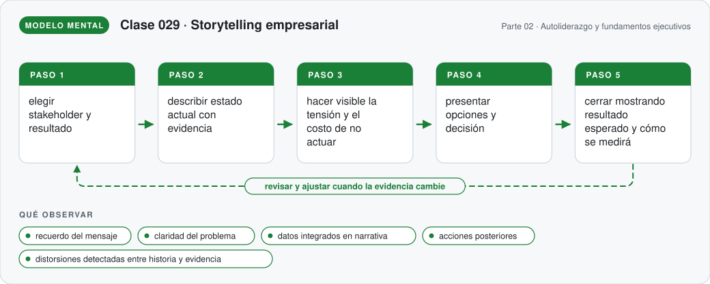

# Clase 029 — Storytelling empresarial

<!-- nav:inicio -->
> **Parte 02 · Comunicación, influencia y presencia ejecutiva** — clase 5 de 12 · [índice de la parte](../../README.md) · [temario](../../../../SYLLABUS.md)
<!-- nav:fin -->

**Parte:** 02 — Comunicación, influencia y presencia ejecutiva  
**Nivel:** Etapa 1 — Profesional → Líder  
**Duración sugerida:** 150–180 minutos · **Estándar:** deep-class-v2

## 🎯 Propósito

Las cifras informan; las historias hacen que la información importe y se recuerde. Un líder que quiere explicar por qué se cambia una estrategia, qué le pasó a un cliente o qué se aprendió de un error necesita ambas cosas, y suele tener solo una. La palabra *storytelling* se asocia con adornos, y por eso conviene empezar por lo contrario: en la empresa, una historia es una **forma de transmitir un hecho verificable en un formato que la gente retiene y puede actuar**.

Esta clase usa dos marcos: los seis rasgos de las ideas que se pegan, de Chip y Dan Heath, y el recorrido de una narrativa de cambio de Nancy Duarte. Al terminar sabrás construir una historia breve con un personaje, una decisión y un resultado real, y comprobar que no sustituya los datos ni los distorsione.

## 📚 Resultados de aprendizaje

Al finalizar podrás:

1. **Aplicar** los seis rasgos (simple, inesperada, concreta, creíble, emocional, historia) a un mensaje y detectar cuál falta.
2. **Construir** una historia breve con personaje, tensión, decisión y resultado.
3. **Elegir** el caso que ilustra mejor el punto, sin elegir el que más conviene.
4. **Verificar** que la historia sea cierta y representativa, y declarar lo que no lo es.
5. **Combinar** historia y datos de modo que cada una refuerce a la otra.

## 🧭 Agenda

| Tramo | Qué se hace |
|---|---|
| 0–20 min | Recuperación: recuerda una historia que oíste en el trabajo y todavía recuerdas; ¿por qué se quedó? |
| 20–60 min | Los seis rasgos y la estructura de una historia empresarial. |
| 60–105 min | Ejemplo trabajado: un informe transformado en mensaje con historia. |
| 105–140 min | Caso ejecutivo: explicar un cambio de estrategia a los empleados. |
| 140–170 min | Ética de la historia y entregable. |

## 🧩 Conceptos centrales

| Concepto | Definición | Cómo se reconoce |
|---|---|---|
| **Idea simple** | Mensaje reducido a su esencia, que prioriza lo central (Heath y Heath, 2007). | Cabe en una frase y deja fuera lo secundario. |
| **Idea inesperada** | Mensaje que rompe una expectativa y genera curiosidad. | Sorprende a quien conoce el tema. |
| **Idea concreta** | Mensaje expresado en detalles perceptibles, no en abstracciones. | Se puede imaginar o medir. |
| **Idea creíble** | Mensaje respaldado por evidencia que la audiencia puede comprobar. | Incluye un detalle verificable. |
| **Idea emocional** | Mensaje que conecta con algo que le importa a la audiencia. | Responde «¿y a mí qué?». |
| **Historia** | Relato de personas que actúan ante una dificultad y obtienen un resultado. | Hay personaje, tensión y desenlace. |
| **Narrativa de cambio** | Recorrido que contrasta la situación actual con la posible para mover a la acción (Duarte, 2010). | La audiencia ve qué se gana al cambiar. |

## 🧠 Modelo mental

**Cómo leer el diagrama.** Cada tarjeta es un rasgo con su pregunta de control. No es necesario que un mensaje los cumpla todos, pero sí conviene revisar cuáles faltan: un mensaje correcto y olvidable suele carecer de lo inesperado o de lo emocional; uno memorable y dudoso, de lo creíble.

## 📖 Desarrollo

### 1. Por qué una historia

Heath y Heath parten de un problema: casi todo el que sabe algo lo explica de forma abstracta, y la abstracción es difícil de entender y de recordar. Su propuesta es revisar el mensaje con seis rasgos —simple, inesperado, concreto, creíble, emocional y contado como historia— que, según los autores, comparten las ideas que perduran. No es una fórmula garantizada, pero sí una lista útil para revisar.

### 2. Simple e inesperado

**Simple** no es simplificar en exceso: es elegir lo esencial. Si todo es importante, nada se recuerda. Pregúntate cuál es la idea que debe sobrevivir si la audiencia olvida todo lo demás. **Inesperado** significa abrir un hueco en lo que la audiencia da por hecho y llenarlo: una cifra que contradice la intuición, una pregunta que obliga a pensar. La sorpresa atrae la atención; la historia la mantiene.

### 3. Concreto y creíble

Una promesa abstracta —«ofrecemos calidad»— no se imagina; un detalle —«cada paquete se revisa con tres fotos antes de salir»— sí. Lo **concreto** ayuda a entender y a recordar. Lo **creíble** permite aceptar: un dato que la audiencia puede comprobar, o un caso cercano y específico, pesa más que un adjetivo. En la empresa, la credibilidad también proviene de reconocer los límites de lo que se afirma.

### 4. Emocional

Las personas actúan cuando algo les importa. Una cifra de pérdida se vuelve actuable cuando se entiende qué significa para alguien: un cliente que esperó tres semanas, un técnico que trabajó de noche. No se trata de manipular la emoción, sino de mostrar la dimensión humana de un hecho verdadero.

### 5. La historia: personaje, tensión, decisión, resultado

Una historia empresarial breve contiene cuatro elementos: un **personaje** con el que la audiencia puede identificarse, una **tensión** o dificultad, una **decisión** que el personaje toma y un **resultado**, incluida la parte que salió mal. Duarte agrega que la narrativa de cambio alterna entre cómo es la situación y cómo podría ser, y que el desenlace es la invitación a la audiencia a actuar.

### 6. El límite ético: verdad y representatividad

Una historia verdadera puede engañar si es **atípica**: el caso brillante que no representa a la mayoría. Regla de la clase: una historia debe ser **cierta**, **representativa** o declarada como excepción, y complementarse con el dato que muestra qué tan común es. Y no se inventan personajes ni se modifican hechos para mejorar el relato; si se anonimiza, se dice.

### 7. Historia y datos, juntos

Los datos responden «¿qué tan frecuente?» y las historias «¿qué significa?». Una presentación que solo tiene datos pierde a la audiencia; una que solo tiene historias pierde a los escépticos. El orden habitual es abrir con la historia que muestra el problema, sostener con el dato que muestra su alcance y cerrar con la decisión.

## 📚 Lectura comparada

| Obra | Qué aporta | Qué no resuelve | Pregunta para contrastar |
|---|---|---|---|
| Heath y Heath (2007) | Los seis rasgos y su revisión. | Sus ejemplos provienen de casos seleccionados. | ¿Qué rasgo le falta a tu mensaje? |
| Duarte (2010) | La narrativa como contraste entre lo actual y lo posible. | No aporta pruebas empíricas del método. | ¿Qué cambio pide tu historia? |
| Cialdini (2016) | Cómo la prueba social y la coherencia refuerzan un relato. | No trata de la estructura de una historia. | ¿Qué palanca estás usando? |
| Stone, Patton y Heen (1999) | Cómo contar lo difícil sin culpar. | No es un método narrativo. | ¿Tu historia atribuye culpa o muestra hechos? |
| Minto (2005) | Estructura para combinar relato y razones. | No cubre lo emocional. | ¿Dónde está la conclusión? |

## 🧮 Ejemplo trabajado

**Situación (hipotética, con cifras ilustrativas).** Un jefe de atención al cliente quiere que la dirección apruebe una segunda línea de soporte. Su informe dice: «El 18 % de los clientes espera más de 24 horas la respuesta; el tiempo medio de primera respuesta es de 19 horas».

**Revisión con los seis rasgos.**

| Rasgo | Informe original | Versión mejorada |
|---|---|---|
| Simple | Varias cifras | «Uno de cada cinco clientes espera más de un día.» |
| Inesperado | No hay | «Nuestra promesa pública es responder en cuatro horas.» |
| Concreto | Porcentajes | Un caso de una clínica cuyo sistema de citas falló un lunes y esperó 31 horas. |
| Creíble | Sin fuente | Cifra del registro de tickets de los últimos 90 días y el ticket anonimizado. |
| Emocional | No hay | Qué significó para la clínica: 40 citas reprogramadas a mano. |
| Historia | No hay | Personaje: la administradora de la clínica; tensión: una caída del sistema; decisión: escribió tres veces; resultado: respondió un técnico al día siguiente. |

**Verificación ética.** ¿Es representativo el caso? El jefe agrega: «Es el 18 % más grave, no el promedio; el promedio es de 19 horas». Declara que es excepcional y muestra el dato que lo sitúa.

**Qué muestra.** (1) La misma información, con los seis rasgos, es más comprensible. (2) El caso no sustituye al dato: lo acompaña. (3) Declarar que el caso es el más grave mantiene la credibilidad.

## 🔀 Comparación y límites

**Historia frente a anécdota.** Una anécdota es un caso suelto; una historia empresarial lleva un personaje, una decisión y un resultado, y se elige por lo que muestra del problema, no por lo llamativa.

**Límites.** Los rasgos de Heath y Heath provienen de un análisis de ideas que perduraron y de ejemplos seleccionados; ayudan a revisar un mensaje, pero no predicen cuál se recordará. La narrativa de Duarte es una propuesta de trabajo. Contar historias con eficacia puede ser una forma de persuasión potente: la frontera con la manipulación se trata en la clase 033.

## 🪜 De profesional a owner

| Nivel | Cómo usa las historias |
|---|---|
| **Profesional** | Ilustra su propuesta con un caso concreto y verificable. |
| **Jefe / Team Lead** | Cuenta los éxitos y los errores del equipo para fijar estándares. |
| **Gerente** | Traduce las cifras de su área en casos de clientes y personas. |
| **CEO / Director** | Construye la narrativa de la empresa sin contradecir los hechos y cuida que cada historia sea representativa. |
| **Founder / Owner** | Cuenta su historia a clientes, inversionistas y talentos con datos que la sostengan. |

## 🏢 Caso ejecutivo

Una empresa de manufactura cambia su estrategia: dejará de fabricar productos de bajo margen y se concentrará en piezas especializadas. Dentro de 18 meses se cerrará una línea con 60 personas. La dirección debe explicarlo a los empleados. Hay rumores, y una parte del personal desconfía de la gerencia por una reestructuración anterior.

Entrega una **narrativa de cambio** que contenga: (a) el mensaje central en una frase; (b) el contraste entre la situación actual y la posible, con datos; (c) una historia breve con personaje, tensión, decisión y resultado, y la verificación de que sea cierta y representativa; (d) lo que no se sabe todavía y cuándo se informará; (e) cómo cuidarás que no se perciba como manipulación.

## 🧪 Práctica

1. Toma un mensaje que preparas y evalúa cuál de los seis rasgos le falta.
2. Redacta una historia de cuatro frases: personaje, tensión, decisión y resultado.
3. Para esa historia, escribe el dato que muestra qué tan común es y verifica que sea cierta.
4. Reescribe una cifra de tu informe como un caso concreto.
5. Escribe una línea que declare qué parte de tu historia es excepcional.

## ⚠️ Errores frecuentes

| Error | Por qué ocurre | Cómo corregirlo |
|---|---|---|
| Historia que reemplaza a los datos | Se cree que emociona más | Acompañarla del dato que muestra su alcance. |
| Caso atípico como regla | Es el más llamativo | Declarar si es excepcional. |
| Personaje inventado | Se quiere mejorar el relato | Usar casos reales, anonimizados y declarados como tales. |
| Demasiadas ideas | Todo parece importante | Dejar una idea que sobreviva. |
| Emoción sin hechos | Se busca conmover | Anclar la emoción en un hecho verificable. |
| Historia sin decisión | Se cuenta lo que pasó | Mostrar qué decidió el personaje y qué ocurrió. |

## ❓ Preguntas de comprobación

1. ¿Cuáles son los seis rasgos de Heath y Heath?
2. ¿Qué diferencia hay entre una idea simple y una simplificada en exceso?
3. ¿Qué cuatro elementos tiene una historia empresarial?
4. ¿Cómo se comprueba que una historia no engaña aunque sea verdadera?
5. ¿Qué papel cumple el contraste «es / podría ser» de Duarte?
6. ¿En qué orden se combinan historia y datos?
7. ¿Qué límite tienen los seis rasgos como método?

Claves de respuesta

1. Simple, inesperada, concreta, creíble, emocional e historia.
2. La simple prioriza lo esencial; la simplificada en exceso distorsiona o elimina lo necesario.
3. Personaje, tensión, decisión y resultado.
4. Verificando que sea cierta y representativa, declarando si es excepcional y mostrando el dato que la sitúa.
5. Mueve a la acción al mostrar la distancia entre la situación actual y la posible.
6. Abrir con la historia que muestra el problema, sostener con el dato de su alcance y cerrar con la decisión.
7. Provienen de ejemplos seleccionados y sirven para revisar, no para garantizar que un mensaje se recuerde.

## 📥 Entregable

Guarda en `portfolio/029-storytelling-empresarial/`:

- `risk-governance-brief.md` (plantilla [Risk & Governance Brief](../../../../templates/risk-governance-brief.md)) con la narrativa del caso ejecutivo y su verificación de representatividad;
- `reading-note.md` con una tensión entre Heath y Heath y Duarte;
- `decision-journal.md` con la historia elegida, las que descartaste y por qué.

## 📗 Fuentes y verificación

- Chip Heath & Dan Heath — *Made to Stick* (Penguin Random House, 2007). **Uso en esta clase:** los seis rasgos de las ideas que se entienden y se recuerdan. Lectura selectiva sobre **storytelling empresarial**. **Localizador:** [ISBN-13 9781905211562](https://openlibrary.org/isbn/9781905211562).
- Nancy Duarte — *Resonate* (John Wiley & Sons, Incorporated, 2010). **Uso en esta clase:** la narrativa como contraste entre lo actual y lo posible. Lectura selectiva sobre **storytelling empresarial**. **Localizador:** [ISBN-13 9781118014875](https://openlibrary.org/isbn/9781118014875).
- Robert B. Cialdini — *Influence* (HarperCollins Publishers and Blackstone Audio, 2016). **Uso en esta clase:** prueba social y coherencia como refuerzo de un relato. Lectura selectiva sobre **storytelling empresarial**. **Localizador:** [ISBN-13 9781624608049](https://openlibrary.org/isbn/9781624608049).
- Douglas Stone, Bruce Patton & Sheila Heen — *Difficult Conversations* (Random House Audio, 1999). **Uso en esta clase:** contar lo difícil sin atribuir culpa. Lectura selectiva sobre **storytelling empresarial**. **Localizador:** [ISBN-13 9780553525687](https://openlibrary.org/isbn/9780553525687).
- Barbara Minto — *The Pyramid Principle* (Financial Times/ Prentice Hall, 2005). **Uso en esta clase:** estructura para combinar relato y razones. Lectura selectiva sobre **storytelling empresarial**. **Localizador:** [ISBN-13 9781405822145](https://openlibrary.org/isbn/9781405822145).

> **Regla de fuentes para Storytelling empresarial:** las obras anteriores estructuran las perspectivas de esta materia; cualquier norma, ley o estándar vivo mencionado debe comprobarse nuevamente en su fuente primaria vigente. Los ejemplos y casos son hipotéticos, con cifras ilustrativas. El desarrollo es original y no reproduce capítulos protegidos.

<!-- pie:inicio -->
---

| Anterior | Índice | Siguiente |
|---|---|---|
| [← 028 · Presentaciones para decisiones](../028-presentaciones-para-decisiones/README.md) | [Parte 02](../../README.md) · [Programa](../../../../SYLLABUS.md) | [030 · Feedback útil y accionable →](../030-feedback-util-y-accionable/README.md) |
<!-- pie:fin -->
