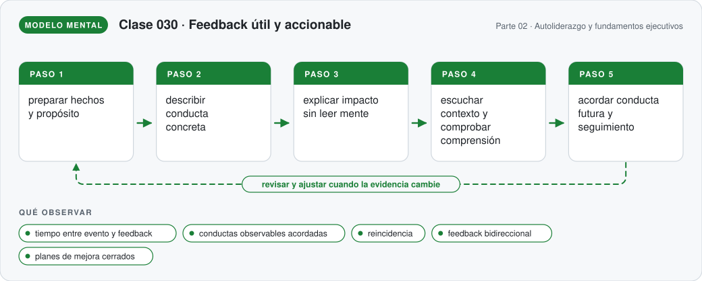

# Clase 030 — Feedback útil y accionable

<!-- nav:inicio -->
> **Parte 02 · Comunicación, influencia y presencia ejecutiva** — clase 6 de 12 · [índice de la parte](../../README.md) · [temario](../../../../SYLLABUS.md)
<!-- nav:fin -->

**Parte:** 02 — Comunicación, influencia y presencia ejecutiva  
**Nivel:** Etapa 1 — Profesional → Líder  
**Duración sugerida:** 150–180 minutos · **Estándar:** deep-class-v2

## 🎯 Propósito

Dar feedback parece un gesto obviamente bueno: se le dice a alguien cómo lo está haciendo para que mejore. La investigación muestra algo menos cómodo: **una parte importante de las intervenciones de feedback no mejora el desempeño, y algunas lo empeoran**. Hay formas de dar feedback que ayudan y formas que dañan, y casi nunca coinciden con la intuición de quien lo da.

Esta clase usa la revisión de Kluger y DeNisi, que muestra que depende del **nivel al que se dirige la atención** del receptor, y el trabajo de Stone y Heen sobre por qué recibir feedback es difícil. Al terminar sabrás dar feedback centrado en la tarea y el proceso, evitar el que apunta a la persona y reconocer tus propias reacciones al recibirlo.

## 📚 Resultados de aprendizaje

Al finalizar podrás:

1. **Distinguir** feedback de tarea, de proceso y de yo, y predecir su efecto.
2. **Formular** un feedback con hecho observable, efecto y una acción posible.
3. **Reconocer** los tres disparadores que dificultan recibirlo: verdad, relación e identidad.
4. **Pedir** feedback específico y usarlo sin defenderte.
5. **Decidir** cuándo el feedback no es la herramienta adecuada.

## 🧭 Agenda

| Tramo | Qué se hace |
|---|---|
| 0–20 min | Recuperación: recuerda un feedback que te ayudó y otro que no; ¿a qué apuntaba cada uno? |
| 20–60 min | Los niveles de feedback y los disparadores de quien lo recibe. |
| 60–105 min | Ejemplo trabajado: tres versiones del mismo feedback. |
| 105–140 min | Caso ejecutivo: feedback a un colaborador con buen desempeño técnico y mala colaboración. |
| 140–170 min | Límites del enfoque y entregable. |

## 🧩 Conceptos centrales

| Concepto | Definición | Cómo se reconoce |
|---|---|---|
| **Intervención de feedback** | Información sobre el desempeño de alguien que ofrece otra persona, para cambiar su conducta (Kluger y DeNisi, 1996). | Hay un emisor, un receptor y información sobre un desempeño. |
| **Nivel de feedback** | Aspecto al que se dirige la atención: la tarea, el proceso o el yo (Kluger y DeNisi, 1996). | Se puede señalar si habla de qué se hizo, cómo o quién es. |
| **Feedback de tarea** | Información sobre qué se logró o faltó en una tarea concreta. | «El informe omite el costo de mantenimiento.» |
| **Feedback de yo** | Juicio sobre la persona, ajeno a la tarea. | «Eres desordenado.» |
| **Disparador de verdad** | Reacción al contenido del feedback: lo siento incorrecto o injusto (Stone y Heen, 2014). | Se discute el dato. |
| **Disparador de relación** | Reacción a quien da el feedback (Stone y Heen, 2014). | Se discute al emisor. |
| **Disparador de identidad** | Reacción a lo que el feedback dice de quien lo recibe (Stone y Heen, 2014). | Se vive como amenaza a la propia valía. |

## 🧠 Modelo mental

**Cómo leer el diagrama.** A la izquierda, quien da: cuanto más cerca del yo apunta el feedback, menos tiende a ayudar. A la derecha, quien recibe: tres razones por las que cuesta aceptarlo. Dar bien requiere apuntar a la tarea; recibir bien requiere reconocer qué disparador se activó.

## 📖 Desarrollo

### 1. Dar feedback no garantiza que ayude

Kluger y DeNisi revisaron un gran conjunto de estudios sobre feedback y encontraron que, en promedio, mejora el desempeño, pero con **mucha variación**: en más de un tercio de los casos las intervenciones lo redujeron. La conclusión práctica es que dar feedback no basta; importa cómo, sobre qué y a quién. Quien lo da con la sola intención de ayudar puede estar haciendo daño sin saberlo.

### 2. El nivel de la atención

Su explicación es que el feedback dirige la atención del receptor a algún nivel. Si lo dirige a los **detalles de la tarea** —qué se hizo, qué faltó—, tiende a mejorar el desempeño. Si lo dirige al **proceso** —cómo se trabajó—, también puede ayudar. Si lo dirige al **yo** —quién es el receptor, cómo queda ante los demás—, la atención se aparta de la tarea y el efecto tiende a ser neutro o negativo. Por eso el elogio o la crítica a la persona suelen servir menos que información sobre la tarea.

### 3. Cómo formular un feedback centrado en la tarea

Una estructura simple, que la clase propone como método de trabajo y no como una fórmula de los autores: **hecho observable → efecto → acción posible**. «En el informe del martes faltaba el costo de mantenimiento (hecho). Por eso el comité no pudo comparar las alternativas (efecto). Para el próximo, incluye una fila de mantenimiento por alternativa (acción).» Contiene lo que se observó, por qué importa y qué hacer.

### 4. Evitar el yo sin dejar de ser honesto

Evitar el nivel del yo no significa suavizar. Significa describir la conducta o el producto y no inferir el carácter. «Entregaste tarde tres veces» es un hecho; «eres irresponsable» es una conclusión sobre la persona. Si el patrón preocupa, se dice: «hay un patrón de tres entregas tardías; ¿qué está pasando?».

### 5. Por qué cuesta recibirlo

Stone y Heen explican que recibir feedback activa tres tipos de reacción. El de **verdad**: «esto no es cierto ni justo». El de **relación**: «¿quién eres tú para decírmelo?». El de **identidad**: «esto significa que no valgo». Cada uno desvía la atención del contenido hacia otra cosa. Reconocerlos es el primer paso: se puede decir «me estoy defendiendo por la forma en que lo dijo» y separar la forma del contenido.

### 6. Pedir feedback

Pedir feedback de manera general («¿cómo lo hago?») invita a respuestas vagas. Funciona mejor pedir algo **específico**: «¿qué una cosa cambiarías de mi presentación?». Es más fácil de responder, centra la atención en la tarea y muestra disposición a usarlo. Quien lo recibe agradece, resume lo entendido y decide qué hará, sin obligarse a aceptarlo todo.

### 7. Cuándo el feedback no es la herramienta

El feedback sirve cuando la persona puede y quiere cambiar y el obstáculo es información. No resuelve problemas de capacidad (necesita formación), de recursos (necesita medios) ni de motivación estructural (necesita un cambio de rol). Insistir con feedback ante lo que no es información produce frustración. Antes de darlo, pregúntate cuál es el obstáculo.

## 📚 Lectura comparada

| Obra | Qué aporta | Qué no resuelve | Pregunta para contrastar |
|---|---|---|---|
| Kluger y DeNisi (1996) | Niveles de atención y efecto variable del feedback. | Es una revisión de estudios, con promedios. | ¿A qué nivel apuntó tu último feedback? |
| Stone y Heen (2014) | Los tres disparadores de quien recibe. | No mide efectos. | ¿Cuál se activa más en ti? |
| Stone, Patton y Heen (1999) | Cómo conducir la conversación de feedback difícil. | No da una estructura de mensaje. | ¿Cuál es la conversación sobre identidad que evitas? |
| Edmondson (2018) | Seguridad psicológica para dar y recibir feedback. | No trata de formulación. | ¿Qué cuesta en tu equipo decir una verdad incómoda? |
| Goleman, Boyatzis y McKee (2002) | El efecto emocional del feedback del líder. | No distingue niveles. | ¿Qué estado transmites al darlo? |

## 🧮 Ejemplo trabajado

**Situación (hipotética).** Una gerente quiere dar feedback a un analista cuya presentación al comité fue confusa. Veamos tres versiones.

| Versión | Contenido | Nivel | Efecto probable |
|---|---|---|---|
| **A** | «Eres muy desordenado al presentar.» | Yo | Activa identidad y defensa; no indica qué cambiar. |
| **B** | «Estuvo bien, pero podrías mejorar.» | Ninguno claro | No informa; el analista no sabe qué hacer. |
| **C** | «La lámina 3 tenía seis cifras y el comité preguntó cuál importaba (hecho). Por eso la discusión se fue a un detalle y no a la decisión (efecto). La próxima vez, deja una cifra por lámina y resalta la que sostiene la afirmación (acción).» | Tarea | Información usable; el analista sabe qué cambiar. |

**Cómo se recibe.** El analista siente el disparador de verdad: «las otras láminas estaban bien». La gerente responde: «Sí, la 2 y la 4 funcionaron; me refiero a esta, y a lo que podemos hacer con ella». Reconoce lo correcto y mantiene el foco.

**Qué muestra.** (1) La versión C es más específica, no más dura. (2) Separar hecho, efecto y acción evita el juicio sobre la persona. (3) Reconocer lo que funcionó no es adulación: es información.

## 🔀 Comparación y límites

**Feedback frente a coaching.** El feedback informa sobre un desempeño pasado; el coaching ayuda a quien aprende a descubrir qué cambiar. El coaching usa preguntas (clase 026); el feedback usa hechos. Un buen líder alterna.

**Límites.** Los resultados de Kluger y DeNisi son promedios de muchos estudios, la mayoría en entornos de laboratorio o de tareas acotadas; su aplicación a una conversación concreta debe hacerse con criterio. La estructura «hecho, efecto, acción» es un método de trabajo de la clase. Y dar feedback sin una relación de confianza previa suele activar el disparador de relación.

## 🪜 De profesional a owner

| Nivel | Cómo trabaja el feedback |
|---|---|
| **Profesional** | Pide feedback específico y lo usa. |
| **Jefe / Team Lead** | Da feedback de tarea con regularidad, cerca del hecho. |
| **Gerente** | Forma a sus jefes para dar feedback y detecta patrones que no son de información. |
| **CEO / Director** | Recibe feedback de pares y del directorio, y crea condiciones para que le lleguen verdades incómodas. |
| **Founder / Owner** | Busca feedback de clientes y socios sin protegerse de lo que escuche. |

## 🏢 Caso ejecutivo

Un director de ingeniería tiene un colaborador con resultados técnicos excelentes y una conducta que daña al equipo: interrumpe, descalifica ideas y no comparte información. Dos personas ya pidieron cambiarse de equipo. El colaborador cree que su aporte justifica su estilo.

Entrega un **plan de feedback** que contenga: (a) los hechos observables, con fecha y fuente; (b) el feedback formulado como hecho, efecto y acción; (c) cómo anticipar el disparador de identidad y de relación; (d) qué pedirás a cambio: feedback específico sobre tu propia conducta como jefe; (e) cómo medirás el cambio y cuándo volverás a conversar; (f) qué harás si el problema no es de información.

## 🧪 Práctica

1. Clasifica los últimos tres feedbacks que diste: tarea, proceso o yo.
2. Reescribe uno que apuntaba al yo con la estructura hecho, efecto y acción.
3. Identifica cuál de los tres disparadores se activa más en ti al recibir críticas.
4. Pide a alguien un feedback específico sobre algo concreto y resume lo que entendiste.
5. Piensa en una situación donde el feedback no es la herramienta y escribe cuál sí lo es.

## ⚠️ Errores frecuentes

| Error | Por qué ocurre | Cómo corregirlo |
|---|---|---|
| Juzgar a la persona | Es lo que se infiere | Describir la conducta o el producto. |
| Feedback vago | Se evita incomodar | Hecho, efecto y acción concretos. |
| Esperar mucho para darlo | Se acumulan observaciones | Darlo cerca del hecho. |
| Defenderse al recibirlo | Se activa un disparador | Agradecer, resumir y decidir después. |
| Dar feedback a quien necesita otra cosa | No se identifica el obstáculo | Distinguir información, capacidad, medios y motivación. |
| Elogio genérico | Se quiere animar | Decir qué hizo bien y qué efecto tuvo. |

## ❓ Preguntas de comprobación

1. ¿Qué encontraron Kluger y DeNisi sobre el efecto promedio y la variación del feedback?
2. ¿Qué tres niveles de atención distinguen y cuál tiende a ser dañino?
3. Formula un feedback con hecho, efecto y acción sobre un informe sin conclusiones.
4. ¿Cuáles son los tres disparadores de Stone y Heen?
5. ¿Qué diferencia hay entre pedir feedback general y específico?
6. ¿Cuándo el feedback no es la herramienta adecuada?
7. ¿Qué límite tiene la evidencia de Kluger y DeNisi?

Claves de respuesta

1. En promedio mejora el desempeño, pero con mucha variación: en más de un tercio de los casos lo redujo.
2. Tarea, proceso y yo; el dirigido al yo tiende a ser dañino o inútil.
3. Por ejemplo: «El informe presenta tres cifras sin concluir (hecho). El comité no supo qué decidir (efecto). Cierra con una recomendación de una frase (acción).»
4. Verdad, relación e identidad.
5. El general invita a respuestas vagas; el específico centra la atención en la tarea y es más fácil de responder.
6. Cuando el obstáculo no es información: falta de capacidad, de medios o un problema estructural.
7. Son promedios de muchos estudios, con entornos acotados; su aplicación a un caso concreto exige criterio.

## 📥 Entregable

Guarda en `portfolio/030-feedback-util-y-accionable/`:

- `people-decision-brief.md` (plantilla [People Decision Brief](../../../../templates/people-decision-brief.md)) con el plan de feedback del caso ejecutivo;
- `reading-note.md` con una tensión entre Kluger y DeNisi y Stone y Heen;
- `decision-journal.md` con el feedback formulado, la reacción y el seguimiento.

## 📗 Fuentes y verificación

- Avraham N. Kluger & Angelo DeNisi — *The Effects of Feedback Interventions on Performance: A Historical Review, a Meta-Analysis, and a Preliminary Feedback Intervention Theory* (Psychological Bulletin, 1996). **Uso en esta clase:** niveles de atención y efecto variable del feedback. Lectura selectiva sobre **feedback útil y accionable**. **Localizador:** [DOI 10.1037/0033-2909.119.2.254](https://doi.org/10.1037/0033-2909.119.2.254).
- Douglas Stone & Sheila Heen — *Thanks for the Feedback* (Viking, 2014). **Uso en esta clase:** los tres disparadores de quien recibe feedback. Lectura selectiva sobre **feedback útil y accionable**. **Localizador:** [ISBN-13 9780670014668](https://openlibrary.org/isbn/9780670014668).
- Douglas Stone, Bruce Patton & Sheila Heen — *Difficult Conversations* (Random House Audio, 1999). **Uso en esta clase:** conducir la conversación difícil. Lectura selectiva sobre **feedback útil y accionable**. **Localizador:** [ISBN-13 9780553525687](https://openlibrary.org/isbn/9780553525687).
- Amy C. Edmondson — *The Fearless Organization* (Wiley, 2018). **Uso en esta clase:** seguridad psicológica para dar y recibir feedback. Lectura selectiva sobre **feedback útil y accionable**. **Localizador:** [ISBN-13 9781119477242](https://openlibrary.org/isbn/9781119477242).
- Daniel Goleman, Richard Boyatzis & Annie McKee — *Primal Leadership* (Harvard Business School Press, 2002). **Uso en esta clase:** el efecto emocional del líder al dar feedback. Lectura selectiva sobre **feedback útil y accionable**. **Localizador:** [ISBN-13 9781578514861](https://openlibrary.org/isbn/9781578514861).

> **Regla de fuentes para Feedback útil y accionable:** las obras anteriores estructuran las perspectivas de esta materia; cualquier norma, ley o estándar vivo mencionado debe comprobarse nuevamente en su fuente primaria vigente. Los ejemplos y casos son hipotéticos. El desarrollo es original y no reproduce capítulos protegidos.

<!-- pie:inicio -->
---

| Anterior | Índice | Siguiente |
|---|---|---|
| [← 029 · Storytelling empresarial](../029-storytelling-empresarial/README.md) | [Parte 02](../../README.md) · [Programa](../../../../SYLLABUS.md) | [031 · Conversaciones difíciles →](../031-conversaciones-dificiles/README.md) |
<!-- pie:fin -->
