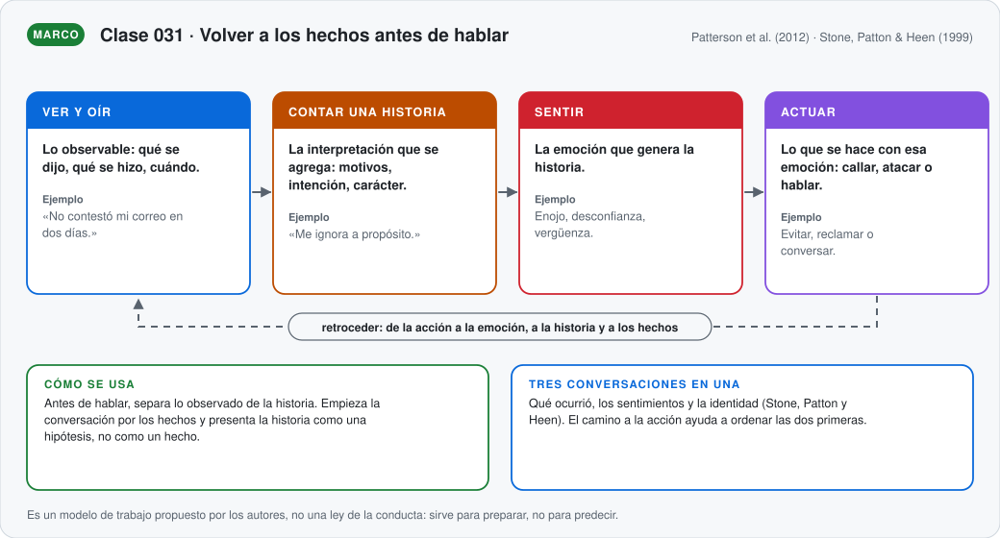

# Clase 031 — Conversaciones difíciles

<!-- nav:inicio -->
> **Parte 02 · Comunicación, influencia y presencia ejecutiva** — clase 7 de 12 · [índice de la parte](../../README.md) · [temario](../../../../SYLLABUS.md)
<!-- nav:fin -->

**Parte:** 02 — Comunicación, influencia y presencia ejecutiva  
**Nivel:** Etapa 1 — Profesional → Líder  
**Duración sugerida:** 150–180 minutos · **Estándar:** deep-class-v2

## 🎯 Propósito

Una conversación es difícil cuando lo que está en juego es importante, las opiniones difieren y las emociones son intensas. Casi todos hacemos una de dos cosas: evitarla hasta que se vuelve un problema mayor o abordarla con una versión de los hechos que ya incluye un juicio sobre el otro. En ambos casos la conversación empieza mal, porque ocurre **después** de que nos contamos una historia sobre lo sucedido.

Esta clase usa el modelo de «camino a la acción» de Patterson y colegas para ordenar lo que pasa dentro de uno antes de hablar, y la distinción de Stone, Patton y Heen entre las tres conversaciones que contiene toda conversación difícil. Al terminar sabrás separar lo observado de la interpretación, preparar un inicio que no ponga al otro a la defensiva y conducir la conversación hacia un resultado concreto.

## 📚 Resultados de aprendizaje

Al finalizar podrás:

1. **Describir** el camino a la acción —ver, contar una historia, sentir, actuar— y ubicar dónde estás en él.
2. **Separar** hechos observables de la historia que les agregas.
3. **Identificar** las tres conversaciones presentes: qué ocurrió, los sentimientos y la identidad.
4. **Abrir** una conversación difícil con hechos, propósito común y curiosidad.
5. **Cerrarla** con acuerdos concretos, responsables y fecha de seguimiento.

## 🧭 Agenda

| Tramo | Qué se hace |
|---|---|
| 0–20 min | Recuperación: ¿qué conversación estás evitando hoy y qué historia te cuentas sobre ella? |
| 20–60 min | El camino a la acción y las tres conversaciones. |
| 60–105 min | Ejemplo trabajado: de una historia de intención a una conversación de hechos. |
| 105–140 min | Caso ejecutivo: una conversación con un par que incumple compromisos. |
| 140–170 min | Límites y entregable. |

## 🧩 Conceptos centrales

| Concepto | Definición | Cómo se reconoce |
|---|---|---|
| **Conversación difícil** | Conversación donde hay mucho en juego, opiniones opuestas y emociones fuertes (Patterson et al., 2012). | La persona siente tensión antes de empezarla. |
| **Camino a la acción** | Secuencia interna: ver y oír, contar una historia, sentir y actuar (Patterson et al., 2012). | Se puede ubicar en qué paso se produjo el problema. |
| **Hecho** | Lo que se puede observar y registrar sin interpretar: qué se dijo, qué se hizo, cuándo. | Una cámara lo habría captado. |
| **Historia** | Interpretación que se agrega a los hechos: motivos, intención, carácter. | Contiene un «porque» sobre la persona. |
| **Las tres conversaciones** | Qué ocurrió, los sentimientos y la identidad (Stone, Patton y Heen, 1999). | Se distingue sobre qué se discute realmente. |
| **Propósito común** | Meta que ambas partes comparten en la conversación. | El otro entiende que no se lo ataca. |
| **Conversación de aprendizaje** | Postura de curiosidad: se busca entender cómo vio el otro la situación. | Se preguntan hechos y se escucha. |

## 🧠 Modelo mental

**Cómo leer el diagrama.** El problema casi nunca está en lo que se ve y se oye, sino en la historia que se agrega y en la emoción que genera. Cuando una conversación se desvía, se retrocede por el camino: de la acción a la emoción, a la historia y, por último, a los hechos. Se vuelve a empezar desde lo observable.

## 📖 Desarrollo

### 1. El camino a la acción

Patterson y colegas proponen que ante cualquier situación pasamos por cuatro pasos casi instantáneos. **Vemos y oímos** algo; **contamos una historia** que le da sentido; **sentimos** una emoción a partir de esa historia; y **actuamos**, ya sea callando, atacando o conversando. La acción que vemos desde fuera es el último eslabón; los otros ocurren dentro y a gran velocidad.

### 2. Hechos e historias

«Entregó tarde el informe» es un hecho. «Lo hizo para dejarme mal» es una historia: atribuye una intención que no está en el hecho. La historia puede ser cierta, pero es una **hipótesis** y debe tratarse como tal. Si la presentas como un hecho, el otro responderá a la acusación y no al contenido. Una buena preparación consiste en escribir los hechos y, aparte, las historias, y preguntarse qué otras historias son posibles.

### 3. Las tres conversaciones

Stone, Patton y Heen observan que toda conversación difícil contiene tres: la de **qué ocurrió** (¿quién tiene razón?, ¿quién tuvo la culpa?), la de **los sentimientos** (¿qué siento y qué siente el otro?) y la de **la identidad** (¿qué dice esto de mí?). Solemos concentrarnos en la primera, mientras la tensión la producen las otras dos. Reconocer sobre cuál se está discutiendo cambia la forma de responder.

### 4. Empezar por lo que ayuda

La forma de abrir determina el resto. Tres ideas: **cuida tu propio estado** antes de hablar; **establece un propósito común** («quiero que podamos trabajar bien juntos») para que el otro no sienta un ataque; y **presenta los hechos** con una invitación a conocer su perspectiva («esto es lo que observé; ¿cómo lo ves tú?»). Evita abrir con un juicio, un «siempre» o un «nunca».

### 5. Escuchar la otra historia

Después de exponer los hechos, la tarea es descubrir la otra historia: qué vio, qué siente y qué necesitaba. Preguntas de la clase 026, resúmenes y reconocimiento de la emoción. Cambiar de la postura «tengo la razón» a la de **aprendizaje** —¿qué no estoy viendo?— suele abrir información que explica el hecho.

### 6. Cuando la conversación se desvía

Si una conversación se vuelve tensa, se retrocede por el camino. Reconoce la emoción («veo que esto te molesta»), vuelve al propósito común, separa hechos de historias y pregunta. Si la emoción es muy intensa, se acuerda una pausa con fecha para retomar. Insistir en el contenido cuando el otro está desbordado no avanza.

### 7. Cerrar con acuerdos

Una conversación difícil termina bien cuando concluye con acuerdos: **quién hará qué, para cuándo** y **cómo se sabrá** que se cumplió. Anótalo y comparte el registro. Fija una fecha de seguimiento. Una conversación que no termina en un acuerdo, o en la decisión explícita de no tenerlo, se repite.

## 📚 Lectura comparada

| Obra | Qué aporta | Qué no resuelve | Pregunta para contrastar |
|---|---|---|---|
| Patterson et al. (2012) | El camino a la acción y cómo abrir la conversación. | Sus ejemplos son seleccionados. | ¿En qué paso se produjo tu último malentendido? |
| Stone, Patton y Heen (1999) | Las tres conversaciones y la postura de aprendizaje. | No da un guion. | ¿Sobre cuál estás discutiendo realmente? |
| Schein (2013) | Preguntar con curiosidad. | No trata de emociones. | ¿Qué preguntarías sin saber la respuesta? |
| Edmondson (2018) | Seguridad psicológica para tener estas conversaciones. | No es una técnica personal. | ¿Qué hace que alguien no hable contigo? |
| Goleman, Boyatzis y McKee (2002) | Regulación emocional del que conduce. | No trata de estructura. | ¿Qué estado llevas a la conversación? |

## 🧮 Ejemplo trabajado

**Situación (hipotética).** Una jefa de proyecto, Marta, observa que su par Diego no entregó dos veces seguidas el insumo que ella necesita, y siente enojo.

| Paso | Lo que ocurre en Marta | Lo que haría con el método |
|---|---|---|
| **Ver y oír** | Diego entregó el insumo el jueves y el lunes en vez de la fecha acordada. | Escribe: «Acordamos el martes; se entregó el jueves (2 días) y el lunes (6 días).» |
| **Historia** | «No le importa mi trabajo.» | Escribe otras historias posibles: sobrecarga, cambio de prioridades, falta de información. |
| **Sentir** | Enojo, desconfianza. | Reconoce la emoción antes de hablar. |
| **Actuar** | Pensó en escribirle un correo con copia al jefe. | Pide una conversación breve. |

**La apertura.** «Diego, quiero que podamos coordinarnos bien; el proyecto depende de eso. Acordamos el martes y recibí el insumo el jueves y el lunes. ¿Cómo lo ves tú?»

**La otra historia.** Diego explica que su área cambió de prioridad y no supo cómo avisar. Marta resume: «Entiendo que cambiaron prioridades y no sabías a quién avisar. ¿Entendí bien?».

**El acuerdo.** Diego avisará por mensaje apenas sepa que no cumplirá; Marta compartirá su calendario de dependencias. Revisan el viernes.

**Qué muestra.** (1) Marta cambió una acusación por una pregunta. (2) La historia inicial —«no le importa»— era falsa. (3) El acuerdo es concreto y con fecha.

## 🔀 Comparación y límites

**Conversación difícil frente a confrontación.** No se trata de ganar, sino de resolver. La conversación puede terminar en desacuerdo; lo que no debe quedar es un malentendido.

**Límites.** El camino a la acción es un modelo propuesto por los autores y no una descripción medida del funcionamiento mental; sirve para preparar. No todas las conversaciones difíciles se resuelven con diálogo: cuando hay abuso, acoso o riesgo, corresponde aplicar los protocolos institucionales y no una conversación a solas. Y la distinción entre hechos e historias es práctica: a veces es difícil decidir qué es observable.

## 🪜 De profesional a owner

| Nivel | Cómo conversa |
|---|---|
| **Profesional** | Aborda con un par o jefe una diferencia antes de que escale. |
| **Jefe / Team Lead** | Conversa sobre desempeño y conducta con hechos y acuerdos. |
| **Gerente** | Conduce conversaciones entre áreas y detecta las que se evitan. |
| **CEO / Director** | Tiene las conversaciones de alto riesgo con directores, ejecutivos y socios. |
| **Founder / Owner** | Habla con cofundadores y socios sobre lo que incomoda antes de que dañe el negocio. |

## 🏢 Caso ejecutivo

Una gerente comercial descubre que su par de operaciones comprometió con un cliente un plazo que su equipo no puede cumplir, sin consultarla. El cliente es importante. Ella siente que fue pasada a llevar, y piensa que lo hizo para quedar bien con la dirección. Tiene una reunión con él mañana.

Entrega un **plan de conversación** que contenga: (a) los hechos observables, con fechas; (b) las historias que te cuentas y otras posibles; (c) la emoción que sientes y cómo la regularás; (d) la apertura con propósito común y la invitación a su perspectiva; (e) las preguntas para conocer su historia; (f) los acuerdos que buscarás y el seguimiento.

## 🧪 Práctica

1. Escribe los hechos de una situación que te molesta, como lo captaría una cámara.
2. Escribe la historia que te cuentas y dos historias alternativas.
3. Identifica cuál de las tres conversaciones te cuesta más.
4. Redacta una apertura de tres frases con propósito común y hechos.
5. Escribe el acuerdo que quisieras al final: quién, qué, cuándo y cómo se sabrá.

## ⚠️ Errores frecuentes

| Error | Por qué ocurre | Cómo corregirlo |
|---|---|---|
| Evitar la conversación | Se teme el conflicto | Prepararla y fijar fecha. |
| Presentar la historia como hecho | Parece obvia | Separar hechos e historias. |
| Abrir con un juicio | Se quiere expresar el enojo | Abrir con propósito común y hechos. |
| Hablar con el estado alterado | Se actúa de inmediato | Regular antes o postergar con fecha. |
| No escuchar | Se llega a convencer | Preguntar y resumir. |
| Terminar sin acuerdos | Se alivia la tensión | Cerrar con quién, qué, cuándo y seguimiento. |

## ❓ Preguntas de comprobación

1. ¿Cuáles son los cuatro pasos del camino a la acción?
2. ¿Qué diferencia hay entre un hecho y una historia? Da un ejemplo.
3. ¿Cuáles son las tres conversaciones que contiene toda conversación difícil?
4. ¿Qué tres elementos tiene una buena apertura?
5. ¿Qué haces si la conversación se desvía?
6. ¿Qué debe contener un acuerdo de cierre?
7. ¿Cuándo no corresponde una conversación a solas?

Claves de respuesta

1. Ver y oír, contar una historia, sentir y actuar.
2. El hecho se puede observar y registrar; la historia es una interpretación de motivos. «Entregó tarde» es un hecho; «lo hizo para dejarme mal» es una historia.
3. Qué ocurrió, los sentimientos y la identidad.
4. Cuidar el propio estado, establecer un propósito común y presentar los hechos invitando a conocer la perspectiva del otro.
5. Retroceder por el camino: reconocer la emoción, volver al propósito común, separar hechos de historias y preguntar; si hace falta, pausar con fecha.
6. Quién hará qué, para cuándo y cómo se sabrá que se cumplió, con una fecha de seguimiento.
7. Cuando hay abuso, acoso o riesgo: se aplican los protocolos institucionales.

## 📥 Entregable

Guarda en `portfolio/031-conversaciones-dificiles/`:

- `leadership-decision-brief.md` (plantilla [Leadership Decision Brief](../../../../templates/leadership-decision-brief.md)) con el plan de conversación del caso ejecutivo;
- `reading-note.md` con una diferencia entre Patterson et al. y Stone, Patton y Heen;
- `decision-journal.md` con la conversación que tuviste, la historia que revisaste y el acuerdo.

## 📗 Fuentes y verificación

- Kerry Patterson et al. — *Crucial Conversations* (McGraw Hill, 2012). **Uso en esta clase:** el camino a la acción y cómo abrir la conversación. Lectura selectiva sobre **conversaciones difíciles**. **Localizador:** [ISBN-13 9781259005213](https://openlibrary.org/isbn/9781259005213).
- Douglas Stone, Bruce Patton & Sheila Heen — *Difficult Conversations* (Random House Audio, 1999). **Uso en esta clase:** las tres conversaciones y la postura de aprendizaje. Lectura selectiva sobre **conversaciones difíciles**. **Localizador:** [ISBN-13 9780553525687](https://openlibrary.org/isbn/9780553525687).
- Edgar H. Schein — *Humble Inquiry* (ReadHowYouWant.com, Limited, 2013). **Uso en esta clase:** preguntar con curiosidad para conocer la otra historia. Lectura selectiva sobre **conversaciones difíciles**. **Localizador:** [ISBN-13 9780369308443](https://openlibrary.org/isbn/9780369308443).
- Amy C. Edmondson — *The Fearless Organization* (Wiley, 2018). **Uso en esta clase:** seguridad psicológica para tener estas conversaciones. Lectura selectiva sobre **conversaciones difíciles**. **Localizador:** [ISBN-13 9781119477242](https://openlibrary.org/isbn/9781119477242).
- Daniel Goleman, Richard Boyatzis & Annie McKee — *Primal Leadership* (Harvard Business School Press, 2002). **Uso en esta clase:** regulación emocional de quien conduce. Lectura selectiva sobre **conversaciones difíciles**. **Localizador:** [ISBN-13 9781578514861](https://openlibrary.org/isbn/9781578514861).

> **Regla de fuentes para Conversaciones difíciles:** las obras anteriores estructuran las perspectivas de esta materia; cualquier norma, ley o estándar vivo mencionado debe comprobarse nuevamente en su fuente primaria vigente. Los ejemplos y casos son hipotéticos. El desarrollo es original y no reproduce capítulos protegidos.

<!-- pie:inicio -->
---

| Anterior | Índice | Siguiente |
|---|---|---|
| [← 030 · Feedback útil y accionable](../030-feedback-util-y-accionable/README.md) | [Parte 02](../../README.md) · [Programa](../../../../SYLLABUS.md) | [032 · Conflicto productivo →](../032-conflicto-productivo/README.md) |
<!-- pie:fin -->
