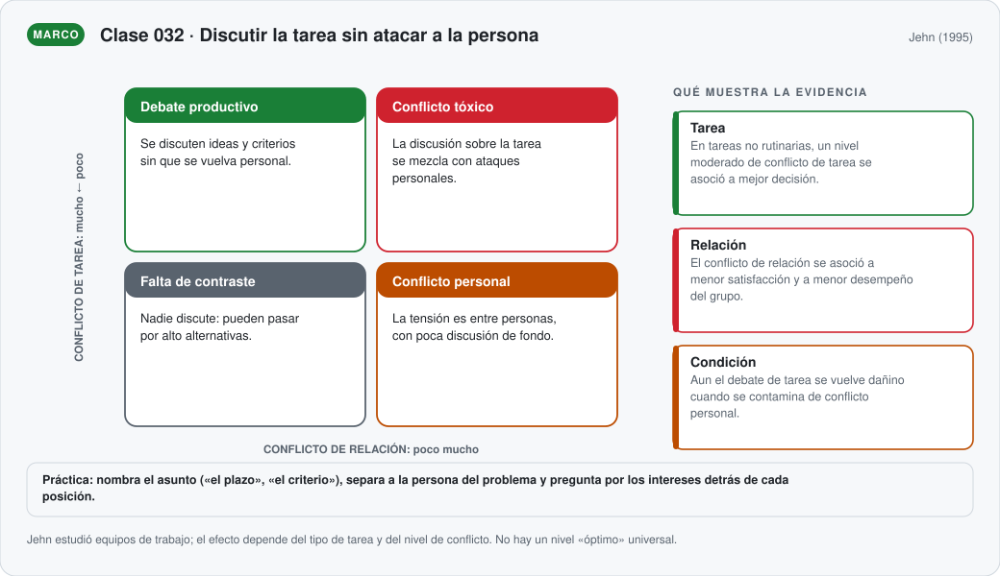

# Clase 032 — Conflicto productivo

<!-- nav:inicio -->
> **Parte 02 · Comunicación, influencia y presencia ejecutiva** — clase 8 de 12 · [índice de la parte](../../README.md) · [temario](../../../../SYLLABUS.md)
<!-- nav:fin -->

**Parte:** 02 — Comunicación, influencia y presencia ejecutiva  
**Nivel:** Etapa 1 — Profesional → Líder  
**Duración sugerida:** 150–180 minutos · **Estándar:** deep-class-v2

## 🎯 Propósito

Muchos equipos tratan todo conflicto como una falla y hacen lo posible por evitarlo. La investigación sobre grupos muestra algo más matizado: **hay conflictos que mejoran las decisiones y otros que las destruyen**, y se diferencian por su objeto. Discutir sobre cómo resolver una tarea puede ser productivo; discutir sobre quién es quién, casi nunca lo es.

Esta clase se apoya en el estudio de Karen Jehn sobre conflicto de tarea y de relación en grupos de trabajo, en la noción de seguridad psicológica de Amy Edmondson y en el enfoque de intereses de Fisher, Ury y Patton. Al terminar sabrás clasificar un conflicto, mantener el debate en la tarea, evitar que se vuelva personal y llevar la discusión desde posiciones a intereses.

## 📚 Resultados de aprendizaje

Al finalizar podrás:

1. **Distinguir** conflicto de tarea y de relación.
2. **Explicar** qué mostró la investigación sobre sus efectos y bajo qué condiciones.
3. **Conducir** un debate de tarea separando personas y problema.
4. **Pasar** de posiciones a intereses en una discusión.
5. **Detectar** cuando un conflicto de tarea se está contaminando de conflicto personal.

## 🧭 Agenda

| Tramo | Qué se hace |
|---|---|
| 0–20 min | Recuperación: recuerda una discusión de trabajo que mejoró una decisión y otra que la empeoró; ¿qué las diferenció? |
| 20–60 min | Tipos de conflicto, evidencia de Jehn y cuadrante de la clase. |
| 60–105 min | Ejemplo trabajado: un desacuerdo de prioridades convertido en debate de tarea. |
| 105–140 min | Caso ejecutivo: un equipo directivo dividido. |
| 140–170 min | Límites y entregable. |

## 🧩 Conceptos centrales

| Concepto | Definición | Cómo se reconoce |
|---|---|---|
| **Conflicto de tarea** | Desacuerdo sobre el contenido del trabajo: ideas, criterios, opiniones (Jehn, 1995). | Se discute qué hacer y cómo. |
| **Conflicto de relación** | Incompatibilidad entre personas, con tensión y fricción afectiva (Jehn, 1995). | Se discute sobre las personas. |
| **Seguridad psicológica** | Creencia compartida de que el equipo es seguro para correr riesgos interpersonales (Edmondson, 2018). | Se puede decir lo que se piensa sin temor a castigo. |
| **Posición** | Lo que una parte exige. | «Quiero entregar el viernes.» |
| **Interés** | La necesidad o preocupación que explica la posición (Fisher, Ury y Patton, 1983). | «Necesito que el cliente reciba antes del cierre.» |
| **Separar personas y problema** | Tratar el desacuerdo como un problema compartido, no como una disputa entre personas. | Se habla del criterio y no de quién lo propone. |

## 🧠 Modelo mental

**Cómo leer el diagrama.** El eje horizontal es el nivel de conflicto de relación; el vertical, el de tarea. La zona verde —mucho conflicto de tarea, poco de relación— es el debate productivo. La roja ocurre cuando el desacuerdo de tarea se mezcla con conflicto personal. Ausencia total de conflicto de tarea no es necesariamente buena: puede significar que nadie discute alternativas.

## 📖 Desarrollo

### 1. Qué dos conflictos hay

Jehn distinguió el conflicto de **tarea** —desacuerdos sobre ideas, opiniones y criterios del trabajo— del conflicto de **relación** —tensión interpersonal, fricción y sentimientos negativos—. La distinción es analítica; en la práctica se mezclan. Pero es útil porque cada tipo tiene un efecto distinto y exige una respuesta distinta.

### 2. Qué encontró la investigación

En su estudio de grupos de trabajo, Jehn halló que el conflicto de relación se asoció a **menor satisfacción** y a menor desempeño. El conflicto de tarea, en cambio, podía asociarse a **mejores resultados** en tareas no rutinarias, particularmente en niveles moderados, y no tanto en tareas rutinarias. El efecto dependía también del tipo de tarea y de la presencia simultánea de conflicto de relación. Los resultados son de grupos concretos y orientan, no son una ley.

### 3. Por qué el desacuerdo de tarea ayuda

Un debate sobre una tarea compleja obliga a explicitar supuestos, a considerar alternativas y a detectar errores. Un grupo en el que todos están de acuerdo desde el inicio puede dejar de examinar lo que no ve. Sin embargo, el debate solo sirve si las personas se sienten seguras de discrepar, y ahí entra la seguridad psicológica.

### 4. Seguridad psicológica

Edmondson define la seguridad psicológica como la creencia compartida de que el equipo es seguro para asumir riesgos interpersonales: preguntar, admitir un error, disentir. Es la condición para que el conflicto de tarea ocurra y para que no se convierta en personal. Un jefe que castiga la discrepancia elimina el debate y el aprendizaje; uno que la pide y agradece la hace posible.

### 5. Cuando el debate se vuelve personal

Hay señales de que un conflicto de tarea se está contaminando: se atribuyen motivos («lo dices para quedar bien»), aparecen generalizaciones («siempre»), se discute quién propone y no qué se propone, o alguien deja de hablar. Es el momento de detenerse y devolver la conversación al asunto: nombrar el criterio en discusión («estamos discutiendo la prioridad del cliente A») y separar a las personas del problema.

### 6. De posiciones a intereses

Fisher, Ury y Patton proponen discutir **intereses** y no posiciones. Dos personas que piden «entregar el viernes» y «entregar el lunes» tienen posiciones opuestas; sus intereses —cumplir con el cliente, tener calidad— pueden ser compatibles. Preguntar «¿qué necesitas que ocurra?» abre opciones que la posición oculta. Después, se generan alternativas y se elige con criterios objetivos.

### 7. Cerrar el debate

Un conflicto productivo termina en una **decisión clara**, con razones expuestas y un responsable, aun si no todos están de acuerdo. La regla de la clase: *disentir y comprometerse*. Quien disintió expone su razón y luego actúa con el equipo. Revisar más adelante con evidencia nueva es legítimo; reabrir la discusión sin evidencia, no.

## 📚 Lectura comparada

| Obra | Qué aporta | Qué no resuelve | Pregunta para contrastar |
|---|---|---|---|
| Jehn (1995) | Distinción y efectos del conflicto de tarea y de relación. | Es un estudio con una muestra concreta. | ¿Tu último desacuerdo era de tarea o de relación? |
| Edmondson (2018) | La seguridad psicológica como condición. | No da una técnica de debate. | ¿Quién calla en tu equipo y por qué? |
| Fisher, Ury y Patton (1983) | Intereses en lugar de posiciones. | No trata de equipos estables. | ¿Qué interés hay tras la posición del otro? |
| Stone, Patton y Heen (1999) | Cómo conducir la parte emocional. | No clasifica conflictos. | ¿Sobre qué conversación discuten? |
| Patterson et al. (2012) | Mantener el diálogo cuando hay mucho en juego. | No distingue tipos. | ¿Cuándo se vuelve peligroso hablar? |

## 🧮 Ejemplo trabajado

**Situación (hipotética).** Un equipo directivo discute si lanzar un producto en abril o esperar a septiembre. El gerente comercial insiste en abril; la gerente de operaciones, en septiembre. La discusión se calienta: «a ti solo te importa tu bono» / «tú nunca asumes un riesgo».

**Diagnóstico.** Hay conflicto de tarea (fecha y riesgo) y de relación (atribución de motivos). El debate se contaminó.

**Intervención del director.**

1. *Nombra el asunto:* «Estamos decidiendo la fecha de lanzamiento. Dejemos de hablar de motivos.»
2. *Separa posiciones de intereses.* Comercial: no perder la ventana de ventas de otoño. Operaciones: no lanzar con una capacidad de entrega insuficiente.
3. *Genera alternativas:* lanzar en abril solo en una región; lanzar en junio con una fase piloto; esperar a septiembre.
4. *Elige con criterios objetivos:* capacidad de entrega comprobada, ventas esperadas, riesgo reputacional.
5. *Decide y registra:* piloto regional en junio; la gerente de operaciones certificará la capacidad antes de ampliar.

**Qué muestra.** (1) Reconocer el tipo de conflicto permitió devolver la discusión a la tarea. (2) Los intereses eran compatibles. (3) La decisión quedó con un responsable y con un criterio de revisión.

## 🔀 Comparación y límites

**Conflicto frente a falta de acuerdo.** Un conflicto de tarea bien conducido puede terminar en acuerdo o en una decisión con disenso. No siempre debe resolverse buscando consenso: a veces la decisión corresponde a un responsable.

**Límites.** El estudio de Jehn es una investigación de grupos específicos y la relación entre conflicto de tarea y desempeño depende del tipo de tarea y de otras variables; no hay un nivel óptimo universal. Distinguir tarea y relación en la práctica es difícil, porque se alimentan entre sí. Y en entornos donde hay una asimetría de poder fuerte, el «debate abierto» puede ser una ficción si las personas temen consecuencias.

## 🪜 De profesional a owner

| Nivel | Cómo trabaja el conflicto |
|---|---|
| **Profesional** | Discute el contenido, no a la persona, y pide el criterio detrás de una posición. |
| **Jefe / Team Lead** | Provoca el desacuerdo de tarea y protege la seguridad de quien discrepa. |
| **Gerente** | Conduce el conflicto entre áreas hacia intereses y decisiones. |
| **CEO / Director** | Fomenta el debate en el equipo directivo y decide cuando el disenso persiste. |
| **Founder / Owner** | Aborda con socios los conflictos de relación antes de que dañen el negocio. |

## 🏢 Caso ejecutivo

El comité ejecutivo de una empresa de servicios se divide sobre si abrir una sucursal en una nueva ciudad. La gerente de finanzas se opone por el costo; el gerente comercial dice que «si no crecemos, nos quedamos atrás». Dos directores dejaron de hablarse. El gerente general debe tomar la decisión en tres semanas.

Entrega un **plan de conducción del conflicto** que contenga: (a) clasificación de lo que es de tarea y lo que es de relación, con hechos; (b) las posiciones y los intereses de cada parte; (c) cómo restablecerás la seguridad psicológica; (d) las alternativas y los criterios objetivos de elección; (e) cómo cerrarás con una decisión y un responsable; (f) cuándo y con qué evidencia se revisará.

## 🧪 Práctica

1. Clasifica los tres últimos desacuerdos de tu equipo como de tarea, de relación o mixtos.
2. Para uno, escribe las posiciones y los intereses de cada parte.
3. Escribe tres frases que devuelvan una discusión personal a la tarea.
4. Identifica quién calla en tu equipo y qué haces tú que lo explica.
5. Redacta cómo comunicarás una decisión con disenso: razones, responsable y fecha de revisión.

## ⚠️ Errores frecuentes

| Error | Por qué ocurre | Cómo corregirlo |
|---|---|---|
| Evitar todo conflicto | Se lo asocia a mal clima | Provocar el desacuerdo de tarea y proteger a quien discrepa. |
| Dejar que se vuelva personal | Se pierde el control del asunto | Nombrar el asunto y separar personas y problema. |
| Discutir posiciones | Es lo visible | Preguntar por intereses. |
| Buscar siempre consenso | Se teme decidir | Decidir con razones expuestas y un responsable. |
| Reabrir sin evidencia | Se insiste en la posición | Revisar solo con evidencia nueva. |
| Ignorar el poder | Se supone igualdad | Reconocer la asimetría y reforzar la seguridad. |

## ❓ Preguntas de comprobación

1. ¿Qué diferencia hay entre conflicto de tarea y de relación?
2. ¿Qué efectos asoció Jehn a cada uno?
3. ¿Por qué la seguridad psicológica es condición del conflicto productivo?
4. ¿Qué señales muestran que un debate de tarea se está volviendo personal?
5. ¿Qué diferencia hay entre una posición y un interés? Da un ejemplo.
6. ¿Qué significa «disentir y comprometerse»?
7. ¿Qué límite tiene el estudio de Jehn?

Claves de respuesta

1. El de tarea es sobre el contenido del trabajo; el de relación, sobre las personas y la fricción afectiva.
2. El de relación se asoció a menor satisfacción y desempeño; el de tarea, en tareas no rutinarias y en niveles moderados, a mejores resultados.
3. Porque permite discrepar sin temor a castigo, que es lo que hace posible el debate sin que se vuelva personal.
4. Atribución de motivos, generalizaciones («siempre»), discusión sobre quién propone y no sobre qué se propone, y personas que dejan de hablar.
5. La posición es lo que se exige; el interés, la necesidad que la explica. «Entregar el viernes» frente a «que el cliente reciba antes del cierre».
6. Quien discrepó expone su razón y luego actúa con el equipo según la decisión.
7. Es un estudio de grupos concretos; el efecto depende del tipo de tarea y de otras variables, y no hay un nivel óptimo universal.

## 📥 Entregable

Guarda en `portfolio/032-conflicto-productivo/`:

- `leadership-decision-brief.md` (plantilla [Leadership Decision Brief](../../../../templates/leadership-decision-brief.md)) con el plan de conducción del caso ejecutivo;
- `reading-note.md` con una tensión entre Jehn y Edmondson;
- `decision-journal.md` con la clasificación, las posiciones e intereses y la decisión.

## 📗 Fuentes y verificación

- Karen A. Jehn — *A Multimethod Examination of the Benefits and Detriments of Intragroup Conflict* (Administrative Science Quarterly, 1995). **Uso en esta clase:** conflicto de tarea y de relación y sus efectos. Lectura selectiva sobre **conflicto productivo**. **Localizador:** [DOI 10.2307/2393638](https://doi.org/10.2307/2393638).
- Amy C. Edmondson — *The Fearless Organization* (Wiley, 2018). **Uso en esta clase:** seguridad psicológica como condición del debate. Lectura selectiva sobre **conflicto productivo**. **Localizador:** [ISBN-13 9781119477242](https://openlibrary.org/isbn/9781119477242).
- Roger Fisher, William Ury & Bruce Patton — *Getting to Yes* (Hutchinson, 1983). **Uso en esta clase:** intereses en lugar de posiciones y separación de personas y problema. Lectura selectiva sobre **conflicto productivo**. **Localizador:** [ISBN-13 9780091493714](https://openlibrary.org/isbn/9780091493714).
- Douglas Stone, Bruce Patton & Sheila Heen — *Difficult Conversations* (Random House Audio, 1999). **Uso en esta clase:** conducir la parte emocional del conflicto. Lectura selectiva sobre **conflicto productivo**. **Localizador:** [ISBN-13 9780553525687](https://openlibrary.org/isbn/9780553525687).
- Kerry Patterson et al. — *Crucial Conversations* (McGraw Hill, 2012). **Uso en esta clase:** mantener el diálogo cuando hay mucho en juego. Lectura selectiva sobre **conflicto productivo**. **Localizador:** [ISBN-13 9781259005213](https://openlibrary.org/isbn/9781259005213).

> **Regla de fuentes para Conflicto productivo:** las obras anteriores estructuran las perspectivas de esta materia; cualquier norma, ley o estándar vivo mencionado debe comprobarse nuevamente en su fuente primaria vigente. Los ejemplos y casos son hipotéticos. El desarrollo es original y no reproduce capítulos protegidos.

<!-- pie:inicio -->
---

| Anterior | Índice | Siguiente |
|---|---|---|
| [← 031 · Conversaciones difíciles](../031-conversaciones-dificiles/README.md) | [Parte 02](../../README.md) · [Programa](../../../../SYLLABUS.md) | [033 · Persuasión ética e influencia →](../033-persuasion-etica-e-influencia/README.md) |
<!-- pie:fin -->
