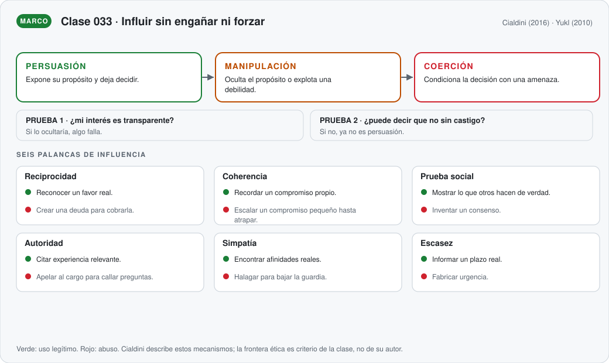

# Clase 033 — Persuasión ética e influencia

<!-- nav:inicio -->
> **Parte 02 · Comunicación, influencia y presencia ejecutiva** — clase 9 de 12 · [índice de la parte](../../README.md) · [temario](../../../../SYLLABUS.md)
<!-- nav:fin -->

**Parte:** 02 — Comunicación, influencia y presencia ejecutiva  
**Nivel:** Etapa 1 — Profesional → Líder  
**Duración sugerida:** 150–180 minutos · **Estándar:** deep-class-v2

## 🎯 Propósito

Dirigir es lograr que otros hagan cosas, y casi siempre sin poder ordenarlas: pares, otras áreas, clientes, socios y autoridades no responden al organigrama. Por eso influir es parte del trabajo. Y como toda capacidad útil, puede usarse bien o mal: la misma técnica que ayuda a que una propuesta sea escuchada puede usarse para que alguien acepte lo que no le conviene.

Esta clase da dos instrumentos. El primero es un **mapa de las palancas de influencia**, a partir de los seis principios que describe Robert Cialdini y de las tácticas de influencia que ordena Gary Yukl. El segundo es una **frontera ética** con dos pruebas simples para distinguir persuasión, manipulación y coerción. Al terminar sabrás reconocer qué palanca estás usando, cuándo cruza la línea y cómo detectar cuándo la usan contigo.

## 📚 Resultados de aprendizaje

Al finalizar podrás:

1. **Nombrar** los seis principios de influencia de Cialdini y dar un uso legítimo y un abuso de cada uno.
2. **Aplicar** las dos pruebas —transparencia del interés y libertad de rechazar— para clasificar una conducta.
3. **Reconocer** las tácticas de influencia hacia pares y superiores y elegir la más adecuada.
4. **Detectar** cuándo alguien aplica una de estas palancas sobre ti.
5. **Decidir** cuándo no influir, y qué hacer en lugar de ello.

## 🧭 Agenda

| Tramo | Qué se hace |
|---|---|
| 0–20 min | Recuperación: recuerda una vez que te convencieron de algo y luego lamentaste haber cedido; ¿qué palanca usaron? |
| 20–60 min | Las seis palancas y las dos pruebas éticas. |
| 60–105 min | Ejemplo trabajado: una negociación interna con cuatro conductas posibles. |
| 105–140 min | Caso ejecutivo: obtener apoyo para una propuesta sin cruzar la línea. |
| 140–170 min | Límites y entregable. |

## 🧩 Conceptos centrales

| Concepto | Definición | Cómo se reconoce |
|---|---|---|
| **Persuasión** | Influencia que expone su propósito y deja decidir (criterio de la clase). | El interés es visible y se puede decir que no. |
| **Manipulación** | Influencia que oculta su propósito o explota una debilidad (criterio de la clase). | Se esconde el interés o se aprovecha una vulnerabilidad. |
| **Coerción** | Influencia que condiciona la decisión con una amenaza (criterio de la clase). | Rechazar tiene un costo impuesto por quien influye. |
| **Reciprocidad** | Tendencia a devolver lo recibido (Cialdini, 2016). | Un favor genera una obligación percibida. |
| **Coherencia y compromiso** | Tendencia a actuar de acuerdo con compromisos previos (Cialdini, 2016). | Se recuerda lo que la persona dijo antes. |
| **Prueba social** | Tendencia a seguir lo que hacen otros (Cialdini, 2016). | Se invoca lo que «todos» hacen. |
| **Autoridad, simpatía y escasez** | Los otros tres principios descritos por Cialdini (2016). | Se apela a la experiencia, a la afinidad o a la rareza. |

## 🧠 Modelo mental

**Cómo leer el diagrama.** Arriba, el espectro: de la persuasión a la coerción disminuye la libertad de quien recibe. Debajo, dos preguntas permiten ubicar una conducta. Abajo, las seis palancas: la columna verde de cada una es un uso legítimo; la roja, su abuso. La misma palanca sirve a ambos fines; lo que cambia es la transparencia y la libertad.

## 📖 Desarrollo

### 1. Influir es parte del trabajo

Yukl describe la influencia como el uso del poder para lograr que otros hagan o acepten algo, y señala que en las organizaciones se ejerce hacia abajo, lateralmente y hacia arriba. Quien no tiene autoridad formal sobre la persona debe influir con otras herramientas: razones, relación, coaliciones, reciprocidad. No influir es una decisión, y suele dejar la agenda en manos de quien sí lo hace.

### 2. Los seis principios de Cialdini

Cialdini describe seis tendencias que orientan cómo las personas deciden, a partir de investigación y de su observación de profesionales de la persuasión. **Reciprocidad:** devolvemos lo recibido. **Coherencia y compromiso:** tendemos a ser consistentes con lo que dijimos o hicimos. **Prueba social:** miramos lo que hacen otros. **Autoridad:** damos peso a quien percibimos experto. **Simpatía:** accedemos más a quien nos agrada. **Escasez:** valoramos lo que parece limitado. Son atajos mentales útiles que pueden ser explotados.

### 3. Uso legítimo y abuso

Cada palanca tiene un uso que ayuda a decidir bien y otro que lo dificulta. **Reciprocidad:** reconocer un favor real frente a crear una deuda para cobrarla. **Coherencia:** recordar un compromiso propio frente a escalar compromisos pequeños hasta atrapar. **Prueba social:** mostrar lo que otros hacen de verdad frente a inventar un consenso. **Autoridad:** citar experiencia relevante frente a usar el cargo para impedir preguntas. **Simpatía:** encontrar afinidades reales frente a halagar para bajar la guardia. **Escasez:** informar un plazo real frente a fabricar urgencia.

### 4. Dos pruebas para la frontera

Cialdini describe los mecanismos; la frontera ética es un criterio de esta clase, y se aplica con dos preguntas. **¿Mi interés es transparente?** Si lo ocultaría o me incomodaría que la otra persona lo supiera, algo falla. **¿Puede la otra persona decir que no sin castigo?** Si no, ya no es persuasión. Una conducta que supera ambas pruebas es persuasión; si falla la primera, manipulación; si falla la segunda, coerción.

### 5. Las tácticas de influencia en la organización

Yukl ordena tácticas que se usan en el trabajo: persuasión racional (argumentos y evidencia), llamados inspiradores, consulta, intercambio, coaliciones, legitimación (apelar a una norma o a una autoridad) y presión, entre otras. No todas valen para todo: la **persuasión racional** y la **consulta** suelen ser más aceptadas y duraderas que la **presión**, que obtiene obediencia sin compromiso. Elegir la táctica es parte del diseño del mensaje.

### 6. Detectar la influencia sobre ti

Cuando sientas urgencia, deuda o la tentación de aceptar para ser coherente, hazte tres preguntas: **¿quién gana con que acepte?**, **¿qué información me falta?** y **¿qué pasaría si espero un día?** Pedir tiempo y consultar a un tercero independiente reduce la fuerza de casi todas las palancas, y es una práctica sensata ante decisiones importantes.

### 7. Cuando no influir

Hay situaciones donde conviene no influir sino informar o escuchar: cuando la decisión es de otro y debe ser libre, cuando existe una asimetría que haría la influencia equivalente a presión, o cuando tu interés está en conflicto con el de la persona. En esos casos se declara el interés y se deja decidir.

## 📚 Lectura comparada

| Obra | Qué aporta | Qué no resuelve | Pregunta para contrastar |
|---|---|---|---|
| Cialdini (2016) | Seis principios de influencia. | La frontera ética no es su objeto central. | ¿Qué palanca usas y puedes decirlo en voz alta? |
| Yukl (2010) | Tácticas de influencia en la organización. | No es un tratado de ética. | ¿Qué táctica usarías sin conocer tu poder? |
| Carnegie (2004) | Interés genuino por el otro como base de la relación. | Es un texto de divulgación, anterior a la investigación citada. | ¿Qué te interesa de esta persona? |
| Heath y Heath (2007) | Cómo hacer un mensaje comprensible. | No trata de ética. | ¿Tu mensaje se entiende sin presión? |
| Goleman, Boyatzis y McKee (2002) | Cómo el líder influye por su estado emocional. | No clasifica tácticas. | ¿Qué estado usas para influir? |

## 🧮 Ejemplo trabajado

**Situación (hipotética).** Una jefa de ventas quiere que el área de operaciones priorice un pedido urgente de un cliente grande. Considera cuatro conductas.

| Conducta | Palanca | ¿Interés transparente? | ¿Puede decir no sin castigo? | Clasificación |
|---|---|---|---|---|
| «Es un cliente de USD 400.000 anuales y el plazo contractual es el viernes. ¿Qué necesitarías para cumplirlo?» | Escasez real, persuasión racional | Sí | Sí | **Persuasión** |
| «Te cubrí en la auditoría del mes pasado; ahora me debes esta.» | Reciprocidad convertida en deuda | Parcial | Sí, pero con costo relacional | **Manipulación** si la deuda se fabricó |
| «Todos los demás jefes ya aceptaron priorizar mi pedido.» (no es cierto) | Prueba social inventada | No | Sí | **Manipulación** |
| «Si no lo haces, informaré a la gerencia de que tu área bloqueó la venta.» | Amenaza | Sí | No | **Coerción** |

**Reescritura de la conducta 2.** «Quiero pedir tu ayuda: el pedido es urgente y no tengo cómo cumplirlo sin tu área. Entiendo si tienes otra prioridad; ¿qué podemos hacer?» Mantiene la relación y declara el interés.

**Qué muestra.** (1) Una misma palanca puede ser legítima o un abuso. (2) Las dos pruebas permiten clasificar sin discutir la intención. (3) Si la persuasión falla, la salida legítima es escalar con transparencia, no coaccionar.

## 🔀 Comparación y límites

**Influir frente a manipular.** Ambos buscan un cambio; la diferencia está en la transparencia y en la libertad. Una conducta puede ser eficaz y éticamente inaceptable.

**Límites.** Los principios de Cialdini se han desarrollado a partir de estudios y de observación de prácticas de venta y marketing; su peso relativo varía con la cultura y el contexto. La clasificación en persuasión, manipulación y coerción es un criterio de trabajo de la clase y existen casos intermedios. Y conviene recordar que la relación de poder cambia la lectura: lo que un par ve como invitación, un subordinado puede sentirlo como presión.

## 🪜 De profesional a owner

| Nivel | Cómo influye |
|---|---|
| **Profesional** | Usa razones y evidencia para que su propuesta sea escuchada. |
| **Jefe / Team Lead** | Influye por la consulta y el ejemplo, y cuida que su autoridad no se use para callar. |
| **Gerente** | Construye coaliciones con otras áreas declarando sus intereses. |
| **CEO / Director** | Reconoce que su cargo amplifica cualquier palanca y adopta límites explícitos. |
| **Founder / Owner** | Influye sobre clientes, socios e inversionistas con transparencia: su reputación es su activo. |

## 🏢 Caso ejecutivo

Un gerente de proyectos necesita que otras tres áreas cedan personal durante dos meses para un lanzamiento. No tiene autoridad sobre ellas. Dos jefes se oponen; uno de ellos le debe un favor. La fecha del lanzamiento es real y tiene penalizaciones contractuales. El director general apoya el lanzamiento, pero no ha dicho que obligará a nadie.

Entrega un **plan de influencia** que contenga: (a) los intereses de cada área y los tuyos, declarados; (b) las palancas y tácticas que usarás y por qué son legítimas; (c) la clasificación de cada conducta con las dos pruebas; (d) lo que no harás; (e) cómo reaccionarías si alguien usa una palanca sobre ti; (f) cuándo y cómo escalarás con transparencia.

## 🧪 Práctica

1. Identifica la palanca que más usas y escribe un uso legítimo y un abuso posible.
2. Aplica las dos pruebas a tres conductas de tu semana.
3. Reescribe una petición manipulativa como una persuasión transparente.
4. Piensa en la última decisión que tomaste con urgencia: ¿quién fijó el plazo?
5. Define una regla personal: ante una decisión importante, ¿a quién consultas y cuánto esperas?

## ⚠️ Errores frecuentes

| Error | Por qué ocurre | Cómo corregirlo |
|---|---|---|
| Ocultar el interés | Se teme que el otro rechace | Declararlo y dar razones. |
| Fabricar urgencia | La presión acelera la respuesta | Informar solo plazos reales. |
| Usar el cargo para callar | Es eficaz a corto plazo | Responder las preguntas con razones. |
| Cobrar favores como deudas | Se considera un intercambio | Pedir ayuda declarando que se puede negar. |
| No influir | Se confunde con manipular | Persuadir con evidencia y consulta. |
| Ignorar la asimetría de poder | Se supone igualdad | Reconocer que tu cargo cambia la lectura. |

## ❓ Preguntas de comprobación

1. ¿Cuáles son los seis principios de influencia de Cialdini?
2. ¿Qué dos preguntas distinguen persuasión, manipulación y coerción?
3. Da un uso legítimo y un abuso de la escasez.
4. ¿Qué tácticas de Yukl suelen generar compromiso y cuál obediencia sin compromiso?
5. ¿Qué haces cuando sientes urgencia y deuda ante una decisión importante?
6. ¿Cuándo conviene no influir?
7. ¿Qué límite tiene la clasificación en persuasión, manipulación y coerción?

Claves de respuesta

1. Reciprocidad, coherencia y compromiso, prueba social, autoridad, simpatía y escasez.
2. ¿Es transparente mi interés? ¿Puede la otra persona decir que no sin castigo?
3. Legítimo: informar un plazo real. Abuso: fabricar urgencia.
4. La persuasión racional y la consulta generan compromiso; la presión obtiene obediencia sin compromiso.
5. Pregunto quién gana, qué información me falta, pido tiempo y consulto a un tercero independiente.
6. Cuando la decisión es de otro y debe ser libre, cuando hay una asimetría que convertiría la influencia en presión o cuando mi interés está en conflicto con el suyo.
7. Es un criterio de trabajo de la clase y existen casos intermedios; la relación de poder cambia la lectura.

## 📥 Entregable

Guarda en `portfolio/033-persuasion-etica-e-influencia/`:

- `risk-governance-brief.md` (plantilla [Risk & Governance Brief](../../../../templates/risk-governance-brief.md)) con el plan de influencia del caso ejecutivo;
- `reading-note.md` con una tensión entre Cialdini y Yukl;
- `decision-journal.md` con las conductas clasificadas y las reglas personales que fijaste.

## 📗 Fuentes y verificación

- Robert B. Cialdini — *Influence* (HarperCollins Publishers and Blackstone Audio, 2016). **Uso en esta clase:** los seis principios de influencia. Lectura selectiva sobre **persuasión ética e influencia**. **Localizador:** [ISBN-13 9781624608049](https://openlibrary.org/isbn/9781624608049).
- Gary Yukl — *Leadership in Organizations* (Prentice Hall, 2010). **Uso en esta clase:** tácticas de influencia en la organización. Lectura selectiva sobre **persuasión ética e influencia**. **Localizador:** [ISBN-13 9780132424318](https://openlibrary.org/isbn/9780132424318).
- Dale Carnegie — *How to Win Friends and Influence People* (Min zhu yu jian she chu ban she, 2004). **Uso en esta clase:** el interés genuino por el otro como base de la relación. Lectura selectiva sobre **persuasión ética e influencia**. **Localizador:** [ISBN-13 9787801121820](https://openlibrary.org/isbn/9787801121820).
- Chip Heath & Dan Heath — *Made to Stick* (Penguin Random House, 2007). **Uso en esta clase:** hacer un mensaje comprensible sin presión. Lectura selectiva sobre **persuasión ética e influencia**. **Localizador:** [ISBN-13 9781905211562](https://openlibrary.org/isbn/9781905211562).
- Daniel Goleman, Richard Boyatzis & Annie McKee — *Primal Leadership* (Harvard Business School Press, 2002). **Uso en esta clase:** el estado emocional como forma de influencia. Lectura selectiva sobre **persuasión ética e influencia**. **Localizador:** [ISBN-13 9781578514861](https://openlibrary.org/isbn/9781578514861).

> **Regla de fuentes para Persuasión ética e influencia:** las obras anteriores estructuran las perspectivas de esta materia; cualquier norma, ley o estándar vivo mencionado debe comprobarse nuevamente en su fuente primaria vigente. Los ejemplos y casos son hipotéticos, con cifras ilustrativas. El desarrollo es original y no reproduce capítulos protegidos.

<!-- pie:inicio -->
---

| Anterior | Índice | Siguiente |
|---|---|---|
| [← 032 · Conflicto productivo](../032-conflicto-productivo/README.md) | [Parte 02](../../README.md) · [Programa](../../../../SYLLABUS.md) | [034 · Mapa de stakeholders y poder →](../034-mapa-de-stakeholders-y-poder/README.md) |
<!-- pie:fin -->
