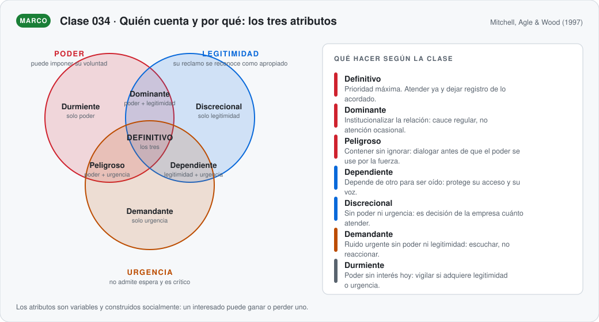

# Clase 034 — Mapa de stakeholders y poder

<!-- nav:inicio -->
> **Parte 02 · Comunicación, influencia y presencia ejecutiva** — clase 10 de 12 · [índice de la parte](../../README.md) · [temario](../../../../SYLLABUS.md)
<!-- nav:fin -->

**Parte:** 02 — Comunicación, influencia y presencia ejecutiva  
**Nivel:** Etapa 1 — Profesional → Líder  
**Duración sugerida:** 150–180 minutos · **Estándar:** deep-class-v2

## 🎯 Propósito

Una organización se relaciona con decenas de grupos: clientes, trabajadores, socios, proveedores, autoridades, vecinos, medios. Nadie puede atenderlos a todos con la misma intensidad, y equivocarse al elegir tiene dos costos opuestos: **ignorar a quien podía detener la decisión**, o **gastar la agenda en quien hacía ruido y no tenía ni poder ni derecho a ser atendido**.

Esta clase enseña un criterio para decidir a quién se atiende primero y con qué tipo de relación: el **modelo de prominencia** de Mitchell, Agle y Wood (1997), que clasifica a cada interesado por tres atributos —poder, legitimidad y urgencia— y de esa clasificación deriva qué hacer. Al terminar podrás construir un mapa donde cada ubicación esté respaldada por evidencia, y rehacerlo cuando la situación cambie.

## 📚 Resultados de aprendizaje

Al finalizar podrás:

1. **Definir** interesado, poder, legitimidad, urgencia y prominencia con las palabras de la teoría, no con sinónimos.
2. **Clasificar** a un actor en una de las siete clases del modelo, justificando cada atributo con un hecho observable.
3. **Explicar** por qué un mismo actor cambia de clase cuando cambia uno de sus atributos, y anticipar ese cambio.
4. **Traducir** la clase a una conducta de relación: monitorear, institucionalizar, dialogar, proteger la voz o atender de inmediato.
5. **Reconocer** el límite del modelo: describe a quién prestan atención los directivos, no a quién se le debe consideración moral.

## 🧭 Agenda

| Tramo | Qué se hace |
|---|---|
| 0–20 min | Recuperación: lista los grupos que afectarían tu última decisión importante y ordénalos por intuición; guarda la lista. |
| 20–60 min | Los tres atributos y las siete clases, con el diagrama de la clase. |
| 60–95 min | Ejemplo trabajado: se clasifican seis actores y se rehace el mapa cuando uno cambia. |
| 95–130 min | Caso ejecutivo: mapa, prioridad de atención y primer contacto con cada actor. |
| 130–150 min | Contraste con tu intuición inicial, límites del modelo y entregable. |

## 🧩 Conceptos centrales

| Concepto | Definición | Cómo se reconoce en un caso |
|---|---|---|
| **Interesado (stakeholder)** | Según Freeman (1984), cualquier grupo o individuo que puede afectar o ser afectado por el logro de los objetivos de la organización. | Se puede nombrar qué hace o qué le ocurre a causa de la decisión. |
| **Poder** | Capacidad de un actor de lograr que otro haga algo que de otro modo no haría, mediante recursos coercitivos, utilitarios o normativos. | Puede bloquear, retrasar, sancionar, retirar un recurso o mover la opinión. |
| **Legitimidad** | Percepción generalizada de que las acciones de un actor son deseables o apropiadas dentro de un sistema socialmente construido de normas, valores y creencias. | Su reclamo se apoya en un contrato, una ley, un derecho o una norma aceptada. |
| **Urgencia** | Grado en que el reclamo exige atención inmediata: sensibilidad al tiempo y criticidad para el actor. | Hay un plazo cercano y un daño relevante si se espera. |
| **Prominencia (salience)** | Grado en que los directivos dan prioridad a los reclamos de un actor. | Mide dónde va la atención real, no dónde debería ir. |
| **Latente, expectante, definitivo** | Según tenga uno, dos o los tres atributos. Cada grupo tiene subtipos con nombre propio. | Se cuenta cuántos de los tres atributos se pueden respaldar con evidencia. |

## 🧠 Modelo mental

**Cómo leer el diagrama.** Cada círculo es un atributo. Un actor con **un** atributo es latente: puede esperar. Con **dos** es expectante: ya hay una expectativa de atención. Con **los tres** es definitivo: la atención es inmediata. Lo útil no es el nombre de la región sino la pregunta que obliga a hacer sobre cada atributo: *¿qué hecho lo demuestra?*

## 📖 Desarrollo

### 1. Por qué no todos los interesados cuentan igual

La definición de Freeman es deliberadamente amplia: cualquiera que pueda afectar o ser afectado es un interesado. Esa amplitud tiene un costo práctico: si todos cuentan, el directivo no tiene criterio para priorizar. Mitchell, Agle y Wood plantean la pregunta que Freeman deja abierta: **quién y qué realmente cuenta** para quienes dirigen. Su respuesta no es moral sino descriptiva: cuenta para el directivo quien reúne atributos que lo hacen difícil de ignorar.

La consecuencia pedagógica es doble. Primero, el mapa es una herramienta de **gestión de la atención**, no un registro de derechos. Segundo, el mapa se puede equivocar: un atributo mal evaluado produce un actor mal ubicado.

### 2. Los tres atributos, uno por uno

**Poder.** Los autores distinguen tres fuentes: **coercitiva** (fuerza o amenaza: un paro, una sanción), **utilitaria** (recursos materiales: dinero, suministro, contratos) y **normativa** (recursos simbólicos: prestigio, capacidad de mover la opinión). Poder no es posición en el organigrama: un proveedor único tiene poder utilitario sobre una planta aunque nadie lo haya tratado como "alto".

**Legitimidad.** Es la percepción de que el reclamo es apropiado dentro de un sistema de normas. No es lo mismo que tener razón ni que tener poder: se apoya en un contrato, una ley, un derecho reconocido o una expectativa social aceptada. Un actor puede tener un reclamo legítimo y ningún poder (los vecinos de una planta), o mucho poder y ningún reclamo legítimo (quien amenaza con filtrar información privada).

**Urgencia.** Combina dos condiciones: que el asunto **no admita espera** (sensibilidad al tiempo) y que sea **crítico** para el actor. Un reclamo con plazo pero sin importancia no es urgente; uno importante sin plazo tampoco. La urgencia es el atributo que más cambia con los días.

### 3. Las siete clases y lo que implican

| Clase | Atributos | Qué significa para quien dirige | Conducta que sugiere la clase |
|---|---|---|---|
| **Durmiente** | Poder | Puede actuar, pero hoy no tiene reclamo legítimo ni urgente. | Monitorear: ¿puede ganar legitimidad o urgencia? |
| **Discrecional** | Legitimidad | Tiene un reclamo apropiado, pero ni poder ni urgencia. | Atender por decisión propia; no hay presión externa. |
| **Demandante** | Urgencia | Insiste, pero sin poder ni derecho reconocido. | Escuchar sin reaccionar; es más ruido que riesgo. |
| **Dominante** | Poder + legitimidad | Su influencia está respaldada por un derecho; recibe atención casi segura. | Institucionalizar: un cauce regular y un responsable. |
| **Peligroso** | Poder + urgencia | Puede usar el poder con prisa y sin derecho que lo limite. | Contener con diálogo antes de que actúe; evitar la escalada. |
| **Dependiente** | Legitimidad + urgencia | Tiene un reclamo legítimo y apremiante, pero necesita a otro para ser oído. | Proteger su acceso y su voz; es quien más se pierde en un mapa de poder. |
| **Definitivo** | Los tres | Todo coincide: la atención es inmediata. | Atender ya, registrar los compromisos y revisar a menudo. |

### 4. Los atributos cambian, y a veces sin que el actor lo sepa

Los autores subrayan que los atributos son **variables, no permanentes**: un actor puede ganar o perder uno según el contexto. También son **construidos socialmente**: la legitimidad y la urgencia dependen de cómo otros perciben la situación, no de una propiedad objetiva. Y existe la posibilidad de que un actor **tenga** un atributo y no lo **ejerza**, o ni siquiera sepa que lo tiene.

Para la práctica esto significa que el mapa tiene fecha y se rehace ante cada cambio relevante: un anuncio, un plazo, una alianza, una denuncia. El actor dependiente es el caso típico de cambio: suele adquirir poder **aliándose** con otro actor que lo tiene.

### 5. De la clasificación a la relación institucional

El mapa solo vale si cambia lo que se hace. Para cada actor importante, define cuatro cosas: **quién lo atiende** (un responsable con nombre), **por qué cauce** (reunión periódica, mesa, canal), **qué se le comunica** y **qué se registra**. En el caso de autoridades, gremios y comunidades, esa tarea la sostiene la función de **asuntos corporativos**: construir la relación *antes* de la crisis, de modo que en una fiscalización o un conflicto ya exista confianza y un interlocutor conocido.

Regla de coherencia: lo que se dice a la autoridad no puede contradecir lo que se dice al mercado, a los trabajadores o a los vecinos. Los actores se hablan entre sí.

### 6. Límites del modelo

El modelo **describe** la prominencia percibida por los directivos; no afirma a quién se le debe consideración. Un actor sin poder, legitimidad reconocida ni urgencia —por ejemplo, quienes serán afectados en el futuro— quedaría fuera del mapa aunque la decisión lo perjudique. Quien usa el modelo para decidir **solo** a quién atiende comete un error ético y también práctico: los actores olvidados suelen ser los que mañana adquieren poder.

Por eso la clase pide siempre una segunda pasada con una pregunta distinta: *¿a quién afecta esta decisión, aunque no pueda reclamar?* Es la pregunta amplia de Freeman, y complementa —no sustituye— la clasificación.

## 📚 Lectura comparada

| Obra | Qué aporta a esta clase | Qué no resuelve | Pregunta para contrastar |
|---|---|---|---|
| Freeman (1984/2010) | La definición amplia de interesado y el enfoque de gestión por relaciones. | No dice cómo priorizar. | ¿Quién queda en tu mapa solo por esta definición? |
| Mitchell, Agle y Wood (1997) | Los tres atributos, las siete clases y su dinámica. | No juzga qué es justo atender. | ¿Qué hecho respalda cada atributo que asignaste? |
| Tricker (2019) | El contexto del gobierno corporativo: ante quién rinde cuentas la empresa. | No es una guía de mapeo. | ¿Qué interesados tienen un cauce formal de reclamo? |
| Yukl (2010) | Fuentes y uso del poder y la influencia en las organizaciones. | No clasifica interesados externos. | ¿De qué tipo es el poder del actor que clasificaste? |
| Watkins (2003) | Construir alianzas y relaciones en una transición de cargo. | Trata del nuevo líder, no del mapa. | ¿A quién tendrías que escuchar primero en un cargo nuevo? |

Después de leer, escribe una discrepancia real entre dos fuentes y qué cambia en tu mapa por ella.

## 🧮 Ejemplo trabajado

**Situación (hipotética, para practicar).** *Distribuidora Andina* tiene una bodega en un barrio residencial. Los vecinos reclaman por el ruido de los camiones nocturnos. Debe decidir si amplía el turno de noche. Clasifiquemos seis actores con el método: asignar o no cada atributo y **escribir el hecho que lo respalda**.

| Actor | Poder | Legitimidad | Urgencia | Clase | Respaldo |
|---|:-:|:-:|:-:|---|---|
| Autoridad sanitaria municipal | Sí | Sí | No | Dominante | Puede sancionar y fiscalizar por ley; hoy no hay plazo abierto. |
| Sindicato de choferes | Sí | Sí | Sí | **Definitivo** | Puede paralizar el reparto, tiene derecho a negociar y anunció un paro para el viernes. |
| Vecinos de la bodega | No | Sí | Sí | Dependiente | Su reclamo por descanso es aceptado socialmente y ocurre cada noche; no pueden sancionar. |
| Ex socio que amenaza con denunciar en medios | Sí | No | Sí | Peligroso | Puede dañar la reputación; su reclamo contractual ya fue resuelto; amenaza para esta semana. |
| Proveedor de pallets con contrato vigente | No | Sí | No | Discrecional | Tiene contrato y reclamos válidos, sin presión ni plazo. |
| Cuenta anónima que critica en redes | No | No | Sí | Demandante | Insiste a diario, sin respaldo de hechos ni capacidad de sanción. |

**Primera lectura.** La atención inmediata es del sindicato (definitivo). Después, contener al ex socio con una conversación formal y asesoría legal, y proteger la voz de los vecinos, que no tienen poder pero sí un reclamo legítimo.

**El mapa cambia.** La autoridad municipal recibe los reclamos de los vecinos y abre una fiscalización. Los vecinos, antes dependientes, **ganan poder por alianza** con la autoridad: pasan a definitivos. Si el mapa no se rehace, la empresa seguiría tratándolos como actores sin poder, y la decisión de ampliar el turno nocturno sería la más cara.

**Qué muestra el ejemplo.** (1) Cada celda necesita un hecho, no una impresión. (2) La clase determina la conducta. (3) El mapa tiene fecha: un evento externo reordena las prioridades sin que ningún actor haya cambiado en sí mismo.

## 🔀 Comparación y límites

**Frente a una matriz de dos ejes (poder × interés).** La matriz de dos ejes, de uso muy extendido, ordena rápido, pero no distingue si el poder está respaldado por un derecho, ni si el reclamo apremia, ni cómo cambia. Pierde justamente al dependiente y confunde al peligroso con el dominante. El modelo de tres atributos cuesta más y es más preciso.

**Límites que debes declarar al presentar un mapa.**

- Los atributos son **percepciones** de quien mapea; otra persona podría puntuar distinto. Registra quién lo evaluó y con qué evidencia.
- El mapa es **fotografía**: pierde vigencia con el primer cambio relevante.
- No decide qué es justo. Sirve para ordenar la atención y debe acompañarse de la pregunta sobre quién resulta afectado sin poder reclamar.

## 🪜 De profesional a owner

| Nivel | Cómo usa el mapa |
|---|---|
| **Profesional** | Antes de proponer un cambio, identifica quién lo implementa y quién lo sufre, y los consulta. |
| **Jefe / Team Lead** | Mapea a quienes dependen de su equipo y a quienes su equipo necesita para entregar. |
| **Gerente** | Gestiona el cauce con otras áreas, proveedores y clientes clave, con responsables y cadencia. |
| **CEO / Director** | Decide la relación con autoridades, trabajadores, inversionistas y medios, y qué llega al directorio. |
| **Founder / Owner** | Cuida a los socios, primeros clientes y reguladores; su legitimidad es su activo y la asimetría de información es su riesgo. |

El alcance crece, y con él el costo de dejar a un actor sin mapear.

## 🏢 Caso ejecutivo

Una empresa de servicios prepara el cierre de una oficina regional. Ya se conoce la decisión en la gerencia general, pero no se ha comunicado. Los trabajadores de la oficina sospechan; el sindicato nacional pide una reunión; la autoridad laboral tiene una fiscalización pendiente en esa región; un medio local preguntó por rumores; los clientes de la zona dependen de esa oficina y no saben nada.

Entrega un **mapa de interesados y legitimidad** que contenga: (a) los actores y su clasificación con el hecho que respalda cada atributo; (b) el orden de atención en las próximas 72 horas; (c) quién habla con cada actor, por qué cauce y con qué mensaje (el mismo hecho para todos); (d) a quién afecta la decisión sin que pueda reclamar y qué harás por ellos; (e) qué evento cambiaría el mapa y cuándo lo revisarás.

## 🧪 Práctica

1. Rehace la lista de la recuperación inicial con el método: asigna cada atributo y escribe el hecho que lo respalda. ¿Cuántos actores cambiaron de lugar?
2. Elige un actor que hoy sea dependiente en tu entorno. ¿Con quién podría aliarse para ganar poder? ¿Qué te conviene hacer antes de que ocurra?
3. Identifica un actor que clasificaste como demandante. Escribe el hecho que lo ubica ahí y la conducta que seguirías para escucharlo sin reaccionar.
4. Escribe la respuesta a esta pregunta: *¿quién resulta afectado por mi decisión y no puede reclamar?*
5. Define un evento que obligaría a rehacer tu mapa y fija una fecha de revisión.

## ⚠️ Errores frecuentes

| Error | Por qué ocurre | Cómo corregirlo |
|---|---|---|
| Asignar atributos por impresión | Se mapea de memoria o por simpatía | Exigir un hecho para cada atributo. |
| Confundir poder con legitimidad | Quien puede imponer parece tener razón | Preguntar en qué contrato, norma o derecho se apoya el reclamo. |
| Tratar la urgencia como importancia | El que grita parece más grave | Verificar el plazo y el daño crítico. |
| Ignorar al dependiente | No tiene poder, así que no aparece en el mapa de poder | Reservar un espacio para quienes tienen reclamo legítimo sin voz. |
| Dejar el mapa fijo | Se hizo una vez y se archivó | Fechar el mapa y rehacerlo ante cada evento. |
| Usar el mapa como filtro moral | Se confunde atención con deber | Añadir la pregunta de Freeman: a quién afecta, aunque no pueda reclamar. |

## ❓ Preguntas de comprobación

1. ¿Cuáles son los tres atributos del modelo de Mitchell, Agle y Wood y qué distingue a un interesado latente de uno definitivo?
2. Un grupo de vecinos tiene un reclamo legítimo y apremiante, pero ninguna capacidad de presión. ¿En qué clase cae y por qué es el más fácil de perder?
3. Un actor amenaza con una acción dañina esta semana, y no tiene ningún derecho que lo respalde. ¿Qué clase es y qué conducta sugiere?
4. ¿Por qué decimos que los atributos son «construidos socialmente»? Da un ejemplo en que la legitimidad cambie sin que el actor haga nada.
5. ¿Qué diferencia práctica hay entre institucionalizar la relación con un dominante y atender de inmediato a un definitivo?
6. ¿Qué limita el modelo y qué pregunta de Freeman lo complementa?

Claves de respuesta

1. Poder, legitimidad y urgencia. El latente tiene uno solo; el definitivo tiene los tres.
2. Dependiente. Se pierde porque no genera presión: necesita que otro actor lo respalde.
3. Peligroso (poder + urgencia, sin legitimidad). Contener con diálogo formal antes de que actúe.
4. Porque dependen de cómo otros perciben el sistema de normas. Ejemplo: una regulación nueva convierte en legítimo un reclamo que antes era solo una queja.
5. Con el dominante se construye un cauce regular y sostenido; con el definitivo se actúa ya y se revisa con frecuencia.
6. Describe a quién prestan atención los directivos, no a quién se le debe consideración. La pregunta de Freeman: quién puede afectar o ser afectado, aunque no pueda reclamar.

## 📥 Entregable

Guarda en `portfolio/034-mapa-de-stakeholders-y-poder/`:

- `stakeholder-legitimacy-map.md` (plantilla [mapa de interesados y legitimidad](../../../../templates/stakeholder-legitimacy-map.md)) con el caso ejecutivo resuelto;
- `reading-note.md` con una discrepancia entre dos de las fuentes y su efecto en el mapa;
- `decision-journal.md` con la fecha del mapa, quién evaluó cada atributo y el evento que obligaría a rehacerlo.

## 📗 Fuentes y verificación

- R. Edward Freeman — *Strategic Management: A Stakeholder Approach* (Cambridge University Press, 2010). **Uso en esta clase:** la definición amplia de interesado y la pregunta de a quién afecta la decisión. Lectura selectiva sobre **mapa de stakeholders y poder**. **Localizador:** [ISBN-13 9780521151740](https://openlibrary.org/isbn/9780521151740).
- Ronald K. Mitchell, Bradley R. Agle & Donna J. Wood — *Toward a Theory of Stakeholder Identification and Salience: Defining the Principle of Who and What Really Counts* (Academy of Management Review, 1997). **Uso en esta clase:** los tres atributos, las siete clases y su dinámica, que organizan toda la clase. Lectura selectiva sobre **mapa de stakeholders y poder**. **Localizador:** [DOI 10.2307/259247](https://doi.org/10.2307/259247).
- Bob Tricker — *Corporate Governance* (Oxford University Press, 2019). **Uso en esta clase:** ante quién rinde cuentas una empresa y por qué cauces se expresa cada interesado. Lectura selectiva sobre **mapa de stakeholders y poder**. **Localizador:** [ISBN-13 9780198809869](https://openlibrary.org/isbn/9780198809869).
- Gary Yukl — *Leadership in Organizations* (Prentice Hall, 2010). **Uso en esta clase:** fuentes de poder e influencia y sus límites. Lectura selectiva sobre **mapa de stakeholders y poder**. **Localizador:** [ISBN-13 9780132424318](https://openlibrary.org/isbn/9780132424318).
- Michael D. Watkins — *The First 90 Days* (Harvard Business School Press, 2003). **Uso en esta clase:** construir alianzas y relaciones al asumir una responsabilidad nueva. Lectura selectiva sobre **mapa de stakeholders y poder**. **Localizador:** [ISBN-13 9781591391104](https://openlibrary.org/isbn/9781591391104).

> **Regla de fuentes para Mapa de stakeholders y poder:** las obras anteriores estructuran las perspectivas de esta materia; cualquier norma, ley o estándar vivo mencionado debe comprobarse nuevamente en su fuente primaria vigente. El ejemplo de *Distribuidora Andina* es hipotético y no describe a ninguna empresa real. El desarrollo es original y no reproduce capítulos protegidos.

<!-- pie:inicio -->
---

| Anterior | Índice | Siguiente |
|---|---|---|
| [← 033 · Persuasión ética e influencia](../033-persuasion-etica-e-influencia/README.md) | [Parte 02](../../README.md) · [Programa](../../../../SYLLABUS.md) | [035 · Presencia ejecutiva →](../035-presencia-ejecutiva/README.md) |
<!-- pie:fin -->
