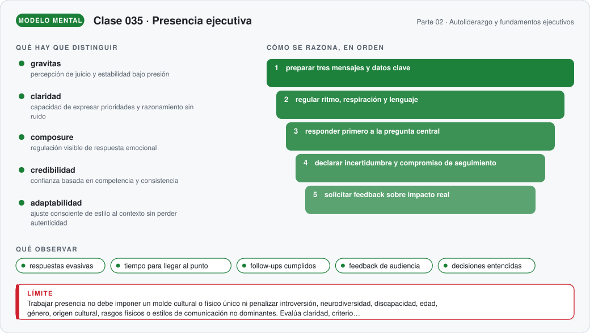

# Clase 035 — Presencia ejecutiva

<!-- nav:inicio -->
> **Parte 02 · Comunicación, influencia y presencia ejecutiva** — clase 11 de 12 · [índice de la parte](../../README.md) · [temario](../../../../SYLLABUS.md)
<!-- nav:fin -->

**Parte:** 02 — Comunicación, influencia y presencia ejecutiva  
**Nivel:** Etapa 1 — Profesional → Líder  
**Duración sugerida:** 150–180 minutos · **Estándar:** deep-class-v2

## 🎯 Propósito

«Presencia ejecutiva» se usa con tanta frecuencia y tan poca precisión que a menudo termina significando «parecerse a quien ya está arriba»: cierto tono de voz, cierta forma de vestir, cierta seguridad. Esa lectura confunde la señal con la sustancia y premia a quienes ya encajan. Esta clase propone otra: la presencia es la capacidad de transmitir **claridad, estabilidad y criterio cuando hay atención sobre ti**, y la imagen es solo una de las señales que la acompañan, y no la más importante.

El enfoque es contextual. No hay un código universal de vestuario, de gesto ni de voz; hay variables que se investigan y un propósito que se sirve. Al terminar sabrás analizar el contexto de una reunión o una entrevista, decidir cómo presentarte sin disfrazarte, preparar el canal en una videollamada y observar la comunicación no verbal sin sacar conclusiones que la evidencia no permite.

## 📚 Resultados de aprendizaje

Al finalizar podrás:

1. **Distinguir** presencia ejecutiva, imagen profesional, estilo, apariencia, reputación y competencia.
2. **Analizar** un contexto con las variables de industria, organización, audiencia, cultura, modalidad y clima.
3. **Decidir** una presentación personal por función y coherencia, no por una receta.
4. **Preparar** el canal de una reunión remota o híbrida con criterios de audio, encuadre, luz y accesibilidad.
5. **Observar** la comunicación no verbal como dato descriptivo y no como diagnóstico.

## 🧭 Agenda

| Tramo | Qué se hace |
|---|---|
| 0–20 min | Recuperación: recuerda a alguien que transmitía presencia; ¿qué hacía, y qué no tenía que ver con su apariencia? |
| 20–60 min | Definiciones, desigualdades y el ajuste de contexto. |
| 60–105 min | Ejemplo trabajado: una misma entrevista en tres contextos. |
| 105–140 min | Caso ejecutivo: preparar una presentación ante el directorio. |
| 140–170 min | Auditoría de contexto y entregable. |

## 🧩 Conceptos centrales

| Concepto | Definición | Cómo se reconoce |
|---|---|---|
| **Presencia ejecutiva** | Capacidad de transmitir claridad, estabilidad y criterio bajo atención (criterio de la clase). | La audiencia entiende qué piensas y confía en cómo decides. |
| **Imagen profesional** | Presentación visual, conductual y contextual elegida para facilitar un propósito de trabajo. | Es una elección con función. |
| **Apariencia** | Lo perceptible a primera vista, incluida información que la persona no elige ni controla. | Incluye rasgos que no son una decisión. |
| **Reputación** | Juicio acumulado a lo largo del tiempo sobre conducta, decisiones y resultados. | Se forma con evidencia repetida. |
| **Competencia** | Capacidad demostrada para realizar una tarea o responder por un resultado. | Se comprueba con desempeño, no con impresión. |
| **Comunicación no verbal** | Postura, gestos, mirada, movimiento y uso del espacio que acompañan el mensaje (Hall, Horgan y Murphy, 2019). | Se describen como conducta, sin atribuir intención. |

## 🧠 Modelo mental

**Cómo leer el diagrama.** En el centro está lo que la reunión debe lograr. Alrededor, las variables que se investigan antes de decidir cómo presentarte; ninguna decide sola. A la derecha, las dos desigualdades que protegen el criterio: **apariencia no es competencia** y **vestirse formal no es presencia ejecutiva**.

## 📖 Desarrollo

### 1. Qué es presencia y qué no es

La presencia ejecutiva incluye claridad al hablar, criterio en lo que se decide, regulación emocional bajo presión, preparación y credibilidad. La imagen —vestuario, cuidado, entorno— forma parte, pero **no la reemplaza ni debe dominarla**. Una persona con una presentación impecable y un mensaje confuso transmite poca presencia; una con una presentación sencilla y un mensaje claro, mucha.

### 2. Lo que la investigación permite decir sobre la ropa

Chang y Cortina revisan la investigación sobre el efecto de la vestimenta en el trabajo. Para esta clase importan tres ideas: la ropa **puede influir en las percepciones** de los demás, ese efecto **varía con el contexto** y las impresiones que produce pueden reflejar **sesgos de atribución** de quien observa. De ahí no se sigue que la ropa mida la capacidad de nadie. Por eso la clase fija la desigualdad *apariencia ≠ competencia*: no conviertas una señal superficial en un diagnóstico de inteligencia, liderazgo o potencial.

### 3. Ajuste de contexto: adecuación antes que receta

La pregunta útil no es «¿qué debería ponerme?» sino «¿qué contexto tengo y qué debe lograr esta reunión?». Evalúa la combinación de **industria, organización, responsabilidad, audiencia, tipo de reunión, cultura, país, modalidad, clima y objetivo**. Investiga ejemplos locales, consulta el protocolo de la invitación y elige una opción suficientemente coherente para que el mensaje y el trabajo concentren la atención.

| Contexto | Ajuste razonable | Error de sobreadaptación |
|---|---|---|
| Empresa tecnológica o startup | Prendas cuidadas y cómodas; más formalidad ante inversionistas o clientes si aporta claridad. | Disfrazarse de informal o asumir que una polera siempre es adecuada. |
| Banca o consultoría | Confirmar códigos más estructurados y el protocolo de la oficina. | Confundir traje costoso con capacidad. |
| Educación o sector público | Cercanía, sobriedad y reglas institucionales. | Copiar códigos corporativos que crean distancia. |
| Entrevista | Investigar organización, rol y modalidad; una señal ligeramente más cuidada que el día a día esperado. | Actuar un personaje que no podrías sostener. |
| Comité o directorio | Sobriedad funcional, preparación y mínima distracción. | Usar formalidad para ocultar una recomendación débil. |
| Videoconferencia | Optimizar audio, encuadre, luz y fondo. | Juzgar una limitación doméstica como falta de profesionalismo. |

### 4. Formalidad como lenguaje aproximado

Los nombres de los niveles —formal, business formal, business casual, smart casual— son convenciones y no normas universales: cambian por país, industria, organización y evento, y dos empleadores pueden usar la misma etiqueta para expectativas distintas. Antes de decidir, pide ejemplos o consulta el protocolo. Criterios funcionales que sirven en cualquier nivel: **ajuste** que permita moverse y respirar, **comodidad**, **limpieza y conservación**, **seguridad** y **coherencia** entre prendas. El precio y la marca no son indicadores de profesionalismo.

### 5. Videoconferencia y reuniones híbridas

Configura el canal antes de interpretar a la persona: cámara cerca de la altura de los ojos cuando sea cómodo, encuadre estable, luz frontal o lateral suave, audio inteligible, fondo sobrio que proteja la privacidad, y pausas ante la latencia. Las recomendaciones de distancia, altura y postura neutral se apoyan en las guías ergonómicas de OSHA para pantallas, y deben adaptarse a lentes, movilidad, dolor, fatiga y espacio disponible. La accesibilidad y la ergonomía prevalecen sobre una pose fotogénica.

### 6. Comunicación no verbal sin lecturas deterministas

Hall, Horgan y Murphy tratan la comunicación no verbal como procesos de **emisión y percepción** cuya interpretación requiere contexto y cautela. Postura, orientación, gestos y mirada acompañan el mensaje, pero una misma conducta puede deberse a cultura, personalidad, comodidad, temperatura, dolor, discapacidad o preferencia. Observa como dato descriptivo («giró hacia la pantalla mientras respondía») y no como etiqueta («ocultó algo»). Evita reglas del tipo «cruzar los brazos significa resistencia». Para ajustar, triangula: patrón habitual, cambio observado, contenido verbal, restricciones del entorno y confirmación de la persona.

### 7. Autenticidad e inclusión

Adaptarse es ampliar opciones, no borrar identidad. Busca la intersección entre identidad, contexto, comodidad y propósito. Si una convención exige ocultar el origen cultural, una discapacidad o rasgos físicos para parecer «ejecutivo», es la convención la que se cuestiona. La evaluación de la presencia no debe penalizar la introversión, la neurodiversidad, la edad, el género ni los estilos de comunicación no dominantes, ni premiar el volumen, la teatralidad o el lujo. Cuddy ofrece en *Presence* una mirada práctica sobre autenticidad y desempeño bajo presión; conviene leerla junto con la evidencia empírica, porque algunas afirmaciones populares de este campo, como los efectos fisiológicos de ciertas posturas, no se han replicado de manera consistente.

## 📚 Lectura comparada

| Obra | Qué aporta | Qué no resuelve | Pregunta para contrastar |
|---|---|---|---|
| Chang y Cortina (2024) | Efectos de la ropa en las percepciones, con variación contextual y sesgos. | No dice qué vestir. | ¿Qué atribución podría hacer alguien sobre ti sin evidencia? |
| Hall, Horgan y Murphy (2019) | La comunicación no verbal como emisión y percepción. | No da reglas de lectura. | ¿Qué conducta tuya podría malinterpretarse? |
| Cuddy (2015) | Autenticidad y desempeño bajo presión, desde la práctica. | Algunas de sus afirmaciones no se han replicado. | ¿Qué parte contrastarías con evidencia? |
| Duarte (2010) | Cómo una presentación mueve a una audiencia. | No trata de imagen. | ¿Qué cambio propone tu intervención? |
| Goleman, Boyatzis y McKee (2002) | El efecto emocional de la conducta del líder. | No analiza vestuario. | ¿Qué estado transmites antes de hablar? |

## 🧮 Ejemplo trabajado

**Situación (hipotética).** Una ingeniera, Carla, tiene una entrevista de trabajo en tres lugares distintos: una startup de software, un banco y una universidad pública. Aplica el ajuste de contexto.

| Variable | Startup | Banco | Universidad |
|---|---|---|---|
| **Código declarado** | Informal | Estructurado, indicado en la invitación | No declarado |
| **Qué investiga** | Fotos del equipo, tono de la oferta | Protocolo de la sucursal, seniority de entrevistadores | Ceremonias, rol del cargo |
| **Presentación** | Prendas cuidadas y cómodas, una capa más formal que el día a día | Conjunto estructurado sobrio | Sobria y cercana |
| **Qué cuida más** | Claridad al explicar su trabajo técnico | Orden y precisión | Cercanía y función docente |
| **Error que evita** | Fingir un estilo que no es el suyo | Pensar que el traje compensa un mensaje débil | Copiar un código corporativo ajeno |

**Videollamada previa.** Carla prueba cámara a la altura de sus ojos, luz frontal suave, un fondo sobrio y el micrófono, y avisa de una conexión inestable con un plan de respaldo.

**Qué muestra.** (1) La misma persona decide distinto según el contexto, sin cambiar quién es. (2) La preparación del canal pesa tanto como la imagen. (3) Ninguna elección de vestuario sustituye la claridad de lo que dirá.

## 🔀 Comparación y límites

**Presencia frente a carisma.** El carisma impresiona; la presencia ordena. Una persona poco carismática puede transmitir mucha presencia si es clara y confiable.

**Límites.** La evidencia sobre el efecto de la apariencia en el trabajo es contextual y no permite recetas; la lectura no verbal es probabilística y depende de la cultura y de la persona; y las guías de formalidad son convenciones locales. Esta clase no es un código de vestimenta, y no avala juzgar a una persona por un rasgo que no elige.

## 🪜 De profesional a owner

| Nivel | Cómo trabaja la presencia |
|---|---|
| **Profesional** | Prepara el contexto de una reunión y comunica con claridad lo que sabe y lo que no. |
| **Jefe / Team Lead** | Mantiene estabilidad ante la presión y crea espacio para que otros hablen. |
| **Gerente** | Ajusta su comunicación a cada audiencia sin cambiar los hechos. |
| **CEO / Director** | Sabe que su conducta se interpreta como señal y la usa con intención. |
| **Founder / Owner** | Se presenta ante inversionistas y clientes con una imagen coherente con su negocio y su identidad. |

## 🏢 Caso ejecutivo

Un gerente nuevo debe presentar los resultados del año ante un directorio de siete personas, tres de ellas de otro país y una que asiste por videoconferencia. Es su primera presentación al directorio. Sus resultados son mixtos: un buen margen, una caída de ventas. Está nervioso y su jefe le sugiere «proyectar más autoridad».

Entrega un **análisis de contexto** que contenga: (a) las variables del contexto y qué investigarás de cada una; (b) el objetivo de la presentación y las tres ideas que la sostienen; (c) las decisiones de presentación personal y de canal con su función; (d) cómo hablarás de la caída de ventas sin disfrazarla; (e) qué observarás y cómo evitarás interpretar de más la reacción del directorio; (f) un ajuste que preserve tu identidad.

## 🧪 Práctica

1. Elige una reunión próxima y completa el ajuste de contexto con las ocho variables.
2. Define el objetivo y las tres ideas que sostienen tu mensaje.
3. Prepara el canal de una videollamada con la lista de criterios y pruébalo.
4. Pide a dos observadores que describan tu conducta y su impacto, no tu apariencia ni tu personalidad.
5. Escribe una convención de «presencia» de tu entorno que cuestionarías y la alternativa funcional.

## ⚠️ Errores frecuentes

| Error | Por qué ocurre | Cómo corregirlo |
|---|---|---|
| Confundir formalidad con presencia | Se asocia al cargo | Poner la claridad y el criterio en el centro. |
| Copiar un código ajeno | Se busca una receta | Investigar el contexto local. |
| Actuar un personaje | Se teme no encajar | Elegir una opción que puedas sostener. |
| Leer el lenguaje corporal como diagnóstico | Hay reglas populares | Describir conducta y triangular. |
| Descuidar el canal | Se piensa en la ropa | Preparar audio, luz, encuadre y accesibilidad. |
| Penalizar rasgos no elegidos | Se confunde estilo con competencia | Evaluar claridad, criterio y comportamiento. |

## ❓ Preguntas de comprobación

1. ¿Qué diferencia hay entre presencia ejecutiva e imagen profesional?
2. ¿Qué dos desigualdades ordenan la clase?
3. ¿Qué variables componen el ajuste de contexto?
4. ¿Por qué los nombres de los niveles de formalidad son «un lenguaje aproximado»?
5. ¿Qué preparas en una videoconferencia antes de interpretar a una persona?
6. ¿Por qué no se debe leer «brazos cruzados» como resistencia?
7. ¿Cómo se concilia adaptarse con ser auténtico?

Claves de respuesta

1. La presencia es capacidad de transmitir claridad, estabilidad y criterio bajo atención; la imagen es una de las señales que la acompañan.
2. Apariencia no es competencia; vestirse formal no es presencia ejecutiva.
3. Industria, organización, responsabilidad, audiencia, tipo de reunión, cultura, país, modalidad, clima y objetivo.
4. Porque cambian por país, industria, organización y evento, y la misma etiqueta puede significar expectativas distintas.
5. El canal: audio, encuadre, luz, fondo, distancia y accesibilidad.
6. Porque una misma conducta puede deberse a cultura, comodidad, dolor, personalidad o preferencia; se describe y se triangula.
7. Adaptarse es ampliar opciones sin borrar identidad: se busca la intersección entre identidad, contexto y propósito.

## 📥 Entregable

Guarda en `portfolio/035-presencia-ejecutiva/`:

- `risk-governance-brief.md` (plantilla [Risk & Governance Brief](../../../../templates/risk-governance-brief.md)) con el análisis de contexto del caso ejecutivo;
- `reading-note.md` con una tensión entre Chang y Cortina y Cuddy;
- `decision-journal.md` con la matriz `Contexto → Evidencia → Ajuste → Revisión`, una evidencia por ajuste y una fecha de revisión.

## 📗 Fuentes y verificación

- Yingyi Chang & Jose M. Cortina — *What should I wear to work? An integrative review of the impact of clothing in the workplace* (Journal of Applied Psychology, 2024). **Uso en esta clase:** efectos de percepción, variación contextual y sesgos de atribución sin convertir vestuario en competencia. Lectura selectiva sobre **presencia ejecutiva**. **Localizador:** [DOI 10.1037/apl0001158](https://doi.org/10.1037/apl0001158).
- Judith A. Hall, Terrence G. Horgan & Nora A. Murphy — *Nonverbal Communication* (Annual Review of Psychology, 2019). **Uso en esta clase:** las señales no verbales como procesos de emisión y percepción que requieren contexto y cautela. Lectura selectiva sobre **presencia ejecutiva**. **Localizador:** [DOI 10.1146/annurev-psych-010418-103145](https://doi.org/10.1146/annurev-psych-010418-103145).
- Amy Cuddy — *Presence* (Little, Brown and Company, 2015). **Uso en esta clase:** perspectiva práctica sobre autenticidad y desempeño bajo presión, contrastada con la evidencia. Lectura selectiva sobre **presencia ejecutiva**. **Localizador:** [ISBN-13 9780316256551](https://openlibrary.org/isbn/9780316256551).
- Nancy Duarte — *Resonate* (John Wiley & Sons, Incorporated, 2010). **Uso en esta clase:** cómo una presentación mueve a una audiencia. Lectura selectiva sobre **presencia ejecutiva**. **Localizador:** [ISBN-13 9781118014875](https://openlibrary.org/isbn/9781118014875).
- Daniel Goleman, Richard Boyatzis & Annie McKee — *Primal Leadership* (Harvard Business School Press, 2002). **Uso en esta clase:** el efecto emocional de la conducta del líder. Lectura selectiva sobre **presencia ejecutiva**. **Localizador:** [ISBN-13 9781578514861](https://openlibrary.org/isbn/9781578514861).
- Occupational Safety and Health Administration — *Computer Workstations eTool: Monitors*. **Uso en esta clase:** distancia, altura, orientación, postura neutral y control de reflejos en videoconferencia. **Fuente primaria:** <https://www.osha.gov/etools/computer-workstations/components/monitors>.

> **Regla de fuentes para Presencia ejecutiva:** las obras anteriores estructuran las perspectivas de esta materia; cualquier norma, ley o estándar vivo mencionado debe comprobarse nuevamente en su fuente primaria vigente. Los ejemplos y casos son hipotéticos. El desarrollo es original y no reproduce capítulos protegidos.

<!-- pie:inicio -->
---

| Anterior | Índice | Siguiente |
|---|---|---|
| [← 034 · Mapa de stakeholders y poder](../034-mapa-de-stakeholders-y-poder/README.md) | [Parte 02](../../README.md) · [Programa](../../../../SYLLABUS.md) | [036 · Capstone: comunicar una decisión impopular →](../036-capstone-comunicar-una-decision-impopular/README.md) |
<!-- pie:fin -->
