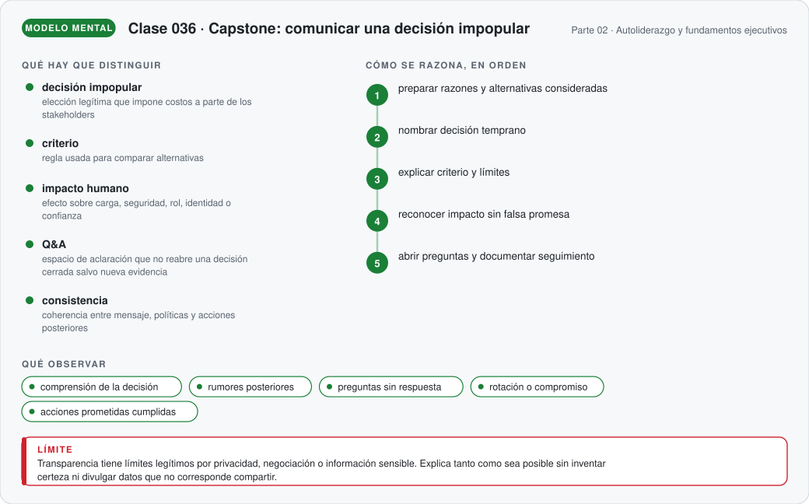

# Clase 036 — Capstone: comunicar una decisión impopular

<!-- nav:inicio -->
> **Parte 02 · Comunicación, influencia y presencia ejecutiva** — clase 12 de 12 · [índice de la parte](../../README.md) · [temario](../../../../SYLLABUS.md)
<!-- nav:fin -->

**Parte:** 02 — Comunicación, influencia y presencia ejecutiva  
**Nivel:** Etapa 1 — Profesional → Líder  
**Duración sugerida:** 150–180 minutos · **Estándar:** deep-class-v2

## 🎯 Propósito

Todo directivo termina tomando una decisión que una parte importante de las personas afectadas no quiere: un recorte de presupuesto, un cambio de turnos, el cierre de un proyecto, la salida de alguien. La decisión puede ser correcta y la comunicación puede deshacerla. La investigación sobre justicia organizacional muestra que las personas no evalúan solo **qué** se decidió, sino **cómo** se decidió, **cómo las trataron** y **cómo se les explicó**.

Este capstone integra lo trabajado en la parte 02: elegir el canal (clase 025), escuchar (026), estructurar el mensaje (027 y 028), usar una historia con rigor (029), dar feedback (030), conducir la conversación difícil (031), manejar el conflicto (032), influir con ética (033), mapear a los afectados (034) y cuidar tu presencia (035). La base conceptual nueva es el metaanálisis de Colquitt y colegas sobre cuatro dimensiones de la justicia. Al terminar sabrás preparar y ejecutar el anuncio de una decisión impopular con un plan completo y verificable.

## 📚 Resultados de aprendizaje

Al finalizar podrás:

1. **Describir** las cuatro dimensiones de la justicia —distributiva, procedimental, interpersonal e informacional— y qué evalúan las personas en cada una.
2. **Diseñar** el anuncio de una decisión impopular que cubra las cuatro.
3. **Secuenciar** la comunicación: a quién primero, por qué canal y con qué mensaje.
4. **Anticipar** las reacciones y preparar respuestas sin ocultar hechos ni prometer lo que no controlas.
5. **Evaluar** el resultado con evidencia y corregir lo que falló.

## 🧭 Agenda

| Tramo | Qué se hace |
|---|---|
| 0–20 min | Recuperación: recuerda una decisión que te perjudicó; ¿qué te molestó más: el resultado, el proceso, el trato o la explicación? |
| 20–60 min | Las cuatro dimensiones de la justicia y la secuencia del anuncio. |
| 60–105 min | Ejemplo trabajado: el cierre de un turno de trabajo. |
| 105–150 min | Caso ejecutivo integrado, usando las herramientas de la parte. |
| 150–170 min | Límites, rúbrica y entregable. |

## 🧩 Conceptos centrales

| Concepto | Definición | Cómo se reconoce |
|---|---|---|
| **Justicia distributiva** | Percepción de justicia del resultado: lo que cada uno recibe o pierde (Colquitt et al., 2001). | «¿Es justo lo que me toca?» |
| **Justicia procedimental** | Percepción de justicia del proceso por el que se decidió (Colquitt et al., 2001). | «¿Se decidió de manera justa y con voz?» |
| **Justicia interpersonal** | Percepción del trato recibido: respeto y dignidad (Colquitt et al., 2001). | «¿Me trataron con respeto?» |
| **Justicia informacional** | Percepción de la calidad de las explicaciones: veracidad, razones y oportunidad (Colquitt et al., 2001). | «¿Me explicaron con claridad y sinceridad?» |
| **Decisión impopular** | Decisión legítima que perjudica a personas que no la desean. | Genera resistencia aun cuando es necesaria. |
| **Secuencia del anuncio** | Orden de las audiencias, canales y mensajes. | Los más afectados se enteran primero y por la persona adecuada. |

## 🧠 Modelo mental

**Cómo leer el diagrama.** Las cuatro tarjetas son lo que las personas evalúan, aunque no lo digan así. Abajo, la secuencia: los más afectados primero, luego el hecho sin rodeos, el proceso y las razones, lo que viene y lo que se hará por ellos, y un canal para preguntas con fecha de seguimiento. Una buena explicación no compensa un trato irrespetuoso ni un proceso percibido como injusto.

## 📖 Desarrollo

### 1. Qué evalúan las personas

Colquitt y colegas revisaron 25 años de investigación sobre justicia organizacional y concluyeron que sus dimensiones se distinguen y se asocian a resultados distintos. Quien recibe una decisión adversa se pregunta, a veces sin darse cuenta: ¿es justo el resultado? (distributiva); ¿fue justo el proceso? (procedimental); ¿me trataron con respeto? (interpersonal); ¿me explicaron la verdad con claridad? (informacional). La implicancia práctica es que el líder **controla bastante más que el resultado**: puede cuidar el proceso, el trato y la explicación aun cuando la decisión no cambie.

### 2. Antes de anunciar: la decisión debe sostenerse

Nada de esto sirve si la decisión es débil. Antes de comunicar, comprueba tres cosas: que **los hechos** que la sostienen sean verificables, que se hayan evaluado **alternativas** y puedas decir cuáles y por qué se descartaron, y que sepas **qué es negociable y qué no**. Una decisión que cambia tras el anuncio por presión, sin hecho nuevo, destruye la credibilidad.

### 3. Justicia distributiva: el resultado, dicho sin rodeos

Las personas necesitan saber **qué cambia, para quién y en qué medida**. Los eufemismos («reestructuración de capacidades», «optimización de turnos») se interpretan como ocultamiento. Di el hecho con las cifras y los plazos, y lo que se hará para reducir el daño: indemnizaciones, reubicación, plazos de transición. Si no hay compensación posible, no se la sugiere.

### 4. Justicia procedimental: cómo se decidió

Explica el proceso: qué se evaluó, quién participó, qué alternativas se consideraron, qué información se usó. Si hubo oportunidad de que los afectados expresaran su opinión, dilo; si no la hubo, reconócelo y abre un cauce para lo que aún se puede decidir (cómo se implementa, por ejemplo). La percepción de un proceso consistente, sin sesgos y con posibilidad de corrección pesa en la aceptación.

### 5. Justicia interpersonal: el trato

El trato se juega en detalles: **quién** da la noticia (alguien con autoridad y cercanía), **dónde** (en privado cuando es personal), **cuándo** (sin esperar a que se filtre) y **cómo** (con respeto, sin condescendencia, sin leer un libreto). Reconoce el impacto en las personas sin dramatizar. Prepara tu estado emocional antes de comunicar: la clase 025 mostró que el tono del líder llega antes que el contenido.

### 6. Justicia informacional: la explicación

Una explicación es **veraz** (no oculta hechos relevantes), **razonada** (da las razones reales, no las convenientes), **oportuna** (llega antes que el rumor) y **suficiente** (responde lo que la gente necesita saber). Usa la estructura de la clase 025: qué sabemos, qué no sabemos, qué hacemos, cuándo informaremos. Si una parte de las razones es confidencial, dilo y explica por qué, en vez de inventar otras.

### 7. La secuencia: a quién, por dónde y cuándo

El orden importa. En general: primero a los **más afectados**, en conversación directa y antes del anuncio general; luego a quienes deben ejecutar o explicar la decisión (jefaturas) con un mensaje común; después al resto, con el canal que corresponda según la clase 025; y, si procede, a clientes, medios y autoridades. Usa el mapa de interesados de la clase 034 para definir los actores y el nivel de atención. Define quién habla con quién, qué se dice y cómo se registra.

### 8. Anticipar reacciones y responder

Prepara las tres reacciones más probables: **negación o ira**, **preguntas de fondo** («¿por qué yo?») y **propuestas de alternativa**. Escucha según la clase 026, resume lo que oyes y distingue lo que puedes cambiar de lo que no. Evita tres tentaciones: prometer lo que no controlas, minimizar el impacto y atribuir la decisión a otro («lo decidió la casa matriz») cuando tú la respaldas.

### 9. Después del anuncio

Una decisión impopular se comunica en el tiempo: comprueba que llegó (clase 025), mantén el canal de preguntas, cumple los compromisos en fecha y revisa con evidencia qué funcionó. Si la información cambia, corrígela con la misma visibilidad. La confianza en lo que sigue depende de cómo se manejó este momento.

## 📚 Lectura comparada

| Obra | Qué aporta | Qué no resuelve | Pregunta para contrastar |
|---|---|---|---|
| Colquitt et al. (2001) | Cuatro dimensiones de justicia y sus efectos. | No es una guía de comunicación. | ¿Cuál de las cuatro cuidaste menos en tu último anuncio? |
| Coombs (2007) | Qué comunicar primero y cómo responder según la responsabilidad atribuida. | Se centra en crisis públicas. | ¿Qué responsabilidad te atribuirán? |
| Daft y Lengel (1986) | Elegir el canal según la equivocidad. | No trata de justicia. | ¿Tu canal corresponde a la sensibilidad del mensaje? |
| Stone, Patton y Heen (1999) | Conducir la conversación difícil. | No cubre anuncios masivos. | ¿Qué conversación de identidad está en juego? |
| Mitchell, Agle y Wood (1997) | A quién atender y con qué prioridad. | No dice qué decir. | ¿Qué actor dependiente podrías olvidar? |

## 🧮 Ejemplo trabajado

**Situación (hipotética, con cifras ilustrativas).** Una empresa de logística debe eliminar el turno de noche de un centro de distribución por una caída del 30 % de los pedidos nocturnos. Afecta a 45 personas; 20 podrán reubicarse en otros turnos y 25 no.

| Dimensión | Qué hace el gerente | Qué evita |
|---|---|---|
| **Distributiva** | Dice cuántas personas se ven afectadas, qué ocurre con cada grupo (20 reubicables, 25 con indemnización y apoyo) y desde cuándo. | Eufemismos y cifras vagas. |
| **Procedimental** | Explica que se evaluaron tres alternativas (reducir turnos, congelar contratación, cerrar el turno), los datos de demanda y por qué las otras no alcanzaban; abre un cauce para decidir cómo reubicar. | Presentar la decisión como inevitable sin mostrar el proceso. |
| **Interpersonal** | Conversa en privado con cada uno de los 25 afectados antes del anuncio general, con su jefe presente y sin leer un libreto. | Que se enteren por un correo o por el rumor. |
| **Informacional** | Entrega una hoja con los hechos, los plazos y una persona de contacto con respuesta en 48 horas; dice qué aún no se sabe. | Prometer lo que no está decidido. |

**La secuencia.** Día 1, 09:00: conversaciones individuales con los 25. 11:00: reunión con los jefes de turno con un mensaje común. 14:00: comunicación general. Día 3: sesión de preguntas. Semana 2: revisión de compromisos.

**Qué muestra.** (1) La decisión no cambia, pero la comunicación cubre las cuatro dimensiones. (2) Los más afectados se enteran primero y de una persona con autoridad. (3) Hay un registro de lo prometido y una fecha de revisión.

## 🔀 Comparación y límites

**Comunicar bien frente a decidir bien.** Una comunicación excelente no corrige una decisión errada; y una decisión correcta puede fracasar por una mala comunicación. Esta clase trata la segunda, y supone que la primera se trabajó en la parte 01.

**Límites.** El metaanálisis de Colquitt y colegas se basa en estudios de organizaciones, con sus sesgos de muestra y de medición; muestra tendencias, no garantiza la aceptación de una decisión concreta. Las dimensiones se solapan en la práctica. Y la obligación de informar a representantes de trabajadores o a autoridades depende de la jurisdicción y se verifica con asesoría; esta clase no la sustituye.

## 🪜 De profesional a owner

| Nivel | Cómo comunica una decisión impopular |
|---|---|
| **Profesional** | Comunica un cambio que afecta a un cliente o a un par con hechos y respeto. |
| **Jefe / Team Lead** | Anuncia a su equipo una decisión que no comparte del todo, sin desmarcarse de ella. |
| **Gerente** | Conduce una reorganización o un recorte con las cuatro dimensiones y una secuencia. |
| **CEO / Director** | Comunica decisiones que afectan a toda la organización y responde por la coherencia ante todas las audiencias. |
| **Founder / Owner** | Anuncia a su equipo, socios o clientes lo que cuesta, con su patrimonio y su palabra de por medio. |

## 🏢 Caso ejecutivo

Una gerente general debe anunciar que la empresa suspende el bono anual de desempeño este año por una caída del margen. El bono representa en promedio el 12 % de la remuneración. Los empleados venían de un año de esfuerzo; el sindicato ya expresó preocupación; la prensa sectorial publicó que la competencia sí lo pagará. La gerente tiene una reunión con directores en cuatro días.

Entrega un **plan de comunicación de una decisión impopular** que integre la parte 02 y contenga: (a) la decisión, sus hechos y las alternativas evaluadas; (b) el mapa de interesados con su clasificación (clase 034); (c) cómo cubrirás las cuatro dimensiones de justicia; (d) la secuencia del anuncio con canal, responsable y mensaje (clases 025 y 027); (e) la historia o el ejemplo que usarás y su verificación de representatividad (clase 029); (f) las preguntas difíciles y tus respuestas (clase 031); (g) lo que no prometerás; (h) la evaluación posterior y qué evidencia cambiaría tu plan.

## 🧪 Práctica

1. Elige una decisión impopular real o simulada y escribe el hecho en una frase sin eufemismos.
2. Evalúa, para cada una de las cuatro dimensiones, qué harías y qué evitarías.
3. Escribe la secuencia con horarios, canales y responsables.
4. Prepara las tres preguntas más difíciles y la respuesta con la estructura *hecho → límite → compromiso*.
5. Define cómo comprobarás en una semana si el mensaje llegó y qué corregirás.

## ⚠️ Errores frecuentes

| Error | Por qué ocurre | Cómo corregirlo |
|---|---|---|
| Eufemismos | Se quiere suavizar | Decir el hecho con cifras y plazos. |
| Que se enteren por rumor | Se posterga | Comunicar rápido y en secuencia. |
| Anunciar sin proceso explicado | Se supone que es obvio | Mostrar qué se evaluó y por qué. |
| Delegar la noticia personal | Incomoda darla | Que la dé alguien con autoridad y cercanía. |
| Prometer lo que no se controla | Se quiere calmar | Prometer solo lo que se puede cumplir. |
| Culpar a un tercero | Se quiere distanciarse | Asumir y respaldar la decisión. |
| No hacer seguimiento | Se cree que terminó | Comprobar, cumplir y revisar. |

## ❓ Preguntas de comprobación

1. ¿Cuáles son las cuatro dimensiones de la justicia organizacional y qué evalúa cada una?
2. ¿Por qué una buena explicación no compensa un trato irrespetuoso?
3. ¿A quién se informa primero y por qué?
4. ¿Qué diferencia hay entre decir el hecho y usar un eufemismo? Da un ejemplo.
5. ¿Qué tres tentaciones debes evitar al responder a una reacción?
6. ¿Qué haces si una parte de las razones es confidencial?
7. ¿Qué comprobarás después del anuncio?

Claves de respuesta

1. Distributiva (el resultado), procedimental (el proceso), interpersonal (el trato) e informacional (la explicación).
2. Porque las dimensiones se distinguen y se asocian a resultados distintos: las personas evalúan cada una por separado.
3. A los más afectados, en conversación directa y antes del anuncio general, para que no se enteren por rumor ni por terceros.
4. El hecho dice qué cambia, para quién y desde cuándo («se elimina el turno de noche el 1 de abril»); el eufemismo lo vela («optimización de turnos»).
5. Prometer lo que no controlas, minimizar el impacto y atribuir la decisión a otro.
6. Decirlo y explicar por qué, en lugar de inventar otras razones.
7. Que el mensaje llegó, que se cumplen los compromisos en fecha y qué funcionó y qué no.

## 📥 Entregable

Guarda en `portfolio/036-capstone-comunicar-una-decision-impopular/`:

- `leadership-decision-brief.md` (plantilla [Leadership Decision Brief](../../../../templates/leadership-decision-brief.md)) con el plan de comunicación del caso ejecutivo;
- `stakeholder-legitimacy-map.md` (plantilla [mapa de interesados y legitimidad](../../../../templates/stakeholder-legitimacy-map.md)) con los actores afectados;
- `reading-note.md` con una tensión entre Colquitt et al. y otra fuente de la parte;
- `decision-journal.md` con la secuencia, la evaluación posterior y lo que corregiste.

## 📗 Fuentes y verificación

- Jason A. Colquitt, Donald E. Conlon, Michael J. Wesson, Christopher O. L. H. Porter & K. Yee Ng — *Justice at the Millennium: A Meta-Analytic Review of 25 Years of Organizational Justice Research* (Journal of Applied Psychology, 2001). **Uso en esta clase:** las cuatro dimensiones de la justicia y su efecto. Lectura selectiva sobre **capstone: comunicar una decisión impopular**. **Localizador:** [DOI 10.1037/0021-9010.86.3.425](https://doi.org/10.1037/0021-9010.86.3.425).
- W. Timothy Coombs — *Protecting Organization Reputations During a Crisis: The Development and Application of Situational Crisis Communication Theory* (Corporate Reputation Review, 2007). **Uso en esta clase:** qué comunicar primero y cómo responder según la responsabilidad atribuida. Lectura selectiva sobre **capstone: comunicar una decisión impopular**. **Localizador:** [DOI 10.1057/palgrave.crr.1550049](https://doi.org/10.1057/palgrave.crr.1550049).
- Richard L. Daft & Robert H. Lengel — *Organizational Information Requirements, Media Richness and Structural Design* (Management Science, 1986). **Uso en esta clase:** elegir el canal según la equivocidad del mensaje. Lectura selectiva sobre **capstone: comunicar una decisión impopular**. **Localizador:** [DOI 10.1287/mnsc.32.5.554](https://doi.org/10.1287/mnsc.32.5.554).
- Douglas Stone, Bruce Patton & Sheila Heen — *Difficult Conversations* (Random House Audio, 1999). **Uso en esta clase:** conducir la conversación difícil. Lectura selectiva sobre **capstone: comunicar una decisión impopular**. **Localizador:** [ISBN-13 9780553525687](https://openlibrary.org/isbn/9780553525687).
- Ronald K. Mitchell, Bradley R. Agle & Donna J. Wood — *Toward a Theory of Stakeholder Identification and Salience: Defining the Principle of Who and What Really Counts* (Academy of Management Review, 1997). **Uso en esta clase:** a quién atender primero. Lectura selectiva sobre **capstone: comunicar una decisión impopular**. **Localizador:** [DOI 10.2307/259247](https://doi.org/10.2307/259247).

> **Regla de fuentes para Capstone: comunicar una decisión impopular:** las obras anteriores estructuran las perspectivas de esta materia; cualquier norma, ley o estándar vivo mencionado debe comprobarse nuevamente en su fuente primaria vigente, en particular las obligaciones de información a trabajadores o autoridades. Los ejemplos y casos son hipotéticos, con cifras ilustrativas. El desarrollo es original y no reproduce capítulos protegidos.

<!-- pie:inicio -->
---

| Anterior | Índice | Siguiente |
|---|---|---|
| [← 035 · Presencia ejecutiva](../035-presencia-ejecutiva/README.md) | [Parte 02](../../README.md) · [Programa](../../../../SYLLABUS.md) | [037 · Autoconciencia ejecutiva →](../../../03-emotional-intelligence-resilience-adaptive-leadership/classes/037-autoconciencia-ejecutiva/README.md) |
<!-- pie:fin -->
