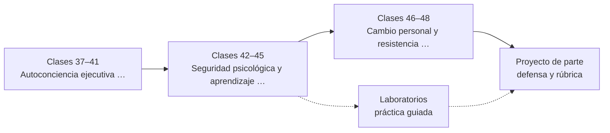

# Parte 03 — Inteligencia emocional, resiliencia y liderazgo adaptativo

<!-- parte:inicio -->

> ← [Parte 02 — Comunicación, influencia y presencia ejecutiva](../02-communication-influence-negotiation-basics/README.md) · [Temario](../../SYLLABUS.md) · [Parte 04 — Liderazgo de equipos](../04-team-leadership/README.md) →

*Mantener criterio y capacidad de conducción cuando hay presión*

**Etapa:** 1 — Autoliderazgo y fundamentos ejecutivos  
**Duración:** 12 clases · 30 horas  
**Resultado de salida:** Mantener criterio, empatía y capacidad de conducción bajo presión, cambio y ambigüedad.

🟢 [Ver las 6 etapas](../../SYLLABUS.md) · 12 clases (037–048) · 4 laboratorios · [proyecto de parte](project.md)

## 🎯 De qué trata esta parte

Las partes anteriores enseñan qué hacer; esta enseña a poder hacerlo cuando la presión, el cambio o la ambigüedad empujan en contra. Un líder que pierde la regulación pierde primero el juicio y después al equipo.

El eje es la **autorregulación con exigencia**: empatía sin renunciar al estándar, resiliencia sin negar el límite, y valores que se sostienen cuando cuesta. Cierra con una crisis humana donde todo se prueba.

## 🧱 Con qué hay que llegar

| Parte | Qué aporta |
|---|---|
| [00 — De profesional a líder](../00-professional-to-leader/README.md) | Gobierno de energía y sistema personal. |
| [02 — Comunicación, influencia y presencia ejecutiva](../02-communication-influence-negotiation-basics/README.md) | Comunicación y conversación difícil. |

Cada clase supone la anterior: el orden importa, y saltarse una deja sin base a las que vienen después.

## 📚 Resultados de la parte

Al terminar esta parte podrás:

1. **Observar** las propias reacciones bajo presión y regularlas.
2. **Combinar** empatía y exigencia en una misma conversación.
3. **Crear** seguridad psicológica sin bajar el estándar.
4. **Diferenciar** problemas técnicos de adaptativos y actuar en consecuencia.
5. **Resolver** dilemas éticos con método y conducir una crisis humana.

## 🗺️ Mapa de la parte

## 🧭 Cómo se encadenan las 12 clases

Las clases **37 a 41** trabajan la persona: autoconciencia, autorregulación, empatía, motivación y resiliencia.

Las clases **42 a 45** pasan al entorno: seguridad psicológica, problemas adaptativos, incertidumbre y dilemas éticos.

Las clases **46 a 48** cierran con cambio personal, sostenibilidad y el capstone de liderar una crisis humana.

## 📘 Las 12 clases

| # | Clase | Qué se trabaja | Entregable | Min |
|---:|---|---|---|---:|
| 037 | [Autoconciencia ejecutiva](classes/037-autoconciencia-ejecutiva/README.md) | Inteligencia emocional, Autoconciencia emocional, Autoevaluación exacta | [risk-governance-brief](../../templates/risk-governance-brief.md) | 150 |
| 038 | [Autorregulación y respuesta bajo presión](classes/038-autorregulacion-y-respuesta-bajo-presion/README.md) | Regulación emocional, Selección de la situación, Modificación de la situación | [leadership-decision-brief](../../templates/leadership-decision-brief.md) | 150 |
| 039 | [Empatía sin perder exigencia](classes/039-empatia-sin-perder-exigencia/README.md) | Empatía, Interesarse personalmente, Desafiar directamente | [risk-governance-brief](../../templates/risk-governance-brief.md) | 150 |
| 040 | [Motivación y propósito](classes/040-motivacion-y-proposito/README.md) | Motivación intrínseca, Motivación extrínseca, Autonomía | [leadership-decision-brief](../../templates/leadership-decision-brief.md) | 150 |
| 041 | [Resiliencia, flexibilidad y agilidad](classes/041-resiliencia-flexibilidad-y-agilidad/README.md) | Resiliencia, Recuperación, Trayectoria | [risk-governance-brief](../../templates/risk-governance-brief.md) | 150 |
| 042 | [Seguridad psicológica y aprendizaje](classes/042-seguridad-psicologica-y-aprendizaje/README.md) | Seguridad psicológica, Riesgo interpersonal, Conducta de aprendizaje | [leadership-decision-brief](../../templates/leadership-decision-brief.md) | 150 |
| 043 | [Problemas técnicos versus adaptativos](classes/043-problemas-tecnicos-versus-adaptativos/README.md) | Problema técnico, Problema adaptativo, Trabajo adaptativo | [leadership-decision-brief](../../templates/leadership-decision-brief.md) | 150 |
| 044 | [Liderar en incertidumbre](classes/044-liderar-en-incertidumbre/README.md) | Riesgo, Incertidumbre, Ambigüedad | [leadership-decision-brief](../../templates/leadership-decision-brief.md) | 150 |
| 045 | [Valores y dilemas éticos](classes/045-valores-y-dilemas-eticos/README.md) | Dilema de bien contra bien, Tentación, Criterio basado en resultados | [leadership-decision-brief](../../templates/leadership-decision-brief.md) | 150 |
| 046 | [Cambio personal y resistencia](classes/046-cambio-personal-y-resistencia/README.md) | Inmunidad al cambio, Compromiso de mejora, Compromiso en competencia | [risk-governance-brief](../../templates/risk-governance-brief.md) | 150 |
| 047 | [Recuperación, límites y sostenibilidad](classes/047-recuperacion-limites-y-sostenibilidad/README.md) | Burnout, Agotamiento, Cinismo | [leadership-decision-brief](../../templates/leadership-decision-brief.md) | 150 |
| 048 | [Capstone: liderar una crisis humana](classes/048-capstone-liderar-una-crisis-humana/README.md) | Crisis humana, Información de instrucción y de ajuste, Reconocer sin aceptar | [leadership-decision-brief](../../templates/leadership-decision-brief.md) | 150 |

## ⚠️ Riesgos característicos

- Confundir empatía con complacencia.
- Tratar un problema adaptativo con una solución técnica.
- Sostener ritmos que agotan al líder y al equipo.
- Decidir un dilema ético por intuición sin método ni registro.

## 🔤 Glosario de la parte

70 conceptos definidos en las clases, con la definición operacional que usa cada una.

| Concepto | Definición operacional |
|---|---|
| **Agotamiento** | Dimensión de tensión: sentirse sobrepasado y sin recursos emocionales o físicos (Maslach et al., 2001). |
| **Agresión odiosa** | Desafiar sin interesarse (Scott, 2017). |
| **Ambigüedad** | Situación con varias interpretaciones posibles sin una que se imponga (Weick, 1995). |
| **Autoconciencia emocional** | Reconocer una emoción en el momento en que ocurre y entender su efecto (Goleman, 1996). |
| **Autoevaluación exacta** | Conocer las propias fortalezas y límites con realismo. |
| **Autonomía** | Necesidad de sentir que la propia conducta es elegida y es expresión de uno mismo (Ryan y Deci, 2000). |
| **Balcón y pista de baile** | Alternar entre participar en la acción y mirarla desde arriba para ver patrones (Heifetz et al., 2009). |
| **Burnout** | Síndrome de respuesta prolongada a estresores crónicos del trabajo, con tres dimensiones: agotamiento, cinismo y menor eficacia (Maslach et al., 2001). |
| **Cambio cognitivo (reevaluación)** | Cambiar el significado de la situación para modificar su efecto emocional. |
| **Cinismo** | Actitud distante y negativa hacia el trabajo y las personas (Maslach et al., 2001). |
| **Competencia** | Necesidad de sentirse eficaz en lo que se hace (Ryan y Deci, 2000). |
| **Compromiso con la resiliencia (organizacional)** | Capacidad de una organización de contener y recuperarse de errores y sorpresas (Weick y Sutcliffe, 2015). |
| **Compromiso de mejora** | Objetivo de cambio que la persona declara con sinceridad (Kegan y Lahey, 2009). |
| **Compromiso en competencia** | Otro compromiso, a menudo oculto, que la conducta actual protege (Kegan y Lahey, 2009). |
| **Conducta de aprendizaje** | Acciones del equipo para aprender: preguntar, pedir ayuda, experimentar, discutir errores (Edmondson, 1999). |
| **Construcción de sentido** | Proceso por el cual las personas dan significado a lo que ocurre mientras actúan (Weick, 1995). |
| **Crisis humana** | Situación en que lo amenazado son principalmente las personas y la confianza que depositan en la organización (criterio de la clase). |
| **Criterio basado en el cuidado** | Actuar como se querría ser tratado en el lugar del otro (Kidder, 2009). |
| **Criterio basado en reglas** | Actuar según un principio que se querría ver como regla para todos (Kidder, 2009). |
| **Criterio basado en resultados** | Elegir lo que produce el mayor bien para el mayor número (Kidder, 2009). |
| **Decisión por reconocimiento** | Modo en que los expertos reconocen una situación como típica y simulan mentalmente una acción (Klein, 1999). |
| **Desafiar directamente** | Decir con claridad lo que no está bien o puede mejorar (Scott, 2017). |
| **Desconexión psicológica** | No pensar en el trabajo durante el tiempo libre (Sonnentag y Fritz, 2007). |
| **Despliegue de la atención** | Dirigir la atención hacia o lejos de aspectos de la situación. |
| **Dilema de bien contra bien** | Situación en que dos valores legítimos entran en conflicto y no se pueden satisfacer ambos (Kidder, 2009). |
| **Eficacia reducida** | Sensación de logro y competencia disminuida (Maslach et al., 2001). |
| **Empatía** | Percibir y comprender los sentimientos y puntos de vista de otros, e interesarse activamente por sus preocupaciones (Goleman, 1996). |
| **Empatía ruinosa** | Interesarse sin desafiar: se evita decir lo que ayudaría (Scott, 2017). |
| **Estándares altos** | Nivel de exigencia en resultados y calidad. |
| **Etapas del cambio** | Precontemplación, contemplación, preparación, acción y mantenimiento (Prochaska y DiClemente, 1983). |
| **Exceso de confianza** | Tendencia a sobreestimar la exactitud de los propios juicios (Kahneman, 2011). |
| **Experimento seguro** | Prueba pequeña y reversible que permite verificar un gran supuesto. |
| **Feedback sobre el efecto** | Información de otros sobre cómo tu conducta los afecta. |
| **Flexibilidad** | Capacidad de ajustar la conducta ante cambios del entorno (criterio de la clase). |
| **Franqueza radical** | Interesarse personalmente y desafiar directamente a la vez (Scott, 2017). |
| **Gran supuesto** | Creencia que sostiene el compromiso oculto y se vive como verdad (Kegan y Lahey, 2009). |
| **Incertidumbre** | Situación en que no se conocen bien los resultados posibles o sus probabilidades (criterio de la clase). |
| **Información de instrucción y de ajuste** | Qué ocurrió y qué debe hacer quien está en riesgo; reconocimiento del daño y apoyo (Coombs, 2007). |
| **Inmunidad al cambio** | Sistema que protege un statu quo mediante compromisos en competencia con el cambio deseado (Kegan y Lahey, 2009). |
| **Inteligencia emocional** | Conjunto de capacidades de reconocer y manejar las propias emociones y las de otros, que Goleman (1996) organiza en cinco dominios. |
| **Interesarse personalmente** | Preocuparse genuinamente por la persona como un todo, no solo por su rendimiento (Scott, 2017). |
| **Justicia distributiva, procedimental, interpersonal e informacional** | Las cuatro dimensiones con que las personas evalúan una decisión (Colquitt et al., 2001). |
| **Magia ordinaria** | Idea de que la resiliencia procede de sistemas adaptativos comunes, no de cualidades extraordinarias (Masten, 2001). |
| **Modificación de la situación** | Cambiar la situación para alterar su efecto emocional. |
| **Modulación de la respuesta** | Actuar sobre la expresión de la emoción ya generada, por ejemplo suprimirla. |
| **Motivación extrínseca** | Hacer algo por una consecuencia separable de la actividad (Ryan y Deci, 2000). |
| **Motivación intrínseca** | Hacer algo por la satisfacción de hacerlo (Ryan y Deci, 2000). |
| **Plausibilidad** | Criterio de un relato que es suficiente y creíble para actuar, aunque no sea exacto (Weick, 1995). |
| **Principio de progreso** | De todos los factores que alimentan la vida laboral, el más potente es avanzar en un trabajo con sentido (Amabile y Kramer, 2011). |
| **Problema adaptativo** | Problema que exige que las personas aprendan nuevas formas de actuar, cambiando valores, creencias o hábitos (Heifetz et al., 2009). |
| **Problema técnico** | Problema cuya definición y solución son conocidas y pueden resolverse con la experticia existente (Heifetz et al., 2009). |
| **Punto ciego** | Lo que otros ven en ti y tú no (Stone y Heen, 2014). |
| **Pérdida** | Lo que alguien valora y debería soltar para adaptarse: una rutina, una identidad, una lealtad. |
| **Reconocer sin aceptar** | Admitir que existe un reclamo y su impacto sin pronunciarse aún sobre su contenido. |
| **Recuperación** | Período de disfunción seguido de retorno gradual al nivel previo (Bonanno, 2004). |
| **Regulación emocional** | Procesos por los cuales influimos en qué emociones tenemos, cuándo las tenemos y cómo las vivimos y expresamos (Gross, 1998). |
| **Represalia** | Medida adversa contra quien reclamó, aunque tenga otra causa declarada. |
| **Resiliencia** | Patrón de adaptación positiva en el contexto de adversidad significativa (Masten, 2001). |
| **Riesgo** | Situación en que se conocen los resultados posibles y se pueden estimar sus probabilidades (criterio de la clase). |
| **Riesgo interpersonal** | Exponerse a parecer ignorante, incompetente, negativo o disruptivo. |
| **Ritmo soportable** | Velocidad de cambio que las personas pueden asimilar sin colapsar ni anestesiarse. |
| **Seguridad psicológica** | Creencia compartida de que el equipo es seguro para asumir riesgos interpersonales (Edmondson, 1999). |
| **Selección de la situación** | Acercarse o evitar situaciones según la emoción que se espera. |
| **Tentación** | Situación en que se sabe qué es correcto y lo difícil es hacerlo. |
| **Trabajo adaptativo** | Aprendizaje y cambio que deben hacer las personas con el problema (Heifetz et al., 2009). |
| **Trayectoria** | Curso del funcionamiento de una persona en el tiempo tras un evento adverso (Bonanno, 2004). |
| **Vínculo** | Necesidad de sentirse conectado con otros (Ryan y Deci, 2000). |
| **Zona de ansiedad** | Estándares altos y seguridad baja (Edmondson, 2018). |
| **Zona de aprendizaje** | Seguridad alta y estándares altos (Edmondson, 2018). |
| **Ética limitada** | Tendencia de las personas a actuar contra sus propios valores sin advertirlo, por presión, sesgo e interés propio (Bazerman y Moore, 2013). |

## 📦 Qué queda como evidencia

- Un registro de reacciones bajo presión y su regulación.
- Un análisis de un problema adaptativo real.
- Una resolución documentada de un dilema ético.
- El capstone: conducción de una crisis humana.

## 🔗 Cómo se conecta

Prepara las partes de equipos (04) y personas (05), y es la base humana de la gestión de crisis de las partes 15 y 16.

## 🧪 Cómo se trabaja

Son **12 clases de 150 minutos** —30 horas— con **4 laboratorios** y un proyecto integrador. Cada clase trae su propósito, sus conceptos, un caso, práctica, errores frecuentes, preguntas de comprobación, entregable y fuentes, y se evalúa con su `assessment.md`. Los laboratorios se resuelven con datos propios o sintéticos, nunca con datos reales de terceros, y la parte se cierra con el proyecto y su defensa. Las reglas de recorrido están en [la guía de navegación](../../docs/NAVIGATION.md).

<!-- parte:fin -->

## Laboratorios

- [Lab 01 — Mapa de disparadores](labs/lab-01.md)
- [Lab 02 — Plan de respuesta bajo presión](labs/lab-02.md)
- [Lab 03 — Diagnóstico de seguridad psicológica](labs/lab-03.md)
- [Lab 04 — Caso adaptativo](labs/lab-04.md)

## Proyecto de parte

Conducir una simulación de crisis que combine personas, presión y decisiones ambiguas.

## Bibliografía rectora

- Daniel Goleman — *Emotional Intelligence* (Inteligencia emocional)
- Daniel Goleman, Richard Boyatzis & Annie McKee — *Primal Leadership* (Liderazgo)
- Ronald Heifetz & Marty Linsky — *Leadership on the Line* (Liderazgo adaptativo)
- Amy C. Edmondson — *The Fearless Organization* (Seguridad psicológica)
- Angela Duckworth — *Grit* (Resiliencia)

## Criterio de aprobación

80/100 y entrega del proyecto integrador.
