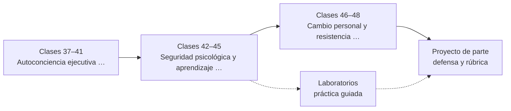

# Parte 03 — Inteligencia emocional, resiliencia y liderazgo adaptativo

<!-- parte:inicio -->

> ← [Parte 02 — Comunicación, influencia y presencia ejecutiva](../02-communication-influence-negotiation-basics/README.md) · [Temario](../../SYLLABUS.md) · [Parte 04 — Liderazgo de equipos](../04-team-leadership/README.md) →

*Mantener criterio y capacidad de conducción cuando hay presión*

**Etapa:** 1 — Autoliderazgo y fundamentos ejecutivos  
**Duración:** 12 clases · 30 horas  
**Resultado de salida:** Mantener criterio, empatía y capacidad de conducción bajo presión, cambio y ambigüedad.

🟢 [Ver las 6 etapas](../../SYLLABUS.md) · 12 clases (037–048) · 4 laboratorios · [proyecto de parte](project.md)

## 🎯 De qué trata esta parte

Las partes anteriores enseñan qué hacer; esta enseña a poder hacerlo cuando la presión, el cambio o la ambigüedad empujan en contra. Un líder que pierde la regulación pierde primero el juicio y después al equipo.

El eje es la **autorregulación con exigencia**: empatía sin renunciar al estándar, resiliencia sin negar el límite, y valores que se sostienen cuando cuesta. Cierra con una crisis humana donde todo se prueba.

## 🧱 Con qué hay que llegar

| Parte | Qué aporta |
|---|---|
| [00 — De profesional a líder](../00-professional-to-leader/README.md) | Gobierno de energía y sistema personal. |
| [02 — Comunicación, influencia y presencia ejecutiva](../02-communication-influence-negotiation-basics/README.md) | Comunicación y conversación difícil. |

Cada clase supone la anterior: el orden importa, y saltarse una deja sin base a las que vienen después.

## 📚 Resultados de la parte

Al terminar esta parte podrás:

1. **Observar** las propias reacciones bajo presión y regularlas.
2. **Combinar** empatía y exigencia en una misma conversación.
3. **Crear** seguridad psicológica sin bajar el estándar.
4. **Diferenciar** problemas técnicos de adaptativos y actuar en consecuencia.
5. **Resolver** dilemas éticos con método y conducir una crisis humana.

## 🗺️ Mapa de la parte

## 🧭 Cómo se encadenan las 12 clases

Las clases **37 a 41** trabajan la persona: autoconciencia, autorregulación, empatía, motivación y resiliencia.

Las clases **42 a 45** pasan al entorno: seguridad psicológica, problemas adaptativos, incertidumbre y dilemas éticos.

Las clases **46 a 48** cierran con cambio personal, sostenibilidad y el capstone de liderar una crisis humana.

## 📘 Las 12 clases

| # | Clase | Qué se trabaja | Entregable | Min |
|---:|---|---|---|---:|
| 037 | [Autoconciencia ejecutiva](classes/037-autoconciencia-ejecutiva/README.md) | trigger, self-schema, impacto | [risk-governance-brief](../../templates/risk-governance-brief.md) | 150 |
| 038 | [Autorregulación y respuesta bajo presión](classes/038-autorregulacion-y-respuesta-bajo-presion/README.md) | activación, impulso, pausa | [leadership-decision-brief](../../templates/leadership-decision-brief.md) | 150 |
| 039 | [Empatía sin perder exigencia](classes/039-empatia-sin-perder-exigencia/README.md) | empatía cognitiva, empatía afectiva, compasión | [risk-governance-brief](../../templates/risk-governance-brief.md) | 150 |
| 040 | [Motivación y propósito](classes/040-motivacion-y-proposito/README.md) | motivación intrínseca, motivación extrínseca, autonomía | [leadership-decision-brief](../../templates/leadership-decision-brief.md) | 150 |
| 041 | [Resiliencia, flexibilidad y agilidad](classes/041-resiliencia-flexibilidad-y-agilidad/README.md) | resiliencia, robustez, adaptabilidad | [risk-governance-brief](../../templates/risk-governance-brief.md) | 150 |
| 042 | [Seguridad psicológica y aprendizaje](classes/042-seguridad-psicologica-y-aprendizaje/README.md) | seguridad psicológica, voice, learning behavior | [leadership-decision-brief](../../templates/leadership-decision-brief.md) | 150 |
| 043 | [Problemas técnicos versus adaptativos](classes/043-problemas-tecnicos-versus-adaptativos/README.md) | problema técnico, desafío adaptativo, pérdida | [leadership-decision-brief](../../templates/leadership-decision-brief.md) | 150 |
| 044 | [Liderar en incertidumbre](classes/044-liderar-en-incertidumbre/README.md) | ambigüedad, incertidumbre, orientación | [leadership-decision-brief](../../templates/leadership-decision-brief.md) | 150 |
| 045 | [Valores y dilemas éticos](classes/045-valores-y-dilemas-eticos/README.md) | valor, deber, dilema | [modelo-financiero-y-memo-de-decision](../../templates/modelo-financiero-y-memo-de-decision.md) | 150 |
| 046 | [Cambio personal y resistencia](classes/046-cambio-personal-y-resistencia/README.md) | resistencia, pérdida percibida, adopción | [risk-governance-brief](../../templates/risk-governance-brief.md) | 150 |
| 047 | [Recuperación, límites y sostenibilidad](classes/047-recuperacion-limites-y-sostenibilidad/README.md) | boundary, recovery debt, on-call | [leadership-decision-brief](../../templates/leadership-decision-brief.md) | 150 |
| 048 | [Capstone: liderar una crisis humana](classes/048-capstone-liderar-una-crisis-humana/README.md) | crisis humana, estabilización, triage | [leadership-decision-brief](../../templates/leadership-decision-brief.md) | 150 |

## ⚠️ Riesgos característicos

- Confundir empatía con complacencia.
- Tratar un problema adaptativo con una solución técnica.
- Sostener ritmos que agotan al líder y al equipo.
- Decidir un dilema ético por intuición sin método ni registro.

## 🔤 Glosario de la parte

58 conceptos definidos en las clases, con la definición operacional que usa cada una.

| Concepto | Definición operacional |
|---|---|
| **accountability** | exigencia explícita por estándares y compromisos. |
| **activación** | nivel fisiológico y emocional que modifica atención y conducta. |
| **adaptabilidad** | capacidad de cambiar conducta o estructura según contexto. |
| **adopción** | uso sostenido de nueva práctica que produce el outcome. |
| **aftercare** | apoyo y seguimiento después de la respuesta inicial. |
| **ambigüedad** | existencia de múltiples interpretaciones plausibles. |
| **antifragilidad** | propiedad de ciertos sistemas que mejoran mediante estrés limitado y aprendizaje. |
| **autonomía** | grado de elección sobre cómo ejecutar dentro de límites. |
| **boundary** | límite que protege responsabilidades y evita rescate impropio. |
| **buffer** | reserva de tiempo, capacidad o recursos que absorbe variabilidad. |
| **bus factor** | dependencia crítica de una o muy pocas personas. |
| **cadencia de actualización** | frecuencia acordada para revisar supuestos y comunicar cambios. |
| **compasión** | motivación por aliviar sufrimiento cuando es apropiado. |
| **competencia** | percepción y evidencia de capacidad creciente. |
| **confidencialidad** | restricción legítima de información sensible. |
| **crisis humana** | evento que amenaza seguridad, dignidad, confianza o continuidad de personas. |
| **deber** | obligación vinculante por rol, ley o compromiso. |
| **delegación** | transferencia de decisión o trabajo con contexto y criterio. |
| **desafío adaptativo** | brecha que requiere aprendizaje y cambio de conducta de stakeholders. |
| **dilema** | conflicto entre obligaciones o valores que no pueden maximizarse simultáneamente. |
| **empatía afectiva** | resonancia emocional con su experiencia. |
| **empatía cognitiva** | comprensión de la perspectiva del otro. |
| **estabilización** | acciones inmediatas para detener o reducir daño. |
| **exigencia** | claridad sobre estándar, fecha y consecuencia. |
| **feedback 360** | percepción estructurada desde múltiples relaciones. |
| **fortaleza sobreutilizada** | capacidad útil que llevada al extremo se vuelve riesgo. |
| **holding environment** | espacio suficientemente seguro para sostener tensión productiva. |
| **impacto** | efecto observable de una conducta sobre otros. |
| **impulso** | acción automática favorecida por el estado emocional. |
| **incertidumbre** | falta de certeza sobre estados futuros. |
| **learning behavior** | pedir ayuda, experimentar y revisar errores. |
| **motivación extrínseca** | conducta influida por recompensas o consecuencias externas. |
| **motivación intrínseca** | energía asociada al interés o satisfacción de la actividad. |
| **on-call** | disponibilidad excepcional regulada por turnos y escalamiento. |
| **orientación** | marco temporal y prioridades que permiten actuar. |
| **pausa** | interrupción breve que permite volver a elegir. |
| **precedente** | señal que una decisión crea para casos futuros. |
| **problema técnico** | brecha con solución conocida y autoridad capaz de implementarla. |
| **proporcionalidad** | grado en que una intervención es adecuada al riesgo y al objetivo. |
| **propósito** | conexión entre trabajo y un resultado considerado significativo. |
| **pérdida** | valor, estatus, identidad o comodidad que alguien debe abandonar. |
| **pérdida percibida** | estatus, control, competencia o seguridad que la persona cree amenazada. |
| **readiness** | capacidad y disposición para comenzar la transición. |
| **recovery debt** | acumulación de falta de recuperación que degrada capacidad. |
| **reencuadre** | interpretación alternativa que cambia respuesta posible. |
| **regulación** | modificación deliberada de intensidad, duración o expresión emocional. |
| **resiliencia** | capacidad de recuperar función y adaptarse después de perturbación. |
| **resistencia** | conducta que retrasa, evita o modifica un cambio propuesto. |
| **robustez** | capacidad de resistir cambio sin perder función. |
| **seguridad psicológica** | expectativa compartida de que hablar con franqueza no traerá castigo interpersonal impropio. |
| **self-schema** | historia que una persona mantiene sobre sí misma. |
| **sensemaking** | proceso de construir significado sobre qué cambia y por qué. |
| **silencio organizacional** | retención sistemática de información relevante por miedo o inutilidad percibida. |
| **triage** | priorización por severidad y urgencia. |
| **trigger** | estímulo que activa una respuesta emocional recurrente. |
| **valor** | principio considerado deseable al elegir conductas. |
| **voice** | conducta de expresar información, duda o desacuerdo. |
| **work avoidance** | conducta que desplaza atención para evitar el cambio real. |

## 📦 Qué queda como evidencia

- Un registro de reacciones bajo presión y su regulación.
- Un análisis de un problema adaptativo real.
- Una resolución documentada de un dilema ético.
- El capstone: conducción de una crisis humana.

## 🔗 Cómo se conecta

Prepara las partes de equipos (04) y personas (05), y es la base humana de la gestión de crisis de las partes 15 y 16.

## 🧪 Cómo se trabaja

Son **12 clases de 150 minutos** —30 horas— con **4 laboratorios** y un proyecto integrador. Cada clase trae su propósito, sus conceptos, un caso, práctica, errores frecuentes, preguntas de comprobación, entregable y fuentes, y se evalúa con su `assessment.md`. Los laboratorios se resuelven con datos propios o sintéticos, nunca con datos reales de terceros, y la parte se cierra con el proyecto y su defensa. Las reglas de recorrido están en [la guía de navegación](../../docs/NAVIGATION.md).

<!-- parte:fin -->

## Laboratorios

- [Lab 01 — Mapa de disparadores](labs/lab-01.md)
- [Lab 02 — Plan de respuesta bajo presión](labs/lab-02.md)
- [Lab 03 — Diagnóstico de seguridad psicológica](labs/lab-03.md)
- [Lab 04 — Caso adaptativo](labs/lab-04.md)

## Proyecto de parte

Conducir una simulación de crisis que combine personas, presión y decisiones ambiguas.

## Bibliografía rectora

- Daniel Goleman — *Emotional Intelligence* (Inteligencia emocional)
- Daniel Goleman, Richard Boyatzis & Annie McKee — *Primal Leadership* (Liderazgo)
- Ronald Heifetz & Marty Linsky — *Leadership on the Line* (Liderazgo adaptativo)
- Amy C. Edmondson — *The Fearless Organization* (Seguridad psicológica)
- Angela Duckworth — *Grit* (Resiliencia)

## Criterio de aprobación

80/100 y entrega del proyecto integrador.
