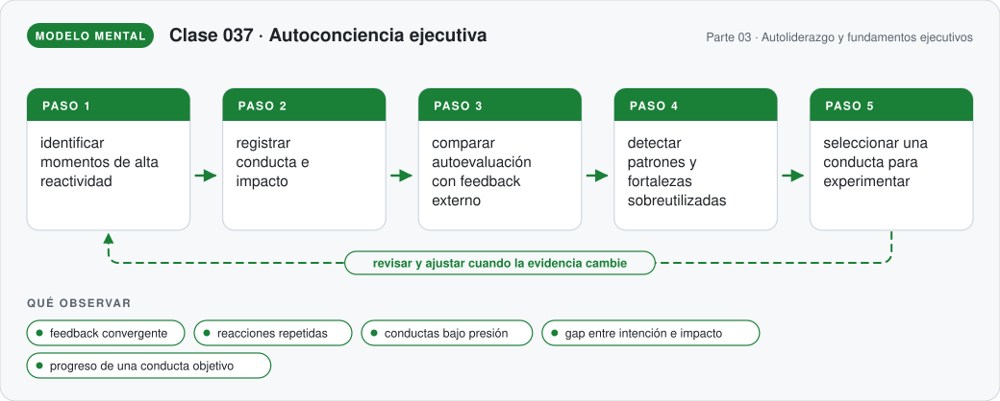

# Clase 037 — Autoconciencia ejecutiva

<!-- nav:inicio -->
> **Parte 03 · Inteligencia emocional, resiliencia y liderazgo adaptativo** — clase 1 de 12 · [índice de la parte](../../README.md) · [temario](../../../../SYLLABUS.md)
<!-- nav:fin -->

**Parte:** 03 — Inteligencia emocional, resiliencia y liderazgo adaptativo  
**Nivel:** Etapa 1 — Profesional → Líder  
**Duración sugerida:** 150–180 minutos · **Estándar:** deep-class-v2

## 🎯 Propósito

Casi todos creemos conocernos bien. Los estudios sobre juicio muestran que solemos equivocarnos justo donde más seguros estamos, y las organizaciones lo confirman: el directivo que no ve su efecto sobre los demás es el último en enterarse. La autoconciencia no es introspección prolongada ni autoindulgencia; es la capacidad de **verse con exactitud**: qué siento, qué hago bien, dónde me equivoco y cómo me perciben.

Esta clase usa el modelo de inteligencia emocional de Daniel Goleman, en el que la autoconciencia es el primer dominio, y la noción de «punto ciego» de Stone y Heen sobre lo que otros ven en nosotros y nosotros no. Al terminar sabrás reconocer una emoción mientras ocurre, contrastar tu autoimagen con evidencia externa y diseñar un mecanismo para recibir información sobre tu efecto en otros.

## 📚 Resultados de aprendizaje

Al finalizar podrás:

1. **Definir** autoconciencia emocional, autoevaluación exacta y confianza en uno mismo según el modelo de Goleman.
2. **Reconocer** una emoción mientras ocurre y nombrarla con precisión.
3. **Identificar** tus puntos ciegos y las fuentes de información que pueden revelarlos.
4. **Reconocer** sesgos que distorsionan la autoevaluación, como el exceso de confianza.
5. **Diseñar** un mecanismo regular para obtener feedback sobre tu efecto en otros.

## 🧭 Agenda

| Tramo | Qué se hace |
|---|---|
| 0–20 min | Recuperación: escribe tres rasgos que crees que otros ven en ti; guarda la lista. |
| 20–60 min | El modelo de Goleman, el cuadrante de conocimiento y los sesgos de autoevaluación. |
| 60–105 min | Ejemplo trabajado: contraste entre la autoimagen y la visión de otros. |
| 105–140 min | Caso ejecutivo: un director que no ve su efecto en el equipo. |
| 140–170 min | Límites y entregable. |

## 🧩 Conceptos centrales

| Concepto | Definición | Cómo se reconoce |
|---|---|---|
| **Inteligencia emocional** | Conjunto de capacidades de reconocer y manejar las propias emociones y las de otros, que Goleman (1996) organiza en cinco dominios. | Se aplica a decisiones concretas, no es un rasgo vago. |
| **Autoconciencia emocional** | Reconocer una emoción en el momento en que ocurre y entender su efecto (Goleman, 1996). | Puedes decir «estoy irritado y por eso respondí seco». |
| **Autoevaluación exacta** | Conocer las propias fortalezas y límites con realismo. | Tu valoración coincide, en lo esencial, con la evidencia. |
| **Punto ciego** | Lo que otros ven en ti y tú no (Stone y Heen, 2014). | Alguien describe una conducta tuya que te sorprende. |
| **Exceso de confianza** | Tendencia a sobreestimar la exactitud de los propios juicios (Kahneman, 2011). | Estás más seguro de lo que tus aciertos justifican. |
| **Feedback sobre el efecto** | Información de otros sobre cómo tu conducta los afecta. | Es específica y proviene de varias personas. |

## 🧠 Modelo mental

**Cómo leer el diagrama.** Las cuatro zonas dependen de dos preguntas: ¿lo sé yo? y ¿lo ven los demás? La zona de mayor riesgo para un directivo es el **punto ciego**, porque su cargo hace que menos personas se lo digan. Se reduce con feedback específico. La zona **reservada** se reduce decidiendo qué compartir para que otros te conozcan.

## 📖 Desarrollo

### 1. Qué es autoconciencia

Goleman organiza la inteligencia emocional en cinco dominios: autoconciencia, autorregulación, motivación, empatía y habilidades sociales. La autoconciencia es la base, porque sin reconocer lo que sentimos no podemos regularlo. Incluye tres capacidades: reconocer las propias emociones y su efecto, evaluarse con realismo y tener una confianza fundada en las propias capacidades.

### 2. Reconocer una emoción mientras ocurre

La emoción se manifiesta primero en el cuerpo y en el pensamiento: tensión, un pensamiento repetido, un impulso de responder. Reconocerla en ese momento abre un margen para decidir qué hacer. Una práctica útil es **nombrar** con precisión: «estoy frustrado porque el plazo cambió sin consulta» es más útil que «estoy mal». Nombrar no elimina la emoción, pero la separa de la acción inmediata.

### 3. Por qué nos equivocamos al evaluarnos

Kahneman muestra que nuestros juicios sobre nosotros mismos están sujetos a los mismos sesgos que los demás: tendemos a sobreestimar la exactitud de lo que creemos saber y a explicar nuestros errores por circunstancias y los de otros por carácter. En un directivo estos sesgos se refuerzan: tiene menos feedback, más validación y más decisiones que le dan la razón.

### 4. Los puntos ciegos

Stone y Heen llaman punto ciego a lo que otros ven en nosotros y nosotros no: el efecto de un tono, un hábito o una omisión. Son difíciles de detectar por definición. La vía principal es la información de otros, específica, de varias fuentes y recibida sin defensa. Un patrón repetido por más de una persona merece atención aunque no lo reconozcas.

### 5. Cómo pedir información sobre tu efecto

Preguntas generales («¿cómo lo hago?») producen respuestas corteses. Funcionan mejor preguntas concretas a personas que te observan: «¿qué hago en las reuniones que hace más difícil que hables?», «¿qué una cosa te gustaría que hiciera distinto?». Pide a tres o cuatro personas con perspectivas distintas, agradece, resume y no discutas. La clase 030 desarrolla cómo recibir feedback.

### 6. Fortalezas, límites y confianza

Una autoevaluación exacta incluye fortalezas: subestimarlas también es un error. La confianza fundada se apoya en evidencia de lo que has logrado y en el conocimiento de lo que aún no sabes. Un directivo con autoconciencia puede decir «esto no lo sé» o «aquí necesito ayuda» sin sentir que pierde autoridad.

### 7. Un hábito sostenible

La autoconciencia se entrena con prácticas breves y regulares: un registro semanal de tres situaciones en que reaccionaste de forma que no querías, con la emoción y lo que la desencadenó; una conversación trimestral con un par de confianza; una revisión de decisiones que salieron mal. La finalidad no es el autoanálisis sino cambiar una conducta concreta.

## 📚 Lectura comparada

| Obra | Qué aporta | Qué no resuelve | Pregunta para contrastar |
|---|---|---|---|
| Goleman (1996) | El modelo de cinco dominios de la inteligencia emocional. | Algunas afirmaciones sobre su peso en el éxito han sido discutidas. | ¿Qué emoción reconoces peor en ti? |
| Goleman, Boyatzis y McKee (2002) | Cómo la autoconciencia del líder afecta al equipo. | Es un texto de gestión, con ejemplos seleccionados. | ¿Qué estado transmites? |
| Stone y Heen (2014) | Los puntos ciegos y cómo recibir información. | No mide la exactitud de la autoevaluación. | ¿Qué te dirían tres personas que no ves? |
| Kahneman (2011) | Sesgos de juicio y exceso de confianza. | No es una guía de liderazgo. | ¿Dónde estás más seguro que tus aciertos? |
| Klein (1999) | Cómo la experiencia entrena el juicio. | No trata de emociones. | ¿Cuándo tu intuición se basa en experiencia y cuándo en deseo? |

## 🧮 Ejemplo trabajado

**Situación (hipotética).** Un gerente de operaciones, Andrés, cree que su estilo es «directo y eficiente». Escribió tres rasgos: «claro, exigente, justo». Pide a cuatro personas dos preguntas: «¿qué hago que ayuda a que el equipo funcione?» y «¿qué hago que lo dificulta?».

| Fuente | Lo que ven en Andrés |
|---|---|
| Par de finanzas | «Claro y rápido para decidir. A veces decide sin consultar a quien debería ejecutar.» |
| Jefa de turno | «Exigente. Cuando se enoja, el equipo deja de traerle los problemas.» |
| Analista | «Justo. Pero interrumpe y no siempre escucha hasta el final.» |
| Su jefe | «Muy bueno en resultados. Me preocupa la rotación en su área.» |

**Lectura.** Tres de cuatro coinciden en un patrón: cuando Andrés se irrita, la información deja de llegarle. Ese es su **punto ciego**: él cree ser «directo»; otros ven que su reacción corta el flujo de problemas.

**Plan.** Andrés registra durante tres semanas las situaciones en que se irrita, la emoción y lo que hizo. Define una práctica: respirar y pedir un resumen antes de responder. Vuelve a preguntar en dos meses.

**Qué muestra.** (1) La autoimagen era parcialmente cierta. (2) El dato valioso vino de coincidencias entre fuentes. (3) El plan apunta a una conducta, no a un rasgo.

## 🔀 Comparación y límites

**Autoconciencia frente a autocrítica.** La autoconciencia es exactitud; la autocrítica excesiva distorsiona tanto como la complacencia y suele paralizar.

**Límites.** El modelo de Goleman es de uso muy extendido, pero algunas afirmaciones sobre el peso de la inteligencia emocional en el éxito profesional han sido objeto de debate, y los instrumentos de medición varían en calidad. El feedback de otros también contiene sesgos y deseos de agradar o de dañar. Triangula varias fuentes y valora los patrones, no los comentarios aislados.

## 🪜 De profesional a owner

| Nivel | Cómo trabaja la autoconciencia |
|---|---|
| **Profesional** | Reconoce sus reacciones y pide feedback concreto a pares. |
| **Jefe / Team Lead** | Es consciente de que su estado de ánimo afecta al equipo y revisa su efecto. |
| **Gerente** | Mantiene canales para que le lleguen verdades incómodas. |
| **CEO / Director** | Reconoce que su cargo filtra la información y busca fuentes independientes. |
| **Founder / Owner** | Distingue entre su convicción y los datos, y escucha a socios y clientes. |

## 🏢 Caso ejecutivo

Un director de producto lleva dos años con resultados sobresalientes. En una evaluación de 360 grados, sus pares y su equipo lo describen como «brillante pero inaccesible»; tres personas clave pidieron traslado en el último año. Él considera que se trata de mala voluntad de personas «poco comprometidas». Su jefe le propone un coaching.

Entrega un **plan de autoconciencia** que contenga: (a) tus hipótesis sobre el patrón y las evidencias que las sustentan o refutan; (b) los sesgos que podrían distorsionar tu lectura; (c) las fuentes de feedback que usarás y las preguntas concretas; (d) la práctica de reconocimiento de emociones; (e) la conducta que cambiarás y cómo se medirá; (f) cuándo y cómo volverás a preguntar.

## 🧪 Práctica

1. Compara la lista de rasgos de la recuperación con lo que te digan tres personas.
2. Registra durante una semana las situaciones en que reaccionaste de forma que no querías, con la emoción.
3. Escribe dos preguntas concretas para pedir feedback sobre tu efecto.
4. Identifica un sesgo que podría afectar tu autoevaluación y cómo lo comprobarás.
5. Define una conducta a cambiar y cómo sabrás si cambió.

## ⚠️ Errores frecuentes

| Error | Por qué ocurre | Cómo corregirlo |
|---|---|---|
| Confiar solo en la introspección | Se cree que uno se conoce | Contrastar con otros. |
| Pedir feedback general | Se evita lo incómodo | Preguntas concretas a varias personas. |
| Defenderse al recibirlo | Se activa un disparador | Agradecer, resumir y reflexionar. |
| Autocrítica excesiva | Se confunde con exactitud | Reconocer también las fortalezas. |
| Analizar sin cambiar | El análisis es cómodo | Definir una conducta y medirla. |
| Desestimar patrones | Se atribuyen a mala voluntad | Valorar lo que repiten varias fuentes. |

## ❓ Preguntas de comprobación

1. ¿Cuáles son los tres componentes de la autoconciencia en el modelo de Goleman?
2. ¿Qué es un punto ciego y cuál es la principal vía para reducirlo?
3. ¿Por qué un directivo es más propenso a tener puntos ciegos?
4. ¿Qué diferencia hay entre nombrar una emoción con precisión y solo sentirla?
5. Formula una pregunta concreta para pedir feedback sobre tu efecto.
6. ¿Qué sesgo describe Kahneman que distorsiona la autoevaluación?
7. ¿Qué límite tiene el modelo de Goleman?

Claves de respuesta

1. Reconocer las propias emociones y su efecto, evaluarse con exactitud y tener confianza fundada en las propias capacidades.
2. Lo que otros ven en ti y tú no; se reduce con feedback específico de varias fuentes.
3. Porque recibe menos feedback y más validación.
4. Nombrar abre un margen entre la emoción y la acción; solo sentirla tiende a conducir a una reacción inmediata.
5. Por ejemplo: «¿Qué hago en las reuniones que hace más difícil que hables?».
6. El exceso de confianza: sobreestimar la exactitud de los propios juicios.
7. Algunas afirmaciones sobre su peso en el éxito profesional son discutidas, y los instrumentos de medición varían.

## 📥 Entregable

Guarda en `portfolio/037-autoconciencia-ejecutiva/`:

- `risk-governance-brief.md` (plantilla [Risk & Governance Brief](../../../../templates/risk-governance-brief.md)) con el plan de autoconciencia del caso ejecutivo;
- `reading-note.md` con una tensión entre Goleman y Stone y Heen;
- `decision-journal.md` con el registro de reacciones, el feedback recibido y la conducta que cambiaste.

## 📗 Fuentes y verificación

- Daniel Goleman — *Emotional Intelligence* (Bloomsbury, 1996). **Uso en esta clase:** el modelo de cinco dominios y la autoconciencia como base. Lectura selectiva sobre **autoconciencia ejecutiva**. **Localizador:** [ISBN-13 9780747528302](https://openlibrary.org/isbn/9780747528302).
- Daniel Goleman, Richard Boyatzis & Annie McKee — *Primal Leadership* (Harvard Business School Press, 2002). **Uso en esta clase:** el efecto del estado emocional del líder en el equipo. Lectura selectiva sobre **autoconciencia ejecutiva**. **Localizador:** [ISBN-13 9781578514861](https://openlibrary.org/isbn/9781578514861).
- Douglas Stone & Sheila Heen — *Thanks for the Feedback* (Viking, 2014). **Uso en esta clase:** los puntos ciegos y cómo recibir información sobre uno mismo. Lectura selectiva sobre **autoconciencia ejecutiva**. **Localizador:** [ISBN-13 9780670014668](https://openlibrary.org/isbn/9780670014668).
- Daniel Kahneman — *Thinking, Fast and Slow* (Farrar, Straus and Giroux, 2011). **Uso en esta clase:** sesgos de juicio y exceso de confianza. Lectura selectiva sobre **autoconciencia ejecutiva**. **Localizador:** [ISBN-13 9780374275631](https://openlibrary.org/isbn/9780374275631).
- Gary Klein — *Sources of Power* (The MIT Press, 1999). **Uso en esta clase:** cómo la experiencia entrena el juicio. Lectura selectiva sobre **autoconciencia ejecutiva**. **Localizador:** [ISBN-13 9780262611466](https://openlibrary.org/isbn/9780262611466).

> **Regla de fuentes para Autoconciencia ejecutiva:** las obras anteriores estructuran las perspectivas de esta materia; cualquier norma, ley o estándar vivo mencionado debe comprobarse nuevamente en su fuente primaria vigente. Los ejemplos y casos son hipotéticos. El desarrollo es original y no reproduce capítulos protegidos.

<!-- pie:inicio -->
---

| Anterior | Índice | Siguiente |
|---|---|---|
| [← 036 · Capstone: comunicar una decisión impopular](../../../02-communication-influence-negotiation-basics/classes/036-capstone-comunicar-una-decision-impopular/README.md) | [Parte 03](../../README.md) · [Programa](../../../../SYLLABUS.md) | [038 · Autorregulación y respuesta bajo presión →](../038-autorregulacion-y-respuesta-bajo-presion/README.md) |
<!-- pie:fin -->
