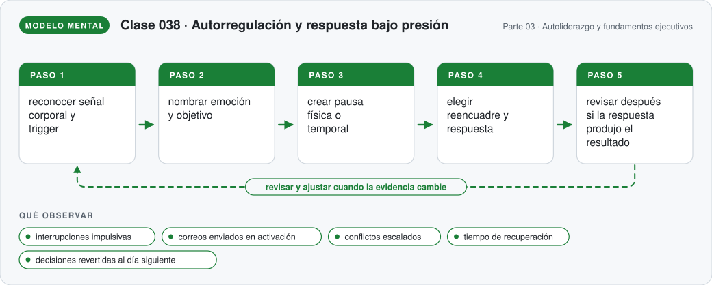

# Clase 038 — Autorregulación y respuesta bajo presión

<!-- nav:inicio -->
> **Parte 03 · Inteligencia emocional, resiliencia y liderazgo adaptativo** — clase 2 de 12 · [índice de la parte](../../README.md) · [temario](../../../../SYLLABUS.md)
<!-- nav:fin -->

**Parte:** 03 — Inteligencia emocional, resiliencia y liderazgo adaptativo  
**Nivel:** Etapa 1 — Profesional → Líder  
**Duración sugerida:** 150–180 minutos · **Estándar:** deep-class-v2

## 🎯 Propósito

Bajo presión, casi todos decimos o hacemos cosas que no haríamos con calma. Para quien dirige, el costo es mayor: un correo escrito con rabia, una frase dicha en una reunión o un silencio hostil se interpretan como señal de la empresa y no como una reacción personal. «Controlarse» suena a contenerse, y la investigación muestra que contenerse es una de las formas menos eficaces de regular una emoción.

Esta clase usa el modelo de proceso de regulación emocional de James Gross, que distingue **cinco puntos** donde se puede intervenir en el curso de una emoción, y concluye que las estrategias que actúan antes de que la emoción se despliegue por completo suelen funcionar mejor que las que actúan sobre su expresión. Al terminar sabrás elegir una estrategia para una situación de presión y preparar de antemano qué harás.

## 📚 Resultados de aprendizaje

Al finalizar podrás:

1. **Describir** los cinco puntos del proceso de regulación emocional de Gross.
2. **Distinguir** estrategias previas a la emoción de estrategias sobre la respuesta.
3. **Explicar** por qué suprimir la expresión no equivale a regular la emoción y qué costos tiene.
4. **Preparar** un plan para una situación de presión: situación, atención, interpretación y respuesta.
5. **Diseñar** una práctica de recuperación inmediata para usar en el momento.

## 🧭 Agenda

| Tramo | Qué se hace |
|---|---|
| 0–20 min | Recuperación: recuerda la última vez que reaccionaste mal bajo presión; ¿en qué momento pudiste intervenir? |
| 20–60 min | El proceso de Gross y las cinco familias de estrategias. |
| 60–105 min | Ejemplo trabajado: una reunión tensa con un plan en cinco puntos. |
| 105–140 min | Caso ejecutivo: una crisis con un cliente. |
| 140–170 min | Límites y entregable. |

## 🧩 Conceptos centrales

| Concepto | Definición | Cómo se reconoce |
|---|---|---|
| **Regulación emocional** | Procesos por los cuales influimos en qué emociones tenemos, cuándo las tenemos y cómo las vivimos y expresamos (Gross, 1998). | Se puede decir qué hiciste para influir en la emoción. |
| **Selección de la situación** | Acercarse o evitar situaciones según la emoción que se espera. | Preparas o evitas el contexto que te desborda. |
| **Modificación de la situación** | Cambiar la situación para alterar su efecto emocional. | Pides más tiempo, divides la tarea. |
| **Despliegue de la atención** | Dirigir la atención hacia o lejos de aspectos de la situación. | Mueves el foco a la tarea o haces una pausa. |
| **Cambio cognitivo (reevaluación)** | Cambiar el significado de la situación para modificar su efecto emocional. | «No me ataca, necesita datos.» |
| **Modulación de la respuesta** | Actuar sobre la expresión de la emoción ya generada, por ejemplo suprimirla. | Contienes el gesto, la voz o la frase. |

## 🧠 Modelo mental

**Cómo leer el diagrama.** La línea del tiempo va de izquierda a derecha: a la izquierda están las estrategias que actúan **antes** de que la emoción se despliegue; a la derecha, la que actúa sobre la respuesta cuando la emoción ya está en marcha. La clase propone preparar los puntos 1 a 4 antes de la situación y dejar el 5 para lo que no se pudo anticipar.

## 📖 Desarrollo

### 1. Qué es regular una emoción

Gross define la regulación emocional como el conjunto de procesos con que influimos sobre qué emociones tenemos, cuándo las tenemos y cómo las vivimos y expresamos. No es eliminar emociones: las emociones informan. Se trata de que no dirijan la conducta cuando no conviene. Y se puede hacer de manera automática o consciente; la clase trabaja la consciente.

### 2. Los cinco puntos

Gross propone que una emoción se genera por una secuencia: una situación, la atención que le damos, la forma en que la interpretamos y la respuesta que produce. En cada paso existe una familia de estrategias: **selección de la situación**, **modificación de la situación**, **despliegue de la atención**, **cambio cognitivo** y **modulación de la respuesta**. Las cuatro primeras son «centradas en los antecedentes», porque actúan antes de que la respuesta emocional se instale; la última se centra en la respuesta.

### 3. Antes de la situación: elegir y modificar

El primer nivel es el más subestimado: **preparar**. Si sabes que una reunión te irrita, puedes llegar con los datos, convocar con una agenda clara, evitar discutir un tema delicado por mensaje o acordar quién modera. Modificar la situación incluye pedir más tiempo, dividir una tarea o sumar a una persona que equilibre. Parecen decisiones logísticas y son regulación emocional anticipada.

### 4. Durante la situación: atención y reinterpretación

El **despliegue de la atención** consiste en mover el foco: de la ofensa a la tarea, de la amenaza a lo que puedes controlar, o a una pausa respiratoria. El **cambio cognitivo** modifica el significado: «ese comentario me ataca» puede reinterpretarse como «necesita información que no tiene». Esta reevaluación actúa en el origen de la emoción y, según la revisión de Gross, tiende a reducir tanto la experiencia como la expresión sin costos añadidos.

### 5. Cuando ya está en marcha: la respuesta

La **modulación de la respuesta** —suprimir el gesto, la voz o la frase— actúa cuando la emoción ya se generó. Según la revisión de Gross, la supresión de la expresión reduce lo que se ve, pero no necesariamente lo que se siente, y tiene costos: exige un esfuerzo sostenido, puede deteriorar la memoria de lo ocurrido y aumenta la activación fisiológica. No significa que sea inútil: a veces es lo único posible en el momento. Pero no debe ser la estrategia principal.

### 6. Una práctica para el momento

Una secuencia breve para usar en la situación: **pausa** (respiración lenta, un par de segundos antes de responder), **nombrar** la emoción («estoy irritado»), **preguntar** («¿qué significado le estoy dando?»), **elegir** una respuesta alineada con tu objetivo. Si la emoción es muy intensa, se pide una pausa con fecha: «necesito pensarlo; te respondo mañana a las diez».

### 7. Cuando el problema es de fondo

La autorregulación individual no resuelve entornos que producen presión crónica y sin sentido. Si la misma situación te desborda cada semana, la intervención es de nivel 1 y 2: cambiar la situación. La clase 047 trata los límites de la sostenibilidad personal.

## 📚 Lectura comparada

| Obra | Qué aporta | Qué no resuelve | Pregunta para contrastar |
|---|---|---|---|
| Gross (1998) | El proceso de regulación y las cinco familias de estrategias. | Es una revisión teórica con experimentos de laboratorio. | ¿En qué punto sueles intervenir? |
| Goleman (1996) | Autorregulación como dominio de la inteligencia emocional. | Con menos precisión conceptual que Gross. | ¿Qué emoción te cuesta más? |
| Goleman, Boyatzis y McKee (2002) | Cómo el estado del líder se transmite. | No distingue estrategias. | ¿Qué estado contagias bajo presión? |
| Kahneman (2011) | Cómo el pensamiento rápido decide bajo estrés. | No trata de regulación. | ¿Qué decisión tomaste rápido y lamentaste? |
| Klein (1999) | Decidir bajo presión de tiempo con experiencia. | Supone experiencia previa. | ¿Cuándo confiar en la reacción inmediata? |

## 🧮 Ejemplo trabajado

**Situación (hipotética).** Una gerente, Paula, debe presentar mañana a la dirección el atraso de un proyecto. El año pasado, un director la interrumpió con dureza en una presentación similar. Siente tensión desde ahora.

| Punto de Gross | Qué hace Paula |
|---|---|
| **1. Elegir la situación** | Pide a su jefe que el atraso se presente en la reunión de seguimiento y no en el comité general, con tiempo reservado. |
| **2. Modificar la situación** | Envía el resumen con anticipación y propone una agenda de tres puntos. |
| **3. Dirigir la atención** | Se prepara con una pregunta: «¿qué decisión necesito de ellos?». Si siente tensión, vuelve a esa pregunta. |
| **4. Reinterpretar** | Reformula: «una interrupción dura probablemente expresa una preocupación por el plazo, no un juicio sobre mí». |
| **5. Modular la respuesta** | Si igual se irrita, hace una pausa de dos segundos, respira y responde con un dato. |

**Resultado.** El director interrumpe, Paula pausa, resume su preocupación («le preocupa el plazo con el cliente; esto es lo que haremos») y la conversación se centra en la decisión.

**Qué muestra.** (1) Cuatro de los cinco puntos se prepararon antes. (2) La reinterpretación cambió la emoción desde el origen. (3) La modulación de la respuesta fue el último recurso, no el primero.

## 🔀 Comparación y límites

**Regular frente a reprimir.** Regular es elegir cómo responder a lo que se siente; reprimir es negarlo. La segunda estrategia tiene costos si se convierte en hábito.

**Límites.** La revisión de Gross es un marco teórico y gran parte de la evidencia proviene de experimentos con estudiantes y tareas de laboratorio; los efectos varían según la persona, la cultura y la situación. Además, la reevaluación no es adecuada cuando la situación es realmente amenazante: reinterpretar un riesgo real como inofensivo es un error. Y la regulación individual no reemplaza el cambio de condiciones de trabajo que generan presión excesiva.

## 🪜 De profesional a owner

| Nivel | Cómo regula |
|---|---|
| **Profesional** | Se prepara para reuniones difíciles y pausa antes de responder por escrito. |
| **Jefe / Team Lead** | Cuida su estado ante el equipo y evita decidir con una emoción intensa. |
| **Gerente** | Anticipa las situaciones de presión de su área y modifica las condiciones. |
| **CEO / Director** | Sabe que su reacción se amplifica y diseña rutinas que protejan su juicio. |
| **Founder / Owner** | Ante la presión financiera, usa las estrategias previas para no decidir con miedo. |

## 🏢 Caso ejecutivo

Un cliente importante amenaza con terminar un contrato por una falla de servicio. El gerente de cuentas recibe el correo un viernes a las 19:30. Siente rabia: la falla fue de otro proveedor. Tiene la tentación de responder de inmediato, con firmeza, copiando a la dirección. El lunes tiene una reunión con el cliente.

Entrega un **plan de autorregulación** que contenga: (a) los cinco puntos aplicados a esta situación; (b) qué harás en los próximos 30 minutos; (c) qué reinterpretaciones son realistas y cuáles serían un autoengaño; (d) cómo preparas la reunión del lunes; (e) qué señal te indica que no debes decidir todavía; (f) cómo reconstruirás la relación si respondes mal.

## 🧪 Práctica

1. Aplica los cinco puntos a una situación de presión que enfrentarás esta semana.
2. Escribe tres cosas que puedes preparar antes de esa situación (puntos 1 y 2).
3. Escribe una reinterpretación realista de una situación que te irrita.
4. Define tu pausa: qué haces en los dos primeros segundos.
5. Escribe una frase para pedir tiempo sin evadir: «necesito pensarlo; te respondo…».

## ⚠️ Errores frecuentes

| Error | Por qué ocurre | Cómo corregirlo |
|---|---|---|
| Contenerse como única estrategia | Se asocia a madurez | Preparar la situación y reinterpretar. |
| Reinterpretar una amenaza real | Se quiere calmar | Distinguir interpretación de negación. |
| Responder de inmediato | Se siente urgencia | Pausar o pedir tiempo con fecha. |
| No prepararse | Se confía en el momento | Anticipar las situaciones previsibles. |
| Ignorar el entorno | Se culpa a la persona | Cambiar las condiciones que generan presión. |
| Regular para no sentir | Se ve la emoción como un defecto | Aceptar la emoción y elegir la respuesta. |

## ❓ Preguntas de comprobación

1. ¿Cuáles son los cinco puntos del proceso de regulación de Gross?
2. ¿Qué diferencia hay entre estrategias centradas en los antecedentes y centradas en la respuesta?
3. ¿Qué costos asocia la revisión de Gross a suprimir la expresión?
4. Da un ejemplo de modificación de la situación y de despliegue de la atención.
5. ¿Cuándo no es adecuada la reevaluación?
6. ¿Qué secuencia breve usarías en el momento de la presión?
7. ¿Qué límite tiene la evidencia de Gross?

Claves de respuesta

1. Selección de la situación, modificación de la situación, despliegue de la atención, cambio cognitivo y modulación de la respuesta.
2. Las primeras actúan antes de que la respuesta emocional se instale; las segundas, sobre la expresión de una emoción ya generada.
3. Reduce lo que se ve pero no necesariamente lo que se siente, exige esfuerzo, puede afectar la memoria y aumenta la activación fisiológica.
4. Modificar: pedir más tiempo o dividir la tarea. Atención: mover el foco a la tarea o hacer una pausa respiratoria.
5. Cuando la situación es realmente amenazante: reinterpretar un riesgo real como inofensivo es un error.
6. Pausa, nombrar la emoción, preguntar qué significado le doy y elegir la respuesta; si es muy intensa, pedir una pausa con fecha.
7. Proviene sobre todo de experimentos de laboratorio, y los efectos varían según la persona, la cultura y la situación.

## 📥 Entregable

Guarda en `portfolio/038-autorregulacion-y-respuesta-bajo-presion/`:

- `leadership-decision-brief.md` (plantilla [Leadership Decision Brief](../../../../templates/leadership-decision-brief.md)) con el plan de autorregulación del caso ejecutivo;
- `reading-note.md` con una tensión entre Gross y Goleman;
- `decision-journal.md` con la situación, los puntos que aplicaste y el resultado.

## 📗 Fuentes y verificación

- James J. Gross — *The Emerging Field of Emotion Regulation: An Integrative Review* (Review of General Psychology, 1998). **Uso en esta clase:** el proceso de regulación emocional y sus cinco familias de estrategias. Lectura selectiva sobre **autorregulación y respuesta bajo presión**. **Localizador:** [DOI 10.1037/1089-2680.2.3.271](https://doi.org/10.1037/1089-2680.2.3.271).
- Daniel Goleman — *Emotional Intelligence* (Bloomsbury, 1996). **Uso en esta clase:** la autorregulación como dominio de la inteligencia emocional. Lectura selectiva sobre **autorregulación y respuesta bajo presión**. **Localizador:** [ISBN-13 9780747528302](https://openlibrary.org/isbn/9780747528302).
- Daniel Goleman, Richard Boyatzis & Annie McKee — *Primal Leadership* (Harvard Business School Press, 2002). **Uso en esta clase:** cómo el estado del líder se transmite al equipo. Lectura selectiva sobre **autorregulación y respuesta bajo presión**. **Localizador:** [ISBN-13 9781578514861](https://openlibrary.org/isbn/9781578514861).
- Daniel Kahneman — *Thinking, Fast and Slow* (Farrar, Straus and Giroux, 2011). **Uso en esta clase:** cómo decide el pensamiento rápido bajo estrés. Lectura selectiva sobre **autorregulación y respuesta bajo presión**. **Localizador:** [ISBN-13 9780374275631](https://openlibrary.org/isbn/9780374275631).
- Gary Klein — *Sources of Power* (The MIT Press, 1999). **Uso en esta clase:** decidir bajo presión de tiempo con experiencia. Lectura selectiva sobre **autorregulación y respuesta bajo presión**. **Localizador:** [ISBN-13 9780262611466](https://openlibrary.org/isbn/9780262611466).

> **Regla de fuentes para Autorregulación y respuesta bajo presión:** las obras anteriores estructuran las perspectivas de esta materia; cualquier norma, ley o estándar vivo mencionado debe comprobarse nuevamente en su fuente primaria vigente. Los ejemplos y casos son hipotéticos. Esta clase no sustituye atención profesional de salud mental. El desarrollo es original y no reproduce capítulos protegidos.

<!-- pie:inicio -->
---

| Anterior | Índice | Siguiente |
|---|---|---|
| [← 037 · Autoconciencia ejecutiva](../037-autoconciencia-ejecutiva/README.md) | [Parte 03](../../README.md) · [Programa](../../../../SYLLABUS.md) | [039 · Empatía sin perder exigencia →](../039-empatia-sin-perder-exigencia/README.md) |
<!-- pie:fin -->
