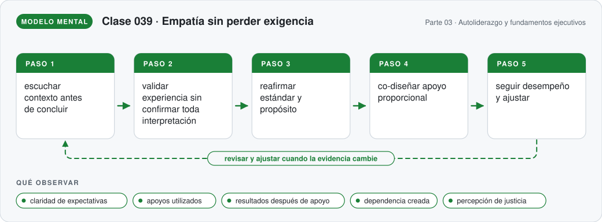

# Clase 039 — Empatía sin perder exigencia

<!-- nav:inicio -->
> **Parte 03 · Inteligencia emocional, resiliencia y liderazgo adaptativo** — clase 3 de 12 · [índice de la parte](../../README.md) · [temario](../../../../SYLLABUS.md)
<!-- nav:fin -->

**Parte:** 03 — Inteligencia emocional, resiliencia y liderazgo adaptativo  
**Nivel:** Etapa 1 — Profesional → Líder  
**Duración sugerida:** 150–180 minutos · **Estándar:** deep-class-v2

## 🎯 Propósito

Muchos líderes creen que deben elegir: ser empáticos, y arriesgarse a bajar el estándar, o ser exigentes, y arriesgarse a ser duros. Esa elección es falsa, y quien la acepta produce dos fallas conocidas: el jefe que no se atreve a decir lo que ayudaría porque «no quiere hacerlo sentir mal», y el que dice todo sin ocuparse de cómo se recibe. En ambos casos la persona no recibe lo que necesita para mejorar.

Esta clase usa la noción de empatía como competencia de Daniel Goleman y el marco práctico de Kim Scott, que propone dos ejes independientes: **interesarse personalmente** por la persona y **desafiarla directamente**. Al terminar sabrás ubicar tu conducta en el cuadrante, reconocer cuándo la empatía se convierte en evitación y formular un mensaje exigente que se pueda escuchar.

## 📚 Resultados de aprendizaje

Al finalizar podrás:

1. **Definir** empatía como percibir y comprender las emociones de otro, y distinguirla de complacencia.
2. **Ubicar** una conducta en el cuadrante de interés personal y desafío directo.
3. **Reconocer** la empatía ruinosa y la agresión odiosa como fallas opuestas.
4. **Formular** un mensaje exigente con interés genuino, hechos y petición clara.
5. **Sostener** un estándar ante la reacción emocional del otro sin ceder ni endurecerte.

## 🧭 Agenda

| Tramo | Qué se hace |
|---|---|
| 0–20 min | Recuperación: recuerda un jefe que te exigió y te cuidó a la vez, y otro que solo hizo una de las dos cosas. |
| 20–60 min | Empatía, exigencia y el cuadrante. |
| 60–105 min | Ejemplo trabajado: un mismo mensaje en las cuatro posturas. |
| 105–140 min | Caso ejecutivo: un colaborador muy apreciado con desempeño insuficiente. |
| 140–170 min | Límites y entregable. |

## 🧩 Conceptos centrales

| Concepto | Definición | Cómo se reconoce |
|---|---|---|
| **Empatía** | Percibir y comprender los sentimientos y puntos de vista de otros, e interesarse activamente por sus preocupaciones (Goleman, 1996). | Puedes describir lo que el otro siente y por qué. |
| **Interesarse personalmente** | Preocuparse genuinamente por la persona como un todo, no solo por su rendimiento (Scott, 2017). | Conoces qué le importa y se nota en lo que haces. |
| **Desafiar directamente** | Decir con claridad lo que no está bien o puede mejorar (Scott, 2017). | El mensaje no deja dudas sobre qué cambiar. |
| **Franqueza radical** | Interesarse personalmente y desafiar directamente a la vez (Scott, 2017). | La persona sabe que le importa y qué debe cambiar. |
| **Empatía ruinosa** | Interesarse sin desafiar: se evita decir lo que ayudaría (Scott, 2017). | Se calla para no incomodar. |
| **Agresión odiosa** | Desafiar sin interesarse (Scott, 2017). | Se dice lo duro sin cuidar la forma. |

## 🧠 Modelo mental

**Cómo leer el diagrama.** Dos ejes independientes: cuánto te importa la persona y cuánto desafías. La esquina superior derecha combina ambos. Las otras tres son fallas: no desafiar (empatía ruinosa), no interesarse (agresión odiosa) o ninguna de las dos (insinceridad manipuladora). Moverse hacia la derecha-arriba exige aumentar la parte que te cuesta, no reducir la que te sobra.

## 📖 Desarrollo

### 1. Empatía no es acuerdo ni complacencia

Goleman describe la empatía como una competencia social: percibir las emociones de otros, comprender su perspectiva e interesarse por sus preocupaciones. No implica compartir su opinión ni evitar el desacuerdo. Un jefe puede entender perfectamente por qué alguien está desanimado y, aun así, mantener un estándar. La empatía **informa** cómo comunicar; no decide qué se exige.

### 2. Dos ejes, no uno

Scott propone que se trata de dos dimensiones separadas. Es posible, y común, tener poco de una y mucho de la otra. Un líder que se ve a sí mismo como «bueno con la gente» puede estar en el cuadrante de empatía ruinosa; otro que se ve como «claro y exigente» puede estar en agresión odiosa. Lo que importa no es cómo te ves sino cómo lo experimenta quien te recibe.

### 3. Las cuatro fallas y el acierto

**Franqueza radical:** «El informe no tiene el nivel que necesitamos; te muestro dónde y cómo mejorarlo, porque quiero que tengas éxito». **Empatía ruinosa:** «Está bien, no te preocupes», cuando no está bien. **Agresión odiosa:** «Esto es un desastre; ¿cómo se te ocurre?». **Insinceridad manipuladora:** halagar o callar según convenga. Las tres últimas protegen a quien habla, no a quien escucha.

### 4. Cómo se ve una exigencia empática

Un mensaje exigente que puede escucharse tiene cuatro rasgos: **intención clara** («quiero que lo logres»), **hechos observables** (no inferencias sobre la persona), **una petición concreta** y **disposición a escuchar** su perspectiva. Un ejemplo: «Las dos últimas entregas llegaron con errores de cifras que el cliente detectó. Necesito que revises con una lista antes de enviar. ¿Qué te lo ha dificultado?». Compárese con «tienes que ser más cuidadoso».

### 5. Sostener el estándar ante la emoción del otro

La reacción emocional del otro —llanto, enojo, silencio— no cambia el hecho. La conducta útil es **reconocer la emoción** sin ceder en el contenido: «veo que esto te afecta; el estándar sigue siendo el mismo, y quiero ayudarte a alcanzarlo». Si la emoción impide conversar, se pausa con fecha, pero el mensaje se completa. Ceder para evitar la incomodidad es empatía ruinosa disfrazada.

### 6. Conocer a la persona

El interés personal no es intromisión ni confidencia forzada. Es saber qué le importa a cada persona de tu equipo —su desarrollo, su familia, su estabilidad— en la medida en que ella quiera compartirlo, y actuar en consecuencia. Sin esa base, la exigencia se vive como ataque; con ella, como apuesta por su capacidad.

### 7. Límites del enfoque

El marco de Scott es práctico y nace de la experiencia del autor en empresas tecnológicas; no es el resultado de una investigación sistemática. Además, lo «directo» se interpreta distinto según la cultura y la jerarquía; adapta la forma, no el contenido. Y el interés personal no se simula: la gente distingue la preocupación genuina de la táctica.

## 📚 Lectura comparada

| Obra | Qué aporta | Qué no resuelve | Pregunta para contrastar |
|---|---|---|---|
| Scott (2017) | El cuadrante de interés personal y desafío directo. | Es un marco práctico sin validación sistemática. | ¿En qué cuadrante te ubicaría tu equipo? |
| Goleman (1996) | Empatía como competencia. | No da una estructura de mensaje. | ¿Qué siente la persona ante lo que vas a decir? |
| Goleman, Boyatzis y McKee (2002) | El efecto emocional del líder. | No trata de estándares. | ¿Qué estado transmites al exigir? |
| Stone, Patton y Heen (1999) | Cómo conducir la conversación difícil. | No distingue ejes. | ¿Qué parte de la conversación evitas? |
| Edmondson (2018) | Exigencia y seguridad psicológica como ejes. | No es un método de feedback. | ¿Tu exigencia es compatible con que te digan la verdad? |
| Brown (2018) | Claridad como forma de cuidado: «ser claro es ser amable». | Es un texto de liderazgo con ejemplos seleccionados. | ¿Qué incomodidad evitas diciendo menos de lo que sabes? |

## 🧮 Ejemplo trabajado

**Situación (hipotética).** Un jefe, Daniel, debe decirle a Rosa, una analista muy querida en el equipo, que sus informes de los últimos dos meses tuvieron errores de cálculo que el cliente detectó. Rosa atraviesa un momento personal difícil.

| Postura | Lo que Daniel le dice |
|---|---|
| **Empatía ruinosa** | «Sé que estás pasando por mucho; no te preocupes por los informes.» |
| **Agresión odiosa** | «Los dos últimos informes tuvieron errores. Esto es inaceptable.» |
| **Insinceridad manipuladora** | «Estás haciendo un gran trabajo» (y pide a otra persona que revise todo sin decirle nada). |
| **Franqueza radical** | «Rosa, me importa cómo estás y por eso quiero ser claro: en dos informes el cliente encontró errores de cálculo. Necesito que revises con una lista antes de enviar. ¿Qué puedo hacer para ayudarte en este momento, sin bajar el estándar?» |

**Reacción.** Rosa llora y dice que se siente fracasada. Daniel reconoce: «Entiendo que esto te duele. El estándar sigue siendo el mismo, y creo que puedes alcanzarlo. Revisemos juntos el primer informe de la semana».

**Qué muestra.** (1) Las tres primeras posturas protegen a Daniel, no a Rosa. (2) La cuarta combina cuidado y claridad. (3) Daniel sostiene el contenido ante la emoción y ofrece apoyo concreto.

## 🔀 Comparación y límites

**Empatía frente a compasión.** La empatía percibe lo que el otro siente; la compasión añade el deseo de ayudar. En el trabajo se necesita la segunda: ayuda para alcanzar el estándar.

**Límites.** El cuadrante es un esquema práctico sin evidencia experimental propia, y puede usarse como etiqueta para juzgar a otros. Hay situaciones donde la exigencia directa no es la mejor primera respuesta: una persona en crisis personal grave necesita primero apoyo y tiempo. Y el cuidado debe ser genuino: una técnica de franqueza usada para manipular es la cuarta postura.

## 🪜 De profesional a owner

| Nivel | Cómo combina empatía y exigencia |
|---|---|
| **Profesional** | Dice con claridad a un par lo que necesita, con respeto. |
| **Jefe / Team Lead** | Da feedback exigente y apoya a cada persona según sus circunstancias. |
| **Gerente** | Sostiene estándares entre áreas y cuida a quienes los alcanzan con esfuerzo. |
| **CEO / Director** | Mantiene la exigencia de resultados y el cuidado de las personas en decisiones difíciles. |
| **Founder / Owner** | Exige a quienes quiere, y quiere a quienes exige, sabiendo que la relación personal convive con la de negocio. |

## 🏢 Caso ejecutivo

Una directora tiene en su equipo a un gerente con doce años en la empresa, querido por todos, cuyos resultados cayeron por tercer trimestre consecutivo. Ella evitó la conversación varias veces porque sabe que su hijo estuvo enfermo. Dos gerentes más jóvenes ya sienten que cargan con su trabajo. El comité de remuneraciones se reúne en cuatro semanas.

Entrega un **plan de conversación** que contenga: (a) tu ubicación actual en el cuadrante y la evidencia; (b) los hechos observables del desempeño; (c) lo que sabes de su situación personal y cómo la reconocerás sin condicionar el estándar; (d) el mensaje con intención, hechos, petición y escucha; (e) cómo reaccionarás ante su emoción; (f) el apoyo que ofrecerás y el plazo y las consecuencias.

## 🧪 Práctica

1. Ubica tu última conversación de feedback en el cuadrante y justifica con lo que dijiste.
2. Reescribe una frase de empatía ruinosa o de agresión odiosa como franqueza radical.
3. Escribe qué le importa a cada persona de tu equipo, según lo que ella te ha compartido.
4. Prepara una frase para reconocer la emoción sin ceder el estándar.
5. Identifica una conversación que evitas por «cuidar» y programa una fecha.

## ⚠️ Errores frecuentes

| Error | Por qué ocurre | Cómo corregirlo |
|---|---|---|
| Callar por cuidar | Se confunde cuidado con evitación | Decirlo con hechos y apoyo. |
| Ser duro para ser claro | Se confunde claridad con dureza | Cuidar la forma sin diluir el fondo. |
| Ceder ante la emoción | Incomoda | Reconocerla y mantener el contenido. |
| Fingir interés | Se usa como técnica | Interesarse de verdad o no decir que se hace. |
| Exigir sin apoyar | Se supone que basta con decirlo | Ofrecer ayuda concreta y plazos. |
| Tratar igual a todos | Se confunde equidad con uniformidad | Adaptar la forma a cada persona. |

## ❓ Preguntas de comprobación

1. ¿Cuáles son los dos ejes del cuadrante de Scott?
2. ¿Qué diferencia hay entre empatía y complacencia?
3. ¿Qué es la empatía ruinosa y por qué «protege» a quien habla?
4. ¿Qué cuatro rasgos tiene un mensaje exigente que puede escucharse?
5. ¿Qué haces si la persona llora al recibir un mensaje difícil?
6. ¿Qué límite tiene el marco de Scott?
7. Reescribe «tienes que ser más cuidadoso» como franqueza radical.

Claves de respuesta

1. Interesarse personalmente por la persona y desafiarla directamente.
2. La empatía comprende lo que el otro siente; la complacencia evita incomodar y cede en el estándar.
3. Interesarse sin desafiar: se calla lo que ayudaría; protege la comodidad de quien habla, no el aprendizaje del otro.
4. Intención clara, hechos observables, petición concreta y disposición a escuchar.
5. Reconocer la emoción sin ceder el contenido, y pausar con fecha si no puede conversar.
6. Es un marco práctico sin validación experimental propia y su sentido de lo «directo» depende de la cultura.
7. Por ejemplo: «Las dos últimas entregas tuvieron errores que el cliente detectó. Quiero que sigas aquí, y necesito que revises con una lista. ¿Qué te lo ha dificultado?».

## 📥 Entregable

Guarda en `portfolio/039-empatia-sin-perder-exigencia/`:

- `risk-governance-brief.md` (plantilla [Risk & Governance Brief](../../../../templates/risk-governance-brief.md)) con el plan de conversación del caso ejecutivo;
- `reading-note.md` con una tensión entre Scott y Goleman;
- `decision-journal.md` con el mensaje, la reacción y el seguimiento.

## 📗 Fuentes y verificación

- Kim Scott — *Radical Candor* (PAN MACMILLAN U.K, 2017). **Uso en esta clase:** el cuadrante de interés personal y desafío directo. Lectura selectiva sobre **empatía sin perder exigencia**. **Localizador:** [ISBN-13 9781509845385](https://openlibrary.org/isbn/9781509845385).
- Daniel Goleman — *Emotional Intelligence* (Bloomsbury, 1996). **Uso en esta clase:** la empatía como competencia. Lectura selectiva sobre **empatía sin perder exigencia**. **Localizador:** [ISBN-13 9780747528302](https://openlibrary.org/isbn/9780747528302).
- Daniel Goleman, Richard Boyatzis & Annie McKee — *Primal Leadership* (Harvard Business School Press, 2002). **Uso en esta clase:** el efecto emocional del líder al exigir. Lectura selectiva sobre **empatía sin perder exigencia**. **Localizador:** [ISBN-13 9781578514861](https://openlibrary.org/isbn/9781578514861).
- Douglas Stone, Bruce Patton & Sheila Heen — *Difficult Conversations* (Random House Audio, 1999). **Uso en esta clase:** conducir la conversación difícil. Lectura selectiva sobre **empatía sin perder exigencia**. **Localizador:** [ISBN-13 9780553525687](https://openlibrary.org/isbn/9780553525687).
- Amy C. Edmondson — *The Fearless Organization* (Wiley, 2018). **Uso en esta clase:** exigencia y seguridad psicológica como ejes. Lectura selectiva sobre **empatía sin perder exigencia**. **Localizador:** [ISBN-13 9781119477242](https://openlibrary.org/isbn/9781119477242).
- Brené Brown — *Dare to Lead* (Ebury Publishing, 2018). **Uso en esta clase:** la claridad como forma de cuidado. Lectura selectiva sobre **empatía sin perder exigencia**. **Localizador:** [ISBN-13 9781473562523](https://openlibrary.org/isbn/9781473562523).

> **Regla de fuentes para Empatía sin perder exigencia:** las obras anteriores estructuran las perspectivas de esta materia; cualquier norma, ley o estándar vivo mencionado debe comprobarse nuevamente en su fuente primaria vigente. Los ejemplos y casos son hipotéticos. El desarrollo es original y no reproduce capítulos protegidos.

<!-- pie:inicio -->
---

| Anterior | Índice | Siguiente |
|---|---|---|
| [← 038 · Autorregulación y respuesta bajo presión](../038-autorregulacion-y-respuesta-bajo-presion/README.md) | [Parte 03](../../README.md) · [Programa](../../../../SYLLABUS.md) | [040 · Motivación y propósito →](../040-motivacion-y-proposito/README.md) |
<!-- pie:fin -->
