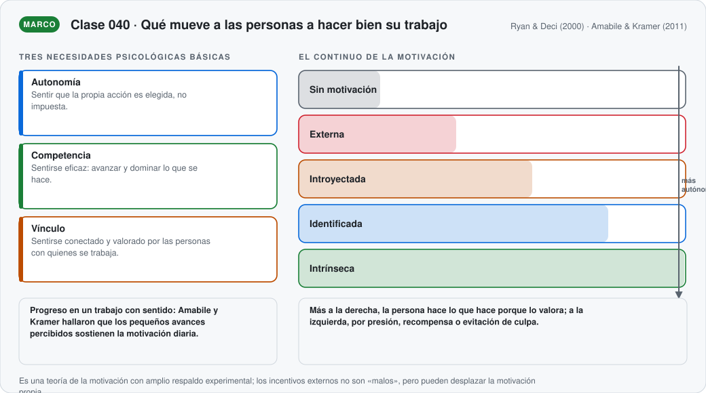

# Clase 040 — Motivación y propósito

<!-- nav:inicio -->
> **Parte 03 · Inteligencia emocional, resiliencia y liderazgo adaptativo** — clase 4 de 12 · [índice de la parte](../../README.md) · [temario](../../../../SYLLABUS.md)
<!-- nav:fin -->

**Parte:** 03 — Inteligencia emocional, resiliencia y liderazgo adaptativo  
**Nivel:** Etapa 1 — Profesional → Líder  
**Duración sugerida:** 150–180 minutos · **Estándar:** deep-class-v2

## 🎯 Propósito

«Motivar» al equipo suele significar ofrecer incentivos o pronunciar discursos. Ambos funcionan menos de lo que se espera, y a veces empeoran lo que pretendían mejorar. La investigación sobre motivación muestra que las personas se mueven mejor cuando se satisfacen tres necesidades básicas: sentir que **eligen** lo que hacen, sentirse **competentes** y sentirse **conectadas** con otras. Un líder no motiva a nadie; **crea condiciones** donde la motivación propia aparece.

Esta clase usa la teoría de la autodeterminación de Ryan y Deci, el análisis de Pink sobre autonomía, maestría y propósito y la investigación de Amabile y Kramer sobre el papel del progreso. Al terminar sabrás diagnosticar qué necesidad falla en una persona o equipo, diseñar condiciones de trabajo que la atiendan y usar incentivos sin dañar la motivación propia.

## 📚 Resultados de aprendizaje

Al finalizar podrás:

1. **Describir** las tres necesidades de la teoría de la autodeterminación y el continuo de motivación.
2. **Diagnosticar** qué necesidad no se satisface en un caso concreto de baja motivación.
3. **Diseñar** condiciones de autonomía, competencia y vínculo en un equipo.
4. **Usar** incentivos externos sin desplazar la motivación propia.
5. **Aplicar** el principio de progreso para sostener la motivación diaria.

## 🧭 Agenda

| Tramo | Qué se hace |
|---|---|
| 0–20 min | Recuperación: recuerda un trabajo que hiciste con ganas y otro que hiciste por obligación; ¿qué cambió? |
| 20–60 min | La teoría de la autodeterminación y el continuo de motivación. |
| 60–105 min | Ejemplo trabajado: diagnóstico de un equipo desmotivado. |
| 105–140 min | Caso ejecutivo: rediseñar el trabajo de un área de soporte. |
| 140–170 min | Límites y entregable. |

## 🧩 Conceptos centrales

| Concepto | Definición | Cómo se reconoce |
|---|---|---|
| **Motivación intrínseca** | Hacer algo por la satisfacción de hacerlo (Ryan y Deci, 2000). | La persona lo haría sin recompensa externa. |
| **Motivación extrínseca** | Hacer algo por una consecuencia separable de la actividad (Ryan y Deci, 2000). | La conducta depende de premios o castigos. |
| **Autonomía** | Necesidad de sentir que la propia conducta es elegida y es expresión de uno mismo (Ryan y Deci, 2000). | La persona tiene voz sobre cómo hacer su trabajo. |
| **Competencia** | Necesidad de sentirse eficaz en lo que se hace (Ryan y Deci, 2000). | Siente que avanza y domina. |
| **Vínculo** | Necesidad de sentirse conectado con otros (Ryan y Deci, 2000). | Siente pertenencia y valoración. |
| **Principio de progreso** | De todos los factores que alimentan la vida laboral, el más potente es avanzar en un trabajo con sentido (Amabile y Kramer, 2011). | Los pequeños avances se notan y se reconocen. |

## 🧠 Modelo mental

**Cómo leer el diagrama.** A la izquierda, las tres necesidades cuya satisfacción favorece la motivación autónoma. A la derecha, el continuo: cuanto más a la derecha, más la persona hace lo que hace porque lo valora; cuanto más a la izquierda, más lo hace por presión o recompensa. El líder no puede mover a nadie, pero sí puede cambiar las condiciones que desplazan la motivación hacia un lado u otro.

## 📖 Desarrollo

### 1. Motivar es crear condiciones

La teoría de la autodeterminación sostiene que las personas tienen tendencia al crecimiento y a la implicación, y que esa tendencia se favorece o se frustra según el entorno. Un jefe no «motiva» a otro como quien enciende una luz; ofrece o quita las condiciones en que la motivación se sostiene. Por eso hablar de motivar es menos útil que preguntar: *¿qué condiciones de este trabajo están ayudando o dañando la motivación de esta persona?*

### 2. Las tres necesidades

La **autonomía** no es hacer lo que uno quiera; es sentir que lo que se hace se elige y tiene sentido. Se favorece dando voz sobre cómo se trabaja, explicando razones, ofreciendo opciones. La **competencia** es sentirse eficaz: requiere desafíos al alcance, feedback informativo y oportunidad de dominar. El **vínculo** es sentirse parte y valorado: se favorece con trato respetuoso, interés genuino y pertenencia al equipo. Si una de las tres falla, la motivación sufre aunque las demás estén bien.

### 3. Un continuo, no una dicotomía

La teoría no divide entre motivación «buena» e «incentivos malos». Distingue grados de autonomía: la **ausencia de motivación**, la **externa** (se hace por premio o castigo), la **introyectada** (se hace para evitar culpa o ganar aprobación), la **identificada** (se hace porque se valora su resultado) y la **intrínseca** (se hace por interés). Las actividades que no interesan por sí mismas pueden vivirse de forma autónoma si la persona comprende su sentido y las integra a sus valores.

### 4. Incentivos: cuándo ayudan y cuándo dañan

Pink, apoyándose en esta investigación, argumenta que para tareas rutinarias y bien definidas, los incentivos externos funcionan; para tareas que requieren creatividad y juicio, pueden ser contraproducentes si se perciben como control. La implicación práctica es que **cómo** se usa el incentivo importa: informar sobre la competencia («lo hiciste bien») sostiene la motivación; controlar la conducta («si lo haces, recibes») tiende a desplazarla. Explica los criterios, evita sorpresas y no uses la recompensa como sustituto del sentido.

### 5. Autonomía, maestría y propósito

Pink resume el hallazgo en tres palabras: **autonomía** (dirigir la propia tarea), **maestría** (el deseo de mejorar) y **propósito** (servir algo mayor que uno mismo). Son una lectura de divulgación de la teoría, útil para conversar con equipos. Un propósito no se declara en una pared; se experimenta cuando la persona ve a quién beneficia su trabajo y por qué importa.

### 6. El principio de progreso

Amabile y Kramer analizaron miles de entradas de diarios de trabajadores del conocimiento y concluyeron que el factor que más favorecía una buena «vida interior laboral» era el **progreso en un trabajo con sentido**, incluso pequeño. Los líderes pueden favorecerlo eliminando obstáculos, definiendo objetivos claros, dando recursos y haciendo visibles los avances. Y pueden dañarlo con cambios constantes de prioridad, trabajo que parece no llevar a ningún lado o reconocimiento ausente.

### 7. Diagnosticar antes de intervenir

Ante una persona o equipo con baja motivación, pregunta: ¿pierde **autonomía** (microgestión, decisiones impuestas)?, ¿pierde **competencia** (tareas muy fáciles o imposibles, falta de feedback)?, ¿pierde **vínculo** (aislamiento, trato injusto)?, ¿falta **sentido** (no sabe para qué)?, ¿o hay un problema de **condiciones** (sobrecarga, incentivos contradictorios)? La respuesta orienta la intervención. No siempre es un problema de la persona.

## 📚 Lectura comparada

| Obra | Qué aporta | Qué no resuelve | Pregunta para contrastar |
|---|---|---|---|
| Ryan y Deci (2000) | Tres necesidades y continuo de motivación. | Es una teoría general, no una guía de gestión. | ¿Qué necesidad está frustrada en tu equipo? |
| Pink (2009) | Autonomía, maestría y propósito, y los límites de los incentivos. | Divulgación; simplifica la investigación. | ¿Qué incentivo podría estar desplazando motivación propia? |
| Amabile y Kramer (2011) | El principio de progreso. | Se basa en diarios de equipos concretos. | ¿Qué avance de esta semana hiciste visible? |
| Goleman, Boyatzis y McKee (2002) | Cómo el líder influye en la motivación por su estilo. | No usa la teoría de la autodeterminación. | ¿Qué estilo usas y qué efecto tiene? |
| Edmondson (2018) | Seguridad psicológica como condición de la implicación. | No trata de incentivos. | ¿Qué cuesta a tu equipo proponer algo? |
| Christensen et al. (2017) | Cómo los factores de higiene se distinguen de lo que motiva de verdad. | Es una obra de reflexión personal y de gestión. | ¿Qué de tu trabajo es higiene y qué es motivación? |

## 🧮 Ejemplo trabajado

**Situación (hipotética).** Un jefe de soporte observa que su equipo, antes comprometido, ahora hace lo mínimo. Introdujo hace seis meses un bono por tickets cerrados y reportes diarios de productividad.

| Necesidad | Qué cambió | Efecto |
|---|---|---|
| **Autonomía** | El bono por tickets define cómo priorizar; los reportes diarios controlan el ritmo. | Se percibe control: «hago lo que mide el bono». |
| **Competencia** | Se cierran tickets simples para sumar puntos; los complejos se evitan. | Menos oportunidades de dominar. |
| **Vínculo** | El ranking individual reemplazó el reconocimiento al equipo. | Menos colaboración. |
| **Sentido** | Nadie explica qué efecto tiene el soporte en los clientes. | Se pierde el propósito. |

**Intervención.** El jefe (1) cambia el bono individual por una meta de equipo ligada a satisfacción del cliente; (2) devuelve a cada persona la decisión sobre cómo organizar su día; (3) crea un espacio semanal para casos complejos con reconocimiento de quienes los resuelven; (4) comparte cada semana un caso de cliente donde el soporte hizo la diferencia; (5) elimina el reporte diario y deja uno semanal.

**Qué muestra.** (1) El incentivo, mal diseñado, desplazó la motivación propia. (2) El diagnóstico fue por necesidad, no por culpa de las personas. (3) Cada medida apunta a una condición.

## 🔀 Comparación y límites

**Motivación frente a compromiso.** El compromiso incluye la conducta sostenida y la identificación con la organización; la motivación es una condición para ello. Un equipo motivado por una tarea puede no estar comprometido con la empresa.

**Límites.** La teoría de la autodeterminación tiene amplio respaldo, pero se ha estudiado sobre todo en educación, salud y trabajo en entornos específicos; los resultados varían por cultura. Los libros de divulgación simplifican los hallazgos. Los incentivos externos no son «malos»: en tareas rutinarias funcionan y un salario justo es una condición, no un motivador. Y ninguna estrategia reemplaza condiciones decentes de trabajo.

## 🪜 De profesional a owner

| Nivel | Cómo trabaja la motivación |
|---|---|
| **Profesional** | Diseña su trabajo para tener avances visibles y pide el sentido de lo que hace. |
| **Jefe / Team Lead** | Da voz, feedback informativo y reconoce el progreso. |
| **Gerente** | Diseña incentivos que no controlen y evita cambios constantes de prioridad. |
| **CEO / Director** | Cuida que la estrategia dé sentido al trabajo y que los sistemas de incentivos no lo desplacen. |
| **Founder / Owner** | Convive con la tentación de motivar con urgencia; construye propósito compartido con su equipo. |

## 🏢 Caso ejecutivo

Una empresa de servicios financieros tiene un área de operaciones que procesa solicitudes. La rotación subió del 12 % al 30 % en un año. Introdujo metas diarias individuales y pantallas con el ranking. Los clientes se quejan de respuestas apresuradas; el equipo dice que «nadie escucha». La directora quiere subir el bono.

Entrega un **diagnóstico y plan de motivación** que contenga: (a) el análisis por necesidad —autonomía, competencia, vínculo y sentido— con la evidencia; (b) las condiciones que cambiarás y por qué; (c) cómo rediseñarás los incentivos sin controlar la conducta; (d) cómo harás visible el progreso; (e) cómo medirás el efecto; (f) qué evidencia te haría concluir que el problema son las condiciones y no las personas.

## 🧪 Práctica

1. Elige a una persona de tu equipo y evalúa qué necesidad está más satisfecha y cuál menos.
2. Revisa un incentivo que usas: ¿informa sobre la competencia o controla la conducta?
3. Identifica un avance pequeño de esta semana y haz que se vea.
4. Escribe el sentido de una tarea rutinaria de tu área: ¿quién se beneficia?
5. Define una condición que cambiarás y cómo sabrás si ayudó.

## ⚠️ Errores frecuentes

| Error | Por qué ocurre | Cómo corregirlo |
|---|---|---|
| Subir el bono ante la desmotivación | Se supone que el dinero resuelve | Diagnosticar la necesidad que falla. |
| Controlar para «motivar» | Se confunde seguimiento con apoyo | Dar voz y feedback informativo. |
| Cambios constantes de prioridad | Se reacciona al entorno | Proteger el foco y hacer visible el avance. |
| Propósito como eslogan | Se declara sin experiencia | Mostrar a quién beneficia el trabajo. |
| Ranking individual | Se busca competencia | Metas de equipo y reconocimiento a la colaboración. |
| Culpar a la persona | Es lo más visible | Revisar las condiciones primero. |

## ❓ Preguntas de comprobación

1. ¿Cuáles son las tres necesidades de la teoría de la autodeterminación?
2. ¿Qué es el continuo de motivación y qué extremos tiene?
3. ¿Cuándo pueden los incentivos externos dañar la motivación?
4. ¿Qué es el principio de progreso?
5. Da un ejemplo de feedback informativo y otro de controlador.
6. ¿Por qué «motivar» es menos útil que «crear condiciones»?
7. ¿Qué límite tiene la divulgación de Pink?

Claves de respuesta

1. Autonomía, competencia y vínculo.
2. Va de la ausencia de motivación, pasando por la externa, la introyectada y la identificada, hasta la intrínseca; crece la autonomía.
3. Cuando se perciben como control y la tarea exige creatividad o juicio.
4. De los factores de la vida laboral, el más potente es avanzar en un trabajo con sentido, incluso con pequeños logros.
5. Informativo: «el análisis de costos fue claro y cambió la decisión». Controlador: «si cierras 30 tickets, recibes el bono».
6. Porque la motivación no se enciende desde fuera; las condiciones la favorecen o la frustran.
7. Es divulgación: simplifica la investigación.

## 📥 Entregable

Guarda en `portfolio/040-motivacion-y-proposito/`:

- `leadership-decision-brief.md` (plantilla [Leadership Decision Brief](../../../../templates/leadership-decision-brief.md)) con el diagnóstico y el plan del caso ejecutivo;
- `reading-note.md` con una tensión entre Ryan y Deci y Pink;
- `decision-journal.md` con las condiciones que cambiaste y su efecto.

## 📗 Fuentes y verificación

- Richard M. Ryan & Edward L. Deci — *Self-Determination Theory and the Facilitation of Intrinsic Motivation, Social Development, and Well-Being* (American Psychologist, 2000). **Uso en esta clase:** las tres necesidades y el continuo de motivación. Lectura selectiva sobre **motivación y propósito**. **Localizador:** [DOI 10.1037/0003-066X.55.1.68](https://doi.org/10.1037/0003-066X.55.1.68).
- Daniel H. Pink — *Drive* (Riverhead Books, 2009). **Uso en esta clase:** autonomía, maestría y propósito, y los límites de los incentivos. Lectura selectiva sobre **motivación y propósito**. **Localizador:** [ISBN-13 9781594488849](https://openlibrary.org/isbn/9781594488849).
- Teresa M. Amabile & Steven J. Kramer — *The Progress Principle* (Harvard Business Review Press, 2011). **Uso en esta clase:** el principio de progreso. Lectura selectiva sobre **motivación y propósito**. **Localizador:** [ISBN-13 9781422198575](https://openlibrary.org/isbn/9781422198575).
- Daniel Goleman, Richard Boyatzis & Annie McKee — *Primal Leadership* (Harvard Business School Press, 2002). **Uso en esta clase:** el efecto del estilo del líder en la motivación. Lectura selectiva sobre **motivación y propósito**. **Localizador:** [ISBN-13 9781578514861](https://openlibrary.org/isbn/9781578514861).
- Amy C. Edmondson — *The Fearless Organization* (Wiley, 2018). **Uso en esta clase:** seguridad psicológica como condición de la implicación. Lectura selectiva sobre **motivación y propósito**. **Localizador:** [ISBN-13 9781119477242](https://openlibrary.org/isbn/9781119477242).
- Clayton Christensen et al. — *How Will You Measure Your Life?* (Harvard Business Review Press, 2017). **Uso en esta clase:** factores de higiene y factores que motivan. Lectura selectiva sobre **motivación y propósito**. **Localizador:** [ISBN-13 9781633692565](https://openlibrary.org/isbn/9781633692565).

> **Regla de fuentes para Motivación y propósito:** las obras anteriores estructuran las perspectivas de esta materia; cualquier norma, ley o estándar vivo mencionado debe comprobarse nuevamente en su fuente primaria vigente. Los ejemplos y casos son hipotéticos, con cifras ilustrativas. El desarrollo es original y no reproduce capítulos protegidos.

<!-- pie:inicio -->
---

| Anterior | Índice | Siguiente |
|---|---|---|
| [← 039 · Empatía sin perder exigencia](../039-empatia-sin-perder-exigencia/README.md) | [Parte 03](../../README.md) · [Programa](../../../../SYLLABUS.md) | [041 · Resiliencia, flexibilidad y agilidad →](../041-resiliencia-flexibilidad-y-agilidad/README.md) |
<!-- pie:fin -->
