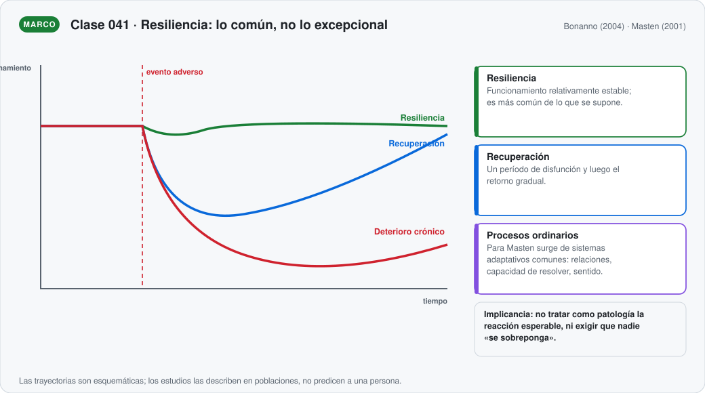

# Clase 041 — Resiliencia, flexibilidad y agilidad

<!-- nav:inicio -->
> **Parte 03 · Inteligencia emocional, resiliencia y liderazgo adaptativo** — clase 5 de 12 · [índice de la parte](../../README.md) · [temario](../../../../SYLLABUS.md)
<!-- nav:fin -->

**Parte:** 03 — Inteligencia emocional, resiliencia y liderazgo adaptativo  
**Nivel:** Etapa 1 — Profesional → Líder  
**Duración sugerida:** 150–180 minutos · **Estándar:** deep-class-v2

## 🎯 Propósito

La palabra *resiliencia* se usa en las empresas como una exigencia: «necesitamos gente resiliente», que equivale a pedir que las personas soporten más. Esa lectura es injusta y además errónea respecto de lo que la investigación describe. La resiliencia no es dureza ni una cualidad rara de unos pocos; es el resultado de procesos ordinarios, entre ellos las relaciones, la capacidad de resolver problemas y el sentido, y mucho más frecuente de lo que se supone.

Esta clase usa el trabajo de Ann Masten, que describe la resiliencia como «magia ordinaria», y el de George Bonanno, que distingue **resiliencia** de **recuperación** a partir de las trayectorias de personas ante eventos adversos. Se completa con la noción de compromiso con la resiliencia de Weick y Sutcliffe para organizaciones. Al terminar sabrás diferenciar las trayectorias, evitar tratar como falla personal lo esperable y diseñar prácticas individuales y de equipo que aumenten la capacidad de adaptación.

## 📚 Resultados de aprendizaje

Al finalizar podrás:

1. **Definir** resiliencia y distinguirla de recuperación, dureza y simple resistencia.
2. **Describir** las trayectorias tras un evento adverso y lo que implican para el liderazgo.
3. **Identificar** procesos que sostienen la capacidad de adaptación: relaciones, resolución de problemas, sentido y recursos.
4. **Diferenciar** resiliencia individual de resiliencia organizacional.
5. **Diseñar** prácticas de equipo que apoyen la adaptación tras un revés.

## 🧭 Agenda

| Tramo | Qué se hace |
|---|---|
| 0–20 min | Recuperación: recuerda un revés profesional; ¿cómo evolucionó tu funcionamiento en las semanas siguientes? |
| 20–60 min | Resiliencia, trayectorias y procesos ordinarios. |
| 60–105 min | Ejemplo trabajado: un equipo tras la pérdida de un cliente clave. |
| 105–140 min | Caso ejecutivo: apoyar a un equipo después de una reestructuración. |
| 140–170 min | Límites y entregable. |

## 🧩 Conceptos centrales

| Concepto | Definición | Cómo se reconoce |
|---|---|---|
| **Resiliencia** | Patrón de adaptación positiva en el contexto de adversidad significativa (Masten, 2001). | Funcionamiento relativamente estable tras un evento adverso. |
| **Recuperación** | Período de disfunción seguido de retorno gradual al nivel previo (Bonanno, 2004). | Cae y vuelve en un tiempo. |
| **Trayectoria** | Curso del funcionamiento de una persona en el tiempo tras un evento adverso (Bonanno, 2004). | Se describe como estable, de recuperación o crónica. |
| **Magia ordinaria** | Idea de que la resiliencia procede de sistemas adaptativos comunes, no de cualidades extraordinarias (Masten, 2001). | Se apoya en relaciones, capacidad cognitiva y sentido. |
| **Flexibilidad** | Capacidad de ajustar la conducta ante cambios del entorno (criterio de la clase). | Cambia de enfoque cuando lo anterior deja de funcionar. |
| **Compromiso con la resiliencia (organizacional)** | Capacidad de una organización de contener y recuperarse de errores y sorpresas (Weick y Sutcliffe, 2015). | Aprende de los fallos y mantiene el funcionamiento. |

## 🧠 Modelo mental

**Cómo leer el diagrama.** La línea punteada marca el evento adverso. La trayectoria verde muestra **resiliencia**: el funcionamiento se mantiene relativamente estable. La azul, **recuperación**: cae y vuelve gradualmente. La roja, **deterioro crónico**. Las tres son reacciones humanas; la más frecuente, según Bonanno, es la primera. La implicancia directiva es no tratar como debilidad la reacción esperable ni exigir que nadie «se sobreponga».

## 📖 Desarrollo

### 1. Qué es resiliencia

Masten la define como un patrón de adaptación positiva en el contexto de una adversidad significativa. Hay dos condiciones: **adversidad** real y **adaptación** positiva. No es una cualidad fija: se manifiesta en un contexto y puede variar con el tiempo. Una persona puede ser resiliente ante un cambio de trabajo y vulnerable ante una pérdida personal.

### 2. «Magia ordinaria»

El título del trabajo de Masten resume su hallazgo: la resiliencia no proviene, en general, de cualidades extraordinarias sino de **procesos adaptativos comunes**: relaciones de apoyo, capacidad de resolver problemas, regulación de las emociones, sentido de eficacia y de significado, y recursos de la comunidad. Esto cambia la pregunta para quien dirige: no «¿quién es resiliente?» sino «¿qué condiciones fortalecen esos procesos en mi equipo?».

### 3. Resiliencia y recuperación

Bonanno distingue dos cosas que suelen confundirse. En la **recuperación**, el funcionamiento se deteriora durante un tiempo y luego vuelve al nivel previo. En la **resiliencia**, el funcionamiento permanece relativamente estable, aun con malestar pasajero. Según su revisión, una parte considerable de las personas ante eventos adversos sigue la segunda trayectoria, mucho más frecuente de lo que se supone. Eso no significa que quien se deteriora haya hecho algo mal.

### 4. Qué hace el líder

El líder no crea resiliencia en otros, pero puede **proteger los procesos** que la sostienen: mantener relaciones de apoyo en el equipo, dar claridad sobre lo que viene, ofrecer recursos, reconocer el impacto sin dramatizar, evitar cambios innecesarios mientras el equipo absorbe uno grande y permitir la recuperación. También puede dañarlos: la sobrecarga, la incertidumbre prolongada sin información y la exigencia de «seguir como si nada».

### 5. Flexibilidad y agilidad

La resiliencia se apoya en la **flexibilidad**: cambiar de enfoque cuando el anterior deja de funcionar. En el trabajo, se traduce en probar alternativas, revisar supuestos y ajustar planes. Es una disposición que se entrena: revisar el plan tras un revés, preguntar «¿qué podemos controlar?» y actuar sobre eso. La **agilidad** organizacional es la versión colectiva: ciclos cortos de aprendizaje y decisiones cerca de quien tiene la información.

### 6. Resiliencia organizacional

Weick y Sutcliffe describen en las organizaciones de alta confiabilidad un **compromiso con la resiliencia**: aceptan que habrá errores y sorpresas, y se organizan para contenerlos y aprender de ellos. Prácticas típicas: entrenar la improvisación ante lo inesperado, mantener capacidad de reserva, desplazar la decisión hacia quien más sabe del problema y tratar los fallos pequeños como información.

### 7. Cuando «resiliencia» se usa mal

Pedir resiliencia sin cambiar las condiciones convierte un problema de la organización en una carga individual. Si el equipo se agota por sobrecarga estructural, la respuesta es revisar la carga, no entrenar más resiliencia. La clase 047 trata los límites de la sostenibilidad.

## 📚 Lectura comparada

| Obra | Qué aporta | Qué no resuelve | Pregunta para contrastar |
|---|---|---|---|
| Masten (2001) | La resiliencia como proceso ordinario. | Se centra en el desarrollo infantil y juvenil. | ¿Qué procesos ordinarios sostiene tu equipo? |
| Bonanno (2004) | La diferencia entre resiliencia y recuperación. | Estudia eventos extremos como la pérdida. | ¿Quién en tu equipo está en cada trayectoria? |
| Weick y Sutcliffe (2015) | Resiliencia organizacional. | No trata del individuo. | ¿Cómo aprende tu organización de los fallos pequeños? |
| Duckworth (2016) | Perseverancia a largo plazo. | Su relación con la resiliencia es debatida. | ¿Perseverancia o terquedad? |
| Edmondson (2018) | Seguridad psicológica para aprender de los reveses. | No distingue trayectorias. | ¿Se puede hablar del revés en tu equipo? |

## 🧮 Ejemplo trabajado

**Situación (hipotética).** Un equipo comercial de 12 personas pierde un cliente que representaba el 25 % de sus ingresos. La directora observa distintas reacciones.

| Persona | Reacción | Trayectoria probable | Respuesta de la directora |
|---|---|---|---|
| Ana | Preocupada, pero mantiene su trabajo y propone alternativas. | Resiliencia | Acompañar, darle un espacio para liderar una iniciativa. |
| Beto | Baja su rendimiento tres semanas, luego se recupera con apoyo del equipo. | Recuperación | No presionar; reconocer y dar tiempo; revisar a las tres semanas. |
| Camila | Se aísla, falta a reuniones, pierde interés durante dos meses. | Deterioro prolongado | Conversar en privado; ofrecer apoyo profesional; revisar carga. |

**Medidas del equipo.** (1) Reunión con hechos: qué ocurrió, qué se sabe del impacto y qué viene. (2) Revisión sin culpas de lo aprendido. (3) Plan de captación con roles claros. (4) Pausa en iniciativas no esenciales. (5) Seguimiento individual semanal por un mes.

**Qué muestra.** (1) Tres personas, tres reacciones normales. (2) La respuesta se adaptó a cada una. (3) Las medidas protegieron los procesos ordinarios: relaciones, claridad, sentido y recursos.

## 🔀 Comparación y límites

**Resiliencia frente a resistencia.** Resistir es aguantar; la resiliencia incluye adaptarse y, a veces, cambiar. Una persona que «aguanta» una situación dañina no es resiliente: puede estar acumulando costos.

**Límites.** Las trayectorias de Bonanno se describen en poblaciones, no predicen a una persona. Gran parte de la investigación proviene de eventos específicos —pérdidas, trauma, desarrollo infantil— y su traslado al trabajo es una extrapolación. La resiliencia no justifica condiciones de trabajo dañinas. Y esta clase no reemplaza atención profesional de salud mental.

## 🪜 De profesional a owner

| Nivel | Cómo trabaja la resiliencia |
|---|---|
| **Profesional** | Cuida sus relaciones de apoyo y revisa su enfoque tras un revés. |
| **Jefe / Team Lead** | Permite que cada persona atraviese un revés a su ritmo y protege los apoyos del equipo. |
| **Gerente** | Diseña planes que contengan errores y aprendan de ellos. |
| **CEO / Director** | Cuida que la organización no pida resiliencia como sustituto de condiciones razonables. |
| **Founder / Owner** | Enfrenta reveses con su patrimonio en juego y construye redes de apoyo antes de necesitarlas. |

## 🏢 Caso ejecutivo

Una empresa de tecnología reestructuró un área: se eliminaron 18 de 60 puestos. Los 42 que quedan tienen más trabajo, información parcial y desconfianza. Tres personas clave anunciaron su salida. La gerente general dice: «necesitamos un equipo más resiliente» y propone un taller de dos horas.

Entrega un **plan de apoyo a la adaptación** que contenga: (a) las trayectorias esperables y cómo las reconocerás sin etiquetar; (b) los procesos que protegerás: relaciones, claridad, sentido y recursos; (c) qué cambiarás en las condiciones de trabajo; (d) qué harás con quienes se deterioran de forma prolongada; (e) cómo aprenderá la organización del episodio; (f) qué evidencia te diría que el taller no era la respuesta.

## 🧪 Práctica

1. Describe tu trayectoria ante un revés reciente y qué procesos la sostuvieron.
2. Identifica en tu equipo qué procesos ordinarios existen y cuál está más débil.
3. Escribe un mensaje a un equipo tras un revés que reconozca el impacto sin dramatizar.
4. Define una práctica de revisión sin culpas para fallos pequeños.
5. Escribe una condición de trabajo que cambiarías antes de pedir resiliencia.

## ⚠️ Errores frecuentes

| Error | Por qué ocurre | Cómo corregirlo |
|---|---|---|
| Exigir resiliencia | Se la ve como rasgo | Mejorar las condiciones y los procesos que la sostienen. |
| Tratar el malestar como debilidad | Se supone que debe sobreponerse | Reconocer la reacción esperable. |
| Taller como respuesta | Es visible y barato | Cambiar carga, claridad y apoyos. |
| Ignorar a quien se deteriora | Se espera que pase | Conversar, ofrecer apoyo y revisar carga. |
| Cambios constantes tras un revés | Se quiere reaccionar | Proteger la estabilidad mientras se absorbe. |
| Confundir perseverancia con terquedad | Se celebra «no rendirse» | Revisar el enfoque cuando no funciona. |

## ❓ Preguntas de comprobación

1. ¿Cómo define Masten la resiliencia y qué dos condiciones requiere?
2. ¿Qué diferencia hay entre resiliencia y recuperación según Bonanno?
3. ¿Qué significa «magia ordinaria»?
4. ¿Qué procesos puede proteger un líder para apoyar la adaptación?
5. ¿Qué es el compromiso con la resiliencia en una organización?
6. ¿Por qué pedir resiliencia sin cambiar las condiciones es un error?
7. ¿Qué límite tienen las trayectorias de Bonanno?

Claves de respuesta

1. Un patrón de adaptación positiva en el contexto de una adversidad significativa; requiere adversidad real y adaptación positiva.
2. En la recuperación hay un período de disfunción y vuelta; en la resiliencia el funcionamiento permanece relativamente estable.
3. Que la resiliencia surge de procesos adaptativos comunes (relaciones, resolución de problemas, sentido), no de cualidades extraordinarias.
4. Relaciones de apoyo, claridad sobre lo que viene, recursos, reconocimiento del impacto y estabilidad.
5. Aceptar que habrá errores y sorpresas y organizarse para contenerlos y aprender de ellos.
6. Porque convierte un problema de la organización en una carga individual.
7. Describen poblaciones, no predicen a una persona, y vienen de eventos específicos.

## 📥 Entregable

Guarda en `portfolio/041-resiliencia-flexibilidad-y-agilidad/`:

- `risk-governance-brief.md` (plantilla [Risk & Governance Brief](../../../../templates/risk-governance-brief.md)) con el plan del caso ejecutivo;
- `reading-note.md` con una tensión entre Masten y Bonanno;
- `decision-journal.md` con las medidas de apoyo y su seguimiento.

## 📗 Fuentes y verificación

- Ann S. Masten — *Ordinary Magic: Resilience Processes in Development* (American Psychologist, 2001). **Uso en esta clase:** la resiliencia como proceso ordinario y sus componentes. Lectura selectiva sobre **resiliencia, flexibilidad y agilidad**. **Localizador:** [DOI 10.1037/0003-066X.56.3.227](https://doi.org/10.1037/0003-066X.56.3.227).
- George A. Bonanno — *Loss, Trauma, and Human Resilience: Have We Underestimated the Human Capacity to Thrive After Extremely Aversive Events?* (American Psychologist, 2004). **Uso en esta clase:** la distinción entre resiliencia y recuperación. Lectura selectiva sobre **resiliencia, flexibilidad y agilidad**. **Localizador:** [DOI 10.1037/0003-066X.59.1.20](https://doi.org/10.1037/0003-066X.59.1.20).
- Karl E. Weick & Kathleen M. Sutcliffe — *Managing the Unexpected* (Jossey-Bass, 2015). **Uso en esta clase:** el compromiso con la resiliencia en organizaciones. Lectura selectiva sobre **resiliencia, flexibilidad y agilidad**. **Localizador:** [ISBN-13 9781118862414](https://openlibrary.org/isbn/9781118862414).
- Angela Duckworth — *Grit* (Collins, 2018). **Uso en esta clase:** perseverancia a largo plazo y sus límites. Lectura selectiva sobre **resiliencia, flexibilidad y agilidad**. **Localizador:** [ISBN-13 9781443442329](https://openlibrary.org/isbn/9781443442329).
- Amy C. Edmondson — *The Fearless Organization* (Wiley, 2018). **Uso en esta clase:** seguridad psicológica para aprender de los reveses. Lectura selectiva sobre **resiliencia, flexibilidad y agilidad**. **Localizador:** [ISBN-13 9781119477242](https://openlibrary.org/isbn/9781119477242).

> **Regla de fuentes para Resiliencia, flexibilidad y agilidad:** las obras anteriores estructuran las perspectivas de esta materia; cualquier norma, ley o estándar vivo mencionado debe comprobarse nuevamente en su fuente primaria vigente. Los ejemplos y casos son hipotéticos, con cifras ilustrativas. Esta clase no sustituye atención profesional de salud mental. El desarrollo es original y no reproduce capítulos protegidos.

<!-- pie:inicio -->
---

| Anterior | Índice | Siguiente |
|---|---|---|
| [← 040 · Motivación y propósito](../040-motivacion-y-proposito/README.md) | [Parte 03](../../README.md) · [Programa](../../../../SYLLABUS.md) | [042 · Seguridad psicológica y aprendizaje →](../042-seguridad-psicologica-y-aprendizaje/README.md) |
<!-- pie:fin -->
