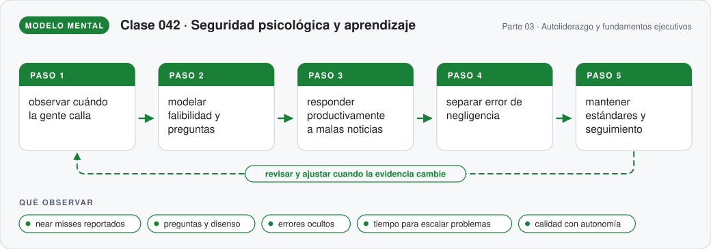

# Clase 042 — Seguridad psicológica y aprendizaje

<!-- nav:inicio -->
> **Parte 03 · Inteligencia emocional, resiliencia y liderazgo adaptativo** — clase 6 de 12 · [índice de la parte](../../README.md) · [temario](../../../../SYLLABUS.md)
<!-- nav:fin -->

**Parte:** 03 — Inteligencia emocional, resiliencia y liderazgo adaptativo  
**Nivel:** Etapa 1 — Profesional → Líder  
**Duración sugerida:** 150–180 minutos · **Estándar:** deep-class-v2

## 🎯 Propósito

Un equipo que oculta sus errores no los corrige; uno que no pregunta no aprende; uno donde disentir es peligroso decide peor. El problema es que quien calla casi nunca lo dice: simplemente no habla. Y casi siempre calla por una razón racional: percibe que hablar tiene un costo para su imagen, su relación o su carrera. Amy Edmondson llamó **seguridad psicológica** a la creencia compartida de que el equipo es seguro para asumir ese riesgo interpersonal.

Esta clase usa su estudio de 1999 sobre equipos de trabajo y su libro de 2018. Su aporte más importante para quien dirige es la distinción entre seguridad y comodidad: la seguridad psicológica **no baja el estándar**, es la condición para que el estándar se pueda cumplir aprendiendo. Al terminar sabrás medir el nivel de seguridad de un equipo, identificar las conductas del líder que lo favorecen o lo dañan y diseñar prácticas para construirla.

## 📚 Resultados de aprendizaje

Al finalizar podrás:

1. **Definir** seguridad psicológica y distinguirla de comodidad, confianza y amabilidad.
2. **Explicar** la cadena entre la conducta del líder, la seguridad, el aprendizaje y el desempeño.
3. **Ubicar** a un equipo en el cuadrante de seguridad y estándares.
4. **Reconocer** las conductas que construyen o destruyen la seguridad.
5. **Diseñar** prácticas concretas para construirla sin reducir la exigencia.

## 🧭 Agenda

| Tramo | Qué se hace |
|---|---|
| 0–20 min | Recuperación: recuerda una vez en que callaste algo que debías decir; ¿qué temías? |
| 20–60 min | Definición, cadena causal y cuadrante. |
| 60–105 min | Ejemplo trabajado: del silencio a una práctica de aprendizaje. |
| 105–140 min | Caso ejecutivo: un equipo que oculta errores. |
| 140–170 min | Límites y entregable. |

## 🧩 Conceptos centrales

| Concepto | Definición | Cómo se reconoce |
|---|---|---|
| **Seguridad psicológica** | Creencia compartida de que el equipo es seguro para asumir riesgos interpersonales (Edmondson, 1999). | Las personas preguntan, admiten errores y disienten. |
| **Riesgo interpersonal** | Exponerse a parecer ignorante, incompetente, negativo o disruptivo. | Hablar tiene un posible costo para la imagen. |
| **Conducta de aprendizaje** | Acciones del equipo para aprender: preguntar, pedir ayuda, experimentar, discutir errores (Edmondson, 1999). | Se observan en reuniones y en el trabajo diario. |
| **Estándares altos** | Nivel de exigencia en resultados y calidad. | Hay metas claras y consecuencias. |
| **Zona de aprendizaje** | Seguridad alta y estándares altos (Edmondson, 2018). | Se exige y se puede decir la verdad. |
| **Zona de ansiedad** | Estándares altos y seguridad baja (Edmondson, 2018). | Se exige y se oculta el error. |

## 🧠 Modelo mental

**Cómo leer el diagrama.** A la izquierda, dos ejes independientes: el nivel de seguridad y el de estándares. Solo la esquina superior derecha —seguridad alta, estándares altos— es una zona de aprendizaje. A la derecha, la cadena: la conducta del líder favorece la seguridad, la seguridad favorece conductas de aprendizaje y estas se asocian con mejor desempeño.

## 📖 Desarrollo

### 1. Una paradoja de partida

Edmondson partió de una observación sorprendente en su estudio de equipos de hospital: los mejores equipos parecían cometer **más** errores. La explicación fue que los reportaban más. Los equipos con un clima en que informar un error era seguro hacían visibles sus fallas y podían corregirlas; los otros las ocultaban. De ahí surgió el constructo: no es que los buenos equipos fallen más, es que los buenos equipos hablan de sus fallas.

### 2. Qué es y qué no es

La seguridad psicológica es una creencia compartida sobre las consecuencias de asumir un riesgo interpersonal en el equipo. **No es** amabilidad, ni ausencia de conflicto, ni bajar el estándar, ni confianza entre amigos. Es poder decir «no entiendo», «me equivoqué» o «no estoy de acuerdo» sin temer que el costo sea una humillación o una sanción. Un equipo puede tener un clima muy cordial y ser inseguro para disentir.

### 3. La cadena

En su estudio de 1999, con equipos de trabajo, Edmondson encontró que la seguridad psicológica se asociaba con conductas de aprendizaje del equipo y que estas, a su vez, se asociaban con el desempeño. La seguridad no mejora el desempeño de forma directa: lo hace porque permite que las personas pregunten, prueben, pidan ayuda y discutan los errores. El mecanismo es el aprendizaje.

### 4. Seguridad y estándares

En su libro de 2018, Edmondson propone dos ejes: seguridad psicológica y estándares. En la **zona de ansiedad** se exige mucho y es peligroso hablar: el error se oculta. En la **zona de confort** hay confianza, pero poco reto. En la **zona de apatía**, ni seguridad ni exigencia. En la **zona de aprendizaje**, ambas. La conclusión práctica es que quien quiere exigencia necesita seguridad, y quien quiere seguridad no debe renunciar a la exigencia.

### 5. Conductas del líder

Edmondson identifica tres tipos de conducta que la favorecen: **enmarcar el trabajo** como un problema de aprendizaje con incertidumbre y no solo de ejecución («no sabemos todo, necesitamos que todos hablen»); **invitar a participar** con preguntas genuinas y reconocer los límites de lo que se sabe; y **responder de forma productiva** cuando alguien habla: agradecer, escuchar, no castigar. Una sola reacción punitiva puede borrar meses de invitaciones.

### 6. Qué la destruye

Los líderes la dañan con conductas pequeñas: interrumpir, ridiculizar, culpar, desestimar una pregunta, o mostrarse infalibles. También la dañan el silencio ante un error de alguien importante y la exigencia de «soluciones, no problemas». La seguridad se construye lentamente y se pierde en un momento.

### 7. Cómo medirla y construirla

Se puede medir con preguntas breves al equipo, como: «Si cometo un error en este equipo, no se me reprocha» o «es seguro asumir riesgos en este equipo». Un resultado bajo es una invitación a conversar, no a sancionar. Prácticas útiles: reuniones de aprendizaje tras proyectos, el líder admite primero sus errores, rutinas para que hable quien menos lo hace, y un canal para plantear problemas sin represalia.

## 📚 Lectura comparada

| Obra | Qué aporta | Qué no resuelve | Pregunta para contrastar |
|---|---|---|---|
| Edmondson (1999) | El constructo, su medición y su relación con el aprendizaje del equipo. | Es un estudio de equipos específicos. | ¿Qué conductas de aprendizaje observas en tu equipo? |
| Edmondson (2018) | Cuadrante de seguridad y estándares y conductas del líder. | Es un libro de gestión, con casos seleccionados. | ¿En qué zona está tu equipo? |
| Stone, Patton y Heen (1999) | Cómo conducir la conversación que se evita. | No habla del equipo. | ¿Qué conversación se evita en tu equipo? |
| Scott (2017) | Exigencia y cuidado. | No trata de equipos. | ¿Dices lo directo con cuidado? |
| Weick y Sutcliffe (2015) | Preocupación por el fallo y aprendizaje. | No trata de clima interpersonal. | ¿Cómo se tratan los errores pequeños? |

## 🧮 Ejemplo trabajado

**Situación (hipotética).** Un jefe de ingeniería, Iván, nota que en las revisiones de código nadie cuestiona las decisiones de los dos ingenieros senior, y que dos errores graves en producción se detectaron tarde porque «alguien lo notó pero no dijo nada».

| Conducta observada | Efecto sobre la seguridad |
|---|---|
| Iván responde a una pregunta con «eso ya lo explicamos». | Disuade preguntar. |
| Los senior interrumpen al explicar. | Quien duda se calla. |
| Los errores se discuten buscando «quién fue». | Se oculta el error. |

**Intervención.** Iván (1) enmarca el trabajo: «es un sistema complejo; vamos a equivocarnos, y necesito que todos hablen»; (2) admite un error propio en la reunión y cuenta qué aprendió; (3) cambia las revisiones: cada persona nombra un riesgo antes de que hablen los senior; (4) introduce revisiones sin culpas: «¿qué falló en nuestro proceso?»; (5) agradece públicamente la primera vez que alguien reporta un error.

**Resultado.** En tres meses se reportan más incidentes pequeños y disminuyen los graves. Iván lo mide con una pregunta de seguridad cada mes.

**Qué muestra.** (1) La conducta del líder cambió el clima. (2) Los errores aumentaron en visibilidad, no en frecuencia real. (3) Los estándares no bajaron: se exigió más aprendizaje.

## 🔀 Comparación y límites

**Seguridad frente a confianza.** La confianza es entre personas (clase 137); la seguridad psicológica es una propiedad del equipo sobre las consecuencias de hablar.

**Límites.** El estudio de Edmondson de 1999 fue en equipos concretos y su relación con el desempeño depende de la tarea; la seguridad psicológica es una condición necesaria, no suficiente. En culturas con fuerte distancia al poder puede expresarse de otra manera. Y se puede usar mal: como excusa para no exigir, o para pedir que todos se sientan cómodos todo el tiempo, lo que no es el punto.

## 🪜 De profesional a owner

| Nivel | Cómo trabaja la seguridad |
|---|---|
| **Profesional** | Pregunta, admite errores y reconoce a quien lo hace. |
| **Jefe / Team Lead** | Enmarca el trabajo, invita a participar y responde productivamente. |
| **Gerente** | Mide la seguridad de sus equipos y corrige a quienes la destruyen. |
| **CEO / Director** | Hace de la seguridad una condición de la cultura y protege a quienes advierten. |
| **Founder / Owner** | Crea una cultura donde el equipo le diga lo que no quiere oír. |

## 🏢 Caso ejecutivo

Una empresa de logística descubre que un error de configuración llevaba seis semanas generando entregas duplicadas. Un analista lo había notado hace un mes y lo comentó con un compañero, pero no lo reportó porque «la última vez que alguien avisó de un problema lo señalaron como el culpable». El costo supera los USD 300.000. El gerente general quiere «identificar al responsable».

Entrega un **plan de seguridad psicológica** que contenga: (a) un diagnóstico del clima con evidencia; (b) cómo responderás al error sin buscar un culpable y qué sí exigirás; (c) las conductas del liderazgo que cambiarás; (d) las prácticas que instalarás; (e) cómo medirás la seguridad y qué resultado te alertaría; (f) cómo mantendrás los estándares.

## 🧪 Práctica

1. Responde tú mismo a las preguntas de medición en relación con tu equipo y compara.
2. Identifica una conducta tuya que podría disuadir hablar.
3. Prepara cómo admitirás un error propio ante el equipo.
4. Define un ritual de revisión sin culpas para tu próximo proyecto.
5. Elige una persona que habla poco y define cómo invitarás su voz.

## ⚠️ Errores frecuentes

| Error | Por qué ocurre | Cómo corregirlo |
|---|---|---|
| Confundir seguridad con comodidad | Se asocia a buen clima | Mantener estándares altos. |
| Buscar al culpable | Se quiere cerrar el caso | Preguntar qué falló en el proceso. |
| Reaccionar mal una vez | El error molesta | Agradecer, escuchar y decidir después. |
| Pedir «soluciones, no problemas» | Se busca proactividad | Aceptar el problema y trabajar la solución juntos. |
| Medir y no actuar | Se hace la encuesta | Conversar los resultados y cambiar algo. |
| Mostrarse infalible | Se cree que da autoridad | Admitir errores propios primero. |

## ❓ Preguntas de comprobación

1. ¿Cómo define Edmondson la seguridad psicológica?
2. ¿Qué paradoja observó en los equipos de hospital?
3. ¿Cuál es la cadena entre seguridad y desempeño?
4. ¿Qué zonas distingue el cuadrante de seguridad y estándares?
5. ¿Qué tres tipos de conducta del líder favorecen la seguridad?
6. ¿Por qué la seguridad psicológica no es bajar el estándar?
7. ¿Qué límite tiene la evidencia de 1999?

Claves de respuesta

1. Creencia compartida de que el equipo es seguro para asumir riesgos interpersonales.
2. Los mejores equipos parecían cometer más errores porque los reportaban más.
3. La seguridad se asocia con conductas de aprendizaje y estas con mejor desempeño.
4. Ansiedad, aprendizaje, apatía y confort.
5. Enmarcar el trabajo como aprendizaje, invitar a participar y responder de forma productiva.
6. Porque es la condición para que el estándar se cumpla aprendiendo; la exigencia sigue siendo alta.
7. Es un estudio de equipos concretos; la relación con el desempeño depende de la tarea y es condición necesaria, no suficiente.

## 📥 Entregable

Guarda en `portfolio/042-seguridad-psicologica-y-aprendizaje/`:

- `leadership-decision-brief.md` (plantilla [Leadership Decision Brief](../../../../templates/leadership-decision-brief.md)) con el plan del caso ejecutivo;
- `reading-note.md` con una tensión entre Edmondson (1999) y Edmondson (2018);
- `decision-journal.md` con tus conductas, las prácticas y la medición.

## 📗 Fuentes y verificación

- Amy C. Edmondson — *Psychological Safety and Learning Behavior in Work Teams* (Administrative Science Quarterly, 1999). **Uso en esta clase:** el constructo de seguridad psicológica y su relación con el aprendizaje. Lectura selectiva sobre **seguridad psicológica y aprendizaje**. **Localizador:** [DOI 10.2307/2666999](https://doi.org/10.2307/2666999).
- Amy C. Edmondson — *The Fearless Organization* (Wiley, 2018). **Uso en esta clase:** el cuadrante de seguridad y estándares y las conductas del líder. Lectura selectiva sobre **seguridad psicológica y aprendizaje**. **Localizador:** [ISBN-13 9781119477242](https://openlibrary.org/isbn/9781119477242).
- Douglas Stone, Bruce Patton & Sheila Heen — *Difficult Conversations* (Random House Audio, 1999). **Uso en esta clase:** la conversación que se evita. Lectura selectiva sobre **seguridad psicológica y aprendizaje**. **Localizador:** [ISBN-13 9780553525687](https://openlibrary.org/isbn/9780553525687).
- Kim Scott — *Radical Candor* (PAN MACMILLAN U.K, 2017). **Uso en esta clase:** exigencia y cuidado. Lectura selectiva sobre **seguridad psicológica y aprendizaje**. **Localizador:** [ISBN-13 9781509845385](https://openlibrary.org/isbn/9781509845385).
- Karl E. Weick & Kathleen M. Sutcliffe — *Managing the Unexpected* (Jossey-Bass, 2015). **Uso en esta clase:** la preocupación por el fallo y el aprendizaje. Lectura selectiva sobre **seguridad psicológica y aprendizaje**. **Localizador:** [ISBN-13 9781118862414](https://openlibrary.org/isbn/9781118862414).

> **Regla de fuentes para Seguridad psicológica y aprendizaje:** las obras anteriores estructuran las perspectivas de esta materia; cualquier norma, ley o estándar vivo mencionado debe comprobarse nuevamente en su fuente primaria vigente. Los ejemplos y casos son hipotéticos, con cifras ilustrativas. El desarrollo es original y no reproduce capítulos protegidos.

<!-- pie:inicio -->
---

| Anterior | Índice | Siguiente |
|---|---|---|
| [← 041 · Resiliencia, flexibilidad y agilidad](../041-resiliencia-flexibilidad-y-agilidad/README.md) | [Parte 03](../../README.md) · [Programa](../../../../SYLLABUS.md) | [043 · Problemas técnicos versus adaptativos →](../043-problemas-tecnicos-versus-adaptativos/README.md) |
<!-- pie:fin -->
