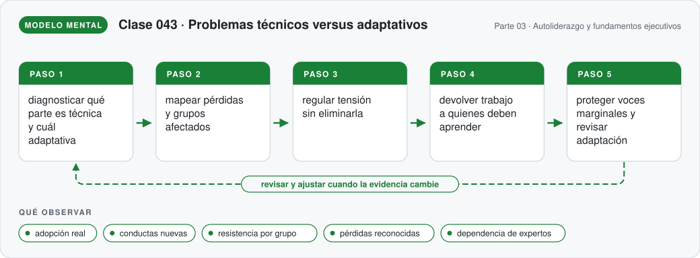

# Clase 043 — Problemas técnicos versus adaptativos

<!-- nav:inicio -->
> **Parte 03 · Inteligencia emocional, resiliencia y liderazgo adaptativo** — clase 7 de 12 · [índice de la parte](../../README.md) · [temario](../../../../SYLLABUS.md)
<!-- nav:fin -->

**Parte:** 03 — Inteligencia emocional, resiliencia y liderazgo adaptativo  
**Nivel:** Etapa 1 — Profesional → Líder  
**Duración sugerida:** 150–180 minutos · **Estándar:** deep-class-v2

## 🎯 Propósito

Hay problemas para los que existe una respuesta conocida y alguien que la sabe aplicar: un sistema caído, un cálculo erróneo, una norma que cumplir. Y hay otros que se resisten a toda solución experta porque exigen que **las propias personas cambien**: pasar a un modelo de trabajo distinto, aceptar una pérdida, revisar lo que valoran. Tratar el segundo tipo como si fuera del primero es uno de los errores directivos más repetidos: se contrata un consultor, se rediseña un proceso, se anuncia un plan, y el problema reaparece.

Esta clase usa la distinción de Ronald Heifetz entre problemas **técnicos** y **adaptativos**, desarrollada con Grashow y Linsky en *The Practice of Adaptive Leadership*. Al terminar sabrás diagnosticar a qué tipo pertenece un problema, reconocer la resistencia como una señal de que hay algo que se pierde y practicar la alternancia entre la acción y la mirada desde el «balcón».

## 📚 Resultados de aprendizaje

Al finalizar podrás:

1. **Distinguir** un problema técnico de uno adaptativo con criterios observables.
2. **Explicar** por qué un problema adaptativo no se resuelve con autoridad y experticia.
3. **Reconocer** la resistencia al cambio como pérdida, no como terquedad.
4. **Aplicar** la alternancia entre la pista de baile y el balcón.
5. **Diseñar** una intervención que devuelva el trabajo a quienes deben hacerlo, a un ritmo que puedan soportar.

## 🧭 Agenda

| Tramo | Qué se hace |
|---|---|
| 0–20 min | Recuperación: recuerda un problema que «se arregló» varias veces y reapareció. ¿Qué tipo era? |
| 20–60 min | Técnico y adaptativo, resistencia y balcón. |
| 60–105 min | Ejemplo trabajado: diagnóstico de un problema mixto. |
| 105–140 min | Caso ejecutivo: un cambio de modelo de ventas. |
| 140–170 min | Límites y entregable. |

## 🧩 Conceptos centrales

| Concepto | Definición | Cómo se reconoce |
|---|---|---|
| **Problema técnico** | Problema cuya definición y solución son conocidas y pueden resolverse con la experticia existente (Heifetz et al., 2009). | Hay un procedimiento o un experto que lo resuelve. |
| **Problema adaptativo** | Problema que exige que las personas aprendan nuevas formas de actuar, cambiando valores, creencias o hábitos (Heifetz et al., 2009). | Ninguna solución experta basta; hay que cambiar conductas. |
| **Trabajo adaptativo** | Aprendizaje y cambio que deben hacer las personas con el problema (Heifetz et al., 2009). | Lo hacen ellas, no una autoridad por ellas. |
| **Pérdida** | Lo que alguien valora y debería soltar para adaptarse: una rutina, una identidad, una lealtad. | La resistencia se explica por lo que se pierde. |
| **Balcón y pista de baile** | Alternar entre participar en la acción y mirarla desde arriba para ver patrones (Heifetz et al., 2009). | Se puede describir qué ocurre en el sistema, no solo en el momento. |
| **Ritmo soportable** | Velocidad de cambio que las personas pueden asimilar sin colapsar ni anestesiarse. | Hay incomodidad productiva, no pánico ni indiferencia. |

## 🧠 Modelo mental

**Cómo leer el diagrama.** Las dos columnas se comparan por cuatro preguntas: quién debe hacer el trabajo, qué se pide, qué se pierde y cómo se ve. En un problema técnico, trabaja quien sabe y casi nada se pierde. En uno adaptativo, trabajan las personas que tienen el problema y se pierde algo que valoran; por eso hay resistencia. La mayoría de los problemas reales tiene ambos componentes.

## 📖 Desarrollo

### 1. La distinción

Heifetz propone que el error más común del liderazgo es tratar los problemas adaptativos como técnicos. Un **problema técnico** puede ser muy complejo, pero la manera de resolverlo es conocida: se identifica el problema, se aplica la solución y se termina. Un **problema adaptativo** es aquel en que la solución no existe todavía o no puede aplicarla un experto, porque supone que las personas cambien algo que valoran.

### 2. La mezcla frecuente

Casi todo problema real tiene un componente técnico y otro adaptativo. Un hospital que quiere reducir infecciones tiene una parte técnica (protocolos de higiene) y una adaptativa (que cirujanos con prestigio acepten que un enfermero los corrija). Resolver solo la parte técnica produce protocolos impecables que no se cumplen. El diagnóstico consiste en separar ambas partes.

### 3. Por qué la autoridad no basta

Quien tiene autoridad suele sentirse obligado a dar la respuesta. En un problema adaptativo, esa respuesta rara vez sirve porque quien debe cambiar no es el directivo sino el equipo. Las soluciones impuestas desde arriba generan cumplimiento aparente y resistencia latente. El trabajo del líder es **plantear el problema, mantener la tensión productiva y devolver el trabajo** a quienes deben hacerlo.

### 4. La resistencia como pérdida

La resistencia al cambio se explica en general como falta de motivación. Heifetz propone otra lectura: las personas no se resisten al cambio, se resisten a **la pérdida**: de una rutina, de un estatus, de una forma de entenderse a sí mismas, de lealtades. Ante la resistencia, la pregunta útil es «¿qué pierde esta persona si cambia?». Reconocerlo y ayudar a procesarlo ocupa mucho más tiempo que explicar las razones del cambio.

### 5. Balcón y pista de baile

El liderazgo adaptativo exige moverse entre dos posiciones: la **pista de baile**, donde se participa en la acción, y el **balcón**, desde donde se observa el patrón: quién habla, quién calla, qué alianzas se forman, qué se evita. Quien solo está en la pista se contagia del sistema; quien solo está en el balcón pierde contacto. El balcón no es un lugar físico sino una práctica: detenerse para preguntar qué está pasando realmente.

### 6. El ritmo

Un cambio adaptativo necesita **incomodidad suficiente** para motivar el aprendizaje y **no tanta** que lo bloquee. Si el líder no mantiene tensión, el sistema vuelve al equilibrio anterior; si la sube demasiado, las personas se defienden, atacan o se desconectan. Regular el ritmo es una responsabilidad: dar tiempo, avanzar por etapas, proteger lo que se mantiene.

### 7. Qué hace el líder

Un conjunto de conductas, según el marco: **diagnosticar** el sistema, incluido el propio papel del líder; **regular la incomodidad**; **mantener la atención** en el problema y no en síntomas; **dar el trabajo a las personas**; y **proteger las voces** que cuestionan, que suelen señalar aquello que el sistema evita ver. Todo esto expone al líder a resistencia personal, por lo que se necesitan aliados y cuidado propio.

## 📚 Lectura comparada

| Obra | Qué aporta | Qué no resuelve | Pregunta para contrastar |
|---|---|---|---|
| Heifetz (1994) | La distinción original y la crítica de la autoridad. | Es un texto teórico, con casos históricos. | ¿Qué trabajo adaptativo evitas dar a tu equipo? |
| Heifetz, Grashow y Linsky (2009) | Herramientas prácticas: balcón, regulación, diagnóstico. | Sus ejemplos son seleccionados. | ¿Qué ves desde el balcón de tu último conflicto? |
| Heifetz y Linsky (2017) | Los riesgos personales de liderar el cambio. | No es un método de diagnóstico. | ¿Qué cuidas de ti mientras lideras? |
| Meadows (2009) | Pensamiento sistémico: patrones y palancas. | No trata de resistencia humana. | ¿Qué patrón se repite en tu problema? |
| Edmondson (2018) | Seguridad para que se diga lo que el sistema evita. | No distingue tipos de problema. | ¿Quién puede decir lo que nadie quiere oír? |

## 🧮 Ejemplo trabajado

**Situación (hipotética).** Una empresa mediana de servicios tiene demoras crónicas en la entrega de proyectos. Ya cambió el software de gestión dos veces. Los gerentes de área culpan a los otros; el director cree que «falta compromiso».

| Componente | Naturaleza | Evidencia |
|---|---|---|
| El software no registra bien las dependencias | **Técnico** | Se puede corregir con configuración y capacitación. |
| Cada gerente protege su capacidad y no informa cuando está sobrecargado | **Adaptativo** | Comparten el sistema de incentivos: se premia cumplir el propio plazo, no el del proyecto. |
| El director decide por urgencia y reasigna sin consultar | **Adaptativo** | Rompe los acuerdos de prioridad. |

**Desde el balcón.** El patrón: cuando hay sobrecarga nadie lo dice, porque admitirla se interpreta como debilidad; el director reasigna, y los gerentes protegen aún más su capacidad.

**Intervención.** (1) Resolver la parte técnica: configurar las dependencias. (2) Plantear el problema al equipo directivo como propio: «la entrega tardía es un problema del sistema, no de un gerente». (3) Revisar los incentivos para premiar la entrega del proyecto. (4) El director acuerda no reasignar sin consulta, y pide que le avisen de la sobrecarga. (5) Fijar una revisión mensual de cómo funciona el acuerdo.

**Qué muestra.** (1) Los cambios de software solo atendían la parte técnica. (2) El trabajo adaptativo incluyó al director. (3) La resistencia se entendió como pérdida: nadie quería exponerse.

## 🔀 Comparación y límites

**Adaptativo frente a complejo.** Un problema técnico puede ser muy complejo (construir un puente); lo adaptativo no se define por la dificultad sino por la necesidad de cambiar conductas y valores.

**Límites.** La distinción es una herramienta de diagnóstico, no una clasificación estricta: casi todo problema contiene ambos componentes, y calificar algo de «adaptativo» puede usarse para justificar no actuar o para culpar a las personas. El marco proviene de la práctica y de casos políticos y organizacionales, no de estudios experimentales. Y exponer a las personas al trabajo adaptativo tiene riesgos que el líder debe cuidar.

## 🪜 De profesional a owner

| Nivel | Cómo trabaja la distinción |
|---|---|
| **Profesional** | Reconoce cuándo un problema exige cambiar hábitos y no solo aplicar una técnica. |
| **Jefe / Team Lead** | Devuelve al equipo el trabajo que le corresponde y regula el ritmo. |
| **Gerente** | Separa lo técnico de lo adaptativo en proyectos de cambio y diagnostica el sistema. |
| **CEO / Director** | Mantiene la tensión productiva y protege las voces que desafían el statu quo. |
| **Founder / Owner** | Reconoce que cambiar el modelo del negocio exige que él mismo cambie. |

## 🏢 Caso ejecutivo

Una empresa de distribución quiere pasar de un modelo de ventas basado en la relación de cada vendedor a uno basado en datos y procesos compartidos. Los vendedores más antiguos —con las mejores relaciones— se resisten: dicen que «el sistema no entiende a los clientes». La dirección ya compró una plataforma de CRM y capacitó dos veces. Las ventas no mejoran, y dos vendedores clave amenazan con irse.

Entrega un **diagnóstico y plan de intervención** que contenga: (a) la separación de lo técnico y lo adaptativo; (b) qué pierden los vendedores y qué valoran; (c) el balcón: qué patrón se repite; (d) el trabajo que devolverás a los vendedores y el que asumes tú; (e) el ritmo del cambio y cómo lo regularás; (f) qué voces protegerás y cómo cuidarás tu propio papel.

## 🧪 Práctica

1. Toma un problema que se repite y separa lo técnico de lo adaptativo.
2. Para una persona que se resiste, escribe qué pierde si cambia.
3. Sal al balcón: describe en cinco líneas qué patrón se repite en tu último conflicto.
4. Identifica un trabajo adaptativo que estás haciendo tú por tu equipo.
5. Define una medida para regular el ritmo de un cambio: qué desacelerar y qué mantener.

## ⚠️ Errores frecuentes

| Error | Por qué ocurre | Cómo corregirlo |
|---|---|---|
| Dar la respuesta | La autoridad se siente obligada | Plantear el problema y devolver el trabajo. |
| Cambiar la herramienta una y otra vez | Es lo técnico y visible | Revisar valores, hábitos y lealtades. |
| Ver la resistencia como terquedad | No se piensa en pérdidas | Preguntar qué pierde la persona. |
| Acelerar o frenar de más | No se regula la incomodidad | Mantener tensión productiva. |
| Silenciar la disidencia | Molesta | Proteger las voces que señalan lo evitado. |
| Quedarse en la pista | Se contagia del sistema | Practicar el balcón. |

## ❓ Preguntas de comprobación

1. ¿Qué diferencia hay entre un problema técnico y uno adaptativo?
2. ¿Por qué la autoridad y la experticia no bastan en un problema adaptativo?
3. ¿Cómo reinterpreta Heifetz la resistencia al cambio?
4. ¿Qué es la alternancia entre pista de baile y balcón?
5. ¿Qué significa regular el ritmo del cambio?
6. Da un ejemplo de problema mixto y separa sus componentes.
7. ¿Qué límite tiene el marco?

Claves de respuesta

1. El técnico tiene una solución conocida aplicable por un experto; el adaptativo exige que las personas aprendan y cambien valores, creencias o hábitos.
2. Porque quien debe cambiar son las propias personas, y las soluciones impuestas generan cumplimiento aparente.
3. Como resistencia a la pérdida, no al cambio en sí.
4. Moverse entre participar en la acción y observarla desde arriba para ver patrones.
5. Mantener incomodidad suficiente para el aprendizaje y no tanta que bloquee.
6. Por ejemplo, infecciones en un hospital: técnico (protocolos de higiene) y adaptativo (aceptar correcciones entre jerarquías).
7. Es una herramienta de diagnóstico, no una clasificación estricta; proviene de la práctica y los casos, no de experimentos.

## 📥 Entregable

Guarda en `portfolio/043-problemas-tecnicos-versus-adaptativos/`:

- `leadership-decision-brief.md` (plantilla [Leadership Decision Brief](../../../../templates/leadership-decision-brief.md)) con el diagnóstico del caso ejecutivo;
- `reading-note.md` con una tensión entre Heifetz (1994) y Heifetz, Grashow y Linsky (2009);
- `decision-journal.md` con el diagnóstico, el trabajo devuelto y la revisión.

## 📗 Fuentes y verificación

- Ronald A. Heifetz, Alexander Grashow & Marty Linsky — *The Practice of Adaptive Leadership* (Harvard Business Press, 2009). **Uso en esta clase:** técnico y adaptativo, balcón y pista de baile, regulación del ritmo. Lectura selectiva sobre **problemas técnicos versus adaptativos**. **Localizador:** [ISBN-13 9781422105764](https://openlibrary.org/isbn/9781422105764).
- Ronald A. Heifetz — *Leadership Without Easy Answers* (Belknap Press of Harvard University Press, 1994). **Uso en esta clase:** la distinción original y la crítica de la autoridad como respuesta. Lectura selectiva sobre **problemas técnicos versus adaptativos**. **Localizador:** [ISBN-13 9780674518582](https://openlibrary.org/isbn/9780674518582).
- Ronald Heifetz & Marty Linsky — *Leadership on the Line* (Harvard Business Review Press, 2017). **Uso en esta clase:** los riesgos personales de liderar el cambio. Lectura selectiva sobre **problemas técnicos versus adaptativos**. **Localizador:** [ISBN-13 9781633692831](https://openlibrary.org/isbn/9781633692831).
- Donella H. Meadows — *Thinking in Systems* (Earthscan, 2009). **Uso en esta clase:** patrones y palancas en sistemas. Lectura selectiva sobre **problemas técnicos versus adaptativos**. **Localizador:** [ISBN-13 9781849773386](https://openlibrary.org/isbn/9781849773386).
- Amy C. Edmondson — *The Fearless Organization* (Wiley, 2018). **Uso en esta clase:** seguridad para decir lo que el sistema evita. Lectura selectiva sobre **problemas técnicos versus adaptativos**. **Localizador:** [ISBN-13 9781119477242](https://openlibrary.org/isbn/9781119477242).

> **Regla de fuentes para Problemas técnicos versus adaptativos:** las obras anteriores estructuran las perspectivas de esta materia; cualquier norma, ley o estándar vivo mencionado debe comprobarse nuevamente en su fuente primaria vigente. Los ejemplos y casos son hipotéticos. El desarrollo es original y no reproduce capítulos protegidos.

<!-- pie:inicio -->
---

| Anterior | Índice | Siguiente |
|---|---|---|
| [← 042 · Seguridad psicológica y aprendizaje](../042-seguridad-psicologica-y-aprendizaje/README.md) | [Parte 03](../../README.md) · [Programa](../../../../SYLLABUS.md) | [044 · Liderar en incertidumbre →](../044-liderar-en-incertidumbre/README.md) |
<!-- pie:fin -->
