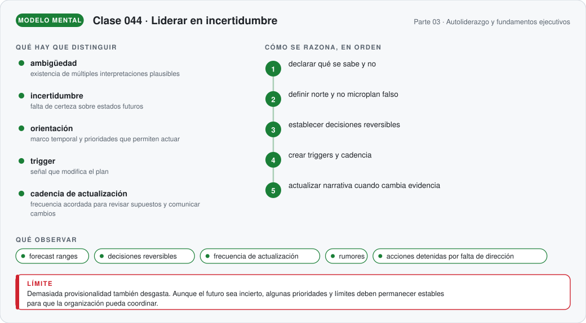

# Clase 044 — Liderar en incertidumbre

<!-- nav:inicio -->
> **Parte 03 · Inteligencia emocional, resiliencia y liderazgo adaptativo** — clase 8 de 12 · [índice de la parte](../../README.md) · [temario](../../../../SYLLABUS.md)
<!-- nav:fin -->

**Parte:** 03 — Inteligencia emocional, resiliencia y liderazgo adaptativo  
**Nivel:** Etapa 1 — Profesional → Líder  
**Duración sugerida:** 150–180 minutos · **Estándar:** deep-class-v2

## 🎯 Propósito

Esperar a tener certeza para actuar es una forma de decidir, y suele ser la peor: cuando los datos llegan, la oportunidad pasó. Pero actuar como si se tuviera certeza es igualmente costoso. Quien dirige en incertidumbre tiene una tarea específica: **dar sentido** a una situación que aún no lo tiene, para que otros puedan actuar con coherencia, y hacerlo de forma que se pueda corregir.

Esta clase usa la teoría de la construcción de sentido de Karl Weick —cómo las personas y las organizaciones interpretan lo ambiguo— y el estudio de Gary Klein sobre cómo deciden los expertos bajo presión de tiempo. Al terminar sabrás distinguir riesgo de incertidumbre, comunicar con honestidad lo que no se sabe, actuar con pasos acotados y reversibles, y revisar el relato cuando la realidad lo contradice.

## 📚 Resultados de aprendizaje

Al finalizar podrás:

1. **Distinguir** riesgo, incertidumbre y ambigüedad, y qué pide cada uno.
2. **Describir** el ciclo de construcción de sentido: notar, interpretar, actuar y corregir.
3. **Comunicar** con honestidad lo que se sabe, lo que no y qué se hará mientras tanto.
4. **Elegir** acciones acotadas y reversibles para aprender de la situación.
5. **Reconocer** cuándo la decisión no debe dilatarse y cuándo la intuición experta es confiable.

## 🧭 Agenda

| Tramo | Qué se hace |
|---|---|
| 0–20 min | Recuperación: recuerda una decisión que tomaste sin información suficiente; ¿qué hiciste y cómo lo corregiste? |
| 20–60 min | Construcción de sentido, las siete propiedades y la decisión experta. |
| 60–105 min | Ejemplo trabajado: un anuncio de un competidor que cambia el mercado. |
| 105–140 min | Caso ejecutivo: una regulación aún sin definir. |
| 140–170 min | Límites y entregable. |

## 🧩 Conceptos centrales

| Concepto | Definición | Cómo se reconoce |
|---|---|---|
| **Riesgo** | Situación en que se conocen los resultados posibles y se pueden estimar sus probabilidades (criterio de la clase). | Se puede calcular. |
| **Incertidumbre** | Situación en que no se conocen bien los resultados posibles o sus probabilidades (criterio de la clase). | Los datos no alcanzan para estimar. |
| **Ambigüedad** | Situación con varias interpretaciones posibles sin una que se imponga (Weick, 1995). | Distintas personas ven cosas distintas. |
| **Construcción de sentido** | Proceso por el cual las personas dan significado a lo que ocurre mientras actúan (Weick, 1995). | Se construye una explicación suficiente para actuar. |
| **Plausibilidad** | Criterio de un relato que es suficiente y creíble para actuar, aunque no sea exacto (Weick, 1995). | Permite seguir adelante y se corrige. |
| **Decisión por reconocimiento** | Modo en que los expertos reconocen una situación como típica y simulan mentalmente una acción (Klein, 1999). | Deciden rápido sin comparar todas las opciones. |

## 🧠 Modelo mental

**Cómo leer el diagrama.** Arriba, el ciclo: se notan señales, se construye un relato **plausible**, se actúa de forma acotada y se corrige con lo que el entorno responde. Se repite mientras la situación cambia. Abajo, las siete propiedades de Weick, que explican por qué el sentido se construye así: es retrospectivo, social, continuo y apoyado en señales concretas.

## 📖 Desarrollo

### 1. Riesgo, incertidumbre y ambigüedad

Los tres se confunden. Con **riesgo** se conocen los resultados y se pueden estimar probabilidades: se calcula. Con **incertidumbre** no se sabe bien qué puede ocurrir ni con qué probabilidad: se explora. Con **ambigüedad** hay varias lecturas posibles de lo que pasa: se construye sentido. Cada una pide una respuesta distinta: calcular, explorar o interpretar con otros. Tratar la ambigüedad como riesgo —pedir más datos— no la resuelve.

### 2. La construcción de sentido

Weick sostiene que las personas no encuentran el sentido de una situación ya hecho: lo **construyen**, mientras actúan. Esto invierte la secuencia habitual «primero entender, luego actuar». En la práctica, se actúa para ver qué pasa y esa información permite entender mejor. De ahí que la acción pequeña, que revela información, sea una herramienta de conocimiento.

### 3. Las siete propiedades

Weick describe siete rasgos del proceso. Se construye desde la **identidad** (quién soy al interpretar); es **retrospectivo** (se entiende mirando lo que ya ocurrió); es **activo** (la acción crea el entorno que luego se interpreta); es **social** (se construye con otros); es **continuo** (no termina); se apoya en **señales** concretas; y se guía por la **plausibilidad** más que por la exactitud. Lo práctico: reúne a personas con perspectivas distintas, mira señales concretas y acepta un relato suficiente.

### 4. Acción acotada y reversible

En incertidumbre, la regla es preferir acciones que **produzcan información, sean reversibles y de costo limitado**: un piloto, una prueba con un cliente, una decisión por etapas. Para decisiones irreversibles se necesita más evidencia antes de actuar, y la clase 021 trabaja ese criterio. La acción acotada protege de dos errores: la parálisis y el compromiso total con una hipótesis que puede estar equivocada.

### 5. Decidir cuando hay presión de tiempo

Klein estudió cómo deciden bomberos, enfermeras y militares bajo presión y halló que no suelen comparar alternativas: **reconocen** la situación como típica, evocan una acción y la simulan mentalmente; si no convence, ajustan. Este modo funciona cuando hay **experiencia** relevante y retroalimentación. Si la situación es nueva o la experiencia previa es de otro tipo, la intuición puede inducir a error y conviene reducir la velocidad y consultar.

### 6. Comunicar lo que no se sabe

El líder debe dar un marco sin fingir certeza. Una estructura útil, de la clase 025: **qué sabemos, qué no sabemos, qué hacemos mientras tanto, cuándo volveremos a informar**. Añade el relato plausible como hipótesis: «nuestra lectura actual es X; si aparece Y, la cambiamos». Así las personas pueden actuar con coherencia y la organización puede corregirse sin pérdida de credibilidad.

### 7. Revisar el relato

Un relato plausible se convierte en peligro cuando se vuelve rígido. Define **señales que lo refutarían** y fecha de revisión. Busca activamente a quien discrepa: según Weick y Sutcliffe, las organizaciones de alta confiabilidad se resisten a simplificar y prestan atención a las señales débiles. Corregir el relato no es una derrota; es el mecanismo.

## 📚 Lectura comparada

| Obra | Qué aporta | Qué no resuelve | Pregunta para contrastar |
|---|---|---|---|
| Weick (1995) | Construcción de sentido y sus siete propiedades. | Es un texto teórico denso. | ¿Qué relato plausible sostienes hoy? |
| Weick y Sutcliffe (2015) | Atención a señales débiles y resistencia a simplificar. | Se centra en organizaciones de alta confiabilidad. | ¿Qué señal débil ignoras? |
| Klein (1999) | Decisión experta bajo presión. | Depende de la experiencia previa. | ¿Cuándo tu intuición es experta? |
| Kahneman (2011) | Cuándo la intuición falla. | No da pasos de acción. | ¿Qué condiciones hacen confiable tu juicio? |
| Duke (2019) | Decidir por procesos y no por resultados. | Se centra en apuestas. | ¿Qué parte de tu decisión es azar? |
| Grant (2021) | Revisar las propias convicciones con humildad intelectual. | Es divulgación de la investigación sobre juicio. | ¿Qué convicción tuya revisarías si apareciera una señal contraria? |

## 🧮 Ejemplo trabajado

**Situación (hipotética).** Una empresa de software de contabilidad se entera de que un competidor global anunció una funcionalidad de inteligencia artificial para sus clientes. No se sabe cuándo llegará al mercado local, ni a qué precio, ni cuánto la usarán.

| Paso | Qué hace la gerente general |
|---|---|
| **Notar señales** | Pide a ventas, producto y soporte tres señales concretas: preguntas de clientes, comentarios en comunidades y precios del competidor. |
| **Relato plausible** | «Es probable que dentro de 6 a 12 meses algunos clientes grandes lo pidan; todavía no sabemos si lo valorarán.» |
| **Acción acotada** | Un piloto de cuatro semanas con cinco clientes y un presupuesto fijo; sin comprometer una hoja de ruta. |
| **Corregir** | Revisión mensual: si más de tres clientes grandes piden la funcionalidad, se acelera; si ninguno la usa, se retrasa. |
| **Comunicar** | Mensaje al equipo: qué sabemos, qué no, qué haremos, cuándo informaremos. |

**Qué señal la haría cambiar de relato.** Que el competidor baje el precio al nivel de su plan básico: pasaría de «oportunidad de diferenciación» a «amenaza de precio».

**Qué muestra.** (1) No espera certeza ni compromete todo. (2) El relato es una hipótesis con señales de refutación. (3) La acción pequeña revela información.

## 🔀 Comparación y límites

**Actuar frente a esperar.** Esperar tiene costo y es una decisión; actuar sin reversibilidad es apostar. La regla es adecuar el compromiso a la reversibilidad.

**Límites.** La construcción de sentido es una teoría interpretativa sin estimaciones cuantitativas, y la decisión por reconocimiento de Klein se basa en entrevistas con expertos en dominios con retroalimentación; en dominios donde la retroalimentación es lenta o engañosa, la intuición es menos confiable, como muestra Kahneman. Además, la acción acotada no es excusa para evitar el análisis cuando hay datos disponibles.

## 🪜 De profesional a owner

| Nivel | Cómo actúa en la incertidumbre |
|---|---|
| **Profesional** | Dice qué sabe y qué no, y propone un paso acotado. |
| **Jefe / Team Lead** | Da un marco al equipo y revisa con él el relato semanalmente. |
| **Gerente** | Prueba con pilotos y define señales de cambio. |
| **CEO / Director** | Comunica con honestidad ante todas las audiencias y mantiene opciones abiertas. |
| **Founder / Owner** | Decide con su patrimonio en juego y limita el costo del error antes de comprometer más. |

## 🏢 Caso ejecutivo

Una empresa de transporte espera que la autoridad publique una nueva regulación sobre emisiones de su flota. Se dice que podría llegar en 6 meses, con requisitos aún desconocidos, desde límites moderados hasta la exigencia de renovar el 30 % de la flota. Tiene que decidir hoy si firma un contrato de compra de 40 camiones con un proveedor que ofrece un descuento si se cierra este mes.

Entrega un **plan de decisión en incertidumbre** que contenga: (a) qué es riesgo, incertidumbre y ambigüedad en la situación; (b) el relato plausible y las señales que lo cambiarían; (c) las acciones acotadas y reversibles posibles; (d) el mensaje al equipo con lo que se sabe y lo que no; (e) cuándo la decisión no debe diferirse; (f) la fecha de revisión.

## 🧪 Práctica

1. Clasifica una decisión actual como riesgo, incertidumbre o ambigüedad.
2. Escribe tu relato plausible y tres señales que lo refutarían.
3. Diseña una acción pequeña y reversible que revele información.
4. Redacta el mensaje de cuatro partes para tu equipo.
5. Identifica una decisión donde tu intuición sea confiable y otra donde no, y por qué.

## ⚠️ Errores frecuentes

| Error | Por qué ocurre | Cómo corregirlo |
|---|---|---|
| Esperar certeza | Se teme equivocarse | Actuar de forma acotada y reversible. |
| Fingir certeza | Se cree que da liderazgo | Decir qué se sabe y qué no. |
| Pedir más datos ante la ambigüedad | Se confunde con riesgo | Construir sentido con otros. |
| Rigidizar el relato | Se defiende la hipótesis | Definir señales de refutación y fecha de revisión. |
| Confiar en la intuición sin experiencia | Se confunde fluidez con acierto | Reducir velocidad y consultar. |
| Comprometerse del todo | Se busca ventaja | Escalar por etapas. |

## ❓ Preguntas de comprobación

1. ¿Qué diferencia hay entre riesgo, incertidumbre y ambigüedad?
2. ¿Por qué Weick dice que el sentido se construye actuando?
3. Nombra tres de las siete propiedades del sentido.
4. ¿Qué características debe tener una acción en incertidumbre?
5. ¿Cuándo es confiable la decisión por reconocimiento de Klein?
6. ¿Qué estructura usas para comunicar lo que no se sabe?
7. ¿Qué es una señal de refutación?

Claves de respuesta

1. Riesgo: se conocen resultados y probabilidades; incertidumbre: no se conocen bien; ambigüedad: hay varias interpretaciones.
2. Porque la acción crea información y entorno que se interpretan después.
3. Por ejemplo: identidad, retrospectivo, activo, social, continuo, señales y plausibilidad.
4. Acotada en costo, reversible y que revele información.
5. Cuando hay experiencia relevante y retroalimentación; si la situación es nueva, conviene reducir la velocidad.
6. Qué sabemos, qué no, qué hacemos mientras tanto y cuándo informaremos.
7. Un dato que, si aparece, obliga a cambiar el relato.

## 📥 Entregable

Guarda en `portfolio/044-liderar-en-incertidumbre/`:

- `leadership-decision-brief.md` (plantilla [Leadership Decision Brief](../../../../templates/leadership-decision-brief.md)) con el plan del caso ejecutivo;
- `reading-note.md` con una tensión entre Weick y Klein;
- `decision-journal.md` con el relato, las señales y la revisión.

## 📗 Fuentes y verificación

- Karl E. Weick — *Sensemaking in Organizations* (Sage Publications, 1995). **Uso en esta clase:** construcción de sentido y sus siete propiedades. Lectura selectiva sobre **liderar en incertidumbre**. **Localizador:** [ISBN-13 9780803971776](https://openlibrary.org/isbn/9780803971776).
- Karl E. Weick & Kathleen M. Sutcliffe — *Managing the Unexpected* (Jossey-Bass, 2015). **Uso en esta clase:** atención a señales débiles y resistencia a simplificar. Lectura selectiva sobre **liderar en incertidumbre**. **Localizador:** [ISBN-13 9781118862414](https://openlibrary.org/isbn/9781118862414).
- Gary Klein — *Sources of Power* (The MIT Press, 1999). **Uso en esta clase:** cómo deciden los expertos bajo presión de tiempo. Lectura selectiva sobre **liderar en incertidumbre**. **Localizador:** [ISBN-13 9780262611466](https://openlibrary.org/isbn/9780262611466).
- Daniel Kahneman — *Thinking, Fast and Slow* (Farrar, Straus and Giroux, 2011). **Uso en esta clase:** cuándo la intuición es confiable y cuándo falla. Lectura selectiva sobre **liderar en incertidumbre**. **Localizador:** [ISBN-13 9780374275631](https://openlibrary.org/isbn/9780374275631).
- Annie Duke — *Thinking in Bets* (Portfolio/Penguin, 2019). **Uso en esta clase:** decidir por procesos y no por resultados. Lectura selectiva sobre **liderar en incertidumbre**. **Localizador:** [ISBN-13 9780735216358](https://openlibrary.org/isbn/9780735216358).
- Adam Grant — *Think Again* (PENGUIN US, 2021). **Uso en esta clase:** revisar las propias convicciones con humildad intelectual. Lectura selectiva sobre **liderar en incertidumbre**. **Localizador:** [ISBN-13 9780593298749](https://openlibrary.org/isbn/9780593298749).

> **Regla de fuentes para Liderar en incertidumbre:** las obras anteriores estructuran las perspectivas de esta materia; cualquier norma, ley o estándar vivo mencionado debe comprobarse nuevamente en su fuente primaria vigente. Los ejemplos y casos son hipotéticos. El desarrollo es original y no reproduce capítulos protegidos.

<!-- pie:inicio -->
---

| Anterior | Índice | Siguiente |
|---|---|---|
| [← 043 · Problemas técnicos versus adaptativos](../043-problemas-tecnicos-versus-adaptativos/README.md) | [Parte 03](../../README.md) · [Programa](../../../../SYLLABUS.md) | [045 · Valores y dilemas éticos →](../045-valores-y-dilemas-eticos/README.md) |
<!-- pie:fin -->
