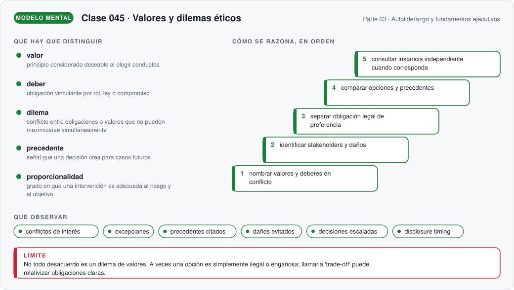

# Clase 045 — Valores y dilemas éticos

<!-- nav:inicio -->
> **Parte 03 · Inteligencia emocional, resiliencia y liderazgo adaptativo** — clase 9 de 12 · [índice de la parte](../../README.md) · [temario](../../../../SYLLABUS.md)
<!-- nav:fin -->

**Parte:** 03 — Inteligencia emocional, resiliencia y liderazgo adaptativo  
**Nivel:** Etapa 1 — Profesional → Líder  
**Duración sugerida:** 150–180 minutos · **Estándar:** deep-class-v2

## 🎯 Propósito

Los dilemas más difíciles de un directivo rara vez son entre el bien y el mal: son entre dos cosas que valora. Ser leal a un colega y decir la verdad a la empresa; proteger a una persona y proteger al equipo; cumplir el plazo y la calidad; ser justo y ser compasivo. Ante ellos, la intuición se divide y, sin método, se decide por el más cómodo o por quien presiona más, y después se racionaliza.

Esta clase usa el análisis de Rushworth Kidder sobre los dilemas de «bien contra bien» y sus tres criterios de resolución, y las advertencias de Bazerman y Moore sobre cómo se distorsiona nuestro propio juicio ético. Al terminar sabrás clasificar un dilema, evaluarlo con tres lentes, detectar las señales de que tu juicio puede estar sesgado y dejar un registro de la decisión y de lo que cediste.

## 📚 Resultados de aprendizaje

Al finalizar podrás:

1. **Distinguir** un dilema de «bien contra bien» de una tentación de «bien contra mal».
2. **Clasificar** un dilema entre las cuatro tensiones típicas.
3. **Aplicar** los tres criterios de resolución y comparar sus conclusiones.
4. **Reconocer** cómo la presión, el interés propio y la rutina deforman el juicio ético.
5. **Registrar** la decisión, el valor que se cedió y las salvaguardas.

## 🧭 Agenda

| Tramo | Qué se hace |
|---|---|
| 0–20 min | Recuperación: recuerda un dilema en que ambas opciones tenían parte de razón; ¿cómo lo resolviste? |
| 20–60 min | Tensiones, criterios y sesgos del juicio ético. |
| 60–105 min | Ejemplo trabajado: un directivo que debe decidir entre lealtad y verdad. |
| 105–140 min | Caso ejecutivo: una relación personal con un proveedor. |
| 140–170 min | Límites y entregable. |

## 🧩 Conceptos centrales

| Concepto | Definición | Cómo se reconoce |
|---|---|---|
| **Dilema de bien contra bien** | Situación en que dos valores legítimos entran en conflicto y no se pueden satisfacer ambos (Kidder, 2009). | Ambas opciones tienen razones respetables. |
| **Tentación** | Situación en que se sabe qué es correcto y lo difícil es hacerlo. | No hay un conflicto de valores, sino de voluntad o de costo. |
| **Criterio basado en resultados** | Elegir lo que produce el mayor bien para el mayor número (Kidder, 2009). | Se comparan consecuencias. |
| **Criterio basado en reglas** | Actuar según un principio que se querría ver como regla para todos (Kidder, 2009). | Se pregunta si sería una buena regla universal. |
| **Criterio basado en el cuidado** | Actuar como se querría ser tratado en el lugar del otro (Kidder, 2009). | Se ocupa de la perspectiva del afectado. |
| **Ética limitada** | Tendencia de las personas a actuar contra sus propios valores sin advertirlo, por presión, sesgo e interés propio (Bazerman y Moore, 2013). | Se racionaliza una conducta que no se aprobaría en otra persona. |

## 🧠 Modelo mental

**Cómo leer el diagrama.** Arriba, las cuatro tensiones más frecuentes entre valores legítimos. En el medio, tres lentes con las que se mira el mismo dilema; si coinciden, la decisión es más clara; si no, hay que justificar cuál pesa más. Abajo, la decisión queda por escrito, con el valor que se cedió.

## 📖 Desarrollo

### 1. Dilema o tentación

Kidder propone una pregunta previa: ¿se trata de un dilema de **bien contra bien** o de **bien contra mal**? Si se sabe qué es lo correcto y el problema es el costo de hacerlo, no hay dilema sino tentación, y lo que se necesita es valentía y apoyo. El dilema auténtico existe cuando dos personas razonables, con buenos valores, podrían llegar a conclusiones distintas.

### 2. Cuatro tensiones típicas

Kidder identifica cuatro patrones: **verdad contra lealtad** (decir lo que ocurre o proteger a quien se debe lealtad), **individuo contra comunidad** (una persona frente a un grupo), **corto contra largo plazo** (el beneficio inmediato frente al futuro) y **justicia contra misericordia** (aplicar la regla o atender las circunstancias). Nombrar la tensión ayuda a ver que el conflicto no es de mala fe: es entre dos cosas buenas.

### 3. Tres criterios para resolver

El mismo autor propone tres formas de mirar el dilema: **resultados** (¿qué produce el mayor bien?), **reglas** (¿qué regla querría ver que todos siguieran?) y **cuidado** (¿cómo querría que me trataran en el lugar del otro?). Cada una privilegia un aspecto. Si las tres conducen a la misma decisión, se puede avanzar con confianza; si divergen, la divergencia es información: indica qué valor se está cediendo y obliga a justificar.

### 4. Lealtad, relaciones y obligaciones del cargo

El dilema más frecuente en cargos con acceso a información no es robar sino **sostener dos lealtades**: una relación personal y una obligación del cargo. La obligación del cargo no se suspende por afecto, y una relación personal no se vuelve ilegítima por existir. Una prueba de tres preguntas, propuesta como método de trabajo en esta clase: ¿la relación puede afectar o parecer que afecta mi juicio en el cargo?, ¿alguien con intereses propios se beneficia de mi acceso?, ¿lo declararía en voz alta ante quien me supervisa? Si la respuesta a la tercera es no, la conducta ya señala el problema.

### 5. Cómo se distorsiona el juicio

Bazerman y Moore describen una **ética limitada**: las personas toman decisiones que contradicen sus propios valores sin advertirlo, por factores como la presión de la situación, el interés propio, la rutina y la tendencia a ver lo que conviene. Rasgos: se subestiman los propios sesgos, se evalúa a otros con severidad y a uno mismo con indulgencia, y se «desvanece» la dimensión ética cuando el problema se encuadra solo como decisión de negocio. De ahí la utilidad de preguntas que fuerzan la perspectiva: ¿qué diría quien no tiene mi interés?

### 6. Declarar y abstenerse

Una salvaguarda eficaz en conflictos entre obligación e interés es **declarar**: informar a quien corresponde de la relación o el interés. Una segunda es **abstenerse**: no participar en la decisión. Una tercera es la **revisión por un tercero independiente**. Declarar no es confesar una falta: es proteger la decisión y a la persona. Separa siempre la **conducta privada**, que no es materia de juicio moral aquí, de **su efecto sobre el cargo**, que sí lo es.

### 7. El registro

Escribir la decisión mejora su calidad y permite explicarla después. El registro incluye: el dilema y la tensión, los hechos, las opciones, el análisis con los tres criterios, la decisión, **el valor que se cedió y por qué**, y las medidas para reducir el daño. Un registro honesto reconoce lo que costó. Si la decisión resultó equivocada, el registro permite distinguir una mala decisión de un mal resultado.

## 📚 Lectura comparada

| Obra | Qué aporta | Qué no resuelve | Pregunta para contrastar |
|---|---|---|---|
| Kidder (2009) | Dilemas de bien contra bien y tres criterios de resolución. | Simplifica tradiciones filosóficas amplias. | ¿Qué valores chocan en tu dilema? |
| Bazerman y Moore (2013) | Cómo se distorsiona el juicio ético. | No da un procedimiento de decisión. | ¿Qué interés propio podría estar sesgándote? |
| Kahneman (2011) | Sesgos de juicio y pensamiento rápido. | No es un texto de ética. | ¿Qué atajo mental usas en este caso? |
| Klein (1999) | Decisión experta bajo presión. | No trata de ética. | ¿Cuándo tu reacción inmediata es confiable? |
| Edmondson (2018) | Seguridad para plantear dilemas. | No es un método de decisión. | ¿Puede alguien decirte que te equivocas? |

## 🧮 Ejemplo trabajado

**Situación (hipotética).** Marcos, gerente de operaciones, descubre que su colega y amigo Esteban, jefe de compras, aprobó durante dos años pedidos a un proveedor con precios algo superiores al mercado. No hay evidencia de beneficio personal, pero el proveedor es un conocido de Esteban. Si informa, Esteban podría ser sancionado; si calla, la empresa seguirá pagando de más.

**Tensión.** Verdad contra lealtad.

| Opción | Resultados | Reglas | Cuidado |
|---|---|---|---|
| **Callar** | Mantiene la relación; perjudica a la empresa. | No querría que todos callaran ante un posible sobreprecio. | No cuida a la empresa ni a Esteban a largo plazo. |
| **Conversar primero con Esteban y pedirle que declare** | Permite corregir con menor daño; si no declara, informa. | Una regla razonable: dar oportunidad de declarar antes de informar. | Trata a Esteban con respeto sin ocultar el hecho. |
| **Informar directamente al comité de ética** | Protege a la empresa; puede dañar a Esteban si es inocente. | Reglas claras; pero no distingue casos. | Menos atento a la persona. |

**Decisión.** Marcos habla con Esteban: le cuenta lo que vio, le pide que lo declare ante el comité en cinco días y que se abstenga de decidir sobre ese proveedor; si no lo hace, Marcos informará. Registra: valor cedido, la inmediatez de informar; lo que no sabe, si hubo beneficio personal; fecha de revisión.

**Qué muestra.** (1) Las tres lentes divergen y la divergencia es información. (2) La opción elegida no oculta el hecho ni condena sin evidencia. (3) El registro deja constancia de lo cedido y de lo desconocido.

## 🔀 Comparación y límites

**Dilema frente a cumplimiento.** Cuando una norma obliga a informar, no hay dilema: hay deber. Los dilemas de la clase ocurren donde la norma no alcanza o admite interpretación; la clase no sustituye asesoría legal ni los protocolos institucionales.

**Límites.** Los tres criterios de Kidder resumen tradiciones filosóficas amplias y pueden usarse de forma simplista. La investigación sobre ética limitada muestra que estos métodos no eliminan el sesgo, solo lo hacen más visible. Y no todo conflicto es un dilema: a veces la dificultad es el miedo a las consecuencias, que exige apoyo y no un análisis.

## 🪜 De profesional a owner

| Nivel | Cómo enfrenta los dilemas |
|---|---|
| **Profesional** | Plantea un dilema a su jefe en lugar de resolverlo solo y declara conflictos. |
| **Jefe / Team Lead** | Hace visibles las tensiones de valores del equipo y decide con criterio. |
| **Gerente** | Diseña canales para declarar conflictos y protege a quien los plantea. |
| **CEO / Director** | Dilucida dilemas de alto impacto con tercero independiente y registro. |
| **Founder / Owner** | Decide con su patrimonio en juego, donde el interés propio sesga más. |

## 🏢 Caso ejecutivo

Una directora de compras evalúa tres ofertas para un contrato de tres años por USD 2 millones. La mejor propuesta técnica y de precio es de una empresa cuyo dueño es el cónyuge de una amiga cercana y antigua colega de la directora. No hay relación comercial ni beneficio para ella. La política de la empresa exige declarar «vínculos significativos», sin definirlos. El plazo para decidir es de una semana.

Entrega un **registro de decisión ética** que contenga: (a) la tensión de valores y por qué es un dilema y no una tentación; (b) los hechos y lo que no se sabe; (c) las opciones —no declarar y decidir; declarar y decidir; declarar y abstenerse; declarar y pedir revisión independiente— analizadas con los tres criterios; (d) la prueba de tres preguntas; (e) la decisión y el valor que se cede; (f) las salvaguardas y la fecha de revisión.

## 🧪 Práctica

1. Clasifica un dilema reciente: ¿bien contra bien o tentación? ¿Cuál de las cuatro tensiones?
2. Analízalo con los tres criterios y anota dónde divergen.
3. Aplica la prueba de tres preguntas a una relación que pudiera afectar tu juicio.
4. Escribe qué interés propio podría estar sesgándote y a quién consultarías.
5. Redacta el registro de una decisión: qué valor cediste y qué harías con otra información.

## ⚠️ Errores frecuentes

| Error | Por qué ocurre | Cómo corregirlo |
|---|---|---|
| Tratar una tentación como dilema | Se busca justificar | Reconocer que se sabe qué es correcto. |
| Decidir solo | Se cree que es un asunto privado | Consultar a un tercero independiente. |
| Resolver por comodidad | Se evita el conflicto | Aplicar los tres criterios y escribir la decisión. |
| Ocultar un vínculo | Se teme que parezca mal | Declarar: es protección, no confesión. |
| Juzgar por la vida privada | Se mezcla moral con riesgo | Evaluar el efecto concreto sobre el cargo. |
| No registrar | Se confía en la memoria | Escribir el valor cedido y las medidas. |

## ❓ Preguntas de comprobación

1. ¿Qué diferencia hay entre un dilema de bien contra bien y una tentación?
2. ¿Cuáles son las cuatro tensiones típicas de Kidder?
3. ¿Cuáles son los tres criterios de resolución?
4. ¿Qué es la ética limitada según Bazerman y Moore?
5. ¿Por qué declarar un vínculo no es confesar una falta?
6. ¿Qué debe incluir el registro de una decisión ética?
7. ¿Qué límite tienen los tres criterios?

Claves de respuesta

1. En el dilema dos valores legítimos chocan; en la tentación se sabe qué es lo correcto y lo difícil es hacerlo.
2. Verdad contra lealtad, individuo contra comunidad, corto contra largo plazo y justicia contra misericordia.
3. Resultados, reglas y cuidado.
4. La tendencia a actuar contra los propios valores sin advertirlo, por presión, sesgo e interés propio.
5. Porque protege la decisión y a la persona; la falta, si la hay, sería ocultar el vínculo.
6. El dilema, los hechos, las opciones y su análisis, la decisión, el valor cedido, las medidas y la fecha de revisión.
7. Resumen tradiciones filosóficas amplias, no eliminan el sesgo y pueden usarse de forma simplista.

## 📥 Entregable

Guarda en `portfolio/045-valores-y-dilemas-eticos/`:

- `leadership-decision-brief.md` (plantilla [Leadership Decision Brief](../../../../templates/leadership-decision-brief.md)) con el registro de decisión del caso ejecutivo;
- `influence-and-conflict-disclosure-brief.md` (plantilla [ficha de influencia y conflictos](../../../../templates/influence-and-conflict-disclosure-brief.md)) con la declaración del vínculo;
- `reading-note.md` con una tensión entre Kidder y Bazerman y Moore;
- `decision-journal.md` con la decisión y el valor cedido.

## 📗 Fuentes y verificación

- Rushworth M. Kidder — *How Good People Make Tough Choices* (William Morrow, 2009). **Uso en esta clase:** dilemas de bien contra bien y los tres criterios de resolución. Lectura selectiva sobre **valores y dilemas éticos**. **Localizador:** [ISBN-13 9780061968723](https://openlibrary.org/isbn/9780061968723).
- Max H. Bazerman & Don A. Moore — *Judgment in Managerial Decision Making* (John Wiley & Sons Inc). **Uso en esta clase:** cómo se distorsiona el juicio ético. Lectura selectiva sobre **valores y dilemas éticos**. **Localizador:** [ISBN-13 9781119427384](https://openlibrary.org/isbn/9781119427384).
- Daniel Kahneman — *Thinking, Fast and Slow* (Farrar, Straus and Giroux, 2011). **Uso en esta clase:** sesgos de juicio y pensamiento rápido. Lectura selectiva sobre **valores y dilemas éticos**. **Localizador:** [ISBN-13 9780374275631](https://openlibrary.org/isbn/9780374275631).
- Gary Klein — *Sources of Power* (The MIT Press, 1999). **Uso en esta clase:** cuándo la reacción inmediata es confiable. Lectura selectiva sobre **valores y dilemas éticos**. **Localizador:** [ISBN-13 9780262611466](https://openlibrary.org/isbn/9780262611466).
- Amy C. Edmondson — *The Fearless Organization* (Wiley, 2018). **Uso en esta clase:** seguridad para plantear dilemas. Lectura selectiva sobre **valores y dilemas éticos**. **Localizador:** [ISBN-13 9781119477242](https://openlibrary.org/isbn/9781119477242).

> **Regla de fuentes para Valores y dilemas éticos:** las obras anteriores estructuran las perspectivas de esta materia; cualquier norma, ley o estándar vivo mencionado debe comprobarse nuevamente en su fuente primaria vigente. Los ejemplos y casos son hipotéticos. Esta clase no sustituye asesoría legal ni los protocolos institucionales. El desarrollo es original y no reproduce capítulos protegidos.

<!-- pie:inicio -->
---

| Anterior | Índice | Siguiente |
|---|---|---|
| [← 044 · Liderar en incertidumbre](../044-liderar-en-incertidumbre/README.md) | [Parte 03](../../README.md) · [Programa](../../../../SYLLABUS.md) | [046 · Cambio personal y resistencia →](../046-cambio-personal-y-resistencia/README.md) |
<!-- pie:fin -->
