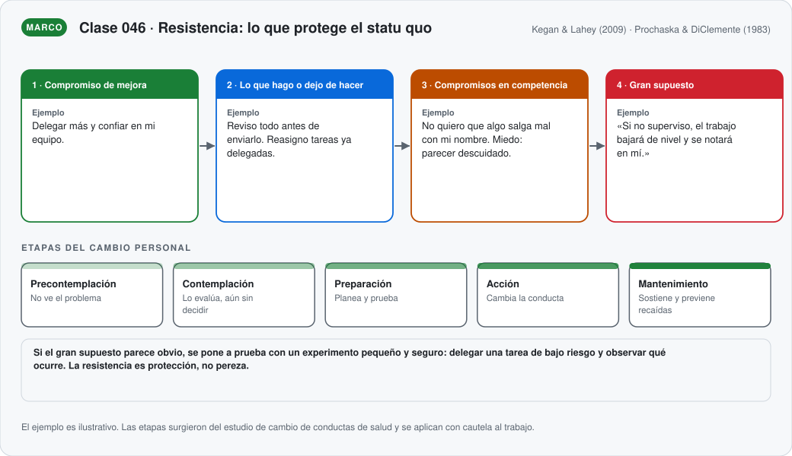

# Clase 046 — Cambio personal y resistencia

<!-- nav:inicio -->
> **Parte 03 · Inteligencia emocional, resiliencia y liderazgo adaptativo** — clase 10 de 12 · [índice de la parte](../../README.md) · [temario](../../../../SYLLABUS.md)
<!-- nav:fin -->

**Parte:** 03 — Inteligencia emocional, resiliencia y liderazgo adaptativo  
**Nivel:** Etapa 1 — Profesional → Líder  
**Duración sugerida:** 150–180 minutos · **Estándar:** deep-class-v2

## 🎯 Propósito

Casi todos los directivos saben qué conductas deberían cambiar: delegar más, escuchar más, decidir con menos urgencia. Y casi todos intentan hacerlo, con convicción, y vuelven a la conducta anterior. La explicación habitual es falta de fuerza de voluntad. Robert Kegan y Lisa Lahey ofrecen otra, más útil: existe un **sistema de protección** que nos mantiene como estamos, porque cambiar amenaza algo que también queremos cuidar.

Esta clase usa su mapa de inmunidad al cambio y el modelo de etapas de Prochaska y DiClemente para diseñar un cambio personal realista: identificar el compromiso oculto que lo bloquea, poner a prueba el supuesto que lo sostiene y elegir intervenciones adecuadas a la etapa en que se está. Al terminar sabrás por qué no cambias lo que dices querer cambiar y qué experimento hacer.

## 📚 Resultados de aprendizaje

Al finalizar podrás:

1. **Explicar** por qué un cambio deseado puede resistirse con un compromiso en competencia.
2. **Construir** un mapa de inmunidad con sus cuatro columnas.
3. **Formular** un gran supuesto y diseñar un experimento seguro para ponerlo a prueba.
4. **Identificar** la etapa del cambio en que estás y qué ayuda a avanzar.
5. **Aplicar** lo anterior a la resistencia de otros sin atribuirles mala voluntad.

## 🧭 Agenda

| Tramo | Qué se hace |
|---|---|
| 0–20 min | Recuperación: ¿qué cambio de conducta intentaste varias veces y abandonaste? |
| 20–60 min | El mapa de inmunidad y las etapas del cambio. |
| 60–105 min | Ejemplo trabajado: un gerente que no puede delegar. |
| 105–140 min | Caso ejecutivo: una directora que quiere cambiar su estilo de decisión. |
| 140–170 min | Límites y entregable. |

## 🧩 Conceptos centrales

| Concepto | Definición | Cómo se reconoce |
|---|---|---|
| **Inmunidad al cambio** | Sistema que protege un statu quo mediante compromisos en competencia con el cambio deseado (Kegan y Lahey, 2009). | Quieres cambiar, lo intentas y vuelves atrás. |
| **Compromiso de mejora** | Objetivo de cambio que la persona declara con sinceridad (Kegan y Lahey, 2009). | «Quiero delegar más». |
| **Compromiso en competencia** | Otro compromiso, a menudo oculto, que la conducta actual protege (Kegan y Lahey, 2009). | «No quiero que algo salga mal con mi nombre.» |
| **Gran supuesto** | Creencia que sostiene el compromiso oculto y se vive como verdad (Kegan y Lahey, 2009). | «Si no superviso, el trabajo bajará de nivel.» |
| **Etapas del cambio** | Precontemplación, contemplación, preparación, acción y mantenimiento (Prochaska y DiClemente, 1983). | Se ubica la disposición actual al cambio. |
| **Experimento seguro** | Prueba pequeña y reversible que permite verificar un gran supuesto. | Se puede hacer sin riesgo alto y produce información. |

## 🧠 Modelo mental

**Cómo leer el diagrama.** Arriba, las cuatro columnas del mapa de inmunidad, con un ejemplo. De izquierda a derecha se pasa de lo que se quiere a lo que protege lo contrario. Abajo, las cinco etapas del cambio: la intervención adecuada depende de en cuál se está. Quien está en contemplación no necesita un plan de acción sino claridad sobre sus razones.

## 📖 Desarrollo

### 1. Por qué no cambiamos

Kegan y Lahey observaron que personas inteligentes y comprometidas fracasaban de forma repetida en cambios que de verdad querían. Su explicación: no es falta de motivación, sino un **compromiso oculto y opuesto** que la conducta actual protege. Quien dice querer delegar y no lo hace puede estar también comprometido con «que nada salga mal con mi nombre», y la conducta de no delegar cumple ese compromiso muy bien. La inmunidad funciona como un sistema inmunológico: protege, pero a veces ataca lo que podría ayudar.

### 2. Las cuatro columnas

El mapa se construye así. **Columna 1:** el compromiso de mejora, redactado en positivo. **Columna 2:** qué haces, o dejas de hacer, que va en contra de ese compromiso. **Columna 3:** los **compromisos en competencia**, que aparecen al preguntar qué te incomodaría o te daría miedo si hicieras lo contrario de la columna 2. **Columna 4:** los **grandes supuestos**, las creencias que hacen que esos compromisos parezcan obligatorios. El ejercicio no juzga: busca entender qué cuida la conducta.

### 3. El gran supuesto como hipótesis

Lo propio de un gran supuesto es que se vive como un hecho. Kegan y Lahey proponen tratarlo como una **hipótesis** que se puede poner a prueba: «Si dejo de supervisar una tarea, el trabajo bajará de nivel y se notará en mí». Se diseña un experimento pequeño, seguro y observable: delegar una tarea de bajo riesgo y registrar qué ocurre. Si el supuesto no se cumple, pierde fuerza; si se cumple, se aprende qué condiciones lo hacen verdadero.

### 4. Las etapas del cambio

Prochaska y DiClemente describieron etapas por las que pasan las personas que cambian una conducta, a partir de estudios sobre dejar de fumar: **precontemplación** (no ve el problema), **contemplación** (lo considera sin decidir), **preparación** (planea y prueba), **acción** (cambia la conducta) y **mantenimiento** (la sostiene y previene recaídas). Cada etapa pide algo distinto: información en la primera, evaluación de razones en la segunda, un plan realista en la tercera, apoyo en la cuarta y estrategias de recaída en la quinta.

### 5. Cómo se usan juntos

Antes de planear un cambio, pregúntate en qué etapa estás. Si estás en contemplación, hacer un plan de acción será prematuro y frustrante. Luego, construye el mapa para entender el obstáculo. Después, diseña un experimento. Es un proceso iterativo: se aprende con cada intento, y las recaídas son datos, no fracasos morales.

### 6. La resistencia de otros

Si la inmunidad explica la resistencia propia, ayuda a entender la ajena. Una persona que se resiste a un cambio que dice aceptar probablemente tiene un compromiso en competencia. Preguntar «¿qué te preocupa que pase si cambias esto?» obtiene más que insistir en las razones. Conecta con la clase 043: la resistencia es un indicio de lo que se pierde.

### 7. Límites del esfuerzo individual

El cambio personal se facilita con entorno y apoyo: una persona que quiere dejar de revisar todo necesita un equipo que no castigue los errores. Cambiar solo en un sistema que premia la conducta anterior tiene poca probabilidad. Por eso conviene decir lo que se intenta a alguien de confianza y pedir su ayuda.

## 📚 Lectura comparada

| Obra | Qué aporta | Qué no resuelve | Pregunta para contrastar |
|---|---|---|---|
| Kegan y Lahey (2009) | El mapa de inmunidad y el experimento sobre el supuesto. | Es un método de consultoría con casos seleccionados. | ¿Qué protege tu conducta actual? |
| Prochaska y DiClemente (1983) | Etapas y procesos del cambio. | Surgieron en el estudio del tabaquismo. | ¿En qué etapa estás para este cambio? |
| Clear (2018) | Hábitos pequeños y diseño del entorno. | No trata de compromisos ocultos. | ¿Qué cambio de entorno facilitaría tu hábito? |
| Heifetz et al. (2009) | Resistencia como pérdida. | Es nivel colectivo. | ¿Qué pierdes al cambiar? |
| Goleman, Boyatzis y McKee (2002) | Cómo el líder cambia su estilo. | No usa el mapa de inmunidad. | ¿Qué estilo quieres modificar? |

## 🧮 Ejemplo trabajado

**Situación (hipotética).** Elena, gerente de operaciones, quiere delegar más. Lleva dos años diciéndolo y revisa el 90 % de lo que sale de su área. Su equipo se queja de que no tiene autonomía.

| Columna | Contenido |
|---|---|
| **1. Compromiso de mejora** | Delegar más y confiar en mi equipo. |
| **2. Lo que hago o dejo de hacer** | Reviso todo antes de enviarlo; reasigno tareas ya delegadas; respondo yo a los clientes importantes. |
| **3. Compromisos en competencia** | No quiero que algo salga mal con mi nombre. No quiero parecer descuidada ante la dirección. |
| **4. Gran supuesto** | «Si no superviso, el nivel bajará y se notará en mí; la dirección pensará que no controlo.» |

**Etapa.** Preparación: ya reconoce el problema y quiere cambiar.

**Experimento.** Elena delega durante tres semanas la preparación de un informe mensual de bajo riesgo, sin revisarlo antes. Anota: ¿bajó el nivel?, ¿quién lo notó?, ¿qué errores hubo y qué costó corregirlos? Define una señal de que el supuesto se cumple: más de dos errores graves.

**Resultado.** Hay un error menor, que el equipo corrige sin que llegue al cliente. El supuesto pierde fuerza. Elena amplía la delegación a dos tareas más.

**Qué muestra.** (1) El obstáculo no era voluntad sino un compromiso protegido. (2) El supuesto se trató como hipótesis. (3) El experimento era pequeño y seguro.

## 🔀 Comparación y límites

**Inmunidad frente a pereza.** La pereza es falta de esfuerzo; la inmunidad es un sistema que protege algo valioso. Tratarla como pereza refuerza la defensa.

**Límites.** El mapa de inmunidad es un método de consultoría y desarrollo que se apoya en estudios de caso, con poca evaluación experimental independiente. El modelo de etapas ha sido criticado por presentar como discretas etapas que son graduales, y proviene de la salud más que del trabajo. Y algunos cambios exigen apoyo profesional y no solo un experimento.

## 🪜 De profesional a owner

| Nivel | Cómo trabaja el cambio personal |
|---|---|
| **Profesional** | Identifica un hábito que frena su desempeño y prueba una conducta distinta. |
| **Jefe / Team Lead** | Construye su mapa de una conducta de liderazgo y lo conversa con su equipo. |
| **Gerente** | Entiende la resistencia de sus equipos como compromisos protegidos. |
| **CEO / Director** | Cambia su estilo de decisión con apoyo externo y feedback. |
| **Founder / Owner** | Revisa el supuesto de que «nadie lo hace como yo». |

## 🏢 Caso ejecutivo

Una directora general quiere cambiar su estilo: decide rápido y en solitario, y su equipo directivo ha dejado de traerle problemas. Se comprometió a consultar antes de decidir, pero lo olvida cuando hay presión. Dice que «no tiene tiempo para consultar». En el último trimestre tomó dos decisiones que su equipo habría podido mejorar, con un costo de USD 150.000.

Entrega un **mapa de inmunidad y plan de cambio** que contenga: (a) las cuatro columnas con tu mejor hipótesis; (b) la etapa del cambio en que estás; (c) el gran supuesto y un experimento seguro con su señal de refutación; (d) el apoyo que pedirás y a quién; (e) cómo medirás el avance; (f) qué harás ante una recaída.

## 🧪 Práctica

1. Construye tu mapa de inmunidad para un cambio que has postergado.
2. Escribe el gran supuesto como hipótesis y una señal que lo refutaría.
3. Diseña un experimento de una a tres semanas, pequeño y seguro.
4. Identifica tu etapa y una acción coherente con ella.
5. Pregunta a alguien que se resiste a un cambio: «¿qué te preocupa que pase?».

## ⚠️ Errores frecuentes

| Error | Por qué ocurre | Cómo corregirlo |
|---|---|---|
| Atribuir el fracaso a la voluntad | Es la explicación habitual | Buscar el compromiso en competencia. |
| Hacer un plan de acción prematuro | Se salta la etapa | Ubicar la etapa y actuar en consecuencia. |
| Creer el supuesto | Se vive como un hecho | Tratarlo como hipótesis. |
| Experimentos grandes | Se quiere resultado rápido | Pequeño, seguro y reversible. |
| Cambiar solo | Se piensa que es privado | Pedir apoyo y ajustar el entorno. |
| Ver la recaída como fracaso | Se juzga con dureza | Usarla como información. |

## ❓ Preguntas de comprobación

1. ¿Qué es un compromiso en competencia?
2. ¿Cuáles son las cuatro columnas del mapa de inmunidad?
3. ¿Por qué se trata el gran supuesto como hipótesis?
4. ¿Cuáles son las cinco etapas del cambio?
5. ¿Qué necesita una persona en contemplación?
6. ¿Cómo ayuda el mapa a entender la resistencia de otros?
7. ¿Qué límites tienen el mapa y el modelo de etapas?

Claves de respuesta

1. Un compromiso, a menudo oculto, que la conducta actual protege y que compite con el cambio deseado.
2. Compromiso de mejora, lo que hago o dejo de hacer, compromisos en competencia y gran supuesto.
3. Porque se vive como un hecho, y al tratarlo como hipótesis se puede verificar con un experimento.
4. Precontemplación, contemplación, preparación, acción y mantenimiento.
5. Claridad sobre sus razones, no un plan de acción.
6. Sugiere preguntar qué le preocupa que pase si cambia, en lugar de insistir en las razones.
7. El mapa se apoya en casos de consultoría; el modelo de etapas es criticado por discretizar procesos graduales y nació en la salud.

## 📥 Entregable

Guarda en `portfolio/046-cambio-personal-y-resistencia/`:

- `risk-governance-brief.md` (plantilla [Risk & Governance Brief](../../../../templates/risk-governance-brief.md)) con el mapa y el plan del caso ejecutivo;
- `reading-note.md` con una tensión entre Kegan y Lahey y Prochaska y DiClemente;
- `decision-journal.md` con el experimento, lo observado y el ajuste.

## 📗 Fuentes y verificación

- Robert Kegan & Lisa Laskow Lahey — *Immunity to Change* (Harvard Business Press, 2009). **Uso en esta clase:** el mapa de inmunidad y el experimento sobre el gran supuesto. Lectura selectiva sobre **cambio personal y resistencia**. **Localizador:** [ISBN-13 9781422117361](https://openlibrary.org/isbn/9781422117361).
- James O. Prochaska & Carlo C. DiClemente — *Stages and Processes of Self-Change of Smoking: Toward an Integrative Model of Change* (Journal of Consulting and Clinical Psychology, 1983). **Uso en esta clase:** las etapas del cambio. Lectura selectiva sobre **cambio personal y resistencia**. **Localizador:** [DOI 10.1037/0022-006X.51.3.390](https://doi.org/10.1037/0022-006X.51.3.390).
- James Clear — *Atomic Habits* (Avery, an Imprint of Penguin Random House LLC, 2018). **Uso en esta clase:** hábitos pequeños y diseño del entorno. Lectura selectiva sobre **cambio personal y resistencia**. **Localizador:** [ISBN-13 9780735211292](https://openlibrary.org/isbn/9780735211292).
- Ronald A. Heifetz, Alexander Grashow & Marty Linsky — *The Practice of Adaptive Leadership* (Harvard Business Press, 2009). **Uso en esta clase:** la resistencia como pérdida. Lectura selectiva sobre **cambio personal y resistencia**. **Localizador:** [ISBN-13 9781422105764](https://openlibrary.org/isbn/9781422105764).
- Daniel Goleman, Richard Boyatzis & Annie McKee — *Primal Leadership* (Harvard Business School Press, 2002). **Uso en esta clase:** cómo el líder cambia su estilo. Lectura selectiva sobre **cambio personal y resistencia**. **Localizador:** [ISBN-13 9781578514861](https://openlibrary.org/isbn/9781578514861).

> **Regla de fuentes para Cambio personal y resistencia:** las obras anteriores estructuran las perspectivas de esta materia; cualquier norma, ley o estándar vivo mencionado debe comprobarse nuevamente en su fuente primaria vigente. Los ejemplos y casos son hipotéticos. Esta clase no sustituye atención profesional de salud mental. El desarrollo es original y no reproduce capítulos protegidos.

<!-- pie:inicio -->
---

| Anterior | Índice | Siguiente |
|---|---|---|
| [← 045 · Valores y dilemas éticos](../045-valores-y-dilemas-eticos/README.md) | [Parte 03](../../README.md) · [Programa](../../../../SYLLABUS.md) | [047 · Recuperación, límites y sostenibilidad →](../047-recuperacion-limites-y-sostenibilidad/README.md) |
<!-- pie:fin -->
