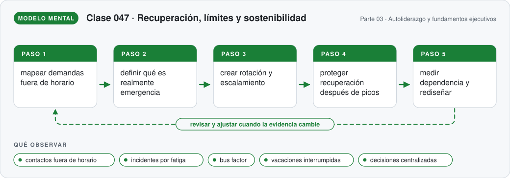

# Clase 047 — Recuperación, límites y sostenibilidad

<!-- nav:inicio -->
> **Parte 03 · Inteligencia emocional, resiliencia y liderazgo adaptativo** — clase 11 de 12 · [índice de la parte](../../README.md) · [temario](../../../../SYLLABUS.md)
<!-- nav:fin -->

**Parte:** 03 — Inteligencia emocional, resiliencia y liderazgo adaptativo  
**Nivel:** Etapa 1 — Profesional → Líder  
**Duración sugerida:** 150–180 minutos · **Estándar:** deep-class-v2

## 🎯 Propósito

Se suele celebrar al directivo que trabaja de más y se lo trata como ejemplo. A mediano plazo es una mala inversión: la fatiga deteriora el juicio, la paciencia y la capacidad de escuchar, justo lo que el cargo más necesita. Cuidar la energía no es un lujo ni una cuestión de «bienestar»; es una **condición de desempeño sostenido**, y para quien dirige también es una responsabilidad hacia el equipo, que copia lo que ve.

Esta clase usa la investigación sobre agotamiento laboral de Maslach, Schaufeli y Leiter —qué es el *burnout* y en qué áreas del trabajo se origina— y la de Sonnentag y Fritz sobre las **experiencias de recuperación** fuera del trabajo. Al terminar sabrás reconocer las señales de agotamiento, distinguir lo que se resuelve con hábitos de lo que exige cambiar condiciones de trabajo y diseñar un sistema de recuperación y de límites realista.

## 📚 Resultados de aprendizaje

Al finalizar podrás:

1. **Describir** las tres dimensiones del *burnout* y distinguirlo del cansancio normal.
2. **Identificar** las seis áreas donde el trabajo se desajusta con la persona.
3. **Explicar** las cuatro experiencias de recuperación y cómo se favorecen.
4. **Establecer** límites concretos de disponibilidad, carga y descanso.
5. **Distinguir** qué es responsabilidad individual y qué es del sistema de trabajo.

## 🧭 Agenda

| Tramo | Qué se hace |
|---|---|
| 0–20 min | Recuperación: describe cómo estaba tu energía las últimas cuatro semanas y qué la afectó. |
| 20–60 min | *Burnout*, áreas de desajuste y experiencias de recuperación. |
| 60–105 min | Ejemplo trabajado: un gerente con señales de agotamiento. |
| 105–140 min | Caso ejecutivo: un equipo con sobrecarga crónica. |
| 140–170 min | Límites y entregable. |

## 🧩 Conceptos centrales

| Concepto | Definición | Cómo se reconoce |
|---|---|---|
| **Burnout** | Síndrome de respuesta prolongada a estresores crónicos del trabajo, con tres dimensiones: agotamiento, cinismo y menor eficacia (Maslach et al., 2001). | Cansancio persistente, distancia del trabajo y sensación de ineficacia. |
| **Agotamiento** | Dimensión de tensión: sentirse sobrepasado y sin recursos emocionales o físicos (Maslach et al., 2001). | Cansancio que el descanso normal no repara. |
| **Cinismo** | Actitud distante y negativa hacia el trabajo y las personas (Maslach et al., 2001). | Se dejó de creer que importa. |
| **Eficacia reducida** | Sensación de logro y competencia disminuida (Maslach et al., 2001). | «Nada de lo que hago sirve.» |
| **Recuperación** | Procesos por los que se restablecen los recursos tras el esfuerzo laboral (Sonnentag y Fritz, 2007). | Se vuelve al trabajo con energía. |
| **Desconexión psicológica** | No pensar en el trabajo durante el tiempo libre (Sonnentag y Fritz, 2007). | El tiempo libre se siente libre. |

## 🧠 Modelo mental

**Cómo leer el diagrama.** A la izquierda, lo que se observa en la persona: tres dimensiones. En el centro, dónde suele originarse: seis áreas del trabajo en que hay un desajuste. A la derecha, lo que repara: cuatro experiencias de recuperación fuera del trabajo. El mensaje: el agotamiento no se resuelve solo con descanso; también se revisan las condiciones que lo producen.

## 📖 Desarrollo

### 1. Qué es el *burnout*

Maslach y sus colegas lo describen como una respuesta prolongada a estresores crónicos del trabajo, con tres dimensiones: **agotamiento** (sentirse sobrepasado y vacío), **cinismo** o despersonalización (distancia y actitud negativa hacia el trabajo) y **eficacia reducida** (sensación de poco logro). No es lo mismo que estar cansado: el cansancio se repara con descanso; el *burnout* persiste, y se acompaña de pérdida de sentido. No siempre es un diagnóstico clínico y esta clase no sustituye atención profesional.

### 2. De dónde viene: el desajuste

La investigación desplaza el foco de la persona al **entorno**: el agotamiento surge cuando hay un desajuste sostenido entre la persona y su trabajo en seis áreas: **carga de trabajo** (demasiado, con poco tiempo), **control** (poca autonomía), **reconocimiento** (poca recompensa material o simbólica), **comunidad** (relaciones deterioradas), **justicia** (decisiones percibidas como injustas) y **valores** (conflicto entre lo que se pide y lo que importa). Un diagnóstico útil pregunta en cuáles hay desajuste.

### 3. Qué hace el líder

El líder puede crear o reducir cada desajuste: define la **carga** realista, da **control** sobre cómo trabajar, **reconoce** con regularidad, cuida la **comunidad** del equipo, decide con **justicia** y explica cómo el trabajo se relaciona con los **valores**. Si trata el agotamiento como problema personal («necesita desconectarse»), sin revisar estas condiciones, no resuelve la causa y suma culpa.

### 4. Las cuatro experiencias de recuperación

Sonnentag y Fritz identificaron cuatro experiencias que, fuera del trabajo, ayudan a restablecer los recursos: **desconexión psicológica** (no pensar en el trabajo), **relajación** (reducir la activación), **dominio** (aprender o lograr algo en otro ámbito) y **control del tiempo libre** (decidir cómo usarlo). La desconexión suele ser la más difícil para quien dirige: la disponibilidad permanente y el correo en el teléfono la impiden. Las cuatro se asocian con mayor bienestar y menor tensión.

### 5. Límites concretos

Un límite eficaz es **específico y visible**: «no reviso correo después de las 20:00 salvo emergencias definidas»; «una tarde sin reuniones por semana»; «vacaciones sin disponibilidad». Se comunican al equipo, se acuerda qué es una emergencia y se respetan. El ejemplo del líder importa: si escribe de madrugada, el equipo entiende que se espera lo mismo. Y un límite sin consecuencia no es un límite.

### 6. Energía, no solo tiempo

Mankins y Garton sostienen que lo escaso en las organizaciones no siempre es el tiempo ni el talento sino la **energía** de las personas, y que se puede medir y gestionar. A nivel individual: ¿en qué actividades gastas energía sin retorno?, ¿cuáles te la devuelven? Diseñar el día para proteger las horas de mayor energía para lo importante rinde más que añadir horas.

### 7. Cuando la causa es el sistema

Si todo un equipo presenta señales de agotamiento, el problema no es de hábitos sino de condiciones: carga, urgencias falsas, incentivos contradictorios. La respuesta es cambiar el sistema: priorizar, dejar de hacer cosas, contratar, cambiar plazos. Pedir «resiliencia» o «autocuidado» sin hacerlo traslada la responsabilidad. Heifetz y Linsky agregan que quien lidera un cambio difícil necesita cuidarse a propósito: aliados, una persona de confianza con quien hablar y espacios donde no tiene que ser el líder.

## 📚 Lectura comparada

| Obra | Qué aporta | Qué no resuelve | Pregunta para contrastar |
|---|---|---|---|
| Maslach, Schaufeli y Leiter (2001) | Definición, dimensiones y áreas de desajuste. | Es una revisión; no da un plan personal. | ¿En cuál de las seis áreas hay desajuste? |
| Sonnentag y Fritz (2007) | Cuatro experiencias de recuperación. | Se basa en cuestionarios; no mide causalidad. | ¿Cuál de las cuatro te falta? |
| Mankins y Garton (2017) | Energía organizacional como recurso. | Es un texto de consultoría. | ¿Dónde gasta energía tu equipo sin retorno? |
| Heifetz y Linsky (2017) | Cuidarse al liderar cambios difíciles. | No trata de recuperación fuera del trabajo. | ¿Quién te cuida mientras lideras? |
| Goleman, Boyatzis y McKee (2002) | El estado del líder se contagia. | No usa los marcos anteriores. | ¿Qué cultura de disponibilidad transmites? |

## 🧮 Ejemplo trabajado

**Situación (hipotética).** Sergio, gerente de ventas, lleva ocho meses trabajando 60 horas semanales. Últimamente está irritable, responde con ironía a su equipo, siente que «da lo mismo» y comete errores simples. Duerme mal y ya no hace deporte.

| Dimensión | Observación en Sergio |
|---|---|
| **Agotamiento** | Cansancio persistente que no cede con el fin de semana. |
| **Cinismo** | Ironía y distancia con el equipo y con los clientes. |
| **Eficacia reducida** | «Nada de lo que hago cambia las ventas.» |

**Áreas de desajuste.** Carga (60 horas), control (la dirección fija metas cambiantes cada mes), reconocimiento (no recibió feedback en seis meses).

**Plan.** (1) Conversación con su jefa: pide priorizar tres metas y quitar una. (2) Límites: sin correo después de las 20:00 y una tarde sin reuniones. (3) Recuperación: retoma el deporte (relajación y dominio), y los domingos no revisa el teléfono (desconexión). (4) Si los síntomas persisten en seis semanas, consulta a un profesional de la salud. (5) Revisa mensualmente carga, control y reconocimiento.

**Qué muestra.** (1) Las tres dimensiones guían el diagnóstico. (2) Las causas incluyen condiciones del trabajo, no solo hábitos. (3) El plan combina cambios del sistema, límites y recuperación, y prevé ayuda profesional.

## 🔀 Comparación y límites

**Descanso frente a recuperación.** Dormir y no trabajar son descanso; la recuperación incluye experiencias que reponen recursos específicos: desconexión, relajación, dominio y control.

**Límites.** El *burnout* no se reconoce igual en todos los sistemas de salud como diagnóstico y las escalas de medición son instrumentos de investigación, no herramientas de diagnóstico individual. La investigación sobre recuperación es en gran parte correlacional. Los consejos de esta clase no reemplazan atención profesional: ante síntomas persistentes, como alteraciones del sueño, ánimo muy bajo o ideas de hacerse daño, consulta a un profesional de la salud.

## 🪜 De profesional a owner

| Nivel | Cómo cuida la sostenibilidad |
|---|---|
| **Profesional** | Reconoce sus señales, pone límites y pide revisar la carga cuando es excesiva. |
| **Jefe / Team Lead** | Define cargas realistas y da ejemplo de desconexión. |
| **Gerente** | Revisa las seis áreas en sus equipos y actúa sobre el sistema. |
| **CEO / Director** | Evalúa si la cultura premia la sobrecarga y cambia los incentivos. |
| **Founder / Owner** | Identifica que su energía es un activo del negocio y diseña su sustituibilidad. |

## 🏢 Caso ejecutivo

Un equipo de 15 personas de atención a clientes lleva un año con picos de trabajo mensuales, metas que suben y dos puestos sin cubrir. En dos meses renunciaron tres personas y otras cuatro están con licencias médicas. La directora propone un taller de manejo del estrés y una «semana del bienestar».

Entrega un **plan de sostenibilidad** que contenga: (a) la evidencia de agotamiento por dimensión; (b) el diagnóstico por las seis áreas de desajuste; (c) las condiciones que cambiarás y en qué orden; (d) los límites que se fijarán y cómo se respetarán; (e) cómo apoyarás la recuperación sin cargar la responsabilidad en las personas; (f) cómo medirás el resultado y cuándo derivarás a apoyo profesional.

## 🧪 Práctica

1. Evalúa tu energía de las últimas cuatro semanas en las tres dimensiones.
2. Identifica las áreas de desajuste en tu trabajo y una acción para cada una de dos.
3. Escribe dos límites específicos de disponibilidad y cómo los comunicarás.
4. Identifica qué experiencia de recuperación te falta y un paso para recuperarla.
5. Define una señal que te indicaría pedir ayuda profesional.

## ⚠️ Errores frecuentes

| Error | Por qué ocurre | Cómo corregirlo |
|---|---|---|
| Admirar la sobrecarga | Se asocia a compromiso | Valorar el desempeño sostenido. |
| Tratarlo como problema personal | Es lo más visible | Revisar las seis áreas del trabajo. |
| Descansar sin desconectar | Se sigue disponible | Establecer límites reales de disponibilidad. |
| Taller como respuesta | Es barato y visible | Cambiar carga, control y reconocimiento. |
| Límites sin consecuencias | Se declaran y se rompen | Acordar qué es emergencia y cumplirlo. |
| Posponer ayuda profesional | Se minimiza | Consultar ante síntomas persistentes. |

## ❓ Preguntas de comprobación

1. ¿Cuáles son las tres dimensiones del *burnout*?
2. ¿En qué se diferencia el *burnout* del cansancio normal?
3. ¿Cuáles son las seis áreas de desajuste?
4. ¿Cuáles son las cuatro experiencias de recuperación?
5. ¿Por qué un taller de manejo del estrés puede no resolver un problema de sobrecarga?
6. Escribe un límite específico de disponibilidad.
7. ¿Qué límite tiene la evidencia de recuperación?

Claves de respuesta

1. Agotamiento, cinismo y eficacia reducida.
2. El cansancio se repara con descanso; el burnout persiste y se acompaña de pérdida de sentido y distancia.
3. Carga de trabajo, control, reconocimiento, comunidad, justicia y valores.
4. Desconexión psicológica, relajación, dominio y control del tiempo libre.
5. Porque no cambia las condiciones que producen el agotamiento y traslada la responsabilidad a las personas.
6. Por ejemplo: «No reviso correo después de las 20:00 salvo emergencias definidas con el equipo».
7. Es en gran parte correlacional y se basa en cuestionarios.

## 📥 Entregable

Guarda en `portfolio/047-recuperacion-limites-y-sostenibilidad/`:

- `leadership-decision-brief.md` (plantilla [Leadership Decision Brief](../../../../templates/leadership-decision-brief.md)) con el plan del caso ejecutivo;
- `reading-note.md` con una tensión entre Maslach et al. y Sonnentag y Fritz;
- `decision-journal.md` con tus límites, la recuperación y el seguimiento.

## 📗 Fuentes y verificación

- Christina Maslach, Wilmar B. Schaufeli & Michael P. Leiter — *Job Burnout* (Annual Review of Psychology, 2001). **Uso en esta clase:** definición, dimensiones y áreas de desajuste del agotamiento laboral. Lectura selectiva sobre **recuperación, límites y sostenibilidad**. **Localizador:** [DOI 10.1146/annurev.psych.52.1.397](https://doi.org/10.1146/annurev.psych.52.1.397).
- Sabine Sonnentag & Charlotte Fritz — *The Recovery Experience Questionnaire: Development and Validation of a Measure for Assessing Recuperation and Unwinding From Work* (Journal of Occupational Health Psychology, 2007). **Uso en esta clase:** las cuatro experiencias de recuperación. Lectura selectiva sobre **recuperación, límites y sostenibilidad**. **Localizador:** [DOI 10.1037/1076-8998.12.3.204](https://doi.org/10.1037/1076-8998.12.3.204).
- Michael C. Mankins & Eric Garton — *Time, Talent, Energy* (Harvard Business Review Press, 2017). **Uso en esta clase:** la energía organizacional como recurso. Lectura selectiva sobre **recuperación, límites y sostenibilidad**. **Localizador:** [ISBN-13 9781633691766](https://openlibrary.org/isbn/9781633691766).
- Ronald Heifetz & Marty Linsky — *Leadership on the Line* (Harvard Business Review Press, 2017). **Uso en esta clase:** cuidarse al liderar cambios difíciles. Lectura selectiva sobre **recuperación, límites y sostenibilidad**. **Localizador:** [ISBN-13 9781633692831](https://openlibrary.org/isbn/9781633692831).
- Daniel Goleman, Richard Boyatzis & Annie McKee — *Primal Leadership* (Harvard Business School Press, 2002). **Uso en esta clase:** el estado del líder se contagia al equipo. Lectura selectiva sobre **recuperación, límites y sostenibilidad**. **Localizador:** [ISBN-13 9781578514861](https://openlibrary.org/isbn/9781578514861).

> **Regla de fuentes para Recuperación, límites y sostenibilidad:** las obras anteriores estructuran las perspectivas de esta materia; cualquier norma, ley o estándar vivo mencionado debe comprobarse nuevamente en su fuente primaria vigente. Los ejemplos y casos son hipotéticos. Esta clase no sustituye atención profesional de salud; ante síntomas persistentes, consulta a un profesional. El desarrollo es original y no reproduce capítulos protegidos.

<!-- pie:inicio -->
---

| Anterior | Índice | Siguiente |
|---|---|---|
| [← 046 · Cambio personal y resistencia](../046-cambio-personal-y-resistencia/README.md) | [Parte 03](../../README.md) · [Programa](../../../../SYLLABUS.md) | [048 · Capstone: liderar una crisis humana →](../048-capstone-liderar-una-crisis-humana/README.md) |
<!-- pie:fin -->
