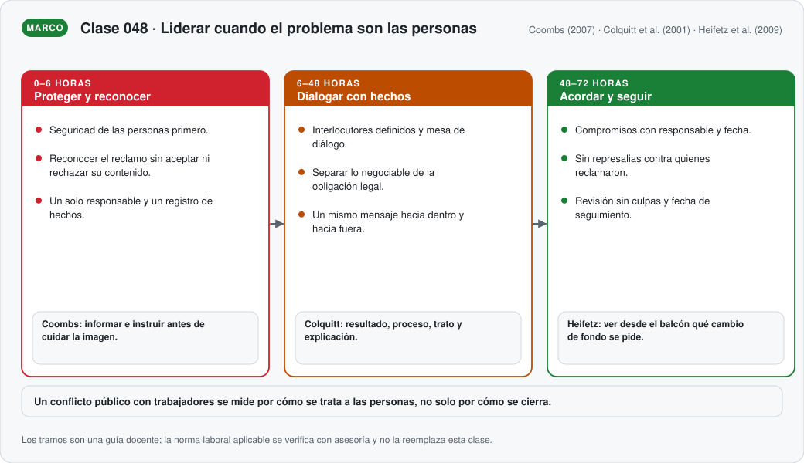

# Clase 048 — Capstone: liderar una crisis humana

<!-- nav:inicio -->
> **Parte 03 · Inteligencia emocional, resiliencia y liderazgo adaptativo** — clase 12 de 12 · [índice de la parte](../../README.md) · [temario](../../../../SYLLABUS.md)
<!-- nav:fin -->

**Parte:** 03 — Inteligencia emocional, resiliencia y liderazgo adaptativo  
**Nivel:** Etapa 1 — Profesional → Líder  
**Duración sugerida:** 150–180 minutos · **Estándar:** deep-class-v2

## 🎯 Propósito

Una crisis humana es aquella en que lo que está en riesgo son las personas: su seguridad, su empleo, su dignidad o su confianza. Un conflicto público con trabajadores, el accidente de un colaborador, una denuncia de acoso o un despido masivo mal comunicado son ejemplos. En ellas, las competencias de la parte 03 se ponen a prueba juntas: hay que **regular la propia reacción**, **escuchar sin defenderse**, **sostener un estándar con empatía**, **dar sentido a lo incierto**, distinguir **qué es técnico y qué adaptativo** y decidir con valores en conflicto.

Este capstone integra la parte 03 con una base nueva: la respuesta base de Coombs (informar e instruir, y reconocer el daño humano antes de la reputación), las cuatro formas de justicia de Colquitt et al. (clase 036) y la lectura adaptativa de Heifetz et al. Al terminar sabrás conducir las primeras 72 horas de una crisis con personas y cerrar con acuerdos y aprendizaje.

## 📚 Resultados de aprendizaje

Al finalizar podrás:

1. **Priorizar** la seguridad y el cuidado de las personas en las primeras horas.
2. **Reconocer** un reclamo sin aceptar ni rechazar su contenido y abrir un cauce de diálogo.
3. **Separar** lo negociable de lo que es una obligación legal, con asesoría.
4. **Evitar** represalias y cuidar la justicia del proceso, del trato y de la explicación.
5. **Integrar** autorregulación, escucha, estándar, incertidumbre, ética y lectura adaptativa en un plan.
6. **Cerrar** con acuerdos, seguimiento y revisión sin culpas.

## 🧭 Agenda

| Tramo | Qué se hace |
|---|---|
| 0–20 min | Recuperación: ¿qué competencias de la parte 03 usarías en una crisis con personas? Elige las tres más difíciles. |
| 20–60 min | Las primeras 72 horas y los marcos que las gobiernan. |
| 60–105 min | Ejemplo trabajado: un conflicto público con trabajadores. |
| 105–150 min | Caso ejecutivo integrado. |
| 150–170 min | Rúbrica, límites y entregable. |

## 🧩 Conceptos centrales

| Concepto | Definición | Cómo se reconoce |
|---|---|---|
| **Crisis humana** | Situación en que lo amenazado son principalmente las personas y la confianza que depositan en la organización (criterio de la clase). | Hay afectados con rostro y un reclamo legítimo. |
| **Información de instrucción y de ajuste** | Qué ocurrió y qué debe hacer quien está en riesgo; reconocimiento del daño y apoyo (Coombs, 2007). | Es lo primero que se comunica. |
| **Reconocer sin aceptar** | Admitir que existe un reclamo y su impacto sin pronunciarse aún sobre su contenido. | «Escuchamos el reclamo y lo vamos a revisar.» |
| **Justicia distributiva, procedimental, interpersonal e informacional** | Las cuatro dimensiones con que las personas evalúan una decisión (Colquitt et al., 2001). | Se cuida el resultado, el proceso, el trato y la explicación. |
| **Represalia** | Medida adversa contra quien reclamó, aunque tenga otra causa declarada. | Se percibe como castigo. |
| **Trabajo adaptativo** | Cambio de valores, hábitos o lealtades que deben hacer las personas con el problema (Heifetz et al., 2009). | La crisis revela algo de fondo que se evitaba. |

## 🧠 Modelo mental

**Cómo leer el diagrama.** Tres tramos de tiempo, cada uno con tres acciones y el marco que lo orienta. En las **primeras horas** gobierna la respuesta base de Coombs: personas primero. En el **tramo medio**, las cuatro justicias: resultado, proceso, trato y explicación. En el **cierre**, la mirada adaptativa: qué cambio de fondo pide la crisis. El conflicto con trabajadores se juzga por cómo se trata a las personas, no solo por cómo se cierra.

## 📖 Desarrollo

### 1. Qué cambia en una crisis humana

En una crisis técnica, la prioridad es restablecer el servicio; en una humana, **cuidar a las personas y su confianza**. Esto altera el orden de las decisiones: antes de discutir la causa o la reputación, se garantiza la seguridad, se reconoce el reclamo y se abre un cauce. Y expone al líder: sus propias reacciones —enojo, defensa, evitación— son parte de la situación. La parte 03 se aplica aquí.

### 2. Primeras horas: proteger y reconocer

Cuatro acciones. **1)** Garantizar la seguridad física y psicológica de las personas afectadas. **2)** Nombrar un responsable único y abrir un registro de hechos con hora (clase 190). **3)** Reconocer el reclamo sin aceptar ni rechazar su contenido, y expresar cuidado por los afectados (información de ajuste de Coombs). **4)** Regular tu propia reacción antes de hablar: nombrar la emoción, pausar, preparar (clases 037 y 038). Una respuesta inicial defensiva suele endurecer posiciones.

### 3. Dialogar con hechos

En el tramo medio se abre un diálogo con **interlocutores definidos**: representantes de los trabajadores, el afectado, quienes puedan aportar hechos. Escucha con preguntas humildes (clase 026), resume y distingue lo que puedes cambiar de lo que no. Separa **lo negociable** (organización del trabajo, plazos, apoyos) de **lo que es obligación legal** (que se verifica con asesoría y no se negocia). Mantén un mensaje único hacia dentro y hacia fuera (clase 025).

### 4. Las cuatro justicias en la práctica

Colquitt et al. muestran que las personas evalúan cuatro cosas. **Distributiva:** qué resultado reciben y es proporcionado. **Procedimental:** cómo se decidió, con qué información y qué voz tuvieron. **Interpersonal:** si las trataron con respeto. **Informacional:** si se les explicó con veracidad y oportunidad. En un conflicto con trabajadores, descuidar una sola puede reabrir la crisis aunque las otras estén bien.

### 5. Sin represalias

Una medida posterior contra quienes reclamaron será leída como castigo, aunque tenga otra causa. Por eso se **documenta antes de actuar** el motivo distinto, y se consulta a una instancia independiente. Se protege también a quienes no participan en el reclamo y a quienes lo lideran. Las normas laborales aplicables deben verificarse con asesoría: esta clase no las reemplaza.

### 6. Proporcionalidad y estándar

La respuesta debe corresponder a la **gravedad** del reclamo, no a su visibilidad. Mantener un estándar significa no ceder en lo que no corresponde y no negar lo que es cierto: empatía sin perder exigencia (clase 039). Si el reclamo es en parte fundado, se reconoce esa parte con hechos; si no lo es, se explica con evidencia, sin descalificar a quien lo hizo.

### 7. Incertidumbre, ética y trabajo adaptativo

En la crisis faltará información. Aplica la clase 044: **qué sabemos, qué no, qué hacemos, cuándo informamos**, y un relato plausible con señales de revisión. Los dilemas de valores —lealtad a un directivo frente a protección de un trabajador— se resuelven con la clase 045: tres criterios, declaración, abstención y registro. Y la mirada adaptativa pregunta qué reveló la crisis: ¿un problema técnico (un protocolo) o uno adaptativo (una cultura que castiga a quien reclama)? Si es adaptativo, la solución no cierra con un acuerdo: requiere trabajo posterior.

### 8. Cierre, aprendizaje y cuidado

Termina con **acuerdos** concretos —quién, qué, cuándo, cómo se verifica—, un seguimiento a fecha fija y una **revisión sin culpas** que produzca cambios con dueño. Cuida a quienes condujeron la crisis: la clase 047 recuerda que el agotamiento es un riesgo para el líder. Y revisa tu propio desempeño: ¿cómo reaccionaste?, ¿qué evitaste?, ¿qué harías distinto?

## 📚 Lectura comparada

| Obra | Qué aporta | Qué no resuelve | Pregunta para contrastar |
|---|---|---|---|
| Coombs (2007) | Respuesta base y posturas según la responsabilidad atribuida. | Está pensada para crisis con público externo. | ¿Qué se comunica primero? |
| Colquitt et al. (2001) | Las cuatro dimensiones de justicia. | No es una guía de crisis. | ¿Qué dimensión descuidaste? |
| Heifetz et al. (2009) | Lectura adaptativa y balcón. | No trata de comunicación. | ¿Qué reveló la crisis? |
| Edmondson (2018) | Seguridad para que se diga la verdad. | No se centra en crisis. | ¿Pudieron avisar a tiempo? |
| Gross (1998) | Regulación de la propia emoción. | No trata del equipo. | ¿En qué punto regularás tu reacción? |

## 🧮 Ejemplo trabajado

**Situación (hipotética).** Un centro de distribución con 120 trabajadores. Tras un accidente leve con una carretilla, un grupo publica en redes que «la empresa ignora la seguridad» y convoca una paralización para el miércoles. La gerente de operaciones, Lucía, se entera el lunes a las 17:00.

| Tramo | Qué hace Lucía | Marco |
|---|---|---|
| **0–6 h** | Verifica que el herido esté atendido y que el área esté segura. Nombra un responsable único y abre un registro. Envía un mensaje: «Hemos visto los reclamos y el accidente; la seguridad de las personas es la prioridad; mañana a las 9:00 nos reunimos con representantes». Antes de hablar con la dirección, pausa, nombra su enojo y prepara. | Coombs; Gross |
| **6–48 h** | Se reúne con tres representantes elegidos por los trabajadores. Escucha, resume, distingue: *negociable*: protocolos de carretillas, capacitación, comité paritario; *obligación legal*: investigación del accidente y reporte a la autoridad, con asesor. Mensaje único hacia dentro y hacia fuera. | Escucha; justicia |
| **48–72 h** | Acuerda un plan con responsables y fechas, una auditoría de seguridad con participación de los trabajadores y un informe público a los 15 días. Declara que no habrá represalias y documenta el motivo de cualquier medida disciplinaria futura. | Colquitt; Heifetz |

**Mirada adaptativa.** Lucía advierte que el accidente expone un patrón: los trabajadores sienten que reportar un incidente tiene costo. Eso no se resuelve con un protocolo; requiere cambiar cómo se recibe un reporte.

**Qué muestra.** (1) Lo primero fue cuidar a las personas, no defender la imagen. (2) Se distinguieron lo negociable y lo legal. (3) Se previeron represalias. (4) Se identificó el trabajo adaptativo posterior.

## 🔀 Comparación y límites

**Crisis humana frente a crisis de reputación.** En la humana, el centro es el cuidado de las personas; la reputación se protege con hechos y conducta, no con comunicación. Las clases 190 y 200 tratan el comité y la vocería.

**Límites.** Las primeras 72 horas son una guía docente, no una norma; cada situación tiene plazos y obligaciones propias. La respuesta base de Coombs proviene de estudios sobre crisis con público externo y su transferencia a un conflicto laboral requiere adaptación. Las normas laborales, de seguridad y de protección de datos aplicables deben verificarse con asesoría legal; esta clase no las sustituye. Y ningún método reemplaza el juicio del que conduce.

## 🪜 De profesional a owner

| Nivel | Cómo conduce una crisis humana |
|---|---|
| **Profesional** | Avisa de inmediato, cuida a los afectados y preserva los hechos. |
| **Jefe / Team Lead** | Conduce la primera respuesta de su equipo, con cuidado y registro. |
| **Gerente** | Abre el diálogo con interlocutores definidos y evita represalias. |
| **CEO / Director** | Responde por la coherencia de la respuesta y por el cambio de fondo. |
| **Founder / Owner** | Conduce con su patrimonio y su palabra en juego, y trata a su equipo como personas, no como costo. |

## 🏢 Caso ejecutivo

Una empresa de servicios anuncia por correo el cierre de una sucursal con 38 personas, con efecto en 30 días. Un delegado difunde el correo en redes y un medio local pide una declaración. Hay rumores de que se despedirá sin indemnización completa. El gerente de personas es un amigo antiguo de la jefa de la sucursal, a quien se le atribuye «haber ocultado el cierre». El sindicato nacional pide una reunión urgente. Tú eres el gerente general; es lunes a las 8:00.

Entrega un **plan integrado de conducción de crisis** que contenga: (a) tu regulación inicial y qué prepararás antes de hablar; (b) las acciones de 0–6 horas y la comunicación a los afectados; (c) el diálogo con los trabajadores: interlocutores, lo negociable y lo legal; (d) cómo cubrirás las cuatro justicias; (e) la gestión del dilema del gerente de personas y de la jefa de sucursal; (f) qué es técnico y qué adaptativo; (g) incertidumbre: qué sabes, qué no y cuándo informarás; (h) el cierre, el seguimiento y la revisión sin culpas; (i) cómo cuidarás tu energía y la del equipo.

## 🧪 Práctica

1. Elige un conflicto con personas real o simulado y escribe los hechos con hora.
2. Redacta el mensaje de reconocimiento sin aceptar ni rechazar el contenido.
3. Separa lo negociable de lo legal y anota con quién verificarás lo legal.
4. Evalúa las cuatro justicias en tu plan y mejora la más débil.
5. Escribe la revisión sin culpas posterior: causa del sistema, tres acciones, dueños y fechas.

## ⚠️ Errores frecuentes

| Error | Por qué ocurre | Cómo corregirlo |
|---|---|---|
| Defender la imagen primero | Se teme la prensa | Personas primero; reputación con hechos. |
| Responder sin regularse | Urgencia y enojo | Pausa, nombrar la emoción, preparar. |
| Ceder lo que no se debe | Se busca cerrar | Distinguir lo negociable de lo legal. |
| Represalia encubierta | Se castiga a quien reclama | Documentar motivos y consultar a un tercero. |
| Mensajes distintos | Cada área comunica por su cuenta | Un hecho y un responsable. |
| Cerrar con un protocolo | Se trata como técnico | Preguntar qué revela de fondo. |
| Olvidar el cuidado propio | La crisis absorbe | Aliados, límites y descanso. |

## ❓ Preguntas de comprobación

1. ¿Qué se comunica primero en una crisis humana según Coombs?
2. ¿Qué significa reconocer un reclamo sin aceptarlo ni rechazarlo?
3. ¿Qué es negociable y qué no en un conflicto con trabajadores?
4. ¿Cuáles son las cuatro dimensiones de justicia?
5. ¿Por qué hay que documentar el motivo de una medida antes de actuar?
6. ¿Qué diferencia hay entre un problema técnico y uno adaptativo en la crisis?
7. ¿Qué debe producir una revisión sin culpas?

Claves de respuesta

1. Información de instrucción y de ajuste: qué ocurrió, qué debe hacer quien está en riesgo y reconocimiento del daño.
2. Admitir que existe un reclamo y su impacto sin pronunciarse todavía sobre su contenido.
3. Negociable: organización, plazos, apoyos; no negociable: las obligaciones legales, verificadas con asesoría.
4. Distributiva, procedimental, interpersonal e informacional.
5. Porque una medida posterior se leerá como represalia aunque tenga otra causa.
6. El técnico se resuelve con un protocolo; el adaptativo exige cambiar valores o hábitos, como una cultura que castiga el reporte.
7. Acciones con dueño y fecha centradas en causas del sistema.

## 📥 Entregable

Guarda en `portfolio/048-capstone-liderar-una-crisis-humana/`:

- `leadership-decision-brief.md` (plantilla [Leadership Decision Brief](../../../../templates/leadership-decision-brief.md)) con el plan integrado del caso ejecutivo;
- `crisis-committee-charter.md` (plantilla [acta del comité de crisis](../../../../templates/crisis-committee-charter.md)) con el responsable y la matriz de decisiones;
- `reading-note.md` con una tensión entre Coombs y Colquitt et al.;
- `decision-journal.md` con tu autoevaluación: cómo reaccionaste, qué evitaste y qué harías distinto.

## 📗 Fuentes y verificación

- W. Timothy Coombs — *Protecting Organization Reputations During a Crisis: The Development and Application of Situational Crisis Communication Theory* (Corporate Reputation Review, 2007). **Uso en esta clase:** la respuesta base de instrucción y ajuste. Lectura selectiva sobre **capstone: liderar una crisis humana**. **Localizador:** [DOI 10.1057/palgrave.crr.1550049](https://doi.org/10.1057/palgrave.crr.1550049).
- Jason A. Colquitt, Donald E. Conlon, Michael J. Wesson, Christopher O. L. H. Porter & K. Yee Ng — *Justice at the Millennium: A Meta-Analytic Review of 25 Years of Organizational Justice Research* (Journal of Applied Psychology, 2001). **Uso en esta clase:** las cuatro dimensiones de justicia en el tratamiento de las personas. Lectura selectiva sobre **capstone: liderar una crisis humana**. **Localizador:** [DOI 10.1037/0021-9010.86.3.425](https://doi.org/10.1037/0021-9010.86.3.425).
- Ronald A. Heifetz, Alexander Grashow & Marty Linsky — *The Practice of Adaptive Leadership* (Harvard Business Press, 2009). **Uso en esta clase:** la lectura adaptativa, el balcón y el trabajo de fondo. Lectura selectiva sobre **capstone: liderar una crisis humana**. **Localizador:** [ISBN-13 9781422105764](https://openlibrary.org/isbn/9781422105764).
- Amy C. Edmondson — *The Fearless Organization* (Wiley, 2018). **Uso en esta clase:** seguridad para que se diga la verdad a tiempo. Lectura selectiva sobre **capstone: liderar una crisis humana**. **Localizador:** [ISBN-13 9781119477242](https://openlibrary.org/isbn/9781119477242).
- James J. Gross — *The Emerging Field of Emotion Regulation: An Integrative Review* (Review of General Psychology, 1998). **Uso en esta clase:** regular la propia reacción antes de actuar. Lectura selectiva sobre **capstone: liderar una crisis humana**. **Localizador:** [DOI 10.1037/1089-2680.2.3.271](https://doi.org/10.1037/1089-2680.2.3.271).

> **Regla de fuentes para Capstone: liderar una crisis humana:** las obras anteriores estructuran las perspectivas de esta materia; cualquier norma, ley o estándar vivo mencionado debe comprobarse nuevamente en su fuente primaria vigente, en particular las normas laborales, de seguridad y de protección de datos aplicables. Los ejemplos y casos son hipotéticos y no describen a ninguna empresa real. El desarrollo es original y no reproduce capítulos protegidos.

<!-- pie:inicio -->
---

| Anterior | Índice | Siguiente |
|---|---|---|
| [← 047 · Recuperación, límites y sostenibilidad](../047-recuperacion-limites-y-sostenibilidad/README.md) | [Parte 03](../../README.md) · [Programa](../../../../SYLLABUS.md) | [049 · Qué hace a un equipo real →](../../../04-team-leadership/classes/049-que-hace-a-un-equipo-real/README.md) |
<!-- pie:fin -->
