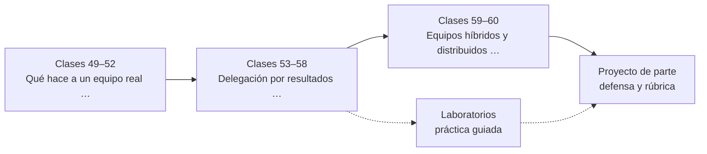

# Parte 04 — Liderazgo de equipos

<!-- parte:inicio -->

> ← [Parte 03 — Inteligencia emocional, resiliencia y liderazgo adaptativo](../03-emotional-intelligence-resilience-adaptive-leadership/README.md) · [Temario](../../SYLLABUS.md) · [Parte 05 — Gestión de talento y personas](../05-talent-people-management/README.md) →

*Un grupo de personas no es un equipo hasta que comparte objetivos, roles y responsabilidad*

**Etapa:** 2 — Liderazgo de equipos y ejecución  
**Duración:** 12 clases · 30 horas  
**Resultado de salida:** Convertir un grupo de individuos en un equipo con objetivos, roles, confianza y accountability.

🔵 [Ver las 6 etapas](../../SYLLABUS.md) · 12 clases (049–060) · 4 laboratorios · [proyecto de parte](project.md)

## 🎯 De qué trata esta parte

La primera responsabilidad de un jefe es que el trabajo de otros sea posible y se haga bien. Esta parte parte de una pregunta práctica: qué debe existir para que un grupo rinda como equipo y no como suma de individuos.

El eje es la **claridad antes del control**: propósito, roles, confianza y delegación por resultados. La accountability se sostiene con acuerdos visibles, no con microgestión.

## 🧱 Con qué hay que llegar

| Parte | Qué aporta |
|---|---|
| [02 — Comunicación, influencia y presencia ejecutiva](../02-communication-influence-negotiation-basics/README.md) | Comunicación, feedback y conversación difícil. |
| [03 — Inteligencia emocional, resiliencia y liderazgo adaptativo](../03-emotional-intelligence-resilience-adaptive-leadership/README.md) | Regulación y seguridad psicológica. |

Cada clase supone la anterior: el orden importa, y saltarse una deja sin base a las que vienen después.

## 📚 Resultados de la parte

Al terminar esta parte podrás:

1. **Definir** un team charter con propósito, objetivos y reglas de trabajo.
2. **Aclarar** roles, responsabilidades y expectativas sin ambigüedad.
3. **Delegar** por resultados y mantener accountability sin microgestión.
4. **Conducir** one-on-ones y reuniones que producen decisiones.
5. **Recuperar** un equipo disfuncional con un diagnóstico y un plan.

## 🗺️ Mapa de la parte

## 🧭 Cómo se encadenan las 12 clases

Las clases **49 a 52** construyen el equipo: qué es uno real, su propósito, sus roles y su confianza.

Las clases **53 a 58** son el oficio diario: delegación, coaching, one-on-ones, reuniones, motivación y accountability.

Las clases **59 y 60** extienden a equipos híbridos y cierran con el capstone de recuperar un equipo disfuncional.

## 📘 Las 12 clases

| # | Clase | Qué se trabaja | Entregable | Min |
|---:|---|---|---|---:|
| 049 | [Qué hace a un equipo real](classes/049-que-hace-a-un-equipo-real/README.md) | equipo, grupo de trabajo, interdependencia | [people-decision-brief](../../templates/people-decision-brief.md) | 150 |
| 050 | [Propósito, objetivos y team charter](classes/050-proposito-objetivos-y-team-charter/README.md) | propósito, objetivo, norma | [leadership-decision-brief](../../templates/leadership-decision-brief.md) | 150 |
| 051 | [Roles, responsabilidades y expectativas](classes/051-roles-responsabilidades-y-expectativas/README.md) | rol, responsabilidad, autoridad | [leadership-decision-brief](../../templates/leadership-decision-brief.md) | 150 |
| 052 | [Confianza y vulnerabilidad profesional](classes/052-confianza-y-vulnerabilidad-profesional/README.md) | vulnerabilidad profesional, confianza, fiabilidad | [risk-governance-brief](../../templates/risk-governance-brief.md) | 150 |
| 053 | [Delegación por resultados](classes/053-delegacion-por-resultados/README.md) | delegación, outcome delegado, contexto | [leadership-decision-brief](../../templates/leadership-decision-brief.md) | 150 |
| 054 | [Coaching y desarrollo cotidiano](classes/054-coaching-y-desarrollo-cotidiano/README.md) | coaching, mentoring, instrucción | [people-decision-brief](../../templates/people-decision-brief.md) | 150 |
| 055 | [One-on-ones que producen información](classes/055-one-on-ones-que-producen-informacion/README.md) | one-on-one, agenda compartida, signal | [leadership-decision-brief](../../templates/leadership-decision-brief.md) | 150 |
| 056 | [Reuniones que deciden](classes/056-reuniones-que-deciden/README.md) | reunión informativa, reunión de decisión, pre-read | [leadership-decision-brief](../../templates/leadership-decision-brief.md) | 150 |
| 057 | [Motivación y reconocimiento](classes/057-motivacion-y-reconocimiento/README.md) | reconocimiento, recompensa, equidad | [leadership-decision-brief](../../templates/leadership-decision-brief.md) | 150 |
| 058 | [Accountability sin microgestión](classes/058-accountability-sin-microgestion/README.md) | accountability, microgestión, guardrail | [leadership-decision-brief](../../templates/leadership-decision-brief.md) | 150 |
| 059 | [Equipos híbridos y distribuidos](classes/059-equipos-hibridos-y-distribuidos/README.md) | remote-first, asincronía, overlap hours | [people-decision-brief](../../templates/people-decision-brief.md) | 150 |
| 060 | [Capstone: recuperar un equipo disfuncional](classes/060-capstone-recuperar-un-equipo-disfuncional/README.md) | disfunción, diagnóstico de equipo, estabilización | [people-decision-brief](../../templates/people-decision-brief.md) | 150 |

## ⚠️ Riesgos característicos

- Delegar tareas en lugar de resultados.
- Reemplazar la accountability por vigilancia.
- Llenar la agenda de reuniones sin decisiones.
- Evitar confrontar el bajo desempeño por proteger el clima.

## 🔤 Glosario de la parte

57 conceptos definidos en las clases, con la definición operacional que usa cada una.

| Concepto | Definición operacional |
|---|---|
| **accountability** | obligación de responder por compromisos y consecuencias. |
| **accountability mutuo** | responsabilidad entre pares por compromisos que afectan el resultado común. |
| **agenda compartida** | temas aportados por ambas partes. |
| **asincronía** | trabajo coordinado sin coincidencia temporal. |
| **autoridad** | derecho de decidir o comprometer recursos dentro de límites. |
| **benevolencia** | percepción de que el otro no explotará intencionalmente la vulnerabilidad. |
| **checkpoint** | punto de revisión acordado que reduce riesgo sin microgestionar. |
| **coaching** | proceso que desarrolla reflexión y capacidad mediante preguntas, feedback y experimentación. |
| **commitment** | acción acordada con owner y fecha. |
| **confianza** | expectativa de conducta fiable bajo vulnerabilidad. |
| **contexto** | información sobre propósito, restricciones y stakeholders. |
| **decision log** | registro de decisión, razón, owner y fecha. |
| **delegación** | transferencia deliberada de trabajo y autoridad con responsabilidad de seguimiento. |
| **derecho de decisión** | definición de quién decide qué. |
| **development thread** | tema de crecimiento que se sigue en el tiempo. |
| **diagnóstico de equipo** | evaluación de propósito, diseño, relaciones, capacidades y contexto. |
| **disfunción** | patrón persistente que impide coordinación o desempeño saludable. |
| **documentation culture** | hábito de registrar decisiones y contexto accesible. |
| **equidad** | percepción de justicia relativa en aportes y resultados. |
| **equipo** | unidad de personas interdependientes responsables por un resultado común. |
| **estabilización** | acciones iniciales para detener daño o caos. |
| **expectativa** | estándar explícito de resultado, conducta o tiempo. |
| **experimento** | conducta concreta para probar una nueva estrategia. |
| **facilitador** | rol que protege proceso y participación. |
| **fiabilidad** | cumplimiento consistente de compromisos. |
| **gaming** | optimización de la métrica sin lograr el propósito. |
| **grupo de trabajo** | personas coordinadas principalmente a través de un jefe pero con outputs separables. |
| **guardrail** | límite que no puede cruzarse sin escalar. |
| **instrucción** | enseñanza directa de conocimiento o procedimiento. |
| **interdependencia** | grado en que el resultado de uno depende del trabajo de otros. |
| **interface** | punto de interacción con otro rol o proceso. |
| **management by exception** | intervención cuando señales salen de rango. |
| **mentoring** | transferencia de perspectiva y experiencia desde alguien más experimentado. |
| **microgestión** | control excesivo del método y decisiones de bajo nivel sin necesidad proporcional. |
| **motivador** | condición que aumenta energía o persistencia para una tarea. |
| **norma** | expectativa compartida sobre conducta. |
| **objetivo** | resultado concreto con horizonte y criterio de éxito. |
| **one-on-one** | reunión recurrente entre manager y colaborador orientada a relación, contexto y desarrollo. |
| **outcome delegado** | resultado que la persona puede producir con margen de decisión. |
| **overlap hours** | ventana mínima de tiempo compartido para interacción sincrónica. |
| **pre-read** | material consumido antes para reservar tiempo a discusión. |
| **pregunta de coaching** | intervención que amplía observación u opciones. |
| **propósito** | razón de existencia del equipo vinculada a un stakeholder o resultado. |
| **proximity bias** | sobrevaloración de quienes están físicamente más visibles. |
| **recompensa** | beneficio material o simbólico asociado a desempeño. |
| **reconocimiento** | señal explícita de que una contribución fue observada y valorada. |
| **remote-first** | diseño donde la información y los procesos funcionan aunque nadie comparta sala. |
| **reparación** | acciones que restauran confianza después de una ruptura. |
| **reset** | renegociación explícita de expectativas y normas. |
| **responsabilidad** | resultado o tarea por la que se espera respuesta. |
| **reunión de decisión** | espacio que culmina con una elección legítima. |
| **reunión informativa** | espacio cuyo fin principal es transmitir contexto. |
| **rol** | conjunto estable de responsabilidades y autoridad alrededor de resultados. |
| **signal** | información temprana sobre carga, riesgo o motivación. |
| **turnaround** | proceso de recuperación con métricas y horizonte. |
| **vulnerabilidad profesional** | acto de reconocer incertidumbre, error o necesidad de ayuda relevante al trabajo. |
| **working agreement** | acuerdo práctico sobre comunicación, reuniones y disponibilidad. |

## 📦 Qué queda como evidencia

- Un team charter acordado con el equipo.
- Un plan de delegación por resultados.
- Una serie de one-on-ones con registro.
- El capstone: plan de recuperación de un equipo.

## 🔗 Cómo se conecta

La parte 05 profundiza en cómo se contrata, evalúa y desarrolla a las personas del equipo; la 14 lleva el diseño del equipo al de toda la organización.

## 🧪 Cómo se trabaja

Son **12 clases de 150 minutos** —30 horas— con **4 laboratorios** y un proyecto integrador. Cada clase trae su propósito, sus conceptos, un caso, práctica, errores frecuentes, preguntas de comprobación, entregable y fuentes, y se evalúa con su `assessment.md`. Los laboratorios se resuelven con datos propios o sintéticos, nunca con datos reales de terceros, y la parte se cierra con el proyecto y su defensa. Las reglas de recorrido están en [la guía de navegación](../../docs/NAVIGATION.md).

<!-- parte:fin -->

## Laboratorios

- [Lab 01 — Team charter](labs/lab-01.md)
- [Lab 02 — Delegation board](labs/lab-02.md)
- [Lab 03 — Diseño de 1:1](labs/lab-03.md)
- [Lab 04 — Team health review](labs/lab-04.md)

## Proyecto de parte

Intervenir un equipo con baja confianza, atrasos y responsabilidades difusas.

## Bibliografía rectora

- Patrick Lencioni — *The Five Dysfunctions of a Team* (Equipos)
- Amy C. Edmondson — *The Fearless Organization* (Seguridad psicológica)
- J. Richard Hackman — *Leading Teams* (Equipos)
- Andrew S. Grove — *High Output Management* (Management)
- Kim Scott — *Radical Candor* (Feedback)

## Criterio de aprobación

80/100 y entrega del proyecto integrador.
