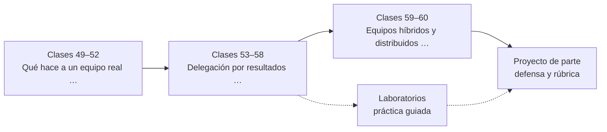

# Parte 04 — Liderazgo de equipos

<!-- parte:inicio -->

> ← [Parte 03 — Inteligencia emocional, resiliencia y liderazgo adaptativo](../03-emotional-intelligence-resilience-adaptive-leadership/README.md) · [Temario](../../SYLLABUS.md) · [Parte 05 — Gestión de talento y personas](../05-talent-people-management/README.md) →

*Un grupo de personas no es un equipo hasta que comparte objetivos, roles y responsabilidad*

**Etapa:** 2 — Liderazgo de equipos y ejecución  
**Duración:** 12 clases · 30 horas  
**Resultado de salida:** Convertir un grupo de individuos en un equipo con objetivos, roles, confianza y accountability.

🔵 [Ver las 6 etapas](../../SYLLABUS.md) · 12 clases (049–060) · 4 laboratorios · [proyecto de parte](project.md)

## 🎯 De qué trata esta parte

La primera responsabilidad de un jefe es que el trabajo de otros sea posible y se haga bien. Esta parte parte de una pregunta práctica: qué debe existir para que un grupo rinda como equipo y no como suma de individuos.

El eje es la **claridad antes del control**: propósito, roles, confianza y delegación por resultados. La accountability se sostiene con acuerdos visibles, no con microgestión.

## 🧱 Con qué hay que llegar

| Parte | Qué aporta |
|---|---|
| [02 — Comunicación, influencia y presencia ejecutiva](../02-communication-influence-negotiation-basics/README.md) | Comunicación, feedback y conversación difícil. |
| [03 — Inteligencia emocional, resiliencia y liderazgo adaptativo](../03-emotional-intelligence-resilience-adaptive-leadership/README.md) | Regulación y seguridad psicológica. |

Cada clase supone la anterior: el orden importa, y saltarse una deja sin base a las que vienen después.

## 📚 Resultados de la parte

Al terminar esta parte podrás:

1. **Definir** un team charter con propósito, objetivos y reglas de trabajo.
2. **Aclarar** roles, responsabilidades y expectativas sin ambigüedad.
3. **Delegar** por resultados y mantener accountability sin microgestión.
4. **Conducir** one-on-ones y reuniones que producen decisiones.
5. **Recuperar** un equipo disfuncional con un diagnóstico y un plan.

## 🗺️ Mapa de la parte

## 🧭 Cómo se encadenan las 12 clases

Las clases **49 a 52** construyen el equipo: qué es uno real, su propósito, sus roles y su confianza.

Las clases **53 a 58** son el oficio diario: delegación, coaching, one-on-ones, reuniones, motivación y accountability.

Las clases **59 y 60** extienden a equipos híbridos y cierran con el capstone de recuperar un equipo disfuncional.

## 📘 Las 12 clases

| # | Clase | Qué se trabaja | Entregable | Min |
|---:|---|---|---|---:|
| 049 | [Qué hace a un equipo real](classes/049-que-hace-a-un-equipo-real/README.md) | Equipo, Grupo de trabajo, Pseudoequipo | [people-decision-brief](../../templates/people-decision-brief.md) | 150 |
| 050 | [Propósito, objetivos y team charter](classes/050-proposito-objetivos-y-team-charter/README.md) | Propósito del equipo, Meta específica y difícil, Compromiso con la meta | [team-charter](../../templates/team-charter.md) | 150 |
| 051 | [Roles, responsabilidades y expectativas](classes/051-roles-responsabilidades-y-expectativas/README.md) | Rol, Ambigüedad de rol, Conflicto de rol | [leadership-decision-brief](../../templates/leadership-decision-brief.md) | 150 |
| 052 | [Confianza y vulnerabilidad profesional](classes/052-confianza-y-vulnerabilidad-profesional/README.md) | Confianza basada en vulnerabilidad, Confianza (Mayer et al.), Miedo al conflicto | [risk-governance-brief](../../templates/risk-governance-brief.md) | 150 |
| 053 | [Delegación por resultados](classes/053-delegacion-por-resultados/README.md) | Delegación, Delegar por resultados, Abdicación | [leadership-decision-brief](../../templates/leadership-decision-brief.md) | 150 |
| 054 | [Coaching y desarrollo cotidiano](classes/054-coaching-y-desarrollo-cotidiano/README.md) | Coaching, Modelo GROW, Pregunta abierta | [people-decision-brief](../../templates/people-decision-brief.md) | 150 |
| 055 | [One-on-ones que producen información](classes/055-one-on-ones-que-producen-informacion/README.md) | Reunión uno a uno, Reunión del colaborador, Transferencia de conocimiento | [one-on-one](../../templates/one-on-one.md) | 150 |
| 056 | [Reuniones que deciden](classes/056-reuniones-que-deciden/README.md) | Reunión de decisión, Reunión de coordinación, Reunión informativa | [leadership-decision-brief](../../templates/leadership-decision-brief.md) | 150 |
| 057 | [Motivación y reconocimiento](classes/057-motivacion-y-reconocimiento/README.md) | Reconocimiento informativo, Reconocimiento controlador, Principio de progreso | [leadership-decision-brief](../../templates/leadership-decision-brief.md) | 150 |
| 058 | [Accountability sin microgestión](classes/058-accountability-sin-microgestion/README.md) | Rendición de cuentas, Microgestión, Responsabilidad mutua | [leadership-decision-brief](../../templates/leadership-decision-brief.md) | 150 |
| 059 | [Equipos híbridos y distribuidos](classes/059-equipos-hibridos-y-distribuidos/README.md) | Equipo distribuido, Equipo híbrido, Problema del conocimiento mutuo | [people-decision-brief](../../templates/people-decision-brief.md) | 150 |
| 060 | [Capstone: recuperar un equipo disfuncional](classes/060-capstone-recuperar-un-equipo-disfuncional/README.md) | Equipo disfuncional, Diagnóstico por condiciones, Pirámide de disfunciones | [people-decision-brief](../../templates/people-decision-brief.md) | 150 |

## ⚠️ Riesgos característicos

- Delegar tareas en lugar de resultados.
- Reemplazar la accountability por vigilancia.
- Llenar la agenda de reuniones sin decisiones.
- Evitar confrontar el bajo desempeño por proteger el clima.

## 🔤 Glosario de la parte

70 conceptos definidos en las clases, con la definición operacional que usa cada una.

| Concepto | Definición operacional |
|---|---|
| **Abdicación** | Entregar una tarea sin claridad ni seguimiento. |
| **Acuerdo de trabajo** | Regla acordada sobre cómo se comunica y colabora el equipo. |
| **Ambigüedad de rol** | Falta de información clara sobre lo que se espera de una persona (Rizzo, House y Lirtzman, 1970). |
| **Atribución disposicional** | Explicar la conducta del otro por su carácter y no por su situación (Cramton, 2001). |
| **Cargo** | Posición formal en el organigrama. |
| **Coaching** | Conversación que ayuda a una persona a desarrollar su propio pensamiento y capacidad para mejorar su desempeño (Whitmore, 1992). |
| **Compromiso con la meta** | Grado en que las personas aceptan y persiguen la meta (Locke y Latham, 2002). |
| **Compromiso de acción** | Paso concreto, con plazo, que la persona decide dar. |
| **Compromiso mutuo** | Acuerdos que obligan a ambos, jefe y colaborador. |
| **Condiciones habilitantes** | Factores que facilitan el trabajo del equipo: equipo real, dirección convincente, estructura propicia, contexto de apoyo y coaching experto (Hackman, 2002). |
| **Confianza (Mayer et al.)** | Disposición a ser vulnerable ante las acciones de otro sin poder controlarlo (Mayer, Davis y Schoorman, 1995). |
| **Confianza basada en vulnerabilidad** | Seguridad de que los compañeros no usarán en contra lo que uno revela de sus debilidades (Lencioni, 2002). |
| **Confidencialidad** | Compromiso de no usar lo conversado fuera del acuerdo. |
| **Conflicto de rol** | Existencia de expectativas incompatibles sobre una persona (Rizzo, House y Lirtzman, 1970). |
| **Conflicto en equipos distribuidos** | Conflicto que surge o se agrava por la distancia, la falta de información y las diferencias de contexto (Hinds y Bailey, 2003). |
| **Consecuencia acordada** | Resultado previsto y proporcional ante un incumplimiento. |
| **Decisión de persona** | Medida individual (reasignar, apoyar, desvincular) tomada con proceso y evidencia. |
| **Delegación** | Transferencia de autoridad para decidir y actuar sobre un resultado, conservando quien delega la responsabilidad final. |
| **Delegar por resultados** | Encargar un resultado y dejar a la persona decidir el cómo, dentro de límites. |
| **Desplazamiento de la motivación** | Efecto por el cual un incentivo externo reduce el interés intrínseco. |
| **Diagnóstico por condiciones** | Evaluación del equipo según equipo real, dirección, estructura, contexto de apoyo y coaching (Hackman, 2002). |
| **Dirección convincente** | Propósito claro, desafiante y consecuente (Hackman, 2002). |
| **Equipo** | Pequeño número de personas con habilidades complementarias, comprometidas con un propósito común, metas de desempeño y un enfoque del que se responsabilizan mutuamente (Katzenbach y Smith, 1993). |
| **Equipo disfuncional** | Equipo cuyo desempeño o clima está por debajo de lo que sus condiciones permitirían, de manera persistente (criterio de la clase). |
| **Equipo distribuido** | Equipo cuyos miembros trabajan en lugares distintos y se comunican sobre todo mediante tecnología. |
| **Equipo híbrido** | Equipo en que parte de los miembros trabaja junto y parte a distancia, de forma estable o alternada. |
| **Equipo real** | Conjunto con límites claros, interdependencia y estabilidad suficiente (Hackman, 2002). |
| **Evasión de la rendición de cuentas** | No pedirse cuentas entre pares (Lencioni, 2002). |
| **Expectativa** | Lo que se espera de alguien en resultados, conducta y plazos. |
| **Falta de compromiso** | Ambigüedad sobre lo decidido por no haber discutido (Lencioni, 2002). |
| **Ganancia temprana** | Resultado visible logrado pronto, que muestra que el cambio es posible. |
| **Grupo de trabajo** | Conjunto cuyo desempeño depende de aportes individuales; cada uno responde por lo suyo (Katzenbach y Smith, 1993). |
| **Hábito de coaching** | Práctica breve y regular de preguntar antes de aconsejar (Bungay Stanier, 2016). |
| **Instrucción** | Transmisión de conocimiento o método a quien no lo tiene. |
| **Límites de autoridad** | Fronteras dentro de las cuales la persona puede decidir sin consultar. |
| **Madurez para la tarea** | Capacidad y disposición de una persona para una tarea específica (Grove, 1983). |
| **Matriz de responsabilidades** | Tabla que asigna, para cada decisión o tarea, quién decide, quién ejecuta, a quién se consulta y a quién se informa. |
| **Meta específica y difícil** | Objetivo claro, con medida, que exige un esfuerzo real (Locke y Latham, 2002). |
| **Microgestión** | Supervisión detallada y constante del cómo, más allá de lo necesario. |
| **Miedo al conflicto** | Evitar el debate de ideas por temor a la incomodidad (Lencioni, 2002). |
| **Modelo GROW** | Estructura de cuatro pasos: Goal (meta), Reality (realidad), Options (opciones), Will (voluntad) (Whitmore, 1992). |
| **Pirámide de disfunciones** | Cinco niveles dependientes: confianza, conflicto, compromiso, rendición de cuentas y resultados (Lencioni, 2002). |
| **Pregunta abierta** | Pregunta que no se responde con sí o no y invita a explorar. |
| **Principio de progreso** | De los eventos que alimentan una buena vida laboral, el más potente es avanzar en un trabajo con sentido (Amabile y Kramer, 2011). |
| **Problema del conocimiento mutuo** | Dificultad para que las personas compartan y comprendan información de contexto entre sí, con consecuencias para la colaboración (Cramton, 2001). |
| **Propósito de la reunión** | Resultado que debe producir (Rogelberg, 2019). |
| **Propósito del equipo** | Razón de ser del equipo: qué valor crea y para quién. |
| **Pseudoequipo** | Grupo que se llama equipo y no ha definido un propósito común; suele rendir menos que un grupo de trabajo (Katzenbach y Smith, 1993). |
| **Punto de revisión** | Momento acordado en que se examina el avance. |
| **Reconocimiento controlador** | Mensaje que usa la recompensa para regular la conducta (Ryan y Deci, 2000). |
| **Reconocimiento específico** | Dice concretamente qué se hizo bien y su efecto. |
| **Reconocimiento informativo** | Mensaje que informa sobre la competencia o contribución de alguien y su efecto (Ryan y Deci, 2000). |
| **Rendición de cuentas** | Obligación de responder por el cumplimiento de lo acordado, con consecuencias previstas. |
| **Responsabilidad mutua** | Los miembros se sienten y se piden cuentas entre sí, no solo ante el jefe. |
| **Retroalimentación** | Información sobre el avance hacia la meta. |
| **Reunión de coordinación** | Reunión breve para alinear tareas y dependencias. |
| **Reunión de decisión** | Reunión cuyo propósito es llegar a una decisión con responsable (criterio de la clase). |
| **Reunión de exploración** | Reunión para pensar juntos un problema abierto, sin decidir. |
| **Reunión del colaborador** | Principio según el cual la agenda y el uso del tiempo pertenecen principalmente a quien no es el jefe (Grove, 1983). |
| **Reunión informativa** | Reunión para comunicar sin necesidad de discusión. |
| **Reunión uno a uno** | Conversación regular, a solas, entre un jefe y un colaborador (Grove, 1983). |
| **Rol** | Conjunto de conductas esperadas de quien ocupa una posición. |
| **Seguimiento** | Registro de decisiones y acciones con responsable y plazo. |
| **Seguimiento visible** | Medios por los que el avance se ve sin que el jefe pregunte. |
| **Seguridad psicológica** | Creencia compartida de que el equipo es seguro para asumir riesgos interpersonales (Edmondson, 1999). |
| **Señal temprana** | Indicio débil de un problema que aún no es visible. |
| **Soporte del vínculo** | Acciones que muestran que la persona importa y pertenece. |
| **Team charter** | Acta del equipo con propósito, objetivos, roles, normas y decisiones, acordada por sus miembros. |
| **Transferencia de conocimiento** | Intercambio de información, contexto y criterio entre jefe y colaborador. |
| **Vulnerabilidad profesional** | Mostrar límites, errores y dudas relevantes para el trabajo. |

## 📦 Qué queda como evidencia

- Un team charter acordado con el equipo.
- Un plan de delegación por resultados.
- Una serie de one-on-ones con registro.
- El capstone: plan de recuperación de un equipo.

## 🔗 Cómo se conecta

La parte 05 profundiza en cómo se contrata, evalúa y desarrolla a las personas del equipo; la 14 lleva el diseño del equipo al de toda la organización.

## 🧪 Cómo se trabaja

Son **12 clases de 150 minutos** —30 horas— con **4 laboratorios** y un proyecto integrador. Cada clase trae su propósito, sus conceptos, un caso, práctica, errores frecuentes, preguntas de comprobación, entregable y fuentes, y se evalúa con su `assessment.md`. Los laboratorios se resuelven con datos propios o sintéticos, nunca con datos reales de terceros, y la parte se cierra con el proyecto y su defensa. Las reglas de recorrido están en [la guía de navegación](../../docs/NAVIGATION.md).

<!-- parte:fin -->

## Laboratorios

- [Lab 01 — Team charter](labs/lab-01.md)
- [Lab 02 — Delegation board](labs/lab-02.md)
- [Lab 03 — Diseño de 1:1](labs/lab-03.md)
- [Lab 04 — Team health review](labs/lab-04.md)

## Proyecto de parte

Intervenir un equipo con baja confianza, atrasos y responsabilidades difusas.

## Bibliografía rectora

- Patrick Lencioni — *The Five Dysfunctions of a Team* (Equipos)
- Amy C. Edmondson — *The Fearless Organization* (Seguridad psicológica)
- J. Richard Hackman — *Leading Teams* (Equipos)
- Andrew S. Grove — *High Output Management* (Management)
- Kim Scott — *Radical Candor* (Feedback)

## Criterio de aprobación

80/100 y entrega del proyecto integrador.
