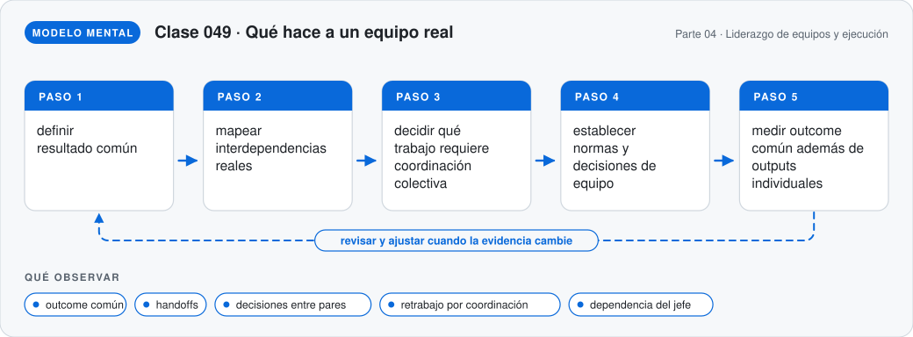

# Clase 049 — Qué hace a un equipo real

<!-- nav:inicio -->
> **Parte 04 · Liderazgo de equipos** — clase 1 de 12 · [índice de la parte](../../README.md) · [temario](../../../../SYLLABUS.md)
<!-- nav:fin -->

**Parte:** 04 — Liderazgo de equipos  
**Nivel:** Etapa 2 — Líder → Jefe / Team Lead  
**Duración sugerida:** 150–180 minutos · **Estándar:** deep-class-v2

## 🎯 Propósito

Se llama «equipo» a casi cualquier conjunto de personas que comparte jefe. Pero una lista de nombres bajo un mismo organigrama es un **grupo de trabajo**, y confundirlo con un equipo lleva a esperar de él lo que solo un equipo puede dar: resultados que ninguna persona logra por separado. Esta clase enseña a distinguir lo que hace real a un equipo y a decidir cuándo conviene construirlo y cuándo no.

Se apoya en la distinción de Katzenbach y Smith entre grupo de trabajo y equipo, con su curva de desempeño, y en las condiciones habilitantes que Hackman identificó en investigaciones sobre equipos de trabajo. Al terminar sabrás ubicar a un equipo en la curva, diagnosticar qué condición le falta y decidir si un grupo necesita ser equipo.

## 📚 Resultados de aprendizaje

Al finalizar podrás:

1. **Distinguir** grupo de trabajo, pseudoequipo y equipo real con criterios observables.
2. **Ubicar** a un equipo en la curva de desempeño de Katzenbach y Smith.
3. **Enumerar** las condiciones habilitantes de Hackman y evaluar cuáles faltan.
4. **Decidir** si un conjunto de personas necesita ser un equipo.
5. **Reconocer** el costo de crear equipos donde no hacen falta.

## 🧭 Agenda

| Tramo | Qué se hace |
|---|---|
| 0–20 min | Recuperación: describe el mejor y el peor equipo en que has trabajado; ¿qué los diferenciaba? |
| 20–60 min | Grupo, pseudoequipo y equipo real; condiciones de Hackman. |
| 60–105 min | Ejemplo trabajado: tres grupos de una empresa en la curva. |
| 105–140 min | Caso ejecutivo: un «equipo» comercial que no rinde como equipo. |
| 140–170 min | Límites y entregable. |

## 🧩 Conceptos centrales

| Concepto | Definición | Cómo se reconoce |
|---|---|---|
| **Equipo** | Pequeño número de personas con habilidades complementarias, comprometidas con un propósito común, metas de desempeño y un enfoque del que se responsabilizan mutuamente (Katzenbach y Smith, 1993). | Los resultados dependen de la contribución conjunta. |
| **Grupo de trabajo** | Conjunto cuyo desempeño depende de aportes individuales; cada uno responde por lo suyo (Katzenbach y Smith, 1993). | El resultado es la suma de las partes. |
| **Pseudoequipo** | Grupo que se llama equipo y no ha definido un propósito común; suele rendir menos que un grupo de trabajo (Katzenbach y Smith, 1993). | Hay reuniones y rótulos, pero no responsabilidad compartida. |
| **Responsabilidad mutua** | Los miembros se sienten y se piden cuentas entre sí, no solo ante el jefe. | Se corrigen entre pares. |
| **Condiciones habilitantes** | Factores que facilitan el trabajo del equipo: equipo real, dirección convincente, estructura propicia, contexto de apoyo y coaching experto (Hackman, 2002). | Se pueden revisar una a una. |
| **Equipo real** | Conjunto con límites claros, interdependencia y estabilidad suficiente (Hackman, 2002). | Se sabe quién está dentro y por qué se necesitan entre sí. |

## 🧠 Modelo mental

**Cómo leer el diagrama.** Los niveles suben de grupo de trabajo a alto desempeño. Fíjate en el segundo: el **pseudoequipo** rinde peor que un grupo de trabajo, porque consume energía en reuniones y rótulos sin generar responsabilidad compartida. Subir de nivel exige definir propósito, metas y responsabilidad mutua; no basta con declarar que se es equipo.

## 📖 Desarrollo

### 1. Una distinción útil

Katzenbach y Smith estudiaron decenas de equipos y propusieron distinguir entre **grupo de trabajo** y **equipo**. En un grupo de trabajo, el desempeño depende de lo que cada uno hace por su cuenta, y la reunión sirve para compartir información. En un equipo, el desempeño surge de la **contribución conjunta**, y la reunión sirve para decidir y trabajar juntos. Ninguno es mejor en sí mismo: son formas distintas de organizar el trabajo, y cada una conviene a tareas distintas.

### 2. La curva de desempeño

Los autores describen una curva con cinco puntos. El **grupo de trabajo** tiene un desempeño adecuado. El **pseudoequipo**, que se llama equipo sin serlo, tiene el peor desempeño. El **equipo potencial** quiere mejorar y empieza a definir propósito, pero aún no tiene responsabilidad mutua. El **equipo real** cumple los rasgos: propósito, metas, complementariedad y responsabilidad mutua. El de **alto desempeño** añade un compromiso con el crecimiento personal de los demás. La mayoría de los grupos llamados «equipos» está en la parte baja.

### 3. Qué define a un equipo real

Cuatro rasgos, según Katzenbach y Smith: un **propósito común** que el equipo hace suyo; **metas de desempeño** específicas, que lo traducen en resultados; **habilidades complementarias**, técnicas, de resolución de problemas e interpersonales; y un **enfoque** de trabajo del que se **responsabilizan mutuamente**. Si falta uno, el resultado es un grupo con rótulo de equipo.

### 4. Las condiciones de Hackman

Hackman, tras décadas de investigación, propuso que los equipos rinden mejor cuando existen cinco condiciones. Un **equipo real**, con límites claros, interdependencia y estabilidad. Una **dirección convincente**, un propósito claro y exigente. Una **estructura habilitante**, con tareas bien diseñadas, normas y un tamaño adecuado. Un **contexto de apoyo**: sistemas de información, recompensas, capacitación y recursos. Y **coaching experto**, disponible en los momentos oportunos. Sorprendentemente, concluye que estas condiciones pesan más que la personalidad o el estilo del líder.

### 5. Cuándo no hace falta un equipo

Crear equipos tiene costos: reuniones, tiempo de coordinación, decisiones más lentas. Si la tarea puede hacerse mejor por separado, un grupo de trabajo bien dirigido es suficiente. La pregunta es: ¿necesitamos la contribución conjunta para lograr el resultado? Si es un sí claro, vale la pena construir un equipo; si no, se evita fingir. Llamar equipo a lo que no lo es produce cinismo.

### 6. Diagnóstico rápido

Para ubicar a un grupo: ¿tiene un propósito que le pertenezca, no solo una lista de funciones?, ¿hay metas del equipo, no solo individuales?, ¿se necesitan entre sí para lograr el resultado?, ¿se piden cuentas entre pares?, ¿qué pasa cuando alguien falla: lo resuelve el jefe o el grupo? Las respuestas indican en qué punto de la curva está y qué trabajar.

### 7. El rol del líder

El líder no «es» el equipo: crea las condiciones. Define o ayuda a definir el propósito, cuida que las metas sean del equipo, protege los límites, gestiona el contexto —recursos, información, recompensas— y ofrece coaching. Y renuncia a algo: en un equipo real parte de la responsabilidad pasa a los miembros. Quien necesita decidirlo todo mantiene un grupo de trabajo.

## 📚 Lectura comparada

| Obra | Qué aporta | Qué no resuelve | Pregunta para contrastar |
|---|---|---|---|
| Katzenbach y Smith (1993) | Equipo frente a grupo de trabajo y la curva de desempeño. | Basada en estudios de caso. | ¿En qué punto de la curva está tu equipo? |
| Hackman (2002) | Cinco condiciones habilitantes. | Se centra en equipos con tareas definidas. | ¿Cuál de las cinco condiciones falta? |
| Lencioni (2002) | Disfunciones que impiden el funcionamiento del equipo. | Es una fábula de gestión. | ¿Cuál se observa más en tu equipo? |
| McChrystal et al. (2015) | Equipos de equipos en entornos complejos. | Nace de un contexto militar. | ¿Cómo se coordinan tus equipos entre sí? |
| Edmondson (1999) | Seguridad psicológica y aprendizaje en el equipo. | No clasifica tipos de grupo. | ¿Puede tu equipo discrepar sin riesgo? |

## 🧮 Ejemplo trabajado

**Situación (hipotética).** Una empresa tiene tres grupos que su directora llama «equipos».

| Grupo | Observación | Ubicación en la curva |
|---|---|---|
| **Ventas regionales** (8 personas) | Metas individuales; la reunión mensual comparte cifras; nadie depende de otros. | **Grupo de trabajo**: funciona bien así. |
| **Comité de producto** (6 personas) | Se llama «equipo», se reúne semanalmente, pero no hay metas conjuntas y cada área defiende lo suyo. | **Pseudoequipo**: gasta tiempo sin generar valor. |
| **Lanzamiento del nuevo servicio** (5 personas) | Propósito claro, meta común, habilidades complementarias y se corrigen entre sí. | **Equipo real**. |

**Decisiones.** Ventas: dejarlo como grupo de trabajo, sin rótulo ni reuniones adicionales. Comité de producto: definir una meta conjunta —o disolverlo y volver a reuniones de coordinación—. Lanzamiento: protegerlo de interrupciones y darle coaching.

**Qué muestra.** (1) No todo grupo debe ser equipo. (2) El pseudoequipo es el caso más costoso. (3) La decisión depende de si la contribución conjunta es necesaria.

## 🔀 Comparación y límites

**Equipo frente a comunidad.** Una comunidad comparte intereses sin responsabilidad por un resultado común; no es un equipo.

**Límites.** La curva de Katzenbach y Smith es un modelo derivado de estudios de caso, no una medición, y los autores mismos la presentan como una herramienta de reflexión. Las condiciones de Hackman provienen de equipos con tareas bastante definidas y su aplicación a equipos cambiantes o muy grandes requiere adaptación. Y distinguir un pseudoequipo de un equipo potencial a veces es un juicio de grado.

## 🪜 De profesional a owner

| Nivel | Cómo trabaja el equipo |
|---|---|
| **Profesional** | Contribuye al propósito común y se hace responsable ante sus pares. |
| **Jefe / Team Lead** | Decide si su grupo debe ser equipo y crea las condiciones. |
| **Gerente** | Diseña la estructura de equipos y evita pseudoequipos. |
| **CEO / Director** | Cuida que el equipo directivo sea un equipo real y no una suma de funciones. |
| **Founder / Owner** | Construye un primer equipo con propósito, antes de agregar cargos. |

## 🏢 Caso ejecutivo

Una empresa de servicios tiene un «equipo comercial» de diez personas. Cada vendedor tiene su cartera y su meta; hay una reunión semanal de dos horas donde se revisan cifras individuales. Las ventas cruzadas con otras áreas son bajas, y los clientes grandes se quejan de que «nadie coordina». El gerente comercial quiere «fortalecer el espíritu de equipo» con un taller.

Entrega un **diagnóstico de equipo** que contenga: (a) la ubicación en la curva con la evidencia; (b) la evaluación de las cinco condiciones de Hackman; (c) la decisión sobre si debe ser equipo, grupo de trabajo o ambos, y para qué tareas; (d) las condiciones que cambiarás y en qué orden; (e) cómo medirás el avance; (f) qué evidencia te haría concluir que el taller no era la respuesta.

## 🧪 Práctica

1. Ubica tres grupos de tu organización en la curva y justifica con una observación.
2. Para uno, evalúa las cinco condiciones de Hackman.
3. Escribe el propósito de un equipo que lideras en una frase y pregunta a un miembro si coincide.
4. Identifica una reunión recurrente y decide si informa, coordina o decide.
5. Define una meta que solo el equipo pueda lograr.

## ⚠️ Errores frecuentes

| Error | Por qué ocurre | Cómo corregirlo |
|---|---|---|
| Llamar equipo a todo grupo | Suena mejor | Distinguir grupo de trabajo y equipo. |
| Crear un pseudoequipo | Se quiere colaboración sin definir qué | Fijar propósito y meta conjunta. |
| Taller como solución | Es visible y barato | Revisar las condiciones de Hackman. |
| Solo metas individuales | Es más fácil medir | Añadir al menos una meta del equipo. |
| Líder que decide todo | Se cree que es su rol | Compartir la responsabilidad. |
| Equipos inestables | Se rota sin criterio | Dar estabilidad y límites claros. |

## ❓ Preguntas de comprobación

1. ¿Qué diferencia hay entre un equipo y un grupo de trabajo según Katzenbach y Smith?
2. ¿Por qué el pseudoequipo rinde peor que un grupo de trabajo?
3. ¿Cuáles son los cuatro rasgos de un equipo real?
4. ¿Cuáles son las cinco condiciones habilitantes de Hackman?
5. ¿Cuándo no conviene construir un equipo?
6. ¿Qué papel tiene el líder en un equipo real?
7. ¿Qué límite tiene la curva de desempeño?

Claves de respuesta

1. En el equipo el desempeño surge de la contribución conjunta y hay responsabilidad mutua; en el grupo de trabajo depende de aportes individuales.
2. Porque consume tiempo y energía en reuniones y rótulos sin generar responsabilidad compartida.
3. Propósito común, metas de desempeño, habilidades complementarias y un enfoque del que se responsabilizan mutuamente.
4. Equipo real, dirección convincente, estructura habilitante, contexto de apoyo y coaching experto.
5. Cuando la tarea se hace mejor por separado y no se necesita la contribución conjunta.
6. Crear las condiciones, proteger los límites, gestionar el contexto y ofrecer coaching, compartiendo responsabilidad.
7. Es un modelo derivado de estudios de caso, no una medición.

## 📥 Entregable

Guarda en `portfolio/049-que-hace-a-un-equipo-real/`:

- `people-decision-brief.md` (plantilla [People Decision Brief](../../../../templates/people-decision-brief.md)) con el diagnóstico del caso ejecutivo;
- `reading-note.md` con una tensión entre Katzenbach y Smith y Hackman;
- `decision-journal.md` con la ubicación del equipo, la decisión y las condiciones que cambiaste.

## 📗 Fuentes y verificación

- Jon R. Katzenbach & Douglas K. Smith — *The Wisdom of Teams* (McGraw-Hill, 2005). **Uso en esta clase:** equipo frente a grupo de trabajo y la curva de desempeño. Lectura selectiva sobre **qué hace a un equipo real**. **Localizador:** [ISBN-13 9780077111687](https://openlibrary.org/isbn/9780077111687).
- J. Richard Hackman — *Leading Teams* (Harvard Business School Press, 2002). **Uso en esta clase:** las cinco condiciones habilitantes de un equipo. Lectura selectiva sobre **qué hace a un equipo real**. **Localizador:** [ISBN-13 9781578513338](https://openlibrary.org/isbn/9781578513338).
- Patrick Lencioni — *The Five Dysfunctions of a Team* (Pfeiffer, 2012). **Uso en esta clase:** disfunciones que impiden el funcionamiento del equipo. Lectura selectiva sobre **qué hace a un equipo real**. **Localizador:** [ISBN-13 9781118127308](https://openlibrary.org/isbn/9781118127308).
- Stanley McChrystal et al. — *Team of Teams* (Penguin Books, Limited, 2015). **Uso en esta clase:** equipos de equipos en entornos complejos. Lectura selectiva sobre **qué hace a un equipo real**. **Localizador:** [ISBN-13 9780241250846](https://openlibrary.org/isbn/9780241250846).
- Amy C. Edmondson — *Psychological Safety and Learning Behavior in Work Teams* (Administrative Science Quarterly, 1999). **Uso en esta clase:** seguridad psicológica y aprendizaje del equipo. Lectura selectiva sobre **qué hace a un equipo real**. **Localizador:** [DOI 10.2307/2666999](https://doi.org/10.2307/2666999).

> **Regla de fuentes para Qué hace a un equipo real:** las obras anteriores estructuran las perspectivas de esta materia; cualquier norma, ley o estándar vivo mencionado debe comprobarse nuevamente en su fuente primaria vigente. Los ejemplos y casos son hipotéticos. El desarrollo es original y no reproduce capítulos protegidos.

<!-- pie:inicio -->
---

| Anterior | Índice | Siguiente |
|---|---|---|
| [← 048 · Capstone: liderar una crisis humana](../../../03-emotional-intelligence-resilience-adaptive-leadership/classes/048-capstone-liderar-una-crisis-humana/README.md) | [Parte 04](../../README.md) · [Programa](../../../../SYLLABUS.md) | [050 · Propósito, objetivos y team charter →](../050-proposito-objetivos-y-team-charter/README.md) |
<!-- pie:fin -->
