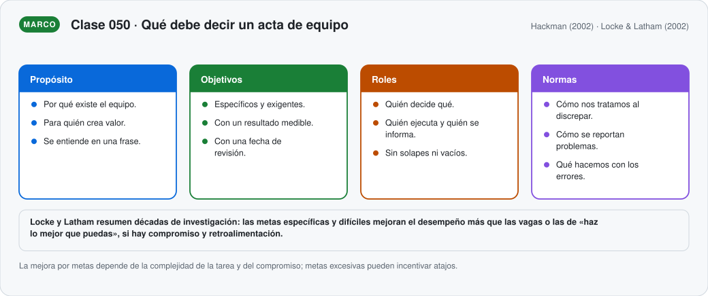

# Clase 050 — Propósito, objetivos y team charter

<!-- nav:inicio -->
> **Parte 04 · Liderazgo de equipos** — clase 2 de 12 · [índice de la parte](../../README.md) · [temario](../../../../SYLLABUS.md)
<!-- nav:fin -->

**Parte:** 04 — Liderazgo de equipos  
**Nivel:** Etapa 2 — Líder → Jefe / Team Lead  
**Duración sugerida:** 150–180 minutos · **Estándar:** deep-class-v2

## 🎯 Propósito

Un equipo sin un propósito que sienta suyo y metas que lo concreten pasa sus reuniones decidiendo qué hacer en lugar de hacerlo. El **acta del equipo** (*team charter*) es el documento donde se escribe, entre todos, para qué existe el equipo, qué logrará, quién hace qué y cómo trabajan juntos. Su valor no está en el papel sino en la conversación que obliga a tener.

Esta clase usa las condiciones de Hackman —una dirección convincente y una estructura habilitante— y la teoría del establecimiento de metas de Locke y Latham, que resume décadas de investigación sobre cómo las metas mejoran el desempeño. Al terminar sabrás redactar un propósito y objetivos que orienten, y construir un acta con el equipo.

## 📚 Resultados de aprendizaje

Al finalizar podrás:

1. **Redactar** un propósito de equipo en una frase que oriente decisiones.
2. **Formular** objetivos específicos y exigentes con medida y fecha.
3. **Explicar** qué condiciones hacen que una meta mejore el desempeño según Locke y Latham.
4. **Construir** un acta de equipo con propósito, objetivos, roles, normas y decisiones.
5. **Revisar** el acta en el tiempo sin convertirla en un documento muerto.

## 🧭 Agenda

| Tramo | Qué se hace |
|---|---|
| 0–20 min | Recuperación: ¿conoces el propósito de tu equipo? Escríbelo y compáralo con el de un colega. |
| 20–60 min | Propósito, metas y los componentes del acta. |
| 60–105 min | Ejemplo trabajado: construir el acta de un equipo nuevo. |
| 105–140 min | Caso ejecutivo: un equipo con objetivos vagos. |
| 140–170 min | Límites y entregable. |

## 🧩 Conceptos centrales

| Concepto | Definición | Cómo se reconoce |
|---|---|---|
| **Propósito del equipo** | Razón de ser del equipo: qué valor crea y para quién. | Orienta decisiones sin detalles de tareas. |
| **Meta específica y difícil** | Objetivo claro, con medida, que exige un esfuerzo real (Locke y Latham, 2002). | Se sabe cuándo se alcanzó y cuesta alcanzarla. |
| **Compromiso con la meta** | Grado en que las personas aceptan y persiguen la meta (Locke y Latham, 2002). | Dicen «es nuestra» y no «nos la dieron». |
| **Retroalimentación** | Información sobre el avance hacia la meta. | El equipo ve su progreso. |
| **Team charter** | Acta del equipo con propósito, objetivos, roles, normas y decisiones, acordada por sus miembros. | Existe, es breve y se usa. |
| **Dirección convincente** | Propósito claro, desafiante y consecuente (Hackman, 2002). | El equipo sabe adónde va y por qué importa. |

## 🧠 Modelo mental

**Cómo leer el diagrama.** El acta tiene cuatro bloques, cada uno con su criterio: un propósito que se dice en una frase, objetivos específicos y exigentes, roles sin solapes ni vacíos y normas de trato. Un acta que no responde a alguno de los criterios es un decorado: cámbialo antes de archivarla.

## 📖 Desarrollo

### 1. El propósito

Un propósito de equipo responde: ¿para qué existimos y para quién creamos valor? Debe ser **breve, concreto y desafiante**: «reducir a menos de 24 horas el tiempo en que un cliente nuevo empieza a usar el producto» orienta mejor que «ser un equipo de excelencia». Hackman llama **dirección convincente** a un propósito que es claro, exigente y consecuente; los equipos con dirección clara rinden mejor y sufren menos conflictos sobre qué hacer.

### 2. Metas específicas y difíciles

Locke y Latham resumieron treinta y cinco años de investigación: las metas **específicas y difíciles** conducen a mejor desempeño que las vagas o que el «haz lo mejor que puedas». Funcionan porque dirigen la atención, movilizan esfuerzo, aumentan la persistencia y estimulan la búsqueda de estrategias. Condiciones: que haya **compromiso**, que exista **retroalimentación** sobre el avance y que la persona tenga la **capacidad** y los recursos.

### 3. Cuándo las metas fallan

Los mismos autores advierten sobre efectos adversos: metas demasiado difíciles en tareas complejas pueden llevar a probar estrategias riesgosas o a atajos éticamente dudosos; metas individuales competitivas pueden dañar la cooperación; metas mal elegidas orientan a optimizar lo medido y descuidar lo no medido. Por eso conviene metas de **aprendizaje** en tareas nuevas y metas de equipo donde se necesita colaboración.

### 4. Del propósito a los objetivos

Una cadena sencilla: **propósito** (razón de ser, estable), **objetivos** (resultados a lograr en un período, medibles), **iniciativas** (acciones que se emprenden) y **medidas** (cómo se ve el progreso). Cada nivel responde al anterior. Si un objetivo no ayuda al propósito, se cuestiona el objetivo; si el propósito no se refleja en ningún objetivo, es una declaración.

### 5. Qué contiene el acta

Un acta práctica cabe en una o dos páginas. **Propósito**: una frase. **Objetivos**: dos a cinco, específicos y con fecha. **Roles**: quién decide qué (clase 051). **Normas**: cómo se discrepa, cómo se reportan los problemas, cómo se tratan los errores, qué horarios y canales se usan. **Decisiones**: cómo se toman las importantes y quién las toma. **Revisión**: cuándo se vuelve a leer.

### 6. Cómo se construye

El proceso importa más que el documento. El líder propone un borrador, no un producto final; el equipo lo discute, corrige y lo hace suyo. Una sesión de dos a tres horas, con un borrador previo, suele bastar. La participación aumenta el compromiso con las metas, que es una condición para que funcionen. Conviene incluir las preguntas incómodas: ¿qué no haremos?, ¿cómo trataremos el incumplimiento?

### 7. Mantenerlo vivo

El acta se revisa en un momento fijo —al inicio de un trimestre, tras un cambio importante o una crisis— y se usa en la práctica: en una discusión, se lee la norma; en una priorización, el propósito. Si nunca se consulta, está muerta. Cambiar el acta no es un fracaso: es el signo de que el equipo aprende.

## 📚 Lectura comparada

| Obra | Qué aporta | Qué no resuelve | Pregunta para contrastar |
|---|---|---|---|
| Locke y Latham (2002) | Condiciones para que las metas mejoren el desempeño y sus efectos adversos. | No dice cómo elegir el propósito. | ¿Tus metas son específicas y difíciles? |
| Hackman (2002) | Dirección convincente y estructura habilitante. | No trae un formato de acta. | ¿Qué dirección ve tu equipo? |
| Katzenbach y Smith (1993) | Propósito, metas y enfoque comunes como rasgos del equipo real. | Basado en estudios de caso. | ¿El propósito le pertenece al equipo? |
| Doerr (2018) | Objetivos y resultados clave en organizaciones. | Es un texto divulgativo; los resultados no son universales. | ¿Cómo se ve el progreso cada semana? |
| Edmondson (1999) | Seguridad psicológica para discutir metas y normas. | No trata del contenido del acta. | ¿Puede alguien discrepar del objetivo? |

## 🧮 Ejemplo trabajado

**Situación (hipotética).** Una gerente forma un equipo de seis personas para mejorar la experiencia de incorporación de clientes nuevos. Convoca una sesión de dos horas con un borrador.

| Parte | Borrador inicial | Versión del equipo |
|---|---|---|
| **Propósito** | «Mejorar la experiencia de los clientes.» | «Que cada cliente nuevo use el producto en 24 horas desde la compra.» |
| **Objetivos** | «Reducir tiempos.» | «Bajar la mediana de 6 a 2 días en el trimestre; satisfacción de incorporación ≥ 4,2 sobre 5.» |
| **Roles** | No definidos. | Un responsable por etapa (contacto, configuración, capacitación) y un decisor para cambios del proceso. |
| **Normas** | «Respeto.» | «Los problemas se reportan el mismo día; discrepamos con datos; se revisa sin culpas.» |
| **Decisiones** | No definidas. | «Cambios menores los decide el responsable de etapa; cambios que afectan a más de una etapa, el líder tras consulta.» |

**Resultado.** El equipo pidió quitar un objetivo que no podía influir y agregó la norma de revisar los casos más lentos cada viernes.

**Qué muestra.** (1) El propósito se hizo medible. (2) Los objetivos son específicos y difíciles. (3) El proceso de construcción generó compromiso.

## 🔀 Comparación y límites

**Acta frente a descripción de cargos.** La descripción de cargos define lo individual; el acta, lo colectivo: propósito, metas y modo de trabajar.

**Límites.** La investigación de Locke y Latham muestra que las metas funcionan en promedio y con condiciones; no todo se debe medir ni toda meta mejora el desempeño. Un acta no resuelve conflictos de fondo ni reemplaza la autoridad de decisión. Y en equipos que cambian de integrantes con frecuencia, el acta debe incorporarse al proceso de ingreso.

## 🪜 De profesional a owner

| Nivel | Cómo trabaja el propósito y las metas |
|---|---|
| **Profesional** | Entiende el propósito de su equipo y conecta su trabajo con él. |
| **Jefe / Team Lead** | Facilita la construcción del acta y la usa para decidir. |
| **Gerente** | Alinea las actas de sus equipos con la estrategia sin imponerlas. |
| **CEO / Director** | Fija una dirección convincente y cuida la coherencia de los propósitos. |
| **Founder / Owner** | Define el propósito de un equipo naciente y lo ajusta con la evidencia. |

## 🏢 Caso ejecutivo

El área de operaciones de una empresa de servicios tiene un equipo de ocho personas que «da soporte a todas las áreas». Sus objetivos del año son «mejorar la eficiencia» y «apoyar la estrategia». Cada semana reciben pedidos urgentes de cuatro gerentes distintos; el equipo dice que «nunca terminamos lo importante». La rotación es alta.

Entrega un **acta de equipo** que contenga: (a) un propósito en una frase verificable; (b) tres objetivos específicos y difíciles, con medida y fecha; (c) qué no hará el equipo; (d) los roles y cómo se deciden las prioridades entre pedidos; (e) las normas de trabajo; (f) cómo se construyó con el equipo y cuándo se revisará.

## 🧪 Práctica

1. Escribe el propósito de un equipo que lideras en una frase y pide a otro miembro que lo reescriba.
2. Reescribe un objetivo vago como específico y exigente.
3. Identifica una meta que podría inducir atajos y cómo lo evitarías.
4. Redacta tres normas concretas para tu equipo.
5. Fija una fecha de revisión del acta y qué evidencia la cambiaría.

## ⚠️ Errores frecuentes

| Error | Por qué ocurre | Cómo corregirlo |
|---|---|---|
| Propósito genérico | Se quiere que suene bien | Concretar para quién y qué cambia. |
| Metas vagas | Es más cómodo | Específicas, medibles y con fecha. |
| Acta impuesta | Se ahorra tiempo | Construirla con el equipo. |
| Demasiados objetivos | Todo parece importante | Dos a cinco y qué no se hará. |
| Acta archivada | Se hizo para cumplir | Usarla en decisiones y revisarla. |
| Metas que inducen atajos | Se premia solo el número | Incluir calidad y aprendizaje. |

## ❓ Preguntas de comprobación

1. ¿Qué características debe tener el propósito de un equipo?
2. ¿Qué encontraron Locke y Latham sobre metas específicas y difíciles?
3. ¿Qué tres condiciones deben darse para que una meta mejore el desempeño?
4. ¿Qué efectos adversos pueden producir las metas?
5. ¿Cuáles son las partes de un acta de equipo?
6. ¿Por qué importa más el proceso que el documento?
7. ¿Qué límite tiene el establecimiento de metas?

Claves de respuesta

1. Breve, concreto, desafiante y que oriente decisiones.
2. Conducen a mejor desempeño que las metas vagas o que «haz lo mejor que puedas».
3. Compromiso con la meta, retroalimentación sobre el avance y capacidad y recursos.
4. Atajos o estrategias riesgosas, competencia dañina entre personas y descuido de lo no medido.
5. Propósito, objetivos, roles, normas, decisiones y revisión.
6. Porque la participación genera compromiso con las metas, condición para que funcionen.
7. Funcionan en promedio y con condiciones; no todo se debe medir ni toda meta mejora el desempeño.

## 📥 Entregable

Guarda en `portfolio/050-proposito-objetivos-y-team-charter/`:

- `team-charter.md` (plantilla [Team charter](../../../../templates/team-charter.md)) con el acta del caso ejecutivo;
- `reading-note.md` con una tensión entre Locke y Latham y Hackman;
- `decision-journal.md` con cómo se construyó el acta y cuándo se revisará.

## 📗 Fuentes y verificación

- Edwin A. Locke & Gary P. Latham — *Building a Practically Useful Theory of Goal Setting and Task Motivation: A 35-Year Odyssey* (American Psychologist, 2002). **Uso en esta clase:** condiciones y efectos adversos de las metas específicas y difíciles. Lectura selectiva sobre **propósito, objetivos y team charter**. **Localizador:** [DOI 10.1037/0003-066X.57.9.705](https://doi.org/10.1037/0003-066X.57.9.705).
- J. Richard Hackman — *Leading Teams* (Harvard Business School Press, 2002). **Uso en esta clase:** dirección convincente y estructura habilitante. Lectura selectiva sobre **propósito, objetivos y team charter**. **Localizador:** [ISBN-13 9781578513338](https://openlibrary.org/isbn/9781578513338).
- Jon R. Katzenbach & Douglas K. Smith — *The Wisdom of Teams* (McGraw-Hill, 2005). **Uso en esta clase:** propósito, metas y enfoque comunes del equipo real. Lectura selectiva sobre **propósito, objetivos y team charter**. **Localizador:** [ISBN-13 9780077111687](https://openlibrary.org/isbn/9780077111687).
- John Doerr — *Measure What Matters* (Penguin Random House USA Ex, 2018). **Uso en esta clase:** objetivos y resultados clave en las organizaciones. Lectura selectiva sobre **propósito, objetivos y team charter**. **Localizador:** [ISBN-13 9780525538349](https://openlibrary.org/isbn/9780525538349).
- Amy C. Edmondson — *Psychological Safety and Learning Behavior in Work Teams* (Administrative Science Quarterly, 1999). **Uso en esta clase:** seguridad psicológica para discutir metas y normas. Lectura selectiva sobre **propósito, objetivos y team charter**. **Localizador:** [DOI 10.2307/2666999](https://doi.org/10.2307/2666999).

> **Regla de fuentes para Propósito, objetivos y team charter:** las obras anteriores estructuran las perspectivas de esta materia; cualquier norma, ley o estándar vivo mencionado debe comprobarse nuevamente en su fuente primaria vigente. Los ejemplos y casos son hipotéticos. El desarrollo es original y no reproduce capítulos protegidos.

<!-- pie:inicio -->
---

| Anterior | Índice | Siguiente |
|---|---|---|
| [← 049 · Qué hace a un equipo real](../049-que-hace-a-un-equipo-real/README.md) | [Parte 04](../../README.md) · [Programa](../../../../SYLLABUS.md) | [051 · Roles, responsabilidades y expectativas →](../051-roles-responsabilidades-y-expectativas/README.md) |
<!-- pie:fin -->
