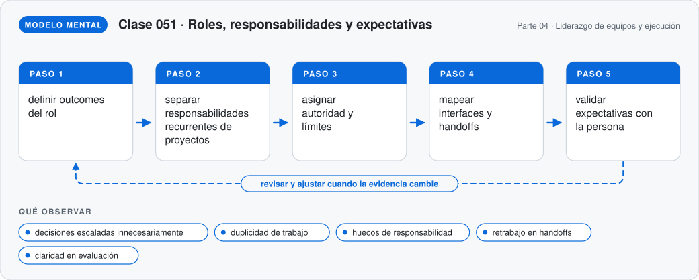

# Clase 051 — Roles, responsabilidades y expectativas

<!-- nav:inicio -->
> **Parte 04 · Liderazgo de equipos** — clase 3 de 12 · [índice de la parte](../../README.md) · [temario](../../../../SYLLABUS.md)
<!-- nav:fin -->

**Parte:** 04 — Liderazgo de equipos  
**Nivel:** Etapa 2 — Líder → Jefe / Team Lead  
**Duración sugerida:** 150–180 minutos · **Estándar:** deep-class-v2

## 🎯 Propósito

Cuando un equipo tiene conflictos, duplica trabajo o deja tareas sin hacer, la causa más frecuente no es la mala voluntad sino la falta de acuerdo sobre **quién hace qué y qué se espera de cada uno**. Esa ambigüedad tiene un nombre en la investigación organizacional: ambigüedad de rol. Rizzo, House y Lirtzman la midieron, junto con el conflicto de rol, y mostraron que ambas se asocian con tensión y menor satisfacción.

Esta clase enseña a definir roles de modo que cada decisión tenga un responsable claro, a conversar las expectativas de manera explícita y a detectar la ambigüedad y el conflicto de rol antes de que se conviertan en un problema de relación. Al terminar sabrás construir una matriz de responsabilidades y conducir la conversación de expectativas.

## 📚 Resultados de aprendizaje

Al finalizar podrás:

1. **Definir** rol, responsabilidad y expectativa, y distinguirlos de cargo.
2. **Distinguir** ambigüedad de rol y conflicto de rol, y sus efectos.
3. **Construir** una matriz de responsabilidades con una sola persona que decide.
4. **Conducir** una conversación de expectativas con una persona o con el equipo.
5. **Detectar** señales de roles confusos: duplicación, vacíos y conflictos entre pares.

## 🧭 Agenda

| Tramo | Qué se hace |
|---|---|
| 0–20 min | Recuperación: recuerda una vez en que no sabías qué se esperaba de ti. ¿Qué hiciste? |
| 20–60 min | Ambigüedad y conflicto de rol; la matriz de responsabilidades. |
| 60–105 min | Ejemplo trabajado: una matriz para un proyecto con roles superpuestos. |
| 105–140 min | Caso ejecutivo: dos líderes que creen decidir lo mismo. |
| 140–170 min | Límites y entregable. |

## 🧩 Conceptos centrales

| Concepto | Definición | Cómo se reconoce |
|---|---|---|
| **Rol** | Conjunto de conductas esperadas de quien ocupa una posición. | Se puede describir qué hace y qué decide quien lo ocupa. |
| **Ambigüedad de rol** | Falta de información clara sobre lo que se espera de una persona (Rizzo, House y Lirtzman, 1970). | «No sé si esto me corresponde.» |
| **Conflicto de rol** | Existencia de expectativas incompatibles sobre una persona (Rizzo, House y Lirtzman, 1970). | Dos jefes piden cosas opuestas. |
| **Matriz de responsabilidades** | Tabla que asigna, para cada decisión o tarea, quién decide, quién ejecuta, a quién se consulta y a quién se informa. | Una sola persona decide cada fila. |
| **Expectativa** | Lo que se espera de alguien en resultados, conducta y plazos. | Está dicha y la persona la entiende. |
| **Cargo** | Posición formal en el organigrama. | Se distingue del rol efectivo, que puede ser otro. |

## 🧠 Modelo mental

**Cómo leer el diagrama.** Cada fila es una decisión; la segunda columna tiene **una sola** persona o rol que decide. Las demás columnas indican quién ejecuta, quién aporta antes y quién solo se entera. Si una fila tiene dos decisores o ninguno, el equipo discutirá quién manda en lugar de decidir.

## 📖 Desarrollo

### 1. Rol, cargo y expectativa

El cargo es la posición en el organigrama; el rol, lo que se espera de la persona en la práctica. Pueden diferir: un cargo de «analista» puede incluir de hecho coordinar a otros. Y la expectativa es la conducta o el resultado que se espera de alguien. Los problemas aparecen cuando el rol real y el declarado difieren sin que nadie lo haya conversado.

### 2. Dos problemas de rol

Rizzo, House y Lirtzman desarrollaron escalas para medir dos problemas. La **ambigüedad de rol** es la falta de claridad sobre qué se espera, cómo cumplirlo y cuáles son las consecuencias. El **conflicto de rol** es la existencia de expectativas incompatibles: dos jefes con prioridades opuestas, o una expectativa que choca con los valores de la persona. En su estudio, ambos se asociaron con mayor tensión y menor satisfacción en el trabajo. La ambigüedad se resuelve con información; el conflicto, con decisiones sobre prioridades.

### 3. Una sola persona decide

La regla más útil para evitar conflictos de rol es que, para cada decisión, **exista una persona que decide**. Las demás personas pueden ejecutar, ser consultadas o informadas, pero no decidir. Cuando dos personas «comparten» una decisión, en la práctica ninguna responde por ella. Hay decisiones colectivas, pero incluso ellas tienen un responsable de que se tome y se registre.

### 4. La matriz de responsabilidades

La matriz tiene filas con decisiones o entregables y columnas con roles. En cada celda se marca si el rol **decide**, **ejecuta**, **es consultado** o **es informado**. Se construye con el equipo, a partir del acta (clase 050), y se revisa ante cambios. Detecta tres problemas: filas sin decisor, filas con dos decisores y personas con demasiadas filas o con ninguna. Es una herramienta de conversación, no solo un documento.

### 5. Expectativas explícitas

Una expectativa se dice con tres partes: **qué resultado** se espera, **por qué importa** y **cómo y cuándo** se revisará. Conviene preguntar a la persona cómo la entendió y qué obstáculo prevé. Las expectativas no dichas se vuelven reproches: «se suponía que lo sabías». Una conversación de expectativas al comienzo de un proyecto, un cargo o un cambio evita meses de fricción.

### 6. Roles que cambian

Los roles evolucionan: una persona crece, un proyecto cambia, se suma alguien. Revisa los roles cuando cambie la carga, se incorpore una persona o aparezca un conflicto. Si alguien asume tareas de otro por necesidad, se formaliza o se corrige. Los roles informales no declarados son una fuente frecuente de resentimiento.

### 7. Cuando hay conflicto entre jefes

Si una persona recibe pedidos incompatibles de dos jefes, no debe resolverlo sola. Lo apropiado es **hacer visible el conflicto** a ambos o a quien tenga la autoridad para decidir la prioridad. Pedir que se decida es una conducta profesional; resolverlo por intuición hace a la persona responsable de una decisión que no le corresponde.

## 📚 Lectura comparada

| Obra | Qué aporta | Qué no resuelve | Pregunta para contrastar |
|---|---|---|---|
| Rizzo, House y Lirtzman (1970) | Definición y medición de ambigüedad y conflicto de rol. | Es un estudio de organizaciones concretas y de su época. | ¿Qué rol te resulta más ambiguo? |
| Hackman (2002) | Estructura habilitante y roles claros en equipos. | No trae una matriz. | ¿Qué estructura necesita tu equipo? |
| Katzenbach y Smith (1993) | Habilidades complementarias y responsabilidad mutua. | Se centra en el equipo real. | ¿Quién responde por qué? |
| Grove (1983) | Responsabilidad y delegación en la gestión. | No trata de matrices. | ¿Quién decide cuándo hay duda? |
| McChrystal et al. (2015) | Cómo cambian los roles en entornos inciertos. | Nace del ámbito militar. | ¿Qué roles se desplazan con la urgencia? |

## 🧮 Ejemplo trabajado

**Situación (hipotética).** Un proyecto de implantación de un sistema tiene cinco participantes: la jefa de proyecto, un analista, el responsable técnico, un usuario clave y un patrocinador. Nadie sabe quién aprueba un cambio de alcance; dos personas creen decidirlo.

| Decisión | Decide | Ejecuta | Consulta | Informa |
|---|---|---|---|---|
| Cambio de alcance | **Patrocinador** | Jefa de proyecto | Usuario clave, técnico | Equipo |
| Prioridad entre tareas | **Jefa de proyecto** | Analista y técnico | Usuario clave | Patrocinador |
| Elección de herramienta | **Responsable técnico** | Técnico | Jefa, usuario | Patrocinador |
| Aceptación final | **Usuario clave** | Equipo | Jefa | Patrocinador |

**Qué cambió.** Antes del ejercicio, la jefa y el patrocinador aprobaban cambios por separado; el equipo recibía órdenes contradictorias (conflicto de rol). Con la matriz, el cambio de alcance es del patrocinador y se consulta al usuario y al técnico.

**Conversación de expectativas.** La jefa dice al analista: «Espero que cada semana entregues el avance de las pruebas con los defectos priorizados, porque el patrocinador decide con eso. ¿Cómo lo ves y qué te lo dificultaría?».

**Qué muestra.** (1) Una sola persona decide cada fila. (2) La matriz hizo visible un conflicto de rol. (3) La expectativa se dijo con resultado, razón y revisión.

## 🔀 Comparación y límites

**Roles claros frente a rigidez.** Un rol claro permite flexibilidad porque se sabe qué cambia cuando se cambia. La rigidez es no revisar. Los roles deben poder moverse cuando el proyecto lo pide, con aviso.

**Límites.** Los estudios de Rizzo et al. son de los años setenta y miden percepciones mediante cuestionarios; su relación con el desempeño depende del contexto. Una matriz no reemplaza la conversación sobre cómo se ejerce el rol, ni resuelve un conflicto entre personas. Y en equipos muy pequeños o en etapas de mucha incertidumbre, un exceso de formalización puede ser contraproducente.

## 🪜 De profesional a owner

| Nivel | Cómo trabaja los roles |
|---|---|
| **Profesional** | Pregunta qué se espera y señala cuando hay ambigüedad o conflicto. |
| **Jefe / Team Lead** | Aclara roles y construye la matriz con el equipo. |
| **Gerente** | Resuelve conflictos de rol entre equipos y evita pedidos incompatibles. |
| **CEO / Director** | Define quién decide en el comité y en la estructura de la empresa. |
| **Founder / Owner** | Evita que los cofundadores decidan lo mismo y fija quién decide qué. |

## 🏢 Caso ejecutivo

Una empresa de servicios tiene dos gerentes —comercial y de operaciones— que creen tener la última palabra sobre los plazos que se prometen a los clientes. El comercial promete fechas ajustadas para cerrar ventas; el de operaciones se queja de que «le imponen compromisos imposibles». El equipo de implementación recibe instrucciones contradictorias, y dos personas están a punto de renunciar. La gerente general no ha intervenido.

Entrega un **plan de aclaración de roles** que contenga: (a) la evidencia de ambigüedad y de conflicto de rol; (b) la matriz de responsabilidades para promesas de plazo, cambios y excepciones; (c) la conversación de expectativas que tendrás con cada gerente; (d) cómo protegerás al equipo de implementación; (e) cómo se resolverá un desacuerdo futuro; (f) cuándo revisarás.

## 🧪 Práctica

1. Escribe tres decisiones de tu equipo y marca quién decide cada una.
2. Detecta una fila sin decisor o con dos y propón una solución.
3. Redacta una expectativa con resultado, razón y revisión y pregunta cómo la entendió la persona.
4. Identifica una tarea informal que alguien hace sin que figure en su rol.
5. Define cuándo revisarás los roles de tu equipo.

## ⚠️ Errores frecuentes

| Error | Por qué ocurre | Cómo corregirlo |
|---|---|---|
| Dos decisores | Se quiere evitar conflicto | Una persona decide; las demás se consultan. |
| Expectativas no dichas | Se asumen obvias | Decirlas con resultado, razón y revisión. |
| Matriz como trámite | Se completa y se archiva | Usarla en las decisiones. |
| Roles informales ocultos | Se ayuda sin formalizar | Formalizar o corregir. |
| Resolver solo un conflicto de jefes | Se evita incomodar | Hacerlo visible a quien decide. |
| Rigidez | Se teme el cambio | Revisar ante cambios de carga o integrantes. |

## ❓ Preguntas de comprobación

1. ¿Qué diferencia hay entre ambigüedad y conflicto de rol?
2. ¿Qué efectos asociaron Rizzo, House y Lirtzman a ambos?
3. ¿Por qué una sola persona debe decidir cada decisión?
4. ¿Qué cuatro funciones tiene cada celda de la matriz?
5. ¿Qué tres partes tiene una expectativa bien dicha?
6. ¿Qué haces si recibes pedidos incompatibles de dos jefes?
7. ¿Qué límite tiene la matriz?

Claves de respuesta

1. La ambigüedad es falta de claridad sobre lo que se espera; el conflicto, expectativas incompatibles.
2. Mayor tensión y menor satisfacción en el trabajo.
3. Porque cuando dos «comparten» una decisión, en la práctica ninguna responde por ella.
4. Decide, ejecuta, es consultado y es informado.
5. Resultado esperado, razón y cómo y cuándo se revisará.
6. Hacer visible el conflicto a ambos o a quien decide la prioridad, en lugar de resolverlo solo.
7. No reemplaza la conversación sobre cómo se ejerce el rol ni resuelve conflictos entre personas, y la formalización excesiva puede ser contraproducente.

## 📥 Entregable

Guarda en `portfolio/051-roles-responsabilidades-y-expectativas/`:

- `leadership-decision-brief.md` (plantilla [Leadership Decision Brief](../../../../templates/leadership-decision-brief.md)) con el plan del caso ejecutivo;
- `team-charter.md` (plantilla [Team charter](../../../../templates/team-charter.md)) con la matriz de responsabilidades;
- `decision-journal.md` con las conversaciones de expectativas y su seguimiento.

## 📗 Fuentes y verificación

- John R. Rizzo, Robert J. House & Sidney I. Lirtzman — *Role Conflict and Ambiguity in Complex Organizations* (Administrative Science Quarterly, 1970). **Uso en esta clase:** definición y medición de ambigüedad y conflicto de rol. Lectura selectiva sobre **roles, responsabilidades y expectativas**. **Localizador:** [DOI 10.2307/2391486](https://doi.org/10.2307/2391486).
- J. Richard Hackman — *Leading Teams* (Harvard Business School Press, 2002). **Uso en esta clase:** estructura habilitante y roles claros. Lectura selectiva sobre **roles, responsabilidades y expectativas**. **Localizador:** [ISBN-13 9781578513338](https://openlibrary.org/isbn/9781578513338).
- Jon R. Katzenbach & Douglas K. Smith — *The Wisdom of Teams* (McGraw-Hill, 2005). **Uso en esta clase:** habilidades complementarias y responsabilidad mutua. Lectura selectiva sobre **roles, responsabilidades y expectativas**. **Localizador:** [ISBN-13 9780077111687](https://openlibrary.org/isbn/9780077111687).
- Andrew S. Grove — *High Output Management* (Random House, 1983). **Uso en esta clase:** responsabilidad y delegación en la gestión. Lectura selectiva sobre **roles, responsabilidades y expectativas**. **Localizador:** [ISBN-13 9780394532349](https://openlibrary.org/isbn/9780394532349).
- Stanley McChrystal et al. — *Team of Teams* (Penguin Books, Limited, 2015). **Uso en esta clase:** cómo cambian los roles en entornos inciertos. Lectura selectiva sobre **roles, responsabilidades y expectativas**. **Localizador:** [ISBN-13 9780241250846](https://openlibrary.org/isbn/9780241250846).

> **Regla de fuentes para Roles, responsabilidades y expectativas:** las obras anteriores estructuran las perspectivas de esta materia; cualquier norma, ley o estándar vivo mencionado debe comprobarse nuevamente en su fuente primaria vigente. Los ejemplos y casos son hipotéticos. El desarrollo es original y no reproduce capítulos protegidos.

<!-- pie:inicio -->
---

| Anterior | Índice | Siguiente |
|---|---|---|
| [← 050 · Propósito, objetivos y team charter](../050-proposito-objetivos-y-team-charter/README.md) | [Parte 04](../../README.md) · [Programa](../../../../SYLLABUS.md) | [052 · Confianza y vulnerabilidad profesional →](../052-confianza-y-vulnerabilidad-profesional/README.md) |
<!-- pie:fin -->
