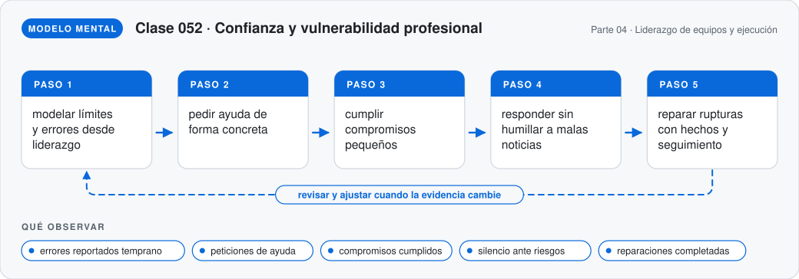

# Clase 052 — Confianza y vulnerabilidad profesional

<!-- nav:inicio -->
> **Parte 04 · Liderazgo de equipos** — clase 4 de 12 · [índice de la parte](../../README.md) · [temario](../../../../SYLLABUS.md)
<!-- nav:fin -->

**Parte:** 04 — Liderazgo de equipos  
**Nivel:** Etapa 2 — Líder → Jefe / Team Lead  
**Duración sugerida:** 150–180 minutos · **Estándar:** deep-class-v2

## 🎯 Propósito

Un equipo donde nadie admite un error, pide ayuda o reconoce que no sabe algo es un equipo que se protege en lugar de trabajar. Patrick Lencioni sostiene que la base de todo equipo funcional es una confianza de un tipo particular: la que permite **mostrarse vulnerable** ante los demás sin temer que se use en contra. Sobre ella se apoyan el debate honesto, el compromiso, la rendición de cuentas y la atención a los resultados.

Esta clase usa el modelo de las cinco disfunciones de Lencioni, la definición de confianza de Mayer, Davis y Schoorman (que ya vimos en la clase 137) y la seguridad psicológica de Edmondson. Al terminar sabrás diagnosticar en qué nivel de la pirámide falla un equipo, entender por qué comienza por la confianza y practicar la vulnerabilidad profesional como líder sin caer en la sobreexposición.

## 📚 Resultados de aprendizaje

Al finalizar podrás:

1. **Describir** las cinco disfunciones de Lencioni y su relación de dependencia.
2. **Definir** confianza basada en vulnerabilidad y distinguirla de confianza predictiva.
3. **Distinguir** vulnerabilidad profesional de sobreexposición personal.
4. **Practicar** conductas de líder que construyen confianza: admitir errores, pedir ayuda, reconocer límites.
5. **Diseñar** ejercicios de equipo que fortalezcan la confianza sin forzar la intimidad.

## 🧭 Agenda

| Tramo | Qué se hace |
|---|---|
| 0–20 min | Recuperación: recuerda un momento en que admitir un error con tu equipo cambió la relación. |
| 20–60 min | La pirámide de Lencioni y la confianza. |
| 60–105 min | Ejemplo trabajado: un equipo que evita el conflicto. |
| 105–140 min | Caso ejecutivo: un líder que nunca admite un error. |
| 140–170 min | Límites y entregable. |

## 🧩 Conceptos centrales

| Concepto | Definición | Cómo se reconoce |
|---|---|---|
| **Confianza basada en vulnerabilidad** | Seguridad de que los compañeros no usarán en contra lo que uno revela de sus debilidades (Lencioni, 2002). | Se admiten errores y se pide ayuda. |
| **Confianza (Mayer et al.)** | Disposición a ser vulnerable ante las acciones de otro sin poder controlarlo (Mayer, Davis y Schoorman, 1995). | Se asume un riesgo con base en la expectativa de buena conducta. |
| **Miedo al conflicto** | Evitar el debate de ideas por temor a la incomodidad (Lencioni, 2002). | Reuniones armónicas y decisiones sin discusión. |
| **Falta de compromiso** | Ambigüedad sobre lo decidido por no haber discutido (Lencioni, 2002). | Cada uno entiende un acuerdo distinto. |
| **Evasión de la rendición de cuentas** | No pedirse cuentas entre pares (Lencioni, 2002). | Se espera que el jefe corrija. |
| **Vulnerabilidad profesional** | Mostrar límites, errores y dudas relevantes para el trabajo. | No implica contar la vida privada. |

## 🧠 Modelo mental

**Cómo leer el diagrama.** Los niveles se apoyan uno en otro, de abajo hacia arriba. La **ausencia de confianza** es la base: sin ella, el equipo evita el conflicto de ideas, y sin debate no hay compromiso real; sin compromiso, nadie exige cuentas, y sin eso se descuida el resultado colectivo. Trabajar un nivel superior sin resolver el inferior es esfuerzo perdido.

## 📖 Desarrollo

### 1. La confianza que importa

Lencioni distingue la confianza **predictiva** —sabes qué hará el otro porque lo has visto actuar— de la confianza **basada en vulnerabilidad** —sabes que no usará en tu contra lo que admitas—. Esta segunda es la que sostiene a un equipo: permite decir «me equivoqué», «no sé» o «necesito ayuda». La definición de Mayer, Davis y Schoorman converge: confiar es estar dispuesto a ser vulnerable sin poder controlar al otro.

### 2. Las cinco disfunciones

Lencioni propone una pirámide de disfunciones. **Ausencia de confianza**: nadie muestra debilidades. **Miedo al conflicto**: se evita el debate, y la armonía es artificial. **Falta de compromiso**: sin debate, los acuerdos son ambiguos. **Evasión de la rendición de cuentas**: nadie corrige a un par. **Inatención a los resultados**: se prioriza el estatus individual o del área. Cada nivel se apoya en el anterior. El modelo se presenta en forma de fábula de gestión y no como resultado de investigación experimental, pero describe patrones reconocibles.

### 3. Por qué todo parte de la confianza

Si decir «no estoy de acuerdo» o «creo que me equivoqué» es peligroso, las personas callan. Callar impide el debate, y sin debate las decisiones no se entienden ni se asumen. Edmondson aporta evidencia sobre este mecanismo: en equipos donde se percibe seguridad para asumir riesgos interpersonales, aparecen más conductas de aprendizaje, como preguntar, pedir ayuda y discutir errores (clase 042). La confianza no es un valor abstracto: es la condición del trabajo conjunto.

### 4. Vulnerabilidad profesional

Es mostrar lo relevante para el trabajo: un error, un límite, una duda, una necesidad de ayuda. **No** es contar la vida privada ni exponerse emocionalmente sin criterio. La frontera práctica es: ¿esto ayuda al equipo a trabajar mejor? Un líder que dice «no sé cómo resolver esto, necesito vuestras ideas» o «me equivoqué en esta decisión y esto cambia» comunica una vulnerabilidad útil; uno que confiesa problemas personales sin relación con el trabajo puede generar incomodidad.

### 5. El líder va primero

La confianza no se pide, se modela. Si el líder no admite errores, nadie lo hará. Conductas concretas: reconocer públicamente un error propio y qué aprendió; pedir ayuda explícitamente; decir «no lo sé»; agradecer a quien lo corrige; y no castigar a quien se expone. Un solo episodio en que el líder reacciona mal a una vulnerabilidad puede deshacer meses de trabajo.

### 6. Cómo se construye con el equipo

Lencioni propone ejercicios para conocerse mejor: historias breves de dónde viene cada uno, evaluaciones de estilos y conversaciones sobre fortalezas y debilidades. Funcionan mejor cuando son **voluntarios y relevantes al trabajo**, y cuando el líder participa. Una regla de la clase: nadie debe sentir que el ejercicio lo expone más de lo que decidió. También cuentan los hábitos diarios: responder con curiosidad ante una pregunta, reconocer aportes, y no avergonzar.

### 7. Qué hacer cuando se rompe

Si una confidencia se usó en contra de alguien, hay que abordarlo de forma directa: reconocer el hecho, conversar con la persona afectada, definir consecuencias proporcionales y restablecer la regla. La reparación sigue los pasos de la clase 137: reconocer, corregir, reparar, verificar y sostener. Ignorar una ruptura enseña al equipo que mostrarse vulnerable tiene costo.

## 📚 Lectura comparada

| Obra | Qué aporta | Qué no resuelve | Pregunta para contrastar |
|---|---|---|---|
| Lencioni (2002) | La pirámide de disfunciones y la confianza como base. | Es una fábula de gestión, no una investigación. | ¿En qué nivel falla tu equipo? |
| Mayer, Davis y Schoorman (1995) | Definición y componentes de la confianza. | No se centra en equipos. | ¿Qué factor de confianza observan tus colegas en ti? |
| Edmondson (1999) | Seguridad psicológica y aprendizaje. | No trata de ejercicios. | ¿Qué conductas de aprendizaje ves? |
| Edmondson (2018) | Conductas del líder que construyen seguridad. | Basada en casos. | ¿Qué haces tú que la daña? |
| Hackman (2002) | Condiciones del equipo, entre ellas el clima. | No describe ejercicios de confianza. | ¿Qué condición no está dada? |

## 🧮 Ejemplo trabajado

**Situación (hipotética).** Un equipo de producto de siete personas tiene reuniones cordiales y decisiones lentas. Nadie discrepa con la directora, Carolina, y varios acuerdos se «reabren» después en pasillos.

| Nivel | Síntoma observado |
|---|---|
| **Confianza** | Nadie reconoce un retraso hasta que es inevitable. |
| **Conflicto** | Las reuniones son amables; las objeciones aparecen después por mensaje. |
| **Compromiso** | Tres personas entendieron tres cosas distintas del último acuerdo. |
| **Rendición de cuentas** | Nadie le dice nada a quien incumple. |

**Diagnóstico.** La base es la confianza: sin ella, los demás niveles se debilitan.

**Intervención.** (1) Carolina abre la siguiente reunión admitiendo un error propio: «Subestimé el esfuerzo de la integración y por eso retrasamos; esto aprendí». (2) Agradece a quien le hace una pregunta incómoda. (3) Propone que cada reunión incluya un punto: «¿qué riesgo no estamos mencionando?». (4) Tras un acuerdo, cada uno escribe en dos frases lo que entendió. (5) A los dos meses, repite una breve pregunta de clima.

**Resultado.** Aparecen discrepancias en la reunión, los acuerdos se aclaran y los retrasos se reportan antes.

**Qué muestra.** (1) La disfunción visible no era la raíz. (2) El líder fue primero. (3) Las prácticas fueron pequeñas, regulares y relevantes al trabajo.

## 🔀 Comparación y límites

**Vulnerabilidad frente a sobreexposición.** La primera es relevante para el trabajo y se elige; la segunda expone sin criterio y puede incomodar. La clase propone un filtro: ¿ayuda al equipo a trabajar mejor?

**Límites.** El modelo de Lencioni es una fábula de gestión, sin validación empírica independiente de su estructura de cinco niveles. Los ejercicios de confianza pueden resultar invasivos o culturalmente inadecuados si se imponen. Y la confianza que se espera también depende de la jerarquía: pedir vulnerabilidad a quien tiene poco poder tiene más riesgo que pedirla a quien tiene mucho.

## 🪜 De profesional a owner

| Nivel | Cómo trabaja la confianza |
|---|---|
| **Profesional** | Admite errores a tiempo y pide ayuda cuando la necesita. |
| **Jefe / Team Lead** | Va primero: admite errores, agradece correcciones y protege a quien se expone. |
| **Gerente** | Crea condiciones para que los equipos se hablen con franqueza. |
| **CEO / Director** | Modela la vulnerabilidad ante el equipo directivo y el directorio. |
| **Founder / Owner** | Admite ante socios y equipo lo que no sabe, y construye relaciones donde se puede decir la verdad. |

## 🏢 Caso ejecutivo

Un director de ingeniería con fama de brillante nunca ha admitido un error ante su equipo. Cuando algo falla, explica por qué «fue una circunstancia». Hace dos trimestres, un incidente grave se detectó tarde porque un ingeniero lo notó y «no quiso incomodar». Dos personas se fueron diciendo que «con él no se puede hablar». El director cree que sus resultados demuestran que su estilo funciona.

Entrega un **plan de construcción de confianza** que contenga: (a) el diagnóstico por nivel de la pirámide con evidencia; (b) las conductas del líder que cambiarás y cómo las harás visibles; (c) los ejercicios de equipo, voluntarios y relevantes; (d) cómo responderás cuando alguien se exponga; (e) cómo medirás el avance; (f) qué harías si una confidencia se usara en contra de alguien.

## 🧪 Práctica

1. Ubica a tu equipo en la pirámide y escribe una evidencia por nivel.
2. Escribe un error propio reciente y cómo lo contarías al equipo en tres frases.
3. Identifica un ejercicio de equipo voluntario y relevante que podrías proponer.
4. Escribe qué haces cuando alguien te trae una mala noticia y qué cambiarías.
5. Define una pregunta breve de clima y cuándo la harías.

## ⚠️ Errores frecuentes

| Error | Por qué ocurre | Cómo corregirlo |
|---|---|---|
| Pedir vulnerabilidad sin darla | El líder se exime | Ir primero. |
| Confundir confianza con simpatía | Se mide por el buen clima | Observar si se admiten errores y se discrepa. |
| Forzar la intimidad | Se asocia a cercanía | Ejercicios voluntarios y relevantes al trabajo. |
| Castigar la vulnerabilidad | Se reacciona al error | Agradecer y resolver. |
| Atender los niveles altos | Son más visibles | Empezar por la confianza. |
| Ignorar una ruptura | Se espera que pase | Abordarla y reparar. |

## ❓ Preguntas de comprobación

1. ¿Cuáles son las cinco disfunciones de Lencioni?
2. ¿Por qué la confianza es la base de la pirámide?
3. ¿Qué diferencia hay entre confianza predictiva y confianza basada en vulnerabilidad?
4. ¿Qué diferencia hay entre vulnerabilidad profesional y sobreexposición?
5. ¿Por qué el líder debe ir primero?
6. ¿Qué haces si una confidencia se usó en contra de alguien?
7. ¿Qué límite tiene el modelo de Lencioni?

Claves de respuesta

1. Ausencia de confianza, miedo al conflicto, falta de compromiso, evasión de la rendición de cuentas e inatención a los resultados.
2. Porque sin confianza se evita el debate, y sin debate no hay compromiso ni rendición de cuentas.
3. La predictiva es saber qué hará el otro; la basada en vulnerabilidad es saber que no usará lo que uno admita en su contra.
4. La primera es relevante para el trabajo y elegida; la segunda expone sin criterio.
5. Porque la confianza se modela: si el líder no se muestra vulnerable, nadie lo hará.
6. Reconocer el hecho, conversar con la persona afectada, aplicar consecuencias proporcionales y restablecer la regla.
7. Es una fábula de gestión sin validación empírica independiente de sus cinco niveles.

## 📥 Entregable

Guarda en `portfolio/052-confianza-y-vulnerabilidad-profesional/`:

- `risk-governance-brief.md` (plantilla [Risk & Governance Brief](../../../../templates/risk-governance-brief.md)) con el plan del caso ejecutivo;
- `reading-note.md` con una tensión entre Lencioni y Mayer, Davis y Schoorman;
- `decision-journal.md` con tus conductas, el feedback y los resultados.

## 📗 Fuentes y verificación

- Patrick Lencioni — *The Five Dysfunctions of a Team* (Pfeiffer, 2012). **Uso en esta clase:** la pirámide de disfunciones y la confianza como base. Lectura selectiva sobre **confianza y vulnerabilidad profesional**. **Localizador:** [ISBN-13 9781118127308](https://openlibrary.org/isbn/9781118127308).
- Roger C. Mayer, James H. Davis & F. David Schoorman — *An Integrative Model of Organizational Trust* (Academy of Management Review, 1995). **Uso en esta clase:** definición y componentes de la confianza. Lectura selectiva sobre **confianza y vulnerabilidad profesional**. **Localizador:** [DOI 10.2307/258792](https://doi.org/10.2307/258792).
- Amy C. Edmondson — *Psychological Safety and Learning Behavior in Work Teams* (Administrative Science Quarterly, 1999). **Uso en esta clase:** seguridad psicológica y conductas de aprendizaje. Lectura selectiva sobre **confianza y vulnerabilidad profesional**. **Localizador:** [DOI 10.2307/2666999](https://doi.org/10.2307/2666999).
- Amy C. Edmondson — *The Fearless Organization* (Wiley, 2018). **Uso en esta clase:** conductas del líder que construyen seguridad. Lectura selectiva sobre **confianza y vulnerabilidad profesional**. **Localizador:** [ISBN-13 9781119477242](https://openlibrary.org/isbn/9781119477242).
- J. Richard Hackman — *Leading Teams* (Harvard Business School Press, 2002). **Uso en esta clase:** condiciones del equipo, entre ellas el clima. Lectura selectiva sobre **confianza y vulnerabilidad profesional**. **Localizador:** [ISBN-13 9781578513338](https://openlibrary.org/isbn/9781578513338).

> **Regla de fuentes para Confianza y vulnerabilidad profesional:** las obras anteriores estructuran las perspectivas de esta materia; cualquier norma, ley o estándar vivo mencionado debe comprobarse nuevamente en su fuente primaria vigente. Los ejemplos y casos son hipotéticos. El desarrollo es original y no reproduce capítulos protegidos.

<!-- pie:inicio -->
---

| Anterior | Índice | Siguiente |
|---|---|---|
| [← 051 · Roles, responsabilidades y expectativas](../051-roles-responsabilidades-y-expectativas/README.md) | [Parte 04](../../README.md) · [Programa](../../../../SYLLABUS.md) | [053 · Delegación por resultados →](../053-delegacion-por-resultados/README.md) |
<!-- pie:fin -->
