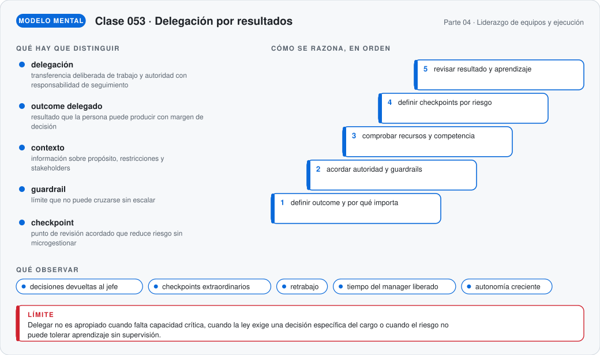

# Clase 053 — Delegación por resultados

<!-- nav:inicio -->
> **Parte 04 · Liderazgo de equipos** — clase 5 de 12 · [índice de la parte](../../README.md) · [temario](../../../../SYLLABUS.md)
<!-- nav:fin -->

**Parte:** 04 — Liderazgo de equipos  
**Nivel:** Etapa 2 — Líder → Jefe / Team Lead  
**Duración sugerida:** 150–180 minutos · **Estándar:** deep-class-v2

## 🎯 Propósito

Delegar es la decisión de gestión que más cuesta y más rinde. Cuesta porque quien delega sigue respondiendo por el resultado; rinde porque libera tiempo para lo que solo el líder puede hacer y desarrolla a quien recibe la tarea. Se hace mal de dos modos opuestos: no delegar (hacerlo todo, o revisar todo) y «abandonar» (entregar una tarea sin claridad y reclamar después).

Esta clase se apoya en la noción de **madurez para la tarea** de Andrew Grove —la capacidad y disposición de una persona para una tarea específica— y en la idea de Drucker de que se delega responsabilidad por resultados, no actividad. Al terminar sabrás elegir el nivel de autoridad a delegar, definir el resultado, los límites y los puntos de revisión, y recuperar una delegación que salió mal.

## 📚 Resultados de aprendizaje

Al finalizar podrás:

1. **Distinguir** delegar tareas, delegar resultados y abdicar.
2. **Evaluar** la madurez de una persona para una tarea concreta.
3. **Elegir** el nivel de autoridad delegada que corresponde.
4. **Redactar** una delegación con resultado, límites, recursos, plazos y revisión.
5. **Gestionar** la tensión entre soltar y mantener la responsabilidad.

## 🧭 Agenda

| Tramo | Qué se hace |
|---|---|
| 0–20 min | Recuperación: lista cinco cosas que haces y podría hacer otra persona; ¿por qué no las delegas? |
| 20–60 min | Madurez para la tarea y niveles de delegación. |
| 60–105 min | Ejemplo trabajado: delegar la preparación de un informe mensual. |
| 105–140 min | Caso ejecutivo: una gerente que no logra soltar. |
| 140–170 min | Límites y entregable. |

## 🧩 Conceptos centrales

| Concepto | Definición | Cómo se reconoce |
|---|---|---|
| **Delegación** | Transferencia de autoridad para decidir y actuar sobre un resultado, conservando quien delega la responsabilidad final. | Se define el resultado, los límites y la revisión. |
| **Delegar por resultados** | Encargar un resultado y dejar a la persona decidir el cómo, dentro de límites. | La persona tiene libertad sobre el método. |
| **Abdicación** | Entregar una tarea sin claridad ni seguimiento. | «Encárgate» sin criterios ni revisión. |
| **Madurez para la tarea** | Capacidad y disposición de una persona para una tarea específica (Grove, 1983). | Varía por tarea: se es maduro en una y novato en otra. |
| **Límites de autoridad** | Fronteras dentro de las cuales la persona puede decidir sin consultar. | «Hasta USD 5.000 decides; más, consultas.» |
| **Punto de revisión** | Momento acordado en que se examina el avance. | Está en el calendario. |

## 🧠 Modelo mental

**Cómo leer el diagrama.** Los cinco niveles ascienden en autoridad delegada. La regla de la clase es elegir el nivel según la **madurez para esa tarea concreta**: alto nivel cuando la persona tiene capacidad y disposición, más bajo cuando es nueva. Y subir de nivel con el tiempo es parte del desarrollo.

## 📖 Desarrollo

### 1. Qué se delega

Drucker insiste en que un directivo responde por los resultados, no por la actividad. Delegar una **tarea** (haz esto de esta manera) conserva toda la decisión en el jefe y desarrolla poco. Delegar un **resultado** (necesito esto, con estas condiciones; decide cómo) transfiere autoridad y desarrolla. En ambos casos, quien delega **sigue siendo responsable**: la responsabilidad no se delega, la autoridad sí.

### 2. La madurez para la tarea

Grove propone que el estilo de gestión se ajuste a la **madurez para la tarea**: la combinación de capacidad (conocimiento, experiencia) y disposición (motivación, confianza) para una tarea específica. Es **relativa a la tarea**: un experto puede ser novato en una tarea nueva. Con baja madurez, el jefe interviene más; con alta, menos. Un error frecuente es evaluar a la persona en general y no para la tarea.

### 3. Los niveles de autoridad

Una escala didáctica de la clase: **1)** hacer lo que se indica; **2)** analizar y proponer, el jefe decide; **3)** decidir e informar antes de ejecutar; **4)** decidir y informar después; **5)** decidir por completo, con revisión periódica. Dejar claro el nivel evita malentendidos: «yo creí que podía decidir» frente a «yo esperaba que me consultara». Nombrar el nivel («esto es un tres: decide y avísame antes») es una práctica simple y eficaz.

### 4. Cómo se redacta una delegación

Seis elementos. **Resultado:** qué se espera, con criterios de aceptación. **Por qué importa:** el contexto. **Límites:** presupuesto, plazos, decisiones que requieren consulta. **Recursos:** personas, información, acceso. **Revisión:** cuándo se verá el avance. **Nivel de autoridad:** qué puede decidir sola. Una delegación escrita en cinco líneas evita meses de fricción.

### 5. Seguimiento sin microgestión

Delegar no es desaparecer. El seguimiento se acuerda: puntos de revisión fijos, indicadores de avance visibles y una vía para pedir ayuda. Entre revisiones, el jefe se abstiene de intervenir, salvo que se cruce un límite. Si el jefe quiere revisar todo, no está delegando. Y si interviene en el método sin que se haya cruzado un límite, le quita la tarea a la persona sin decirlo.

### 6. Cuando algo sale mal

Si el resultado no llega, la conversación comienza por los hechos: ¿estaba claro el resultado?, ¿los límites?, ¿los recursos?, ¿la madurez estaba bien evaluada?, ¿hubo señales a tiempo? Muchos fallos de delegación son de delegación. Si la causa es la persona, se ajusta el nivel de autoridad y se acompaña; si es la tarea, se rediseña. Retirar una tarea sin explicación daña la confianza.

### 7. Por qué cuesta soltar

Soltar enfrenta temores: que salga peor, perder control, quedar mal ante la dirección. El mapa de inmunidad (clase 046) ayuda a ver qué se protege. Un experimento seguro —delegar algo de bajo riesgo y observar— suele ser mejor que una decisión de principio. Y conviene recordar el costo de no delegar: el líder se vuelve cuello de botella y el equipo no crece.

## 📚 Lectura comparada

| Obra | Qué aporta | Qué no resuelve | Pregunta para contrastar |
|---|---|---|---|
| Grove (1983) | Madurez para la tarea y ajuste del estilo de gestión. | Escrita en otro contexto empresarial. | ¿Cuál es la madurez de tu colaborador para esta tarea? |
| Drucker (2006) | Delegar resultados y la responsabilidad del directivo. | No trae una escala. | ¿Delegas actividad o resultado? |
| Hackman (2002) | Estructura y autonomía del equipo. | No trata la delegación individual. | ¿Qué autonomía tiene tu equipo? |
| Kegan y Lahey (2009) | Compromisos ocultos que impiden soltar. | No da pasos de delegación. | ¿Qué proteges al no delegar? |
| Bungay Stanier (2016) | Preguntas para delegar sin dar la solución. | Es divulgación. | ¿Qué pregunta harías antes de resolver? |

## 🧮 Ejemplo trabajado

**Situación (hipotética).** Una gerente, Marta, prepara cada mes un informe de resultados para la dirección. Lleva tres horas y le cuesta soltarlo. Decide delegarlo a Joaquín, analista con dos años de experiencia que conoce los datos pero nunca presentó a la dirección.

| Elemento | Delegación |
|---|---|
| **Resultado** | Informe de dos páginas con cinco indicadores, entregado el día 3 de cada mes, sin errores de cifras. |
| **Por qué importa** | La dirección decide el presupuesto con este informe. |
| **Madurez** | Alta para el análisis; baja para presentar a la dirección. |
| **Nivel de autoridad** | 3 para el contenido (decide y avisa antes); 1 para la presentación al comité (ensayan juntos). |
| **Límites** | Cambios de indicadores los consulta; las cifras se verifican con una lista. |
| **Revisión** | Marta revisa el primer informe antes de enviarlo; el segundo, solo la lista; el tercero, nada. |

**Resultado.** En el primer mes Marta corrige dos cosas; en el tercero, Joaquín presenta solo. Marta ahorra tres horas y Joaquín gana visibilidad.

**Qué muestra.** (1) La madurez se evaluó por tarea, y el nivel varió por componente. (2) Hubo una trayectoria de subir el nivel. (3) El seguimiento fue acordado.

## 🔀 Comparación y límites

**Delegar frente a repartir trabajo.** Repartir asigna tareas dentro de un plan del jefe; delegar transfiere autoridad sobre un resultado.

**Límites.** La escala de niveles es un recurso didáctico de la clase y no un modelo empírico; la madurez para la tarea de Grove es un concepto práctico, no una medición. Hay tareas que no se delegan: decisiones de personal sensibles, relaciones con la dirección y aquellas que, por su riesgo, exigen la autoridad del líder. Y delegar sin dar recursos ni tiempo es abdicar.

## 🪜 De profesional a owner

| Nivel | Cómo delega |
|---|---|
| **Profesional** | Pide claridad sobre el resultado y los límites cuando recibe una tarea. |
| **Jefe / Team Lead** | Delega resultados, define el nivel y acuerda revisiones. |
| **Gerente** | Desarrolla a sus jefes delegando decisiones reales. |
| **CEO / Director** | Delega a su equipo directivo y se concentra en decisiones de empresa. |
| **Founder / Owner** | Aprende a soltar lo que antes hacía solo, para que el negocio no dependa de él. |

## 🏢 Caso ejecutivo

Una directora de operaciones revisa todas las propuestas comerciales de su área antes de que salgan, lo que retrasa las respuestas a los clientes en dos a tres días. Su equipo dice que «no le dejan decidir». Ella argumenta que «ya hubo errores» y que no puede arriesgarse. Dos buenos jefes de área están pensando en irse. Tiene una semana para presentar un plan al gerente general.

Entrega un **plan de delegación** que contenga: (a) el análisis de qué proteges al no soltar; (b) la madurez de cada jefe para cada tipo de propuesta; (c) el nivel de autoridad por tipo, con límites; (d) cómo redactarás la delegación; (e) el seguimiento sin microgestión; (f) qué señal te haría subir o bajar el nivel.

## 🧪 Práctica

1. Elige una tarea que haces tú y redáctala como delegación con los seis elementos.
2. Evalúa la madurez de una persona para esa tarea.
3. Decide el nivel de autoridad y escríbelo en una frase.
4. Define los puntos de revisión y cómo irán subiendo.
5. Describe qué harías si el resultado no llega.

## ⚠️ Errores frecuentes

| Error | Por qué ocurre | Cómo corregirlo |
|---|---|---|
| Delegar tareas, no resultados | Se quiere controlar el método | Definir resultado y límites. |
| Abdicar | Se piensa que delegar es soltar | Acordar revisión y apoyo. |
| Evaluar a la persona en general | Se usa una impresión global | Evaluar la madurez para esa tarea. |
| Intervenir sin cruzar límites | Ansiedad | Esperar al punto de revisión. |
| No explicar el nivel | Se supone claro | Nombrar el nivel de autoridad. |
| Retirar la tarea sin explicar | Se reacciona al error | Revisar la delegación y conversar. |

## ❓ Preguntas de comprobación

1. ¿Qué se delega y qué no, según la idea de responsabilidad?
2. ¿Qué es la madurez para la tarea y por qué es específica?
3. ¿Cuáles son los cinco niveles de delegación de la clase?
4. ¿Qué seis elementos tiene una delegación bien redactada?
5. ¿Qué diferencia hay entre delegar y abdicar?
6. Si una delegación sale mal, ¿qué revisas primero?
7. ¿Qué límite tiene la escala de niveles?

Claves de respuesta

1. Se delega la autoridad para decidir y actuar; la responsabilidad final sigue siendo de quien delega.
2. La combinación de capacidad y disposición para una tarea concreta; una persona puede ser maduro en una tarea y novato en otra.
3. Hacer lo indicado, proponer y esperar, decidir e informar antes, decidir e informar después, y decidir por completo.
4. Resultado, por qué importa, límites, recursos, revisión y nivel de autoridad.
5. Delegar acuerda resultado, límites y seguimiento; abdicar entrega la tarea sin claridad ni revisión.
6. La claridad del resultado, los límites, los recursos, la evaluación de la madurez y las señales a tiempo.
7. Es un recurso didáctico, no un modelo empírico.

## 📥 Entregable

Guarda en `portfolio/053-delegacion-por-resultados/`:

- `leadership-decision-brief.md` (plantilla [Leadership Decision Brief](../../../../templates/leadership-decision-brief.md)) con el plan del caso ejecutivo;
- `reading-note.md` con una tensión entre Grove y Drucker;
- `decision-journal.md` con la delegación redactada, el nivel y el seguimiento.

## 📗 Fuentes y verificación

- Andrew S. Grove — *High Output Management* (Random House, 1983). **Uso en esta clase:** madurez para la tarea y ajuste del estilo de gestión. Lectura selectiva sobre **delegación por resultados**. **Localizador:** [ISBN-13 9780394532349](https://openlibrary.org/isbn/9780394532349).
- Peter F. Drucker — *The Effective Executive* (Collins, 2002). **Uso en esta clase:** delegar resultados y responsabilidad del directivo. Lectura selectiva sobre **delegación por resultados**. **Localizador:** [ISBN-13 9780060516079](https://openlibrary.org/isbn/9780060516079).
- J. Richard Hackman — *Leading Teams* (Harvard Business School Press, 2002). **Uso en esta clase:** estructura y autonomía del equipo. Lectura selectiva sobre **delegación por resultados**. **Localizador:** [ISBN-13 9781578513338](https://openlibrary.org/isbn/9781578513338).
- Robert Kegan & Lisa Laskow Lahey — *Immunity to Change* (Harvard Business Press, 2009). **Uso en esta clase:** compromisos ocultos que impiden soltar. Lectura selectiva sobre **delegación por resultados**. **Localizador:** [ISBN-13 9781422117361](https://openlibrary.org/isbn/9781422117361).
- Michael Bungay Stanier — *The Coaching Habit* (Page Two/Portfolio/Canongate Books/Simon & Schuster UK, 2016). **Uso en esta clase:** preguntas para delegar sin dar la solución. Lectura selectiva sobre **delegación por resultados**. **Localizador:** [ISBN-13 9780978440749](https://openlibrary.org/isbn/9780978440749).

> **Regla de fuentes para Delegación por resultados:** las obras anteriores estructuran las perspectivas de esta materia; cualquier norma, ley o estándar vivo mencionado debe comprobarse nuevamente en su fuente primaria vigente. Los ejemplos y casos son hipotéticos. El desarrollo es original y no reproduce capítulos protegidos.

<!-- pie:inicio -->
---

| Anterior | Índice | Siguiente |
|---|---|---|
| [← 052 · Confianza y vulnerabilidad profesional](../052-confianza-y-vulnerabilidad-profesional/README.md) | [Parte 04](../../README.md) · [Programa](../../../../SYLLABUS.md) | [054 · Coaching y desarrollo cotidiano →](../054-coaching-y-desarrollo-cotidiano/README.md) |
<!-- pie:fin -->
