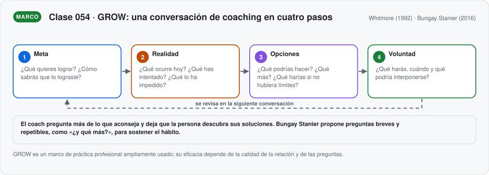

# Clase 054 — Coaching y desarrollo cotidiano

<!-- nav:inicio -->
> **Parte 04 · Liderazgo de equipos** — clase 6 de 12 · [índice de la parte](../../README.md) · [temario](../../../../SYLLABUS.md)
<!-- nav:fin -->

**Parte:** 04 — Liderazgo de equipos  
**Nivel:** Etapa 2 — Líder → Jefe / Team Lead  
**Duración sugerida:** 150–180 minutos · **Estándar:** deep-class-v2

## 🎯 Propósito

Un jefe que responde cada duda con la solución resuelve el problema de hoy y mantiene el de mañana: su equipo seguirá dependiendo de él. El **coaching** propone otra cosa: ayudar a la persona a pensar su propio problema y descubrir sus respuestas, de modo que aprenda a resolver el siguiente sin ayuda. No sustituye la instrucción ni el feedback; es una forma de conversación que conviene cuando la persona tiene la capacidad y necesita claridad, no información.

Esta clase usa el modelo GROW de John Whitmore, un marco de cuatro pasos para estructurar una conversación de coaching, y las preguntas breves de Michael Bungay Stanier, que hacen posible practicarlo en el día a día sin sesiones largas. Al terminar sabrás conducir una conversación de coaching de diez a quince minutos y decidir cuándo coaching, cuándo instrucción y cuándo feedback.

## 📚 Resultados de aprendizaje

Al finalizar podrás:

1. **Definir** coaching y distinguirlo de instrucción, consejo y feedback.
2. **Conducir** una conversación con el modelo GROW: meta, realidad, opciones y voluntad.
3. **Formular** preguntas abiertas y breves que promuevan el pensamiento propio.
4. **Decidir** cuándo corresponde coaching y cuándo no.
5. **Integrar** el coaching en el trabajo diario como hábito breve.

## 🧭 Agenda

| Tramo | Qué se hace |
|---|---|
| 0–20 min | Recuperación: recuerda a quien te ayudó a pensar sin decirte qué hacer; ¿qué hizo? |
| 20–60 min | Coaching, GROW y preguntas breves. |
| 60–105 min | Ejemplo trabajado: una conversación de coaching de doce minutos. |
| 105–140 min | Caso ejecutivo: un colaborador que trae todos los problemas al jefe. |
| 140–170 min | Límites y entregable. |

## 🧩 Conceptos centrales

| Concepto | Definición | Cómo se reconoce |
|---|---|---|
| **Coaching** | Conversación que ayuda a una persona a desarrollar su propio pensamiento y capacidad para mejorar su desempeño (Whitmore, 1992). | Quien lo conduce pregunta más de lo que aconseja. |
| **Modelo GROW** | Estructura de cuatro pasos: Goal (meta), Reality (realidad), Options (opciones), Will (voluntad) (Whitmore, 1992). | Se puede decir en qué paso está la conversación. |
| **Pregunta abierta** | Pregunta que no se responde con sí o no y invita a explorar. | Comienza con «qué» o «cómo». |
| **Instrucción** | Transmisión de conocimiento o método a quien no lo tiene. | Corresponde a una persona sin experiencia en la tarea. |
| **Hábito de coaching** | Práctica breve y regular de preguntar antes de aconsejar (Bungay Stanier, 2016). | Se aplica en conversaciones de minutos. |
| **Compromiso de acción** | Paso concreto, con plazo, que la persona decide dar. | Termina con «haré X para tal fecha». |

## 🧠 Modelo mental

**Cómo leer el diagrama.** Cuatro pasos en orden. La conversación empieza por la **meta**, no por el problema; examina luego la **realidad**; genera **opciones** antes de elegir y termina con la **voluntad**: qué hará la persona y cuándo. Se retoma en la siguiente conversación. El coach no impone una solución: ayuda a que la persona la formule.

## 📖 Desarrollo

### 1. Cuándo coaching y cuándo no

El coaching asume que la persona **tiene capacidad** para encontrar la respuesta, si se le ayuda a pensar. Si no tiene el conocimiento —un procedimiento nuevo, una norma—, corresponde **instruir**. Si hay una conducta a corregir, corresponde **feedback** (clase 030). Si la situación es una emergencia, corresponde **dirigir**. Mezclar los modos sin decirlo confunde: «¿qué opinas?» seguido de una orden es una falsa pregunta. Conviene nombrar el modo: «te voy a preguntar para que lo pienses tú».

### 2. El modelo GROW

Whitmore propone cuatro pasos. **Goal (meta):** ¿qué quieres lograr, en esta conversación y a más largo plazo? **Reality (realidad):** ¿qué ocurre ahora?, ¿qué has intentado?, ¿qué te lo ha impedido? **Options (opciones):** ¿qué podrías hacer?, ¿qué más? **Will (voluntad):** ¿qué harás?, ¿cuándo?, ¿qué podría interponerse? El orden importa: empezar por la meta evita analizar un problema que no se sabe si importa; explorar la realidad evita saltar a soluciones; abrir opciones evita quedarse con la primera.

### 3. Preguntas que ayudan

Una buena pregunta de coaching es **abierta**, **breve** y **sin sugerencia**. Bungay Stanier propone siete preguntas básicas, entre ellas «¿qué tienes en mente?», «¿y qué más?», «¿cuál es el verdadero desafío para ti?», «¿qué quieres?» y «¿qué fue lo más útil de esta conversación?». La más poderosa, según su experiencia, es «¿y qué más?», que alarga la reflexión antes de elegir. Evita el «¿por qué?» acusatorio y el consejo disfrazado de pregunta.

### 4. Escuchar y resumir

El coach escucha para comprender (clase 026) y devuelve lo que oyó: «entonces te preocupa que el cliente retire el pedido y no sabes si hablar con ventas». Resumir ayuda a la persona a oírse y a corregir. El silencio es una herramienta: dar unos segundos tras una pregunta permite pensar. Quien aconseja de inmediato responde con su pensamiento, no con el de la otra persona.

### 5. Termina con un compromiso

Una conversación de coaching sin una acción es una charla agradable. Cierra con un paso **concreto, con plazo** y **posible**: «el miércoles hablaré con ventas y llevaré tres opciones». Se pregunta por el obstáculo previsible y cómo lo enfrentaría, y se agenda la revisión. El compromiso lo formula la persona; el jefe puede ayudar a afinarlo.

### 6. En el trabajo diario

Los equipos rara vez tienen tiempo para sesiones largas. El enfoque de Bungay Stanier es hacer del coaching un **hábito breve**: en las conversaciones habituales, antes de dar una respuesta, hacer una o dos preguntas. Cada vez que alguien trae un problema, un «¿qué tienes en mente?» y un «¿y qué más?» pueden cambiar la dinámica. Con el tiempo, el equipo trae menos problemas y más propuestas.

### 7. Desarrollo más allá de la conversación

El coaching es una parte del desarrollo cotidiano. Otras: asignar tareas que estiren a la persona, dar feedback, ofrecer exposición a decisiones, y facilitar mentores. La práctica deliberada requiere tareas que están en el límite de la capacidad, con retroalimentación inmediata y repetición. Un plan de desarrollo se conversa con la persona y se revisa: qué quiere aprender, qué experiencias lo permitirían y qué apoyo necesita.

## 📚 Lectura comparada

| Obra | Qué aporta | Qué no resuelve | Pregunta para contrastar |
|---|---|---|---|
| Whitmore (1992) | El modelo GROW y la lógica del coaching. | Es un modelo de práctica, sin validación experimental propia. | ¿En qué paso se atasca tu conversación? |
| Bungay Stanier (2016) | Preguntas breves y hábito diario. | Es divulgación con ejemplos seleccionados. | ¿Qué pregunta usarías primero? |
| Schein (2013) | Indagación humilde. | No es un método de coaching. | ¿Tu pregunta sugiere una respuesta? |
| Scott (2017) | Cuidado y desafío directo. | Es complementario al coaching. | ¿Cuándo hace falta feedback y no preguntas? |
| Grove (1983) | La gestión de la madurez para la tarea. | No describe preguntas. | ¿La persona está lista para pensar su solución? |
| Wiseman (2017) | Líderes que amplifican la inteligencia de otros frente a los que la reducen. | Es divulgación con casos seleccionados. | ¿Tu forma de ayudar hace pensar más o menos a tu equipo? |

## 🧮 Ejemplo trabajado

**Situación (hipotética).** Una colaboradora, Valeria, le dice a su jefe, Tomás: «Un cliente pide un plazo imposible y no sé qué hacer». Tomás decide hacer coaching en doce minutos.

| Paso | Pregunta de Tomás | Lo que surge |
|---|---|---|
| **Meta** | «¿Qué te gustaría que pase con este cliente?» | Mantener la relación sin comprometer algo que no puede cumplir. |
| **Realidad** | «¿Qué has intentado?, ¿qué te lo ha impedido?» | Dijo que lo vería; teme decir que no; no sabe si ventas ya prometió algo. |
| **Opciones** | «¿Qué podrías hacer? ¿Y qué más?» | Hablar con ventas; proponer entrega parcial; ofrecer una fecha alternativa con fundamento. |
| **Voluntad** | «¿Qué harás y para cuándo? ¿Qué podría interponerse?» | Llamará a ventas hoy y propondrá una entrega en dos partes mañana; teme la reacción del cliente; pedirá apoyo si hace falta. |

**Cierre.** Tomás pregunta: «¿Qué fue lo más útil de esta conversación?». Valeria responde: «Darme cuenta de que no sabía qué había prometido ventas».

**Qué muestra.** (1) Tomás no dio ninguna solución. (2) Un dato clave —lo que prometió ventas— apareció en la fase de realidad. (3) El compromiso es concreto, con plazo y obstáculo previsto.

## 🔀 Comparación y límites

**Coaching frente a mentoría.** El coach pregunta para que la persona descubra; el mentor comparte su experiencia y consejo. Ambos son útiles; no se confunden.

**Límites.** GROW es un modelo de uso extendido en la práctica profesional, pero su evidencia de eficacia proviene de estudios con calidad variable, y depende de la relación y de la formación de quien lo conduce. El coaching no sirve si la persona carece del conocimiento necesario ni si el problema es del sistema y no de su pensamiento. Y no debe usarse para tratar problemas de salud mental, que requieren atención profesional.

## 🪜 De profesional a owner

| Nivel | Cómo practica el coaching |
|---|---|
| **Profesional** | Ayuda a un par a pensar su problema con preguntas. |
| **Jefe / Team Lead** | Hace preguntas antes de dar soluciones y cierra con compromisos. |
| **Gerente** | Forma a sus jefes en coaching y lo usa en la planificación del desarrollo. |
| **CEO / Director** | Recibe coaching externo y lo practica con su equipo directivo. |
| **Founder / Owner** | Aprende a no resolver todo y desarrolla a quienes lo reemplazarán. |

## 🏢 Caso ejecutivo

Un gerente de ingeniería es el «solucionador» de su equipo: cada vez que alguien tiene un problema técnico, pasa por su oficina y él lo resuelve. Está agotado, el equipo no avanza sin él y dos ingenieros senior se quejan de «no crecer». Quiere cambiar, pero le preocupa que los plazos se alarguen si deja de dar respuestas.

Entrega un **plan de coaching cotidiano** que contenga: (a) qué conversaciones serán de coaching, de instrucción y de feedback; (b) las cinco preguntas que usarás y en qué orden; (c) cómo estructurarás una conversación con GROW; (d) cómo cuidarás los plazos durante la transición; (e) cómo medirás que el equipo trae menos problemas y más propuestas; (f) cómo apoyarás el desarrollo de los dos ingenieros senior.

## 🧪 Práctica

1. Elige tres conversaciones de esta semana y clasifícalas: coaching, instrucción o feedback.
2. Conduce una conversación GROW de diez minutos con un colega y registra las preguntas.
3. Reemplaza tres consejos tuyos por preguntas abiertas.
4. Define un compromiso concreto con plazo para una persona que apoyas.
5. Pide a alguien su opinión sobre qué le fue más útil de tu conversación.

## ⚠️ Errores frecuentes

| Error | Por qué ocurre | Cómo corregirlo |
|---|---|---|
| Preguntas que ocultan consejos | Se quiere dirigir | Preguntar lo que no se sabe. |
| Saltar a las opciones | Se quiere resolver | Explorar la realidad primero. |
| Aconsejar en lugar de preguntar | Es más rápido | Pedir «¿y qué más?» antes de opinar. |
| Terminar sin compromiso | Se alivia la tensión | Cerrar con acción, plazo y obstáculo. |
| Coaching a quien necesita instrucción | Se aplica un método único | Evaluar el conocimiento previo. |
| Usarlo para problemas de salud mental | Se confunde apoyo con tratamiento | Derivar a un profesional. |

## ❓ Preguntas de comprobación

1. ¿Qué diferencia hay entre coaching, instrucción y feedback?
2. ¿Cuáles son los cuatro pasos de GROW y por qué importa su orden?
3. ¿Qué característica tiene una buena pregunta de coaching?
4. ¿Qué función cumple «¿y qué más?»?
5. ¿Cómo debe terminar una conversación de coaching?
6. ¿Cuándo no corresponde coaching?
7. ¿Qué límite tiene la evidencia de GROW?

Claves de respuesta

1. Coaching ayuda a pensar con preguntas; instrucción transmite un conocimiento que falta; feedback informa sobre un desempeño o conducta.
2. Meta, realidad, opciones y voluntad; el orden evita analizar sin meta, saltar a soluciones y quedarse con la primera opción.
3. Es abierta, breve y no sugiere la respuesta.
4. Alarga la reflexión y abre más opciones antes de elegir.
5. Con un compromiso concreto, con plazo, el obstáculo previsto y una revisión.
6. Cuando falta el conocimiento (corresponde instruir), cuando hay emergencia o cuando el problema es de salud mental o del sistema.
7. Los estudios tienen calidad variable y los efectos dependen de la relación y de la formación del coach.

## 📥 Entregable

Guarda en `portfolio/054-coaching-y-desarrollo-cotidiano/`:

- `people-decision-brief.md` (plantilla [People Decision Brief](../../../../templates/people-decision-brief.md)) con el plan del caso ejecutivo;
- `reading-note.md` con una tensión entre Whitmore y Bungay Stanier;
- `decision-journal.md` con tus conversaciones, las preguntas y los compromisos.

## 📗 Fuentes y verificación

- John Whitmore — *Coaching for Performance* (Ediciones Paidos Iberica, 2003). **Uso en esta clase:** el modelo GROW y la lógica del coaching. Lectura selectiva sobre **coaching y desarrollo cotidiano**. **Localizador:** [ISBN-13 9788449314322](https://openlibrary.org/isbn/9788449314322).
- Michael Bungay Stanier — *The Coaching Habit* (Page Two/Portfolio/Canongate Books/Simon & Schuster UK, 2016). **Uso en esta clase:** preguntas breves y hábito diario de coaching. Lectura selectiva sobre **coaching y desarrollo cotidiano**. **Localizador:** [ISBN-13 9780978440749](https://openlibrary.org/isbn/9780978440749).
- Edgar H. Schein — *Humble Inquiry* (ReadHowYouWant.com, Limited, 2013). **Uso en esta clase:** preguntar sin sugerir la respuesta. Lectura selectiva sobre **coaching y desarrollo cotidiano**. **Localizador:** [ISBN-13 9780369308443](https://openlibrary.org/isbn/9780369308443).
- Kim Scott — *Radical Candor* (PAN MACMILLAN U.K, 2017). **Uso en esta clase:** cuándo el desafío directo complementa al coaching. Lectura selectiva sobre **coaching y desarrollo cotidiano**. **Localizador:** [ISBN-13 9781509845385](https://openlibrary.org/isbn/9781509845385).
- Andrew S. Grove — *High Output Management* (Random House, 1983). **Uso en esta clase:** la madurez para la tarea y el estilo de gestión. Lectura selectiva sobre **coaching y desarrollo cotidiano**. **Localizador:** [ISBN-13 9780394532349](https://openlibrary.org/isbn/9780394532349).
- Liz Wiseman — *Multipliers* (2017). **Uso en esta clase:** líderes que amplifican la capacidad de su equipo frente a los que la reducen. Lectura selectiva sobre **coaching y desarrollo cotidiano**. **Localizador:** [ISBN-13 9780062663078](https://openlibrary.org/isbn/9780062663078).

> **Regla de fuentes para Coaching y desarrollo cotidiano:** las obras anteriores estructuran las perspectivas de esta materia; cualquier norma, ley o estándar vivo mencionado debe comprobarse nuevamente en su fuente primaria vigente. Los ejemplos y casos son hipotéticos. El desarrollo es original y no reproduce capítulos protegidos.

<!-- pie:inicio -->
---

| Anterior | Índice | Siguiente |
|---|---|---|
| [← 053 · Delegación por resultados](../053-delegacion-por-resultados/README.md) | [Parte 04](../../README.md) · [Programa](../../../../SYLLABUS.md) | [055 · One-on-ones que producen información →](../055-one-on-ones-que-producen-informacion/README.md) |
<!-- pie:fin -->
