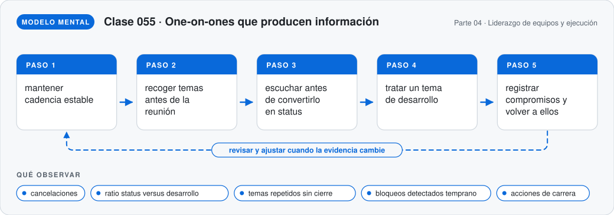

# Clase 055 — One-on-ones que producen información

<!-- nav:inicio -->
> **Parte 04 · Liderazgo de equipos** — clase 7 de 12 · [índice de la parte](../../README.md) · [temario](../../../../SYLLABUS.md)
<!-- nav:fin -->

**Parte:** 04 — Liderazgo de equipos  
**Nivel:** Etapa 2 — Líder → Jefe / Team Lead  
**Duración sugerida:** 150–180 minutos · **Estándar:** deep-class-v2

## 🎯 Propósito

Un jefe que solo conversa con su equipo cuando hay un problema recibe la información tarde y mal: cuando ya es un incidente, cuando la persona ya decidió irse, cuando el conflicto ya estalló. La reunión **uno a uno** regular existe para lo contrario: crear un canal estable donde la información llegue pronto, donde el desarrollo se trate sin urgencia y donde el vínculo entre jefe y colaborador se construya con el tiempo.

Esta clase se apoya en el argumento de Andrew Grove de que la reunión uno a uno es el instrumento principal de transferencia de conocimiento y de corrección entre jefe y colaborador, y en las ideas de Kim Scott sobre las conversaciones de cuidado y desafío. Al terminar sabrás estructurar una reunión uno a uno que produzca información útil, evitando que se convierta en un informe de estado.

## 📚 Resultados de aprendizaje

Al finalizar podrás:

1. **Explicar** el propósito de la reunión uno a uno y qué la distingue de un informe de estado.
2. **Estructurar** una reunión con tres bloques: agenda de la persona, desempeño y desarrollo, y compromisos.
3. **Formular** preguntas que obtengan información que el colaborador no ofrecería de otro modo.
4. **Mantener** la regularidad y la confidencialidad que la sostienen.
5. **Detectar** señales tempranas de desmotivación, conflicto o sobrecarga.

## 🧭 Agenda

| Tramo | Qué se hace |
|---|---|
| 0–20 min | Recuperación: ¿con qué frecuencia conversas con cada persona de tu equipo sobre algo que no sea una tarea? |
| 20–60 min | Propósito, estructura y preguntas. |
| 60–105 min | Ejemplo trabajado: un uno a uno de treinta minutos. |
| 105–140 min | Caso ejecutivo: un jefe que cancela los uno a uno. |
| 140–170 min | Límites y entregable. |

## 🧩 Conceptos centrales

| Concepto | Definición | Cómo se reconoce |
|---|---|---|
| **Reunión uno a uno** | Conversación regular, a solas, entre un jefe y un colaborador (Grove, 1983). | Está en el calendario y no se cancela por urgencia. |
| **Reunión del colaborador** | Principio según el cual la agenda y el uso del tiempo pertenecen principalmente a quien no es el jefe (Grove, 1983). | El colaborador lleva los temas. |
| **Transferencia de conocimiento** | Intercambio de información, contexto y criterio entre jefe y colaborador. | Ambos salen sabiendo algo nuevo. |
| **Señal temprana** | Indicio débil de un problema que aún no es visible. | Un comentario de cansancio o de falta de claridad. |
| **Confidencialidad** | Compromiso de no usar lo conversado fuera del acuerdo. | Se dice qué se comparte y qué no. |
| **Compromiso mutuo** | Acuerdos que obligan a ambos, jefe y colaborador. | El jefe también se compromete. |

## 🧠 Modelo mental

**Cómo leer el diagrama.** Tres bloques con un orden deliberado: **primero**, lo que trae la persona; **después**, lo que el jefe necesita tratar sobre desempeño y desarrollo; **al final**, los compromisos. Esta secuencia protege lo más importante: la información del colaborador no queda desplazada por la agenda del jefe.

## 📖 Desarrollo

### 1. Para qué sirve

Grove sostiene que la reunión uno a uno es el **principal vehículo** para que el jefe sepa lo que ocurre, y para que transfiera su contexto y criterio. Sus beneficios: detectar problemas antes, ajustar prioridades, desarrollar a la persona y construir la relación que permite decir cosas difíciles. No es una reunión de estado: el estado se informa por escrito o en otras reuniones. Si se usa para repasar tareas, desperdicia su valor.

### 2. Una reunión del colaborador

Grove propone que la reunión **pertenece al colaborador**: él elige los temas y el jefe escucha, pregunta y ayuda. Esto invierte la dinámica habitual en que el jefe usa el tiempo para sus propios asuntos. El jefe puede agregar sus temas, pero en segundo lugar. Si el colaborador no trae temas, es información: puede no tener confianza o no saber para qué sirve.

### 3. La estructura

Una estructura que funciona, adaptada a una reunión de treinta a sesenta minutos: **1)** *Su agenda*: obstáculos, decisiones que necesita, dudas, preocupaciones. **2)** *Desempeño y desarrollo*: feedback concreto, lo que quiere aprender, cómo se siente con la carga, cómo avanza en su plan de desarrollo. **3)** *Compromisos*: qué hará cada uno hasta la próxima vez, incluido el jefe. Se registra en un documento compartido.

### 4. Preguntas que producen información

Las preguntas generales («¿cómo va todo?») producen respuestas corteses. Funcionan mejor las concretas: «¿qué te está costando más esta semana?», «¿qué decisión te gustaría que yo tomara y no estoy tomando?», «¿qué estás haciendo que crees que no sirve?», «¿qué te gustaría aprender este trimestre?», «¿cómo te estoy ayudando u obstaculizando?». La última es la más reveladora y la que más cuesta preguntar, y exige no defenderse al responderla.

### 5. Cuidado y desafío

Las reuniones regulares crean la base para lo que Scott llama franqueza radical (clase 039): cuando hay una relación, es más fácil decir algo difícil sin que se perciba como ataque. Aprovecha el uno a uno para dar feedback oportuno (clase 030) y para reconocer lo logrado. Un uno a uno sin feedback es una conversación agradable; uno con solo feedback correctivo se vuelve temido.

### 6. Regularidad y confidencialidad

La **regularidad** importa más que la duración: una reunión semanal o quincenal, siempre en el mismo horario, enseña que la persona es prioridad. Cancelarla por «urgencias» transmite lo contrario; si es inevitable, se reprograma. La **confidencialidad** es la otra condición: se acuerda qué se comparte y qué no. Usar lo dicho en un uno a uno contra la persona destruye la práctica.

### 7. Qué buscar y qué hacer

Con el tiempo, el jefe aprende a ver patrones: temas que se repiten, cambios de ánimo, caída en la energía, conflictos con un par, falta de claridad sobre prioridades. Esas señales tempranas permiten actuar: ajustar la carga, aclarar un rol, mediar un conflicto, ofrecer desarrollo. Y se cierra el circuito: lo que se dijo que se haría, se hace, y se informa. Si no hay respuesta a lo que la persona plantea, el canal se seca.

## 📚 Lectura comparada

| Obra | Qué aporta | Qué no resuelve | Pregunta para contrastar |
|---|---|---|---|
| Grove (1983) | El propósito y la lógica de la reunión uno a uno. | Escrita en otro contexto. | ¿De quién es la agenda en tu uno a uno? |
| Scott (2017) | Cuidado personal y desafío directo. | Es un marco práctico. | ¿Qué feedback evitas en tus uno a uno? |
| Bungay Stanier (2016) | Preguntas breves. | Es divulgación. | ¿Qué pregunta incómoda no haces? |
| Edmondson (2018) | Seguridad psicológica como condición. | No describe la reunión. | ¿Puede decirte la persona algo que no quieres oír? |
| Stone y Heen (2014) | Recibir feedback del colaborador. | No trata de la estructura. | ¿Cómo reaccionas a lo que te dicen de ti? |

## 🧮 Ejemplo trabajado

**Situación (hipotética).** Una jefa, Lorena, tiene un uno a uno quincenal de cuarenta minutos con Pablo, analista con seis meses en el equipo. Ha notado que últimamente entrega más tarde.

| Bloque | Lo que ocurre |
|---|---|
| **Su agenda (15 min)** | Lorena pregunta: «¿Qué te está costando más estos días?». Pablo dice que las prioridades cambian dos veces por semana y no sabe qué es urgente. |
| **Desempeño y desarrollo (15 min)** | Lorena da un feedback concreto: «Los dos últimos informes llegaron con un día de atraso, y eso retrasó al área comercial». Pregunta cómo se siente con la carga. Pablo dice que le gustaría aprender a presentar. Ella pregunta: «¿Cómo te estoy ayudando u obstaculizando?». Pablo menciona que los cambios de prioridad llegan por tres canales distintos. |
| **Compromisos (10 min)** | Lorena: definir un único canal para prioridades y compartir cada lunes la lista. Pablo: avisar el mismo día cuando vea un riesgo de atraso. Lorena: buscarle una oportunidad para presentar un informe el próximo mes. |

**Qué obtuvo Lorena.** Información que no tenía: el atraso nacía de cambios de prioridad por varios canales, un problema suyo y de otros jefes. Una intervención de feedback sobre «entregar a tiempo» habría errado.

**Qué muestra.** (1) Empezar por la agenda de Pablo reveló la causa. (2) La pregunta sobre cómo ayuda u obstaculiza fue la más informativa. (3) Los compromisos incluyen al jefe.

## 🔀 Comparación y límites

**Uno a uno frente a evaluación de desempeño.** La evaluación es periódica, formal y evalúa; el uno a uno es frecuente, informal y conversa. Mezclarlos lo hace temido.

**Límites.** Las recomendaciones de Grove provienen de su experiencia en gestión y no de estudios sistemáticos; la frecuencia ideal depende del rol y de la madurez de la persona. En equipos grandes, un uno a uno con todos puede no ser viable y exige estructuras como jefes de equipo. Y la reunión no reemplaza la conversación sobre temas serios (acoso, desempeño crítico), que siguen protocolos propios.

## 🪜 De profesional a owner

| Nivel | Cómo usa el uno a uno |
|---|---|
| **Profesional** | Lleva temas a su jefe y pide feedback. |
| **Jefe / Team Lead** | Tiene uno a uno regulares y aprende de ellos. |
| **Gerente** | Exige uno a uno a sus jefes y los usa para ver su sistema. |
| **CEO / Director** | Mantiene uno a uno con su equipo directivo y con personas clave más abajo. |
| **Founder / Owner** | Sostiene la regularidad aunque el negocio lo absorba. |

## 🏢 Caso ejecutivo

Un gerente de ventas tiene doce personas a cargo y cancela los uno a uno «porque siempre hay algo urgente». Los vendedores saben que no se reúne con ellos desde hace dos meses; tres de ellos recibieron ofertas de otras empresas. La rotación subió. Él dice que «los resultados están bien» y que «si hay algo, me avisan». Hoy lo llama la directora para preguntar por la salida de un vendedor clave que él no sabía que estaba insatisfecho.

Entrega un **plan de uno a uno** que contenga: (a) la frecuencia, duración y formato; (b) la estructura de tres bloques y las preguntas; (c) cómo darás feedback en esa reunión; (d) cómo registrarás y cumplirás los compromisos; (e) cómo cuidarás la confidencialidad; (f) cómo harás viable la práctica con doce personas.

## 🧪 Práctica

1. Agenda un uno a uno regular con cada persona de tu equipo para el próximo mes.
2. Prepara cinco preguntas concretas y descarta tres genéricas.
3. Pregunta a una persona «¿cómo te estoy ayudando u obstaculizando?» y resume sin defenderte.
4. Registra los compromisos de ambos y verifica su cumplimiento.
5. Identifica una señal temprana que hayas ignorado y qué habría cambiado.

## ⚠️ Errores frecuentes

| Error | Por qué ocurre | Cómo corregirlo |
|---|---|---|
| Convertirlo en informe de estado | Es más cómodo | Dejar el estado por escrito. |
| Cancelarlo | Urgencias | Reprogramarlo y protegerlo. |
| Que hable solo el jefe | Se usa para sus asuntos | Empezar por la agenda de la persona. |
| Sin compromisos | Se queda en la charla | Cerrar con acciones de ambos. |
| Usar lo dicho en contra | Se rompe la confianza | Acordar confidencialidad y respetarla. |
| No responder a lo planteado | Se olvida | Registrar y cerrar el circuito. |

## ❓ Preguntas de comprobación

1. ¿Qué dice Grove sobre el propósito de la reunión uno a uno?
2. ¿Por qué la reunión es «del colaborador»?
3. ¿Cuáles son los tres bloques de la estructura propuesta?
4. Nombra tres preguntas que producen más información que «¿cómo va todo?».
5. ¿Por qué importa más la regularidad que la duración?
6. ¿Qué haces con las señales tempranas?
7. ¿Qué límite tienen las recomendaciones de Grove?

Claves de respuesta

1. Que es el principal vehículo de transferencia de conocimiento y corrección entre jefe y colaborador, y de detección temprana de problemas.
2. Porque el colaborador elige los temas y el jefe escucha y ayuda; invierte la dinámica en que el jefe usa el tiempo para lo suyo.
3. Su agenda, desempeño y desarrollo, y compromisos.
4. Por ejemplo: «¿Qué te está costando más esta semana?», «¿Cómo te estoy ayudando u obstaculizando?», «¿Qué te gustaría aprender este trimestre?».
5. Porque una reunión regular enseña que la persona es prioridad; cancelarla transmite lo contrario.
6. Actuar: ajustar la carga, aclarar roles, mediar, ofrecer desarrollo, y cerrar el circuito.
7. Provienen de la experiencia en gestión y no de estudios sistemáticos; la frecuencia ideal depende del rol y de la persona.

## 📥 Entregable

Guarda en `portfolio/055-one-on-ones-que-producen-informacion/`:

- `one-on-one.md` (plantilla [One-on-one](../../../../templates/one-on-one.md)) con la estructura y un registro del caso;
- `leadership-decision-brief.md` (plantilla [Leadership Decision Brief](../../../../templates/leadership-decision-brief.md)) con el plan del caso ejecutivo;
- `decision-journal.md` con las señales tempranas y los compromisos.

## 📗 Fuentes y verificación

- Andrew S. Grove — *High Output Management* (Random House, 1983). **Uso en esta clase:** propósito y lógica de la reunión uno a uno. Lectura selectiva sobre **one-on-ones que producen información**. **Localizador:** [ISBN-13 9780394532349](https://openlibrary.org/isbn/9780394532349).
- Kim Scott — *Radical Candor* (PAN MACMILLAN U.K, 2017). **Uso en esta clase:** cuidado personal y desafío directo en la relación. Lectura selectiva sobre **one-on-ones que producen información**. **Localizador:** [ISBN-13 9781509845385](https://openlibrary.org/isbn/9781509845385).
- Michael Bungay Stanier — *The Coaching Habit* (Page Two/Portfolio/Canongate Books/Simon & Schuster UK, 2016). **Uso en esta clase:** preguntas breves que producen información. Lectura selectiva sobre **one-on-ones que producen información**. **Localizador:** [ISBN-13 9780978440749](https://openlibrary.org/isbn/9780978440749).
- Amy C. Edmondson — *The Fearless Organization* (Wiley, 2018). **Uso en esta clase:** seguridad psicológica como condición de la conversación. Lectura selectiva sobre **one-on-ones que producen información**. **Localizador:** [ISBN-13 9781119477242](https://openlibrary.org/isbn/9781119477242).
- Douglas Stone & Sheila Heen — *Thanks for the Feedback* (Viking, 2014). **Uso en esta clase:** recibir feedback del colaborador. Lectura selectiva sobre **one-on-ones que producen información**. **Localizador:** [ISBN-13 9780670014668](https://openlibrary.org/isbn/9780670014668).

> **Regla de fuentes para One-on-ones que producen información:** las obras anteriores estructuran las perspectivas de esta materia; cualquier norma, ley o estándar vivo mencionado debe comprobarse nuevamente en su fuente primaria vigente. Los ejemplos y casos son hipotéticos. El desarrollo es original y no reproduce capítulos protegidos.

<!-- pie:inicio -->
---

| Anterior | Índice | Siguiente |
|---|---|---|
| [← 054 · Coaching y desarrollo cotidiano](../054-coaching-y-desarrollo-cotidiano/README.md) | [Parte 04](../../README.md) · [Programa](../../../../SYLLABUS.md) | [056 · Reuniones que deciden →](../056-reuniones-que-deciden/README.md) |
<!-- pie:fin -->
