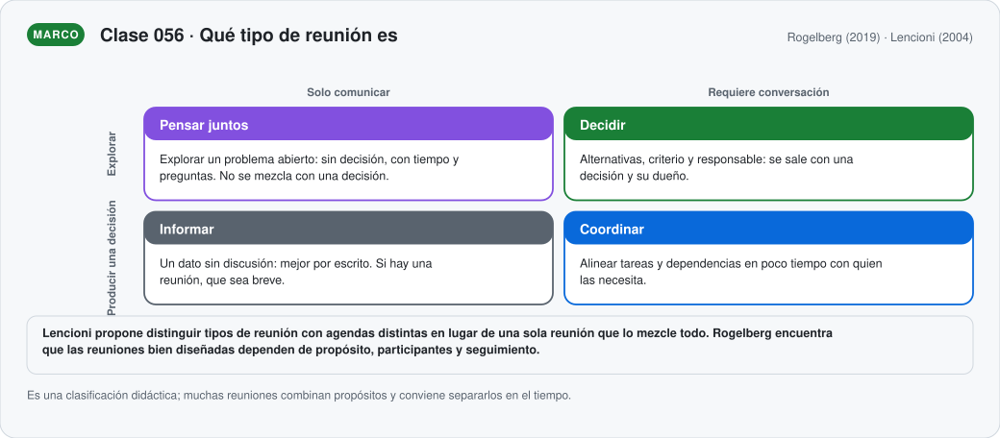

# Clase 056 — Reuniones que deciden

<!-- nav:inicio -->
> **Parte 04 · Liderazgo de equipos** — clase 8 de 12 · [índice de la parte](../../README.md) · [temario](../../../../SYLLABUS.md)
<!-- nav:fin -->

**Parte:** 04 — Liderazgo de equipos  
**Nivel:** Etapa 2 — Líder → Jefe / Team Lead  
**Duración sugerida:** 150–180 minutos · **Estándar:** deep-class-v2

## 🎯 Propósito

Las reuniones son el lugar donde un equipo gasta buena parte de su tiempo y el que más se critica: se dice que son demasiado largas, demasiado numerosas y que no terminan en nada. La crítica suele ser cierta y la causa, casi siempre, la misma: **se convoca a una reunión sin saber qué debe producir**. Una reunión es una herramienta; antes de usarla hay que preguntarse si es la herramienta adecuada y, si lo es, para qué tipo de trabajo.

Esta clase usa el análisis de Steven Rogelberg sobre la ciencia de las reuniones y la propuesta de Patrick Lencioni de distinguir tipos de reunión con agendas distintas. Al terminar sabrás decidir cuándo una reunión es necesaria, qué tipo de reunión convocar, cómo conducirla para que termine con una decisión y cómo hacer seguimiento.

## 📚 Resultados de aprendizaje

Al finalizar podrás:

1. **Decidir** si una reunión es necesaria o si existe un medio mejor.
2. **Clasificar** una reunión como informativa, de coordinación, de decisión o de exploración.
3. **Diseñar** una reunión de decisión: propósito, participantes, agenda, criterios y responsable.
4. **Conducirla** de modo que termine con una decisión registrada.
5. **Medir** y mejorar las reuniones de un equipo.

## 🧭 Agenda

| Tramo | Qué se hace |
|---|---|
| 0–20 min | Recuperación: toma tu agenda de la semana pasada y clasifica cada reunión según su tipo y si produjo algo. |
| 20–60 min | Tipos de reunión y principios de diseño. |
| 60–105 min | Ejemplo trabajado: rediseñar una reunión semanal de equipo. |
| 105–140 min | Caso ejecutivo: un comité que se reúne sin decidir. |
| 140–170 min | Límites y entregable. |

## 🧩 Conceptos centrales

| Concepto | Definición | Cómo se reconoce |
|---|---|---|
| **Reunión de decisión** | Reunión cuyo propósito es llegar a una decisión con responsable (criterio de la clase). | Termina con una decisión escrita. |
| **Reunión de coordinación** | Reunión breve para alinear tareas y dependencias. | Participan quienes dependen unos de otros. |
| **Reunión informativa** | Reunión para comunicar sin necesidad de discusión. | Casi siempre puede reemplazarse por un mensaje. |
| **Reunión de exploración** | Reunión para pensar juntos un problema abierto, sin decidir. | Se declara que no habrá decisión. |
| **Propósito de la reunión** | Resultado que debe producir (Rogelberg, 2019). | Se puede formular en una frase. |
| **Seguimiento** | Registro de decisiones y acciones con responsable y plazo. | Las acciones se revisan en la reunión siguiente. |

## 🧠 Modelo mental

**Cómo leer el diagrama.** Dos preguntas ordenan el diseño: ¿debe producir una decisión? y ¿requiere conversación? Una reunión que solo comunica puede ser un mensaje. Una que debe decidir necesita alternativas, criterio y responsable. Una que explora no decide. Mezclar los propósitos en una misma sesión es la causa frecuente de reuniones largas y sin resultado.

## 📖 Desarrollo

### 1. ¿Hace falta una reunión?

Antes de convocar, pregunta si existe un medio mejor. Para **informar**, suele bastar un mensaje o documento. Para **consultar a una persona**, una conversación breve. Para **coordinar a dos**, una llamada. La reunión se justifica cuando se necesita la **interacción simultánea** de varias personas: discutir alternativas, resolver desacuerdos, construir algo juntos o alinear a un grupo. Convocar por inercia o por no saber qué hacer es una de las causas principales de reuniones inútiles.

### 2. Cuatro tipos

Una clasificación didáctica, cercana a la de Lencioni, que propone tipos de reunión con agendas diferenciadas. La **informativa** comunica datos. La de **coordinación** alinea tareas, de forma breve y con quienes dependen entre sí. La de **decisión** examina alternativas y termina con una decisión y un responsable. La de **exploración** piensa un problema abierto, sin decidir. Cada una pide una duración, una preparación y unos participantes distintos. Combinar propósitos en una sola reunión hace que ninguno se cumpla bien.

### 3. Diseñar una reunión de decisión

Rogelberg resume lo que el análisis de la investigación sugiere: las reuniones eficaces tienen **propósito claro**, **participantes adecuados**, **preparación** y **seguimiento**. Para una reunión de decisión: **1)** formula la decisión como pregunta; **2)** nombra quién decide; **3)** distribuye antes el material (alternativas, criterios, datos); **4)** invita solo a quienes aportan información o ejecutarán; **5)** define el tiempo; **6)** prepara cómo se registrará.

### 4. Conducirla

Un buen conductor hace cuatro cosas: **abre** con el propósito y la decisión esperada; **facilita** para que hablen todos, incluidos quienes callan, y que el debate sea sobre la tarea (clase 032); **controla el tiempo** y ordena los temas; y **cierra** con la decisión, el responsable de cada acción y el plazo. Si no se llega a una decisión, se dice qué falta y quién lo trae. Las decisiones se registran en el momento, no después.

### 5. Participación

Rogelberg encuentra que las reuniones mejoran cuando se invita a menos personas y se incluye a quienes realmente aportan. Para quienes no son necesarios, un resumen basta. Se favorece la participación de todos con prácticas como pedir primero ideas por escrito o una ronda breve en que cada uno habla. Cuidado con la dominancia de los más jerárquicos: el líder puede hablar al final para no sesgar la discusión.

### 6. Seguimiento

La reunión no termina al salir de la sala. El registro de decisiones y acciones, con responsable y plazo, se distribuye el mismo día y se revisa al inicio de la siguiente. Si las acciones no se cumplen y no pasa nada, el equipo aprende que las reuniones son un trámite. Una regla útil: toda reunión comienza revisando lo acordado en la anterior.

### 7. Medir y mejorar

Una vez por trimestre, el equipo revisa sus reuniones: ¿cuáles producen decisiones?, ¿cuáles podrían ser un mensaje?, ¿cuántas horas semanales consumen?, ¿se cumplen las acciones? Un indicador sencillo es el **porcentaje de reuniones con una decisión o acción registrada**. Eliminar o acortar reuniones libera tiempo para el trabajo y es una forma de cuidado del equipo.

## 📚 Lectura comparada

| Obra | Qué aporta | Qué no resuelve | Pregunta para contrastar |
|---|---|---|---|
| Rogelberg (2019) | Resultados de investigación sobre diseño y conducción de reuniones. | No ofrece un formato único. | ¿Cuál de tus reuniones no necesita existir? |
| Lencioni (2004) | Tipos de reunión con agendas diferenciadas. | Es una fábula de gestión. | ¿Cuál de tus reuniones mezcla propósitos? |
| Grove (1983) | La reunión como instrumento de gestión. | Escrita en otro contexto. | ¿Qué tipo de reunión es la tuya? |
| Edmondson (2018) | Seguridad psicológica para participar. | No trata de agendas. | ¿Quién calla en tus reuniones? |
| Katzenbach y Smith (1993) | Cómo trabaja un equipo real. | No es un manual de reuniones. | ¿Tu reunión decide o informa? |

## 🧮 Ejemplo trabajado

**Situación (hipotética).** Un equipo de producto de ocho personas tiene una reunión semanal de dos horas: se reportan avances, se discuten problemas y se toman decisiones. Todos asisten; solo tres hablan; las decisiones se aplazan.

| Antes | Después |
|---|---|
| Una reunión de dos horas semanal con todos. | Tres reuniones separadas. |
| Informes de avance en la reunión. | Informe escrito el lunes; no se lee en voz alta. |
| Decisiones sin responsable. | Reunión de decisión de 45 minutos solo con quienes participan del tema; decisión y responsable al cierre. |
| Problemas abiertos sin tiempo. | Reunión de exploración quincenal de una hora, declarada sin decisión. |
| Acciones sin registro. | Registro compartido; al inicio se revisan las acciones anteriores. |

**Resultado.** El tiempo semanal de reuniones baja de dos a una hora y cuarto; el porcentaje de reuniones con decisión registrada sube de 20 % a 80 %.

**Qué muestra.** (1) Separar los propósitos mejoró cada reunión. (2) Un mensaje reemplazó a una reunión informativa. (3) El seguimiento se instaló como regla.

## 🔀 Comparación y límites

**Reunión frente a comunicación asíncrona.** La reunión aporta interacción inmediata, pero consume tiempo de todos a la vez. La comunicación asíncrona libera tiempo, pero puede retrasar el consenso. Elige según el propósito.

**Límites.** Los resultados que Rogelberg reúne provienen de estudios con calidad desigual y de contextos variados; su aplicación depende de la cultura del equipo. La clasificación de tipos de reunión es una simplificación; hay reuniones que necesitan combinar propósitos y conviene hacerlo de forma explícita y secuenciada. Y reducir reuniones no mejora por sí solo la colaboración si no se atienden las causas de la desorganización.

## 🪜 De profesional a owner

| Nivel | Cómo trabaja las reuniones |
|---|---|
| **Profesional** | Prepara lo que se le pide y pregunta cuál es el propósito. |
| **Jefe / Team Lead** | Diseña las reuniones de su equipo según su tipo y las cierra con decisiones. |
| **Gerente** | Revisa las reuniones de su área y reduce las que no producen. |
| **CEO / Director** | Diseña el ritmo de reuniones de la empresa y cuida el tiempo de la organización. |
| **Founder / Owner** | Evita reproducir las reuniones de una gran empresa en una pequeña. |

## 🏢 Caso ejecutivo

Un comité de dirección de seis personas se reúne cada lunes durante tres horas. Se revisan cifras, se discuten temas operativos y, a veces, decisiones estratégicas. Las decisiones importantes se postergan «hasta tener más información» y se reabren la semana siguiente. Dos directores han empezado a mandar suplentes. El gerente general sospecha que «se pierde tiempo», pero no sabe cómo rediseñarlo.

Entrega un **rediseño del ritmo de reuniones** que contenga: (a) una clasificación de los temas del comité por tipo; (b) los formatos nuevos con propósito, participantes y duración; (c) cómo prepararás y registrarás las decisiones; (d) cómo manejarás la participación; (e) cómo revisarás el cumplimiento de las acciones; (f) los indicadores con que medirás la mejora.

## 🧪 Práctica

1. Clasifica las reuniones de tu semana y marca cuáles podrían ser un mensaje.
2. Rediseña una reunión con propósito, participantes, material previo y cierre.
3. Redacta la decisión de una reunión como una pregunta.
4. Diseña el registro de decisiones y acciones y cómo se revisa al inicio.
5. Define un indicador para medir tus reuniones durante un mes.

## ⚠️ Errores frecuentes

| Error | Por qué ocurre | Cómo corregirlo |
|---|---|---|
| Convocar por inercia | Es el hábito | Preguntar si hay un medio mejor. |
| Mezclar propósitos | Se quiere ahorrar reuniones | Separar informar, decidir y explorar. |
| Invitar a todos | Se evita excluir | Invitar a quienes aportan o ejecutan. |
| Terminar sin decisión | No hay quien cierre | Responsable y registro al final. |
| Sin seguimiento | Se olvida | Revisar acciones al inicio de la siguiente. |
| Informes leídos en voz alta | Es lo habitual | Enviar por escrito antes. |

## ❓ Preguntas de comprobación

1. ¿Cuándo se justifica una reunión frente a un mensaje?
2. ¿Cuáles son los cuatro tipos de reunión de la clase?
3. ¿Qué debe tener el diseño de una reunión de decisión?
4. ¿Cómo debe cerrarse una reunión?
5. ¿Por qué conviene invitar a menos personas?
6. ¿Qué indicador permite medir las reuniones?
7. ¿Qué límite tiene la evidencia sobre reuniones?

Claves de respuesta

1. Cuando se necesita la interacción simultánea de varias personas: discutir alternativas, resolver desacuerdos o construir algo juntos.
2. Informativa, de coordinación, de decisión y de exploración.
3. Decisión formulada como pregunta, quién decide, material previo, participantes necesarios, tiempo y registro.
4. Con la decisión, el responsable de cada acción y el plazo, registrados.
5. Porque las reuniones mejoran con participantes que aportan, y quienes no son necesarios pueden recibir un resumen.
6. El porcentaje de reuniones con una decisión o acción registrada, entre otros.
7. Los estudios tienen calidad desigual y dependen de la cultura del equipo.

## 📥 Entregable

Guarda en `portfolio/056-reuniones-que-deciden/`:

- `leadership-decision-brief.md` (plantilla [Leadership Decision Brief](../../../../templates/leadership-decision-brief.md)) con el rediseño del caso ejecutivo;
- `reading-note.md` con una tensión entre Rogelberg y Lencioni;
- `decision-journal.md` con la clasificación de tus reuniones y los cambios.

## 📗 Fuentes y verificación

- Steven G. Rogelberg — *The Surprising Science of Meetings* (Oxford University Press, 2019). **Uso en esta clase:** resultados de investigación sobre diseño y conducción de reuniones. Lectura selectiva sobre **reuniones que deciden**. **Localizador:** [ISBN-13 9780190689216](https://openlibrary.org/isbn/9780190689216).
- Patrick Lencioni — *Death by Meeting* (Audio Renaissance, 2004). **Uso en esta clase:** tipos de reunión con agendas diferenciadas. Lectura selectiva sobre **reuniones que deciden**. **Localizador:** [ISBN-13 9781593974411](https://openlibrary.org/isbn/9781593974411).
- Andrew S. Grove — *High Output Management* (Random House, 1983). **Uso en esta clase:** la reunión como instrumento de gestión. Lectura selectiva sobre **reuniones que deciden**. **Localizador:** [ISBN-13 9780394532349](https://openlibrary.org/isbn/9780394532349).
- Amy C. Edmondson — *The Fearless Organization* (Wiley, 2018). **Uso en esta clase:** seguridad psicológica para participar. Lectura selectiva sobre **reuniones que deciden**. **Localizador:** [ISBN-13 9781119477242](https://openlibrary.org/isbn/9781119477242).
- Jon R. Katzenbach & Douglas K. Smith — *The Wisdom of Teams* (McGraw-Hill, 2005). **Uso en esta clase:** cómo trabaja un equipo real. Lectura selectiva sobre **reuniones que deciden**. **Localizador:** [ISBN-13 9780077111687](https://openlibrary.org/isbn/9780077111687).

> **Regla de fuentes para Reuniones que deciden:** las obras anteriores estructuran las perspectivas de esta materia; cualquier norma, ley o estándar vivo mencionado debe comprobarse nuevamente en su fuente primaria vigente. Los ejemplos y casos son hipotéticos, con cifras ilustrativas. El desarrollo es original y no reproduce capítulos protegidos.

<!-- pie:inicio -->
---

| Anterior | Índice | Siguiente |
|---|---|---|
| [← 055 · One-on-ones que producen información](../055-one-on-ones-que-producen-informacion/README.md) | [Parte 04](../../README.md) · [Programa](../../../../SYLLABUS.md) | [057 · Motivación y reconocimiento →](../057-motivacion-y-reconocimiento/README.md) |
<!-- pie:fin -->
