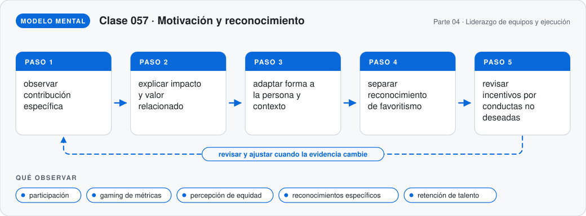

# Clase 057 — Motivación y reconocimiento

<!-- nav:inicio -->
> **Parte 04 · Liderazgo de equipos** — clase 9 de 12 · [índice de la parte](../../README.md) · [temario](../../../../SYLLABUS.md)
<!-- nav:fin -->

**Parte:** 04 — Liderazgo de equipos  
**Nivel:** Etapa 2 — Líder → Jefe / Team Lead  
**Duración sugerida:** 150–180 minutos · **Estándar:** deep-class-v2

## 🎯 Propósito

En la parte 03 vimos que la motivación depende de tres necesidades: autonomía, competencia y vínculo. Esta clase lo lleva al trabajo cotidiano de un jefe de equipo, donde la herramienta más usada y peor aprovechada es el **reconocimiento**: decir a alguien que lo que hizo importó. Bien hecho, informa sobre la competencia y fortalece el vínculo; mal hecho, es una frase vacía, una comparación injusta o un instrumento de control que desplaza la motivación propia.

Se apoya en la teoría de la autodeterminación de Ryan y Deci y en el principio de progreso de Amabile y Kramer. Al terminar sabrás reconocer de manera específica y oportuna, adaptar el reconocimiento a la persona y diseñar prácticas de equipo que hagan visible el progreso sin convertir el reconocimiento en un incentivo que controle.

## 📚 Resultados de aprendizaje

Al finalizar podrás:

1. **Explicar** por qué el reconocimiento puede sostener o dañar la motivación según cómo se perciba.
2. **Formular** un reconocimiento específico, oportuno y vinculado a un efecto.
3. **Adaptar** el reconocimiento a las preferencias de la persona sin suponerlas.
4. **Diseñar** rituales de equipo que hagan visible el progreso y la colaboración.
5. **Evitar** reconocimientos que generen competencia dañina o sensación de control.

## 🧭 Agenda

| Tramo | Qué se hace |
|---|---|
| 0–20 min | Recuperación: recuerda el último reconocimiento que te importó y por qué. |
| 20–60 min | Reconocimiento que informa frente al que controla; el principio de progreso. |
| 60–105 min | Ejemplo trabajado: reemplazar un ranking por un ritual de progreso. |
| 105–140 min | Caso ejecutivo: un programa de «empleado del mes». |
| 140–170 min | Límites y entregable. |

## 🧩 Conceptos centrales

| Concepto | Definición | Cómo se reconoce |
|---|---|---|
| **Reconocimiento informativo** | Mensaje que informa sobre la competencia o contribución de alguien y su efecto (Ryan y Deci, 2000). | Dice qué hizo y qué logró. |
| **Reconocimiento controlador** | Mensaje que usa la recompensa para regular la conducta (Ryan y Deci, 2000). | «Si haces esto, recibes aquello.» |
| **Principio de progreso** | De los eventos que alimentan una buena vida laboral, el más potente es avanzar en un trabajo con sentido (Amabile y Kramer, 2011). | Los pequeños avances se notan. |
| **Soporte del vínculo** | Acciones que muestran que la persona importa y pertenece. | Se la nombra, se la consulta, se la incluye. |
| **Reconocimiento específico** | Dice concretamente qué se hizo bien y su efecto. | Se podría repetir. |
| **Desplazamiento de la motivación** | Efecto por el cual un incentivo externo reduce el interés intrínseco. | Se hace solo lo premiado. |

## 🧠 Modelo mental

**Cómo leer el diagrama.** Dos listas enfrentadas. A la izquierda, tres rasgos del reconocimiento que sostiene la motivación: específico, oportuno y ajustado a la persona. A la derecha, tres que la dañan: genérico, controlador y comparativo. El criterio práctico es qué **efecto** tiene en quien lo recibe: ¿le informa de su competencia y lo conecta con otros, o lo siente como control?

## 📖 Desarrollo

### 1. Qué dice la teoría

Ryan y Deci distinguen dos aspectos de un evento externo, como una recompensa o un elogio: su aspecto **informativo** —comunica competencia y progreso— y su aspecto **controlador** —presiona hacia una conducta—. El mismo gesto puede tener ambos. Cuando predomina lo informativo, tiende a sostener la motivación; cuando predomina lo controlador, tiende a desplazarla. De ahí la importancia de cómo se enuncia y se entrega el reconocimiento.

### 2. Específico, oportuno y vinculado a un efecto

Un reconocimiento útil dice **qué** se hizo, **cuál fue su efecto** y, si corresponde, **qué habilidad** reveló: «el análisis de costos que armaste cambió la decisión del comité; mostraste que el proveedor B sale 8 % más caro en tres años». Compárese con «buen trabajo». Lo específico informa y es creíble. Lo **oportuno** —cerca del hecho— conecta el elogio con la conducta. Y lo vinculado a un efecto muestra que el trabajo importó.

### 3. El principio de progreso

Amabile y Kramer analizaron diarios de trabajo y concluyeron que la sensación de **avanzar en un trabajo que importa** era el factor más ligado a un buen día. Esto sugiere reconocer el progreso, incluso pequeño, y no solo los grandes logros. Eliminar obstáculos, dar recursos, acordar metas claras y hacer visible el avance son formas de reconocimiento indirecto. Su inverso, el retroceso percibido, pesa más: un día de bloqueos puede borrar el efecto de un elogio.

### 4. Cada persona es distinta

A algunos les importa el reconocimiento público; a otros, una conversación privada; a otros, una oportunidad de desarrollo o más autonomía. No es seguro adivinar: **pregunta**. «¿Cómo te gusta que se reconozca tu trabajo?» es una pregunta que casi nadie hace y que ahorra errores. Cuidado con el reconocimiento público a quienes lo incomoda y con ignorar contribuciones menos visibles, como el apoyo a otros o el trabajo de mantenimiento.

### 5. Reconocimiento que daña

Se daña con el elogio **genérico** (no informa), el **controlador** («si cumples, recibes»), el **comparativo** que enfrenta a las personas y erosiona la colaboración (rankings individuales), el **tardío** (sin conexión con el hecho) y el **inconsistente** (se reconoce a unos y se omite a otros por razones de afinidad). Y el reconocimiento que viene acompañado de una carga excesiva se vive como una manipulación.

### 6. Rituales de equipo

Algunas prácticas simples: **cierre de semana** con tres avances del equipo; **agradecimientos entre pares**, y no solo del jefe; **historias de impacto** (cómo el trabajo benefició a un cliente); y **reconocimiento de aprendizaje** (quien reconoció un error a tiempo o compartió lo aprendido). Reconocer la colaboración, y no solo el resultado individual, favorece el vínculo.

### 7. Reconocimiento formal y recompensas

Los programas de «empleado del mes», los bonos y los premios son formas de reconocimiento formal. Pueden funcionar si los criterios son claros y se perciben como justos, y si incluyen el aporte colectivo. Fallan cuando son arbitrarios, repetidos entre los mismos, o cuando convierten el trabajo en un medio para ganar. Pink advierte que, en tareas que requieren creatividad, las recompensas contingentes pueden ser contraproducentes; en tareas rutinarias, funcionan.

## 📚 Lectura comparada

| Obra | Qué aporta | Qué no resuelve | Pregunta para contrastar |
|---|---|---|---|
| Ryan y Deci (2000) | Aspectos informativo y controlador de los eventos externos. | Es una teoría general. | ¿Tu reconocimiento informa o controla? |
| Amabile y Kramer (2011) | El principio de progreso. | Se basa en diarios de equipos concretos. | ¿Qué progreso hiciste visible esta semana? |
| Pink (2009) | Autonomía, maestría y propósito; límites de los incentivos. | Divulgación. | ¿Qué recompensa podría estar desplazando motivación? |
| Goleman, Boyatzis y McKee (2002) | El efecto emocional del líder. | No trata de reconocimiento formal. | ¿Qué estado transmite tu reconocimiento? |
| Scott (2017) | Cuidado personal en el reconocimiento. | Es un marco práctico. | ¿Conoces qué valora cada persona? |

## 🧮 Ejemplo trabajado

**Situación (hipotética).** Un jefe de soporte, Esteban, tiene un ranking semanal de tickets cerrados por persona, visible para todos, con un bono trimestral al primero. Observa que los tickets complejos se evitan y que dos personas dejaron de ayudar a otras.

| Elemento | Problema | Cambio |
|---|---|---|
| Ranking individual público | Competencia dañina; se evitan los tickets difíciles. | Se elimina; se muestra el avance del equipo hacia la meta de satisfacción. |
| Bono al primero | Premio controlador; desplaza la colaboración. | Se sustituye por un bono de equipo ligado a la satisfacción y a reducir tickets repetidos. |
| Reconocimiento genérico | «Buen trabajo, equipo.» | Reconocimiento específico: «Ana resolvió el caso del cliente de logística en una hora y evitó que se repitiera con una guía». |
| Nada para el apoyo a otros | Se ignora el trabajo invisible. | Ritual semanal de agradecimientos entre pares. |

**Cómo lo comunica.** Esteban explica los cambios, escucha objeciones y pregunta a cada persona cómo prefiere ser reconocida. Dos prefieren un mensaje privado; una, el reconocimiento público.

**Resultado.** En dos meses se cierran más tickets complejos, aumenta la colaboración y baja la rotación.

**Qué muestra.** (1) El diseño del reconocimiento afecta la conducta. (2) Lo informativo y lo específico reemplazan lo controlador. (3) Se preguntó a cada persona.

## 🔀 Comparación y límites

**Reconocimiento frente a remuneración.** El salario es una condición: debe ser justo y no usarse como motivador cotidiano. El reconocimiento comunica valor y progreso. No se sustituyen.

**Límites.** La teoría de Ryan y Deci tiene amplio respaldo, pero los efectos varían según el tipo de recompensa, la tarea y la cultura. Los diarios de Amabile y Kramer provienen de equipos de conocimiento concretos. Las recomendaciones de Pink simplifican hallazgos complejos. Y el reconocimiento no compensa condiciones de trabajo injustas: elogiar a alguien sobrecargado sin cambiar su carga se percibe como cinismo.

## 🪜 De profesional a owner

| Nivel | Cómo usa el reconocimiento |
|---|---|
| **Profesional** | Reconoce a sus pares con hechos concretos. |
| **Jefe / Team Lead** | Reconoce de forma específica y oportuna y pregunta preferencias. |
| **Gerente** | Diseña sistemas de reconocimiento que no dañen la colaboración. |
| **CEO / Director** | Cuida que lo que se premia coincida con lo que se declara. |
| **Founder / Owner** | Reconoce a las primeras personas con hechos y con participación en lo que se construye. |

## 🏢 Caso ejecutivo

Una empresa implementó un programa de «empleado del mes» con foto, premio de dinero y estacionamiento preferente. Después de seis meses, los premiados han sido siempre de las áreas comerciales, tres personas de soporte dijeron que «es un premio de popularidad» y un equipo técnico dejó de compartir información por «no regalar méritos». La gerente de personas quiere mantener el programa porque «la dirección lo aprobó».

Entrega un **diagnóstico y rediseño del reconocimiento** que contenga: (a) el análisis del efecto del programa según el aspecto informativo o controlador; (b) las necesidades de autonomía, competencia y vínculo afectadas; (c) qué mantendrás, qué cambiarás y qué eliminarás; (d) los rituales de equipo que propondrás; (e) cómo preguntarás las preferencias de las personas; (f) cómo evaluarás el efecto en la colaboración.

## 🧪 Práctica

1. Escribe tres reconocimientos específicos y oportunos para personas de tu equipo.
2. Pregunta a dos personas cómo prefieren ser reconocidas.
3. Identifica un reconocimiento de tu organización que pueda ser controlador.
4. Diseña un ritual de equipo para hacer visible el progreso.
5. Escribe cómo reconocerías el trabajo menos visible de alguien.

## ⚠️ Errores frecuentes

| Error | Por qué ocurre | Cómo corregirlo |
|---|---|---|
| Elogio genérico | Es rápido | Decir qué hizo y qué efecto tuvo. |
| Ranking individual | Parece motivador | Metas de equipo y reconocimiento a la colaboración. |
| Suponer preferencias | Se generaliza | Preguntar a cada persona. |
| Premiar siempre a los mismos | Se recuerda lo visible | Revisar los criterios y reconocer lo invisible. |
| Reconocer sin cambiar condiciones | Se busca un gesto | Atender carga y recursos. |
| Tardar semanas | Se acumula | Reconocer cerca del hecho. |

## ❓ Preguntas de comprobación

1. ¿Qué diferencia hay entre el aspecto informativo y el controlador de un reconocimiento?
2. ¿Qué es un reconocimiento específico?
3. ¿Qué dice el principio de progreso?
4. ¿Por qué hay que preguntar a cada persona cómo prefiere ser reconocida?
5. Nombra tres tipos de reconocimiento que dañan.
6. ¿Cuándo funcionan las recompensas contingentes según Pink?
7. ¿Qué límite tiene el reconocimiento?

Claves de respuesta

1. El informativo comunica competencia y progreso; el controlador presiona hacia una conducta con una recompensa.
2. El que dice qué se hizo, qué efecto tuvo y, si corresponde, qué habilidad reveló.
3. De los eventos de la vida laboral, avanzar en un trabajo con sentido es el más potente para la motivación diaria.
4. Porque las preferencias varían y no se pueden adivinar.
5. Genérico, controlador, comparativo injusto, tardío o inconsistente.
6. En tareas rutinarias y bien definidas; en tareas creativas pueden ser contraproducentes.
7. No compensa condiciones de trabajo injustas ni sobrecarga.

## 📥 Entregable

Guarda en `portfolio/057-motivacion-y-reconocimiento/`:

- `leadership-decision-brief.md` (plantilla [Leadership Decision Brief](../../../../templates/leadership-decision-brief.md)) con el rediseño del caso ejecutivo;
- `reading-note.md` con una tensión entre Ryan y Deci y Pink;
- `decision-journal.md` con los reconocimientos que diste y su efecto.

## 📗 Fuentes y verificación

- Richard M. Ryan & Edward L. Deci — *Self-Determination Theory and the Facilitation of Intrinsic Motivation, Social Development, and Well-Being* (American Psychologist, 2000). **Uso en esta clase:** aspectos informativo y controlador de los eventos externos. Lectura selectiva sobre **motivación y reconocimiento**. **Localizador:** [DOI 10.1037/0003-066X.55.1.68](https://doi.org/10.1037/0003-066X.55.1.68).
- Teresa M. Amabile & Steven J. Kramer — *The Progress Principle* (Harvard Business Review Press, 2011). **Uso en esta clase:** el principio de progreso. Lectura selectiva sobre **motivación y reconocimiento**. **Localizador:** [ISBN-13 9781422198575](https://openlibrary.org/isbn/9781422198575).
- Daniel H. Pink — *Drive* (Riverhead Books, 2009). **Uso en esta clase:** autonomía, maestría y propósito, y límites de los incentivos. Lectura selectiva sobre **motivación y reconocimiento**. **Localizador:** [ISBN-13 9781594488849](https://openlibrary.org/isbn/9781594488849).
- Daniel Goleman, Richard Boyatzis & Annie McKee — *Primal Leadership* (Harvard Business School Press, 2002). **Uso en esta clase:** el efecto emocional del líder. Lectura selectiva sobre **motivación y reconocimiento**. **Localizador:** [ISBN-13 9781578514861](https://openlibrary.org/isbn/9781578514861).
- Kim Scott — *Radical Candor* (PAN MACMILLAN U.K, 2017). **Uso en esta clase:** cuidado personal en el reconocimiento. Lectura selectiva sobre **motivación y reconocimiento**. **Localizador:** [ISBN-13 9781509845385](https://openlibrary.org/isbn/9781509845385).

> **Regla de fuentes para Motivación y reconocimiento:** las obras anteriores estructuran las perspectivas de esta materia; cualquier norma, ley o estándar vivo mencionado debe comprobarse nuevamente en su fuente primaria vigente. Los ejemplos y casos son hipotéticos. El desarrollo es original y no reproduce capítulos protegidos.

<!-- pie:inicio -->
---

| Anterior | Índice | Siguiente |
|---|---|---|
| [← 056 · Reuniones que deciden](../056-reuniones-que-deciden/README.md) | [Parte 04](../../README.md) · [Programa](../../../../SYLLABUS.md) | [058 · Accountability sin microgestión →](../058-accountability-sin-microgestion/README.md) |
<!-- pie:fin -->
