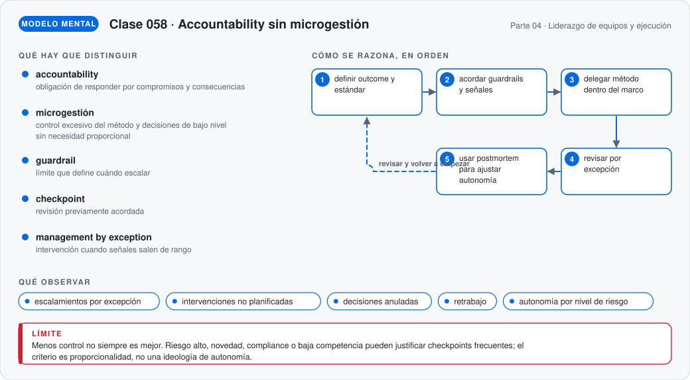

# Clase 058 — Accountability sin microgestión

<!-- nav:inicio -->
> **Parte 04 · Liderazgo de equipos** — clase 10 de 12 · [índice de la parte](../../README.md) · [temario](../../../../SYLLABUS.md)
<!-- nav:fin -->

**Parte:** 04 — Liderazgo de equipos  
**Nivel:** Etapa 2 — Líder → Jefe / Team Lead  
**Duración sugerida:** 150–180 minutos · **Estándar:** deep-class-v2

## 🎯 Propósito

Un jefe enfrenta un dilema conocido: si no controla, los compromisos se incumplen; si controla todo, se convierte en un microgestor que agota a su equipo y se agota a sí mismo. La salida no está en un punto intermedio entre ambos extremos sino en otro lugar: **rendición de cuentas basada en acuerdos claros y seguimiento visible**, donde no hace falta vigilar porque el avance se ve y las consecuencias de incumplir están acordadas.

La clase se apoya en la noción de **responsabilidad mutua** de Katzenbach y Smith como rasgo del equipo real, en la disfunción de la evasión de la rendición de cuentas de Lencioni y en la investigación de Locke y Latham sobre la importancia de la retroalimentación sobre el progreso. Al terminar sabrás construir un ciclo de rendición de cuentas, distinguirlo del control y actuar cuando un compromiso no se cumple.

## 📚 Resultados de aprendizaje

Al finalizar podrás:

1. **Distinguir** rendición de cuentas, control y microgestión.
2. **Establecer** acuerdos claros con resultado, plazo, medida y consecuencia.
3. **Diseñar** un seguimiento visible que no requiera preguntar.
4. **Conducir** la conversación sobre un compromiso incumplido con hechos y sin atribuir intención.
5. **Fomentar** la responsabilidad entre pares y no solo ante el jefe.

## 🧭 Agenda

| Tramo | Qué se hace |
|---|---|
| 0–20 min | Recuperación: recuerda un compromiso incumplido en tu equipo; ¿qué ocurrió después? |
| 20–60 min | El ciclo de rendición de cuentas y la diferencia con el control. |
| 60–105 min | Ejemplo trabajado: de microgestión a seguimiento visible. |
| 105–140 min | Caso ejecutivo: un equipo donde nadie responde por sus compromisos. |
| 140–170 min | Límites y entregable. |

## 🧩 Conceptos centrales

| Concepto | Definición | Cómo se reconoce |
|---|---|---|
| **Rendición de cuentas** | Obligación de responder por el cumplimiento de lo acordado, con consecuencias previstas. | Hay un acuerdo, un seguimiento y una conversación si no se cumple. |
| **Microgestión** | Supervisión detallada y constante del cómo, más allá de lo necesario. | El jefe revisa cada paso. |
| **Responsabilidad mutua** | Los miembros se piden cuentas entre sí (Katzenbach y Smith, 1993). | Se corrigen entre pares sin esperar al jefe. |
| **Evasión de la rendición de cuentas** | Reticencia a señalar a un par cuando incumple (Lencioni, 2002). | Se espera que el jefe corrija. |
| **Seguimiento visible** | Medios por los que el avance se ve sin que el jefe pregunte. | Un tablero compartido, un registro semanal. |
| **Consecuencia acordada** | Resultado previsto y proporcional ante un incumplimiento. | Se conoce de antemano. |

## 🧠 Modelo mental

**Cómo leer el diagrama.** El ciclo tiene cuatro pasos y se repite con cada compromiso. La clave está en el **primero** y el **segundo**: si el acuerdo es claro y el seguimiento es visible, la microgestión no hace falta, porque el jefe no necesita preguntar para saber. El tercero —conversar la brecha— exige hechos, y el cuarto, ajustar el plan o aplicar la consecuencia prevista.

## 📖 Desarrollo

### 1. Qué es y qué no es

Rendir cuentas es **responder por lo acordado**: explicar qué se hizo, qué no, por qué y qué viene. No es castigar ni controlar. La **microgestión** es lo contrario de la confianza: el jefe interviene en el detalle del cómo, revisa todo y decide por otros. Suele aparecer cuando el jefe no sabe qué está ocurriendo y sustituye información por control. El remedio no es «confiar más» sino **crear información** sin intervención.

### 2. Acuerdos claros

El punto de partida es un acuerdo que contenga: **qué** se entrega (resultado y criterio de aceptación), **para cuándo**, **cómo se medirá** y **qué pasa si no se cumple**. Una frase como «lo tendremos pronto» no es un acuerdo. Los acuerdos se registran por escrito y la persona los repite con sus palabras. La mayoría de los incumplimientos nace de acuerdos ambiguos, y la ambigüedad se paga con reproches.

### 3. Seguimiento visible

El avance debe verse sin que el jefe tenga que preguntar: un tablero compartido, un indicador semanal, una breve actualización escrita. Katzenbach y Smith ubican la responsabilidad mutua en el centro del equipo real: cuando todos ven el avance de todos, la presión sana de los pares sustituye a la vigilancia del jefe. Locke y Latham muestran que la retroalimentación sobre el avance es una condición para que las metas mejoren el desempeño: sin ella, la meta pierde efecto.

### 4. La conversación sobre la brecha

Cuando un compromiso no se cumple, la conversación empieza por los **hechos**: «acordamos entregar el viernes y no llegó». Después, la pregunta: «¿qué pasó?», no «¿por qué no cumpliste?». Se examina si el acuerdo era claro, si había recursos, si hubo señales a tiempo. Y se acuerda qué ocurre ahora: replanificar, apoyar, o aplicar la consecuencia acordada. Atribuir intención («no te importa») contamina la conversación (clase 031).

### 5. Consecuencias proporcionales

La rendición de cuentas exige que las consecuencias existan y sean **previsibles y proporcionales**: una conversación y un nuevo plan para un incumplimiento aislado; un seguimiento más cercano para un patrón; una decisión de gestión para un patrón persistente sin mejora. Si las consecuencias son arbitrarias o inexistentes, la rendición de cuentas se vuelve retórica. Y también se **reconoce** el cumplimiento: es la otra cara de la rendición de cuentas.

### 6. Entre pares

Lencioni identifica como disfunción que los miembros eviten confrontar a un par por incomodidad, con lo que la corrección recae en el jefe. Un equipo maduro tiene normas para que se digan las cosas entre pares: «cuando veo que un compromiso está en riesgo, lo digo al dueño y le pregunto qué necesita». Se construye con confianza (clase 052), con claridad de roles (clase 051) y con el ejemplo del líder, que acepta que lo corrijan.

### 7. Cuándo el jefe interviene

Delegar y dar autonomía no excluye intervenir: el jefe actúa cuando se cruza un límite acordado, cuando hay riesgo para el cliente o la seguridad, o cuando el patrón de incumplimiento persiste. La regla es intervenir **por criterio**, no por ansiedad. Si el jefe necesita revisar todo, algo falla antes: el acuerdo, la madurez para la tarea (clase 053) o su propia relación con el control (clase 046).

## 📚 Lectura comparada

| Obra | Qué aporta | Qué no resuelve | Pregunta para contrastar |
|---|---|---|---|
| Katzenbach y Smith (1993) | La responsabilidad mutua como rasgo del equipo real. | Es un estudio de casos. | ¿Se piden cuentas tus pares entre sí? |
| Lencioni (2002) | La evasión de la rendición de cuentas como disfunción. | Es una fábula de gestión. | ¿Qué te impide corregir a un par? |
| Locke y Latham (2002) | Importancia de la retroalimentación sobre el avance. | No trata de relaciones. | ¿Cómo ve el equipo su progreso? |
| Grove (1983) | Indicadores y seguimiento sin microgestión. | Escrita en otro contexto. | ¿Qué indicador muestra el avance? |
| Edmondson (2018) | Seguridad para plantear incumplimientos y riesgos. | No describe el ciclo. | ¿Puede alguien avisar de un riesgo sin ser castigado? |

## 🧮 Ejemplo trabajado

**Situación (hipotética).** Un jefe, Raúl, pregunta cada día a su equipo de seis personas cómo van sus tareas y revisa personalmente cada entrega. Está agotado y el equipo dice sentirse vigilado. Aun así, hay atrasos frecuentes.

| Problema | Causa | Cambio |
|---|---|---|
| Atrasos frecuentes | Acuerdos vagos («para esta semana») | Acuerdos con resultado, fecha y criterio de aceptación por escrito. |
| El jefe necesita preguntar | No hay información visible | Tablero compartido con estado por tarea; actualización de cinco minutos los lunes y miércoles. |
| Conversaciones tensas | Se atribuye intención | La conversación parte de hechos: «acordamos el jueves; llegó el lunes». |
| Nadie se corrige entre pares | Se espera al jefe | Norma del equipo: quien ve un riesgo lo dice al dueño y ofrece ayuda. |
| Sin consecuencias | No se definieron | Primer incumplimiento: conversación y replanificación; patrón: seguimiento más cercano. |

**Resultado.** En dos meses los atrasos bajan a la mitad; Raúl dedica el tiempo de las preguntas diarias a revisar riesgos con el equipo.

**Qué muestra.** (1) Reemplazar control por información redujo la necesidad de vigilar. (2) Los acuerdos claros y el tablero hicieron visible el avance. (3) Las consecuencias eran conocidas.

## 🔀 Comparación y límites

**Rendición de cuentas frente a culpa.** La primera busca cumplir y aprender; la segunda busca un responsable para castigar. En entornos de alto riesgo, la rendición de cuentas se combina con revisión sin culpas.

**Límites.** Parte de lo que se sostiene sobre responsabilidad mutua procede de estudios de casos y de la experiencia de consultoría. Un seguimiento visible mal diseñado se vuelve otra forma de control, y exponer el avance de cada persona puede generar presión. Y hay incumplimientos que no son de rendición de cuentas sino de capacidad, de recursos o de salud, y requieren otra respuesta.

## 🪜 De profesional a owner

| Nivel | Cómo trabaja la rendición de cuentas |
|---|---|
| **Profesional** | Cumple lo que promete y avisa a tiempo cuando no podrá. |
| **Jefe / Team Lead** | Acuerda claro, hace visible el avance y conversa con hechos. |
| **Gerente** | Construye sistemas de seguimiento y consecuencias coherentes entre equipos. |
| **CEO / Director** | Se somete a la misma rendición de cuentas que exige. |
| **Founder / Owner** | Rinde cuentas ante socios, inversionistas y equipo con información regular. |

## 🏢 Caso ejecutivo

En una empresa de servicios, las reuniones de seguimiento terminan con «nos juntamos la próxima semana y vemos». Los compromisos se renuevan sin cumplirse. Cuando alguien incumple, el gerente lo comenta en privado con otra persona y nadie le dice nada al responsable. Dos clientes se quejaron de promesas incumplidas. El gerente se debate entre «apretar el control» y «confiar más».

Entrega un **plan de rendición de cuentas** que contenga: (a) el diagnóstico: acuerdos, seguimiento, consecuencias y cultura entre pares; (b) el formato de acuerdo que usarás; (c) el seguimiento visible, su frecuencia y quién lo actualiza; (d) la conversación sobre un compromiso incumplido con hechos; (e) las consecuencias proporcionales; (f) cómo promoverás la responsabilidad entre pares.

## 🧪 Práctica

1. Reescribe tres compromisos de tu equipo con resultado, fecha, medida y consecuencia.
2. Diseña un seguimiento visible para un proyecto y define quién lo actualiza.
3. Prepara la conversación de un incumplimiento comenzando por los hechos.
4. Identifica una conducta tuya de microgestión y qué información la reemplazaría.
5. Define una norma para que los pares se digan los riesgos.

## ⚠️ Errores frecuentes

| Error | Por qué ocurre | Cómo corregirlo |
|---|---|---|
| Acuerdos vagos | Se evita el conflicto | Resultado, fecha, medida y criterio. |
| Preguntar a diario | Falta de información | Seguimiento visible. |
| Atribuir intención | Se interpreta | Empezar por hechos. |
| Sin consecuencias | Se teme el conflicto | Consecuencias acordadas y proporcionales. |
| Dejar la corrección al jefe | Se evita confrontar | Norma de pares. |
| Intervenir por ansiedad | No se confía | Intervenir por límites cruzados. |

## ❓ Preguntas de comprobación

1. ¿Qué diferencia hay entre rendición de cuentas y microgestión?
2. ¿Qué debe contener un acuerdo claro?
3. ¿Por qué el seguimiento visible reduce la necesidad de vigilar?
4. ¿Cómo comienza la conversación sobre un compromiso incumplido?
5. ¿Qué es la responsabilidad mutua?
6. ¿Cuándo interviene el jefe?
7. ¿Qué límite tiene un seguimiento visible?

Claves de respuesta

1. La rendición de cuentas es responder por lo acordado; la microgestión supervisa el detalle del cómo de manera constante.
2. Resultado y criterio de aceptación, fecha, forma de medirlo y consecuencia.
3. Porque el avance se ve sin preguntar y la presión de pares sustituye la vigilancia del jefe.
4. Con los hechos, y luego con preguntas sobre qué ocurrió, sin atribuir intención.
5. Que los miembros se piden cuentas entre sí, no solo ante el jefe.
6. Cuando se cruza un límite acordado, hay riesgo para el cliente o la seguridad, o el patrón persiste; no por ansiedad.
7. Puede convertirse en otra forma de control y generar presión si se diseña mal.

## 📥 Entregable

Guarda en `portfolio/058-accountability-sin-microgestion/`:

- `leadership-decision-brief.md` (plantilla [Leadership Decision Brief](../../../../templates/leadership-decision-brief.md)) con el plan del caso ejecutivo;
- `reading-note.md` con una tensión entre Katzenbach y Smith y Lencioni;
- `decision-journal.md` con los acuerdos, el seguimiento y la conversación sobre un incumplimiento.

## 📗 Fuentes y verificación

- Jon R. Katzenbach & Douglas K. Smith — *The Wisdom of Teams* (McGraw-Hill, 2005). **Uso en esta clase:** la responsabilidad mutua como rasgo del equipo real. Lectura selectiva sobre **accountability sin microgestión**. **Localizador:** [ISBN-13 9780077111687](https://openlibrary.org/isbn/9780077111687).
- Patrick Lencioni — *The Five Dysfunctions of a Team* (Pfeiffer, 2012). **Uso en esta clase:** la evasión de la rendición de cuentas como disfunción. Lectura selectiva sobre **accountability sin microgestión**. **Localizador:** [ISBN-13 9781118127308](https://openlibrary.org/isbn/9781118127308).
- Edwin A. Locke & Gary P. Latham — *Building a Practically Useful Theory of Goal Setting and Task Motivation: A 35-Year Odyssey* (American Psychologist, 2002). **Uso en esta clase:** la retroalimentación sobre el avance. Lectura selectiva sobre **accountability sin microgestión**. **Localizador:** [DOI 10.1037/0003-066X.57.9.705](https://doi.org/10.1037/0003-066X.57.9.705).
- Andrew S. Grove — *High Output Management* (Random House, 1983). **Uso en esta clase:** indicadores y seguimiento sin microgestión. Lectura selectiva sobre **accountability sin microgestión**. **Localizador:** [ISBN-13 9780394532349](https://openlibrary.org/isbn/9780394532349).
- Amy C. Edmondson — *The Fearless Organization* (Wiley, 2018). **Uso en esta clase:** seguridad para plantear incumplimientos y riesgos. Lectura selectiva sobre **accountability sin microgestión**. **Localizador:** [ISBN-13 9781119477242](https://openlibrary.org/isbn/9781119477242).

> **Regla de fuentes para Accountability sin microgestión:** las obras anteriores estructuran las perspectivas de esta materia; cualquier norma, ley o estándar vivo mencionado debe comprobarse nuevamente en su fuente primaria vigente. Los ejemplos y casos son hipotéticos. El desarrollo es original y no reproduce capítulos protegidos.

<!-- pie:inicio -->
---

| Anterior | Índice | Siguiente |
|---|---|---|
| [← 057 · Motivación y reconocimiento](../057-motivacion-y-reconocimiento/README.md) | [Parte 04](../../README.md) · [Programa](../../../../SYLLABUS.md) | [059 · Equipos híbridos y distribuidos →](../059-equipos-hibridos-y-distribuidos/README.md) |
<!-- pie:fin -->
