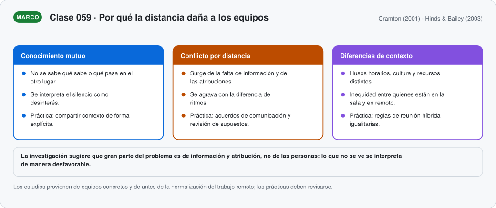

# Clase 059 — Equipos híbridos y distribuidos

<!-- nav:inicio -->
> **Parte 04 · Liderazgo de equipos** — clase 11 de 12 · [índice de la parte](../../README.md) · [temario](../../../../SYLLABUS.md)
<!-- nav:fin -->

**Parte:** 04 — Liderazgo de equipos  
**Nivel:** Etapa 2 — Líder → Jefe / Team Lead  
**Duración sugerida:** 150–180 minutos · **Estándar:** deep-class-v2

## 🎯 Propósito

Un equipo distribuido no es un equipo presencial con una pantalla en medio: tiene problemas propios, y la mayoría se debe a un mismo mecanismo. Cuando las personas no se ven, **no saben lo que ocurre donde está el otro**, interpretan los silencios de manera desfavorable y descubren tarde que trabajaban con supuestos distintos. Los equipos híbridos añaden un segundo problema: la desigualdad entre quienes están en la sala y quienes están en remoto.

Esta clase usa dos investigaciones sobre equipos dispersos: la de Cramton sobre el **problema del conocimiento mutuo** y la de Hinds y Bailey sobre el **conflicto en equipos distribuidos**. Ambas son anteriores a la generalización del trabajo remoto, y sus mecanismos siguen siendo útiles para diagnosticar. Al terminar sabrás identificar qué problema de la distancia afecta a un equipo y diseñar acuerdos de trabajo que lo reduzcan.

## 📚 Resultados de aprendizaje

Al finalizar podrás:

1. **Explicar** el problema del conocimiento mutuo y sus consecuencias en la colaboración.
2. **Describir** cómo la distancia genera conflicto por falta de información y atribuciones.
3. **Diagnosticar** qué problema de distancia afecta a un equipo.
4. **Diseñar** acuerdos de comunicación, reunión y registro para equipos distribuidos e híbridos.
5. **Asegurar** equidad entre quienes están en remoto y quienes están en la oficina.

## 🧭 Agenda

| Tramo | Qué se hace |
|---|---|
| 0–20 min | Recuperación: recuerda un malentendido con alguien remoto; ¿qué no sabías de su contexto? |
| 20–60 min | Conocimiento mutuo, conflicto por distancia y diferencias de contexto. |
| 60–105 min | Ejemplo trabajado: un equipo en tres husos horarios. |
| 105–140 min | Caso ejecutivo: un equipo híbrido con una brecha entre la sala y el remoto. |
| 140–170 min | Límites y entregable. |

## 🧩 Conceptos centrales

| Concepto | Definición | Cómo se reconoce |
|---|---|---|
| **Equipo distribuido** | Equipo cuyos miembros trabajan en lugares distintos y se comunican sobre todo mediante tecnología. | No comparten un espacio físico habitual. |
| **Equipo híbrido** | Equipo en que parte de los miembros trabaja junto y parte a distancia, de forma estable o alternada. | Hay reuniones con personas en la sala y otras conectadas. |
| **Problema del conocimiento mutuo** | Dificultad para que las personas compartan y comprendan información de contexto entre sí, con consecuencias para la colaboración (Cramton, 2001). | Se interpretan silencios y demoras sin conocer su causa. |
| **Atribución disposicional** | Explicar la conducta del otro por su carácter y no por su situación (Cramton, 2001). | «No responde porque no le importa.» |
| **Conflicto en equipos distribuidos** | Conflicto que surge o se agrava por la distancia, la falta de información y las diferencias de contexto (Hinds y Bailey, 2003). | Se discute sobre tareas, relaciones y procesos. |
| **Acuerdo de trabajo** | Regla acordada sobre cómo se comunica y colabora el equipo. | Está escrito y se revisa. |

## 🧠 Modelo mental

**Cómo leer el diagrama.** Tres columnas, cada una con un problema distinto y una práctica asociada. El hilo común: lo que no se ve se interpreta, y se tiende a interpretar de manera desfavorable. Por eso las respuestas son sobre todo de **información**: hacer visible el contexto, acordar cómo se comunica y asegurar que todos participen en igualdad.

## 📖 Desarrollo

### 1. El conocimiento mutuo

Cramton, en un estudio de equipos dispersos, identificó el **problema del conocimiento mutuo**: las personas no logran compartir ni entender el contexto del otro, como sus prioridades, su carga o sus circunstancias. Cinco fuentes de falla: no distribuir información relevante, no reconocer que falta, dificultad para interpretar el silencio, diferencias en la velocidad de acceso a la información y distinto significado atribuido a un mismo dato. Sus efectos: malentendidos, retrasos y desconfianza.

### 2. Atribuciones desfavorables

Una consecuencia importante: ante la falta de respuesta de un colega remoto, tendemos a pensar que no le importa o es poco profesional (**atribución disposicional**), y no que está sobrecargado, sin conexión o sin información. Quien está en el mismo lugar ve la causa situacional; quien está lejos, no. Esta asimetría genera resentimiento y daña la confianza. La práctica útil: preguntar antes de juzgar y hacer visibles las circunstancias.

### 3. Conflicto y distancia

Hinds y Bailey estudiaron el conflicto en equipos distribuidos y propusieron que la distancia, la falta de información compartida y las diferencias de contexto aumentan el conflicto de **tarea**, de **relación** y de **proceso**, y lo hacen más difícil de resolver, porque los mecanismos informales para corregirlo —la conversación de pasillo, la señal no verbal— no existen. De ahí la importancia de crear mecanismos formales: acuerdos explícitos y espacios para resolver desacuerdos.

### 4. Acuerdos de trabajo

Un equipo distribuido necesita acordar por escrito: **qué canal se usa para qué** (urgente, documentos, conversación); **tiempos de respuesta esperados**; **horarios de solapamiento** entre husos; **cómo se comunica la disponibilidad**; **cómo se toman las decisiones**; y **cómo se registran** para que los ausentes las encuentren. Documentar decisiones y su razón permite que quien no estuvo en la reunión las entienda sin depender de comentarios de pasillo.

### 5. Hacer visible el contexto

Prácticas que reducen el problema del conocimiento mutuo: un **estado semanal** corto de cada persona (en qué trabaja, qué bloqueos tiene), un **calendario compartido** con la disponibilidad real, una **bitácora** pública de decisiones, y **conversaciones no operativas** regulares para conocerse. Y una norma: si una respuesta se va a demorar, se avisa. El silencio es la mayor fuente de interpretación negativa.

### 6. Equidad en reuniones híbridas

En una reunión mixta, quien está en la sala tiene ventaja: ve el lenguaje no verbal, participa en la conversación informal y interrumpe con más facilidad. Reglas que ayudan: **todos conectados individualmente**, aunque algunos estén en la misma sala; moderación que da la palabra a quienes están en remoto primero; documentos y pizarras compartidos; y no tomar decisiones en conversaciones de pasillo sin registrarlas. La pregunta de control: ¿alguien en remoto tuvo menos oportunidad de influir que alguien en la sala?

### 7. Cuándo conviene estar juntos

No todo se puede hacer a distancia con igual eficacia. Hay momentos en que la presencia aporta: el inicio de un equipo, la construcción de confianza, la resolución de conflictos de fondo, los talleres creativos. Muchos equipos combinan un trabajo individual remoto con encuentros presenciales planificados, con propósito claro. Decidir cuándo reunirse es decidir qué necesita interacción de alto contenido (clase 025).

## 📚 Lectura comparada

| Obra | Qué aporta | Qué no resuelve | Pregunta para contrastar |
|---|---|---|---|
| Cramton (2001) | Problema del conocimiento mutuo y atribuciones. | Es un estudio de un conjunto de equipos y de otra época tecnológica. | ¿Qué desconoces del contexto de tu colega remoto? |
| Hinds y Bailey (2003) | Conflicto y distancia. | No cubre el trabajo híbrido actual. | ¿Qué conflicto se agrava por la distancia? |
| Hackman (2002) | Condiciones del equipo, útiles para diagnosticar. | No trata de distancia. | ¿Qué condición falla en tu equipo disperso? |
| Edmondson (1999) | Seguridad psicológica, más difícil a distancia. | No habla de tecnología. | ¿Puede un remoto disentir con la misma facilidad? |
| McChrystal et al. (2015) | Transparencia y comunicación en redes de equipos. | Contexto militar. | ¿Qué información comparte tu red de equipos? |

## 🧮 Ejemplo trabajado

**Situación (hipotética).** Un equipo de producto con nueve personas: tres en Santiago, tres en Ciudad de México y tres en Madrid. Las reuniones son a las 10:00 de Santiago, es decir, temprano en México y de noche en Madrid. Los de Madrid se quejan de que «las decisiones se toman antes de que podamos opinar»; los de Santiago creen que «Madrid casi no participa».

| Problema | Diagnóstico | Respuesta |
|---|---|---|
| Decisiones sin los de Madrid | Falta de conocimiento mutuo y de equidad | Decisiones solo con documento previo y 48 horas para comentarios asíncronos. |
| Atribuciones negativas | Se interpreta el silencio | Estado semanal escrito de cada persona con bloqueos y disponibilidad. |
| Reunión incómoda para todos | Horario fijo desfavorable | Rotar el horario cada mes y grabar con resumen escrito. |
| Conflicto entre dos subgrupos | Falta de relación informal | Café virtual quincenal sin agenda; un encuentro presencial semestral. |
| Decisiones sin registro | La información se queda en la sala | Bitácora de decisiones con razón y responsable. |

**Resultado.** En tres meses disminuyen las quejas, aumenta la participación de Madrid y las decisiones se revisan menos.

**Qué muestra.** (1) Cada problema tenía una causa de información y de equidad. (2) Los acuerdos hicieron visible el contexto. (3) Se rediseñó la reunión para que nadie siempre pague el costo del horario.

## 🔀 Comparación y límites

**Distribuido frente a híbrido.** El distribuido es homogéneo en su dispersión; el híbrido combina a quienes están juntos y a quienes no, y por eso tiene un riesgo de desigualdad que el otro no tiene.

**Límites.** Las investigaciones de Cramton y de Hinds y Bailey describen equipos de principios de los años 2000, con tecnologías y normas muy distintas; sus mecanismos siguen siendo útiles, pero sus recomendaciones concretas deben revisarse con evidencia más reciente. Los acuerdos de trabajo no sustituyen la confianza, y la vigilancia tecnológica de la actividad de las personas es otra cosa y tiene límites éticos y legales que esta clase no trata.

## 🪜 De profesional a owner

| Nivel | Cómo trabaja a distancia |
|---|---|
| **Profesional** | Comparte su contexto y avisa de demoras antes de que se interpreten. |
| **Jefe / Team Lead** | Acuerda cómo se trabaja y cuida la equidad en las reuniones. |
| **Gerente** | Diseña la combinación de presencia y remoto según el trabajo. |
| **CEO / Director** | Define principios de trabajo híbrido coherentes con la cultura. |
| **Founder / Owner** | Decide dónde vale la pena estar juntos con un presupuesto limitado. |

## 🏢 Caso ejecutivo

Una empresa de servicios adoptó un modelo híbrido: tres días en la oficina y dos en casa. Los equipos en la oficina toman decisiones en conversaciones informales; los que están en remoto dicen que «se enteran después». Los ascensos recientes fueron casi todos a personas que van más a la oficina. Dos personas excelentes, que viven lejos y trabajan sobre todo en remoto, evalúan irse. La dirección quiere «más presencia».

Entrega un **plan de trabajo híbrido** que contenga: (a) el diagnóstico de los problemas de conocimiento mutuo, atribución y equidad; (b) los acuerdos de comunicación, decisión y registro; (c) las reglas de reuniones híbridas; (d) cómo evaluarás el desempeño sin sesgo de presencia; (e) cuándo convocarás encuentros presenciales y con qué propósito; (f) las señales que revisarás en tres meses.

## 🧪 Práctica

1. Identifica a alguien con quien trabajas a distancia y escribe tres cosas de su contexto que desconoces.
2. Redacta tres acuerdos de comunicación para tu equipo.
3. Rediseña una reunión híbrida con reglas de equidad.
4. Define cómo registrarás decisiones para quienes no asisten.
5. Revisa si tus evaluaciones podrían tener un sesgo de presencia.

## ⚠️ Errores frecuentes

| Error | Por qué ocurre | Cómo corregirlo |
|---|---|---|
| Decidir en el pasillo | Es más rápido | Registrar y consultar a quienes están en remoto. |
| Interpretar el silencio | Falta de contexto | Preguntar y avisar demoras. |
| Reunión híbrida sin reglas | Se improvisa | Conexión individual y moderación equitativa. |
| Un solo horario permanente | Es cómodo para algunos | Rotarlo y grabar con resumen. |
| Evaluar por presencia | Sesgo de visibilidad | Evaluar por resultados acordados. |
| Eliminar los encuentros | Se busca ahorro | Reunirse con propósito claro. |

## ❓ Preguntas de comprobación

1. ¿Qué es el problema del conocimiento mutuo?
2. ¿Por qué la distancia favorece las atribuciones desfavorables?
3. ¿Qué tipos de conflicto agrava la distancia según Hinds y Bailey?
4. ¿Qué debe contener un acuerdo de trabajo a distancia?
5. Nombra tres reglas para reuniones híbridas equitativas.
6. ¿Cuándo conviene reunirse presencialmente?
7. ¿Qué límite tienen los estudios de Cramton y de Hinds y Bailey?

Claves de respuesta

1. La dificultad para compartir y entender el contexto del otro, con consecuencias para la colaboración.
2. Porque quien está lejos no ve las causas situacionales de la conducta del otro y tiende a atribuirla al carácter.
3. De tarea, de relación y de proceso.
4. Canales y su uso, tiempos de respuesta, horarios de solapamiento, disponibilidad, decisiones y su registro.
5. Conexión individual de todos, dar la palabra primero a quienes están en remoto, documentos compartidos y registrar las decisiones.
6. Al inicio del equipo, para construir confianza, resolver conflictos de fondo y en talleres creativos.
7. Son de principios de los 2000, con tecnologías y normas distintas; sus mecanismos sirven, sus recomendaciones concretas deben revisarse.

## 📥 Entregable

Guarda en `portfolio/059-equipos-hibridos-y-distribuidos/`:

- `people-decision-brief.md` (plantilla [People Decision Brief](../../../../templates/people-decision-brief.md)) con el plan del caso ejecutivo;
- `team-charter.md` (plantilla [Team charter](../../../../templates/team-charter.md)) con los acuerdos de trabajo;
- `decision-journal.md` con el diagnóstico y las señales de revisión.

## 📗 Fuentes y verificación

- Catherine Durnell Cramton — *The Mutual Knowledge Problem and Its Consequences for Dispersed Collaboration* (Organization Science, 2001). **Uso en esta clase:** el problema del conocimiento mutuo y las atribuciones. Lectura selectiva sobre **equipos híbridos y distribuidos**. **Localizador:** [DOI 10.1287/orsc.12.3.346.10098](https://doi.org/10.1287/orsc.12.3.346.10098).
- Pamela J. Hinds & Diane E. Bailey — *Out of Sight, Out of Sync: Understanding Conflict in Distributed Teams* (Organization Science, 2003). **Uso en esta clase:** conflicto en equipos distribuidos. Lectura selectiva sobre **equipos híbridos y distribuidos**. **Localizador:** [DOI 10.1287/orsc.14.6.615.24872](https://doi.org/10.1287/orsc.14.6.615.24872).
- J. Richard Hackman — *Leading Teams* (Harvard Business School Press, 2002). **Uso en esta clase:** condiciones del equipo para diagnosticar. Lectura selectiva sobre **equipos híbridos y distribuidos**. **Localizador:** [ISBN-13 9781578513338](https://openlibrary.org/isbn/9781578513338).
- Amy C. Edmondson — *Psychological Safety and Learning Behavior in Work Teams* (Administrative Science Quarterly, 1999). **Uso en esta clase:** seguridad psicológica y aprendizaje. Lectura selectiva sobre **equipos híbridos y distribuidos**. **Localizador:** [DOI 10.2307/2666999](https://doi.org/10.2307/2666999).
- Stanley McChrystal et al. — *Team of Teams* (Penguin Books, Limited, 2015). **Uso en esta clase:** transparencia y comunicación en redes de equipos. Lectura selectiva sobre **equipos híbridos y distribuidos**. **Localizador:** [ISBN-13 9780241250846](https://openlibrary.org/isbn/9780241250846).

> **Regla de fuentes para Equipos híbridos y distribuidos:** las obras anteriores estructuran las perspectivas de esta materia; cualquier norma, ley o estándar vivo mencionado debe comprobarse nuevamente en su fuente primaria vigente, en particular las normas laborales sobre trabajo remoto. Los ejemplos y casos son hipotéticos. El desarrollo es original y no reproduce capítulos protegidos.

<!-- pie:inicio -->
---

| Anterior | Índice | Siguiente |
|---|---|---|
| [← 058 · Accountability sin microgestión](../058-accountability-sin-microgestion/README.md) | [Parte 04](../../README.md) · [Programa](../../../../SYLLABUS.md) | [060 · Capstone: recuperar un equipo disfuncional →](../060-capstone-recuperar-un-equipo-disfuncional/README.md) |
<!-- pie:fin -->
