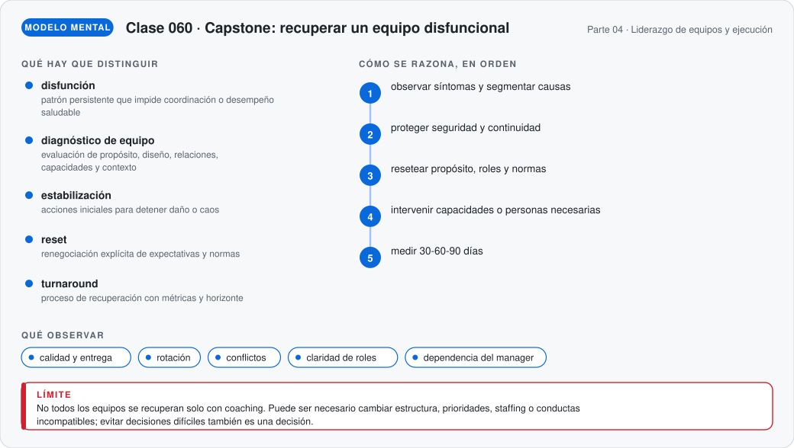

# Clase 060 — Capstone: recuperar un equipo disfuncional

<!-- nav:inicio -->
> **Parte 04 · Liderazgo de equipos** — clase 12 de 12 · [índice de la parte](../../README.md) · [temario](../../../../SYLLABUS.md)
<!-- nav:fin -->

**Parte:** 04 — Liderazgo de equipos  
**Nivel:** Etapa 2 — Líder → Jefe / Team Lead  
**Duración sugerida:** 150–180 minutos · **Estándar:** deep-class-v2

## 🎯 Propósito

Heredar un equipo que no funciona es una de las pruebas más frecuentes y más difíciles del liderazgo: hay desconfianza, metas confusas, conflictos acumulados, personas desgastadas y un historial de intentos fallidos. La tentación es doble: **cambiar a las personas** (despedir, reasignar) o **cambiar el discurso** (un taller, una consigna). Ninguna recompone un equipo por sí sola. Lo que lo recompone es un diagnóstico honesto, la restauración de las condiciones básicas y un trabajo sostenido.

Este capstone integra la parte 04: qué hace real a un equipo (049), propósito y acta (050), roles (051), confianza (052), delegación (053), coaching (054), uno a uno (055), reuniones (056), reconocimiento (057), rendición de cuentas (058) y trabajo distribuido (059). Se apoya en las condiciones de Hackman, la pirámide de Lencioni y la seguridad psicológica de Edmondson. Al terminar sabrás construir un plan de recuperación por etapas, con evidencia y criterios para decidir cuándo cambiar personas.

## 📚 Resultados de aprendizaje

Al finalizar podrás:

1. **Diagnosticar** un equipo con las condiciones de Hackman, la pirámide de Lencioni y la seguridad psicológica.
2. **Secuenciar** una recuperación: seguridad, claridad, rendición de cuentas y sostenimiento.
3. **Decidir** cuándo el problema es de condiciones y cuándo de una persona.
4. **Conducir** las conversaciones iniciales con el equipo y con cada persona.
5. **Medir** la recuperación con evidencia y ajustar el plan.

## 🧭 Agenda

| Tramo | Qué se hace |
|---|---|
| 0–20 min | Recuperación: ¿qué síntomas te harían decir que un equipo es disfuncional? Ordénalos por gravedad. |
| 20–60 min | Diagnóstico y secuencia de recuperación. |
| 60–105 min | Ejemplo trabajado: los primeros 90 días con un equipo recién heredado. |
| 105–150 min | Caso ejecutivo integrado. |
| 150–170 min | Rúbrica, límites y entregable. |

## 🧩 Conceptos centrales

| Concepto | Definición | Cómo se reconoce |
|---|---|---|
| **Equipo disfuncional** | Equipo cuyo desempeño o clima está por debajo de lo que sus condiciones permitirían, de manera persistente (criterio de la clase). | Hay patrones repetidos, no un mal día. |
| **Diagnóstico por condiciones** | Evaluación del equipo según equipo real, dirección, estructura, contexto de apoyo y coaching (Hackman, 2002). | Se revisan las condiciones antes que las personas. |
| **Pirámide de disfunciones** | Cinco niveles dependientes: confianza, conflicto, compromiso, rendición de cuentas y resultados (Lencioni, 2002). | Se identifica el nivel inferior que falla. |
| **Seguridad psicológica** | Creencia compartida de que el equipo es seguro para asumir riesgos interpersonales (Edmondson, 1999). | Se puede hablar sin castigo. |
| **Ganancia temprana** | Resultado visible logrado pronto, que muestra que el cambio es posible. | El equipo ve un avance real. |
| **Decisión de persona** | Medida individual (reasignar, apoyar, desvincular) tomada con proceso y evidencia. | Se documenta y es proporcional. |

## 🧠 Modelo mental

**Cómo leer el diagrama.** Cinco pasos en orden, con retorno a la revisión. El orden es deliberado: se diagnostica antes de actuar; la **seguridad** va antes que la claridad porque, sin poder hablar, no se puede acordar nada; y la rendición de cuentas viene después de que propósito y roles estén claros, porque exigir cuentas sobre algo ambiguo es injusto.

## 📖 Desarrollo

### 1. Diagnosticar antes de actuar

Los primeros treinta días son para observar y escuchar. Hackman propone revisar cinco condiciones: ¿es un **equipo real**, con límites e interdependencia?, ¿tiene una **dirección convincente**?, ¿una **estructura** que facilita el trabajo?, ¿un **contexto de apoyo** con recursos, información y recompensas coherentes?, ¿acceso a **coaching**? Complementa con la pirámide de Lencioni —¿en qué nivel se rompe?— y con una medición de seguridad psicológica. Usa fuentes múltiples: entrevistas individuales, observación de reuniones, datos de desempeño, historial de rotación.

### 2. Entrevistas y escucha

Conversa a solas con cada persona (clases 026 y 055) con preguntas humildes: «¿qué funciona bien aquí?, ¿qué te frustra?, ¿qué cambiarías si fueras tú?, ¿qué debería saber que no me han dicho?». Registra patrones, no anécdotas. Garantiza confidencialidad y cumple. Compara lo que oyes con lo que ves. Al terminar, devuelve al equipo un resumen **sin atribuciones personales**: «esto es lo que escuché; esto es lo que haré primero».

### 3. Restablecer la seguridad

Sin seguridad no hay verdad, y sin verdad no hay diagnóstico real. Primeras conductas: admitir lo que no sabes, reconocer errores propios, agradecer a quien habla con franqueza, responder sin castigo ante una mala noticia y **cumplir** lo que prometes. Si hubo conductas dañinas de un miembro o del líder anterior, se abordan con claridad. La confianza se reconstruye con hechos pequeños y repetidos (clase 052).

### 4. Aclarar propósito, metas y roles

Con el equipo, se redactan un propósito, dos a cinco metas específicas y exigentes y una matriz de roles (clases 050 y 051). Esta etapa expone conflictos latentes sobre quién decide qué; se abordan con la regla de que una sola persona decide cada cosa. Se acuerdan normas de trabajo y el ritmo de reuniones (clase 056). El acta pasa a ser el marco para exigir cuentas.

### 5. Recomponer la rendición de cuentas

Con acuerdos claros, se instala el ciclo de la clase 058: acuerdos escritos, seguimiento visible, conversación sobre brechas con hechos y consecuencias proporcionales. Se deja de hacer la parte del trabajo que corresponde a otros (clase 053) y se reconoce el avance (clase 057). Aquí aparecen las **decisiones de persona**: quien, con condiciones claras y apoyo, no cambia.

### 6. Cuándo cambiar personas

La regla de la clase: **primero las condiciones, después las personas**. Antes de concluir que alguien es el problema, comprueba que tuvo claridad, recursos, feedback y apoyo. Si después de eso persiste un patrón que daña al equipo, la decisión es legítima y a veces necesaria: una persona puede mantener un equipo en la disfunción. Debe hacerse con **proceso y evidencia**, respetando la normativa laboral aplicable, que se verifica con asesoría, y con dignidad. Demorar esa decisión también cuesta: el equipo ve que no hay consecuencias.

### 7. Ganancias tempranas y sostenimiento

Una recuperación dura meses. Para mantener la energía, se buscan **ganancias tempranas**: un resultado visible, aunque pequeño, en el primer trimestre. Se miden indicadores de desempeño, de clima (seguridad psicológica, rotación) y de proceso (cumplimiento de acuerdos). Se revisa el plan cada trimestre y se ajusta. Si el equipo mejora, el líder cede espacio: el objetivo es un equipo que funcione sin depender de él.

## 📚 Lectura comparada

| Obra | Qué aporta | Qué no resuelve | Pregunta para contrastar |
|---|---|---|---|
| Hackman (2002) | Cinco condiciones para el diagnóstico. | No es un manual de recuperación. | ¿Qué condición revisaste primero? |
| Lencioni (2002) | La pirámide para ubicar el nivel inferior que falla. | Es una fábula de gestión. | ¿Dónde se rompe tu equipo? |
| Edmondson (1999) | Seguridad psicológica y aprendizaje. | No trata de decisiones de persona. | ¿Qué evidencia tienes de seguridad? |
| Katzenbach y Smith (1993) | Qué define a un equipo real. | Basado en casos. | ¿Qué le falta para ser un equipo real? |
| McChrystal et al. (2015) | Transparencia y confianza en equipos. | Contexto militar. | ¿Qué información comparte tu equipo? |

## 🧮 Ejemplo trabajado

**Situación (hipotética).** Ana asume la jefatura de un equipo de ocho personas de atención a clientes. Su predecesor se fue tras seis meses de conflictos. La rotación fue del 35 % el último año, hay dos subgrupos enfrentados y los indicadores de satisfacción están en mínimos.

| Etapa | Qué hace Ana | Evidencia |
|---|---|---|
| **Días 1–30: diagnosticar** | Entrevista a cada persona; observa dos reuniones; revisa datos. Evalúa las cinco condiciones. | Dirección difusa, roles superpuestos, reuniones sin decisiones; nivel de la pirámide que falla: la confianza. |
| **Días 15–45: seguridad** | Devuelve un resumen sin atribuciones; admite que no conoce los problemas y pide ayuda; responde sin castigo a una mala noticia de un colaborador. | Dos personas comienzan a hablar en reuniones. |
| **Días 30–60: claridad** | Con el equipo redacta propósito, tres metas y una matriz de roles; acuerda tres normas. | Una sola persona decide cada cosa. |
| **Días 45–90: rendición de cuentas** | Instala un tablero y acuerdos escritos; conversa con hechos sobre dos incumplimientos. | Se cumple el 70 % de los acuerdos. |
| **Ganancia temprana** | El equipo reduce a la mitad un cuello de botella que afectaba a los clientes. | Satisfacción +0,4 puntos. |
| **Decisión de persona** | Un integrante sigue socavando a otros tras tres conversaciones y un plan de apoyo; Ana, con asesoría, inicia un proceso. | Documentación de hechos y apoyo. |

**Qué muestra.** (1) Primero se diagnosticó y se restableció la seguridad. (2) Se esperó a tener claridad antes de exigir cuentas. (3) La decisión de persona se tomó con proceso, tras agotar las condiciones.

## 🔀 Comparación y límites

**Recuperar frente a reemplazar.** Reemplazar a todo el equipo es posible pero raramente deseable; suele ser más costoso y deja intactas las condiciones que lo produjeron.

**Límites.** Los modelos usados proceden de investigación y de consultoría con evidencia de calidad variable, y ningún diagnóstico es exhaustivo. Algunas disfunciones tienen causas fuera del alcance del líder: una estructura organizacional contradictoria, un incentivo mal diseñado o una cultura de la que depende. Las decisiones sobre personas están sujetas a la normativa laboral y a protocolos de la organización que se verifican con asesoría; esta clase no los sustituye.

## 🪜 De profesional a owner

| Nivel | Cómo participa en una recuperación |
|---|---|
| **Profesional** | Aporta información honesta y colabora con el nuevo acuerdo. |
| **Jefe / Team Lead** | Lidera la recuperación de su equipo con diagnóstico y secuencia. |
| **Gerente** | Apoya a los jefes con recursos y protege los plazos para que puedan hacerlo. |
| **CEO / Director** | Revisa si la estructura y los incentivos producen la disfunción. |
| **Founder / Owner** | Reconoce cuando el problema está en las decisiones de fundación y las corrige. |

## 🏢 Caso ejecutivo

Una gerente nueva recibe el área de operaciones de una empresa de servicios: diez personas, dos jefes de turno enfrentados, una rotación del 40 % y un cliente importante amenazando con irse. La dirección espera mejoras en 90 días. Dos personas del equipo le dicen en privado que «el problema es el jefe de turno B», otras dos que «es el jefe A». Los indicadores de calidad empeoraron en los últimos cuatro trimestres. El director dice que «si no funciona, cambia a quien haga falta».

Entrega un **plan de recuperación de 90 días** que contenga: (a) el diagnóstico con las condiciones de Hackman, la pirámide y la seguridad psicológica, y qué evidencia buscarás; (b) la secuencia de recuperación con fechas; (c) cómo conducirás las entrevistas y la devolución al equipo; (d) cómo gestionarás el conflicto entre los jefes de turno y las acusaciones cruzadas; (e) los criterios y el proceso para una decisión de persona; (f) los indicadores, la ganancia temprana y la revisión; (g) cómo protegerás tu energía y la del equipo; (h) qué dirás al director.

## 🧪 Práctica

1. Evalúa un equipo con las cinco condiciones de Hackman y ubica el nivel de la pirámide que falla.
2. Diseña las cinco preguntas de tus entrevistas y cómo devolverás un resumen sin atribuciones.
3. Escribe las tres conductas con que restablecerías la seguridad en la primera semana.
4. Define una ganancia temprana posible y cómo la harías visible.
5. Define los criterios para considerar una decisión sobre una persona: qué habría que haber dado antes.

## ⚠️ Errores frecuentes

| Error | Por qué ocurre | Cómo corregirlo |
|---|---|---|
| Actuar sin diagnosticar | Presión por resultados | Observar y escuchar los primeros 30 días. |
| Cambiar personas primero | Es lo más visible | Revisar condiciones y luego decidir. |
| Exigir cuentas sin claridad | Se quiere control | Aclarar propósito y roles antes. |
| Atribuir en la devolución | Se quiere mostrar autoridad | Resumir patrones sin nombres. |
| Demorar una decisión necesaria | Se teme el conflicto | Decidir con proceso y evidencia. |
| Hacerlo todo el líder | No se delega | Compartir responsabilidades y ceder espacio. |

## ❓ Preguntas de comprobación

1. ¿Cuáles son las cinco condiciones habilitantes de Hackman?
2. ¿Por qué se diagnostica antes de actuar?
3. ¿Por qué la seguridad precede a la claridad en la secuencia?
4. ¿Qué significa «primero las condiciones, después las personas»?
5. ¿Qué es una ganancia temprana?
6. ¿Qué requisitos debe cumplir una decisión sobre una persona?
7. ¿Qué límite tienen estos modelos?

Claves de respuesta

1. Equipo real, dirección convincente, estructura habilitante, contexto de apoyo y coaching experto.
2. Porque las causas visibles pueden no ser las raíces, y actuar sin entender puede empeorar la situación.
3. Porque sin poder hablar sin castigo no se puede acordar nada ni obtener información veraz.
4. Antes de concluir que alguien es el problema, comprobar que tuvo claridad, recursos, feedback y apoyo.
5. Un resultado visible, aunque pequeño, que muestra que el cambio es posible.
6. Proceso y evidencia, proporcionalidad, respeto de la normativa laboral verificada con asesoría y trato digno.
7. Proceden de investigación y consultoría de calidad variable; algunas causas están fuera del alcance del líder.

## 📥 Entregable

Guarda en `portfolio/060-capstone-recuperar-un-equipo-disfuncional/`:

- `people-decision-brief.md` (plantilla [People Decision Brief](../../../../templates/people-decision-brief.md)) con el plan de 90 días del caso ejecutivo;
- `team-charter.md` (plantilla [Team charter](../../../../templates/team-charter.md)) con el acta y la matriz de roles propuestas;
- `reading-note.md` con una tensión entre Hackman y Lencioni;
- `decision-journal.md` con el diagnóstico, la secuencia, las decisiones sobre personas y la evaluación posterior.

## 📗 Fuentes y verificación

- J. Richard Hackman — *Leading Teams* (Harvard Business School Press, 2002). **Uso en esta clase:** las cinco condiciones habilitantes para el diagnóstico. Lectura selectiva sobre **capstone: recuperar un equipo disfuncional**. **Localizador:** [ISBN-13 9781578513338](https://openlibrary.org/isbn/9781578513338).
- Patrick Lencioni — *The Five Dysfunctions of a Team* (Pfeiffer, 2012). **Uso en esta clase:** la pirámide de disfunciones para ubicar el nivel inferior que falla. Lectura selectiva sobre **capstone: recuperar un equipo disfuncional**. **Localizador:** [ISBN-13 9781118127308](https://openlibrary.org/isbn/9781118127308).
- Amy C. Edmondson — *Psychological Safety and Learning Behavior in Work Teams* (Administrative Science Quarterly, 1999). **Uso en esta clase:** seguridad psicológica y aprendizaje. Lectura selectiva sobre **capstone: recuperar un equipo disfuncional**. **Localizador:** [DOI 10.2307/2666999](https://doi.org/10.2307/2666999).
- Jon R. Katzenbach & Douglas K. Smith — *The Wisdom of Teams* (McGraw-Hill, 2005). **Uso en esta clase:** qué define a un equipo real. Lectura selectiva sobre **capstone: recuperar un equipo disfuncional**. **Localizador:** [ISBN-13 9780077111687](https://openlibrary.org/isbn/9780077111687).
- Stanley McChrystal et al. — *Team of Teams* (Penguin Books, Limited, 2015). **Uso en esta clase:** transparencia y confianza en equipos. Lectura selectiva sobre **capstone: recuperar un equipo disfuncional**. **Localizador:** [ISBN-13 9780241250846](https://openlibrary.org/isbn/9780241250846).

> **Regla de fuentes para Capstone: recuperar un equipo disfuncional:** las obras anteriores estructuran las perspectivas de esta materia; cualquier norma, ley o estándar vivo mencionado debe comprobarse nuevamente en su fuente primaria vigente, en particular la normativa laboral aplicable a decisiones sobre personas. Los ejemplos y casos son hipotéticos y no describen a ninguna empresa real. El desarrollo es original y no reproduce capítulos protegidos.

<!-- pie:inicio -->
---

| Anterior | Índice | Siguiente |
|---|---|---|
| [← 059 · Equipos híbridos y distribuidos](../059-equipos-hibridos-y-distribuidos/README.md) | [Parte 04](../../README.md) · [Programa](../../../../SYLLABUS.md) | [061 · Diseño de cargos y resultados esperados →](../../../05-talent-people-management/classes/061-diseno-de-cargos-y-resultados-esperados/README.md) |
<!-- pie:fin -->
