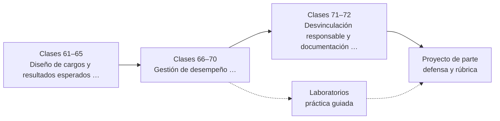

# Parte 05 — Gestión de talento y personas

<!-- parte:inicio -->

> ← [Parte 04 — Liderazgo de equipos](../04-team-leadership/README.md) · [Temario](../../SYLLABUS.md) · [Parte 06 — Proyectos, Agile y entrega](../06-projects-agile-delivery/README.md) →

*Contratar, desarrollar y evaluar personas con criterio y justicia*

**Etapa:** 2 — Liderazgo de equipos y ejecución  
**Duración:** 12 clases · 30 horas  
**Resultado de salida:** Diseñar roles, contratar, desarrollar, evaluar y gestionar desempeño con criterio y justicia.

🔵 [Ver las 6 etapas](../../SYLLABUS.md) · 12 clases (061–072) · 4 laboratorios · [proyecto de parte](project.md)

## 🎯 De qué trata esta parte

Las decisiones sobre personas son las de mayor consecuencia y las que más se toman por intuición. Esta parte las trata como decisiones con método, evidencia y trazabilidad, porque afectan a quien se contrata y a quien se desvincula.

El eje es **el cargo antes que la persona**: se diseña el rol, se selecciona con estructura, se evalúa con criterios conocidos y se desvincula con documentación. Incluye los límites legales y éticos que un gerente debe conocer.

## 🧱 Con qué hay que llegar

| Parte | Qué aporta |
|---|---|
| [04 — Liderazgo de equipos](../04-team-leadership/README.md) | Equipos, delegación y one-on-ones. |
| [01 — Pensamiento crítico y toma de decisiones](../01-critical-thinking-and-decisions/README.md) | Decisiones con evidencia y registro. |

Cada clase supone la anterior: el orden importa, y saltarse una deja sin base a las que vienen después.

## 📚 Resultados de la parte

Al terminar esta parte podrás:

1. **Diseñar** cargos con resultados esperados.
2. **Seleccionar** con entrevistas estructuradas y criterios previos.
3. **Gestionar** desempeño con feedback, coaching y planes de mejora.
4. **Plantear** compensación, aprendizaje y sucesión con coherencia.
5. **Conducir** una desvinculación responsable y documentada.

## 🗺️ Mapa de la parte

## 🧭 Cómo se encadenan las 12 clases

Las clases **61 a 65** cubren la entrada: diseño de cargo, dotación, selección, entrevistas y onboarding.

Las clases **66 a 70** cubren la permanencia: desempeño, feedback, compensación, aprendizaje y sucesión.

Las clases **71 y 72** cubren la salida y el cierre: desvinculación responsable y el capstone de un sistema de talento.

## 📘 Las 12 clases

| # | Clase | Qué se trabaja | Entregable | Min |
|---:|---|---|---|---:|
| 061 | [Diseño de cargos y resultados esperados](classes/061-diseno-de-cargos-y-resultados-esperados/README.md) | Cargo, Resultado esperado, Características centrales del puesto | [role-scorecard](../../templates/role-scorecard.md) | 150 |
| 062 | [Planificación de dotación](classes/062-planificacion-de-dotacion/README.md) | Planificación de dotación, Demanda de trabajo, Oferta interna | [leadership-decision-brief](../../templates/leadership-decision-brief.md) | 150 |
| 063 | [Atracción y selección](classes/063-atraccion-y-seleccion/README.md) | Validez predictiva, Metaanálisis, Sobrecorrección por restricción de rango | [people-decision-brief](../../templates/people-decision-brief.md) | 150 |
| 064 | [Entrevistas estructuradas](classes/064-entrevistas-estructuradas/README.md) | Entrevista estructurada, Pregunta conductual, Pregunta situacional | [leadership-decision-brief](../../templates/leadership-decision-brief.md) | 150 |
| 065 | [Onboarding y primeros 90 días](classes/065-onboarding-y-primeros-90-dias/README.md) | Onboarding, Socialización organizacional, Claridad del rol | [risk-governance-brief](../../templates/risk-governance-brief.md) | 150 |
| 066 | [Gestión de desempeño](classes/066-gestion-de-desempeno/README.md) | Gestión de desempeño, Evaluación de desempeño, Meta específica y difícil | [people-decision-brief](../../templates/people-decision-brief.md) | 150 |
| 067 | [Feedback, coaching y planes de mejora](classes/067-feedback-coaching-y-planes-de-mejora/README.md) | Brecha de desempeño, Diagnóstico de causas, Plan de mejora | [people-decision-brief](../../templates/people-decision-brief.md) | 150 |
| 068 | [Compensación e incentivos: fundamentos](classes/068-compensacion-e-incentivos-fundamentos/README.md) | Equidad percibida, Inequidad, Recompensa tangible contingente | [leadership-decision-brief](../../templates/leadership-decision-brief.md) | 150 |
| 069 | [Aprendizaje y upskilling](classes/069-aprendizaje-y-upskilling/README.md) | Upskilling, Práctica deliberada, Conocimiento previo | [leadership-decision-brief](../../templates/leadership-decision-brief.md) | 150 |
| 070 | [Sucesión y liderazgo interno](classes/070-sucesion-y-liderazgo-interno/README.md) | Sucesión, Cargo crítico, Pasaje de liderazgo | [people-decision-brief](../../templates/people-decision-brief.md) | 150 |
| 071 | [Desvinculación responsable y documentación](classes/071-desvinculacion-responsable-y-documentacion/README.md) | Desvinculación, Desvinculación responsable, Documentación | [leadership-decision-brief](../../templates/leadership-decision-brief.md) | 150 |
| 072 | [Capstone: construir un sistema de talento](classes/072-capstone-construir-un-sistema-de-talento/README.md) | Sistema de talento, Coherencia, Palanca de entrada | [people-decision-brief](../../templates/people-decision-brief.md) | 150 |

## ⚠️ Riesgos característicos

- Contratar por afinidad y no por criterios del cargo.
- Evaluar desempeño sin criterios previos ni registro.
- Desvincular sin documentación ni proceso.
- Aplicar normas laborales sin verificar la fuente vigente.

## 🔤 Glosario de la parte

70 conceptos definidos en las clases, con la definición operacional que usa cada una.

| Concepto | Definición operacional |
|---|---|
| **Aceptación social** | Sentirse parte del grupo y valorado (Bauer et al., 2007). |
| **Autoeficacia** | Confianza en la propia capacidad de desempeñar las tareas (Bauer et al., 2007). |
| **Brecha** | Diferencia entre demanda y oferta, en cantidad y en capacidades. |
| **Brecha de desempeño** | Diferencia entre el desempeño observado y el esperado, con hechos. |
| **Calibración** | Revisión conjunta de evaluaciones para homogeneizar criterios. |
| **Canal de liderazgo (pipeline)** | Secuencia de pasajes por los que avanza un líder en la organización (Charan et al., 2001). |
| **Características centrales del puesto** | Variedad de habilidades, identidad de la tarea, significado, autonomía y retroalimentación (Hackman y Oldham, 1976). |
| **Cargo** | Conjunto de responsabilidades asignadas a una posición. |
| **Cargo crítico** | Posición cuya vacancia genera un riesgo material para la organización. |
| **Claridad del rol** | Comprensión de lo que se espera del cargo (Bauer et al., 2007). |
| **Coaching** | Conversación para que la persona descubra cómo mejorar (Whitmore, 1992). |
| **Coherencia** | Alineación entre lo que la organización declara, lo que premia y lo que hace en sus prácticas. |
| **Conocimiento previo** | Lo que la persona ya sabe y condiciona lo que aprende (Ambrose et al., 2010). |
| **Demanda de trabajo** | Cantidad y tipo de trabajo que la estrategia exige. |
| **Desvinculación** | Término de la relación de trabajo por decisión de la organización o de la persona. |
| **Desvinculación responsable** | Término decidido con evidencia, proceso verificado, trato digno y cuidado de quienes se quedan. |
| **Diagnóstico de causas** | Examen de si la brecha se debe a falta de claridad, de capacidad, de recursos o de motivación. |
| **Diseño del trabajo** | Organización de las tareas y responsabilidades de un puesto (Morgeson y Humphrey, 2006). |
| **Disparador de verdad, relación o identidad** | Reacciones que dificultan recibir feedback (Stone y Heen, 2014). |
| **Documentación** | Registro de hechos, expectativas, apoyo y resultados que sustenta la decisión. |
| **Efecto de desplazamiento** | Reducción del interés intrínseco al introducir una recompensa externa (Deci et al., 1999). |
| **Entrevista estructurada** | Entrevista con preguntas, escala y criterios definidos de antemano (Levashina et al., 2014). |
| **Equidad percibida** | Juicio sobre si la relación entre lo que se aporta y lo que se recibe es justa en comparación con otros (Adams, 1963). |
| **Escala con anclas** | Puntaje con descripciones de respuestas débiles, medias y fuertes. |
| **Escenario** | Supuesto alternativo de demanda u oferta. |
| **Estados psicológicos críticos** | Significado experimentado, responsabilidad experimentada y conocimiento de resultados (Hackman y Oldham, 1976). |
| **Evaluación de desempeño** | Juicio formal periódico sobre el desempeño. |
| **Evaluación independiente** | Cada evaluador puntúa antes de conocer la opinión de los demás. |
| **Feedback de tarea** | Información sobre el desempeño en la tarea, más útil que la dirigida a la persona (Kluger y DeNisi, 1996). |
| **Ganancia temprana** | Resultado visible logrado pronto que da credibilidad (Watkins, 2003). |
| **Gestión de desempeño** | Proceso continuo de acordar expectativas, apoyar, observar, evaluar y decidir sobre el desempeño de las personas. |
| **Hacer o comprar talento** | Decisión entre desarrollar internamente o contratar afuera (Cappelli, 2008). |
| **Impacto adverso** | Efecto desigual de un método sobre grupos protegidos. |
| **Incentivo mal alineado** | Incentivo que premia una conducta distinta de la deseada (Gneezy y Rustichini, 2000). |
| **Indicador de personas** | Medida de resultados sobre las personas: rotación temprana, desempeño, clima, equidad. |
| **Inequidad** | Percepción de que la propia relación aporte-resultado es menos favorable que la de otro. |
| **Justicia interpersonal** | Percepción de que se trató a la persona con respeto (Colquitt et al., 2001). |
| **Justicia procedimental** | Percepción de que el proceso fue justo (Colquitt et al., 2001). |
| **Meta específica y difícil** | Objetivo claro y exigente (Locke y Latham, 2002). |
| **Metaanálisis** | Combinación estadística de muchos estudios para estimar un efecto promedio. |
| **Motivación intrínseca** | Interés por la tarea en sí (Ryan y Deci, 2000). |
| **Muestra de trabajo** | Tarea representativa del cargo que el candidato realiza. |
| **Oferta interna** | Personas disponibles con sus capacidades, considerando rotación y jubilaciones. |
| **Onboarding** | Proceso mediante el cual una persona nueva adquiere los conocimientos, las conductas y las relaciones para desempeñarse en su cargo. |
| **Palanca de entrada** | Decisión que condiciona todo lo posterior: cargo y selección. |
| **Pasaje de liderazgo** | Transición a un nivel con nuevas habilidades, uso del tiempo y valores (Charan et al., 2001). |
| **Plan de mejora** | Acuerdo escrito, con plazo, apoyo y metas, para cerrar una brecha. |
| **Planificación de dotación** | Proceso de determinar qué personas y capacidades necesita la organización, cuándo y cómo obtenerlas. |
| **Pregunta conductual** | Pide una situación pasada real: «cuéntame una vez en que…». |
| **Pregunta situacional** | Plantea una situación hipotética del cargo y pregunta qué haría. |
| **Preparación (readiness)** | Grado en que un candidato está listo para el siguiente pasaje. |
| **Proporcionalidad** | Ajuste del sistema al tamaño y al riesgo de la organización. |
| **Práctica de recuperación** | Intentar recordar lo aprendido, en lugar de releerlo (Brown et al., 2014). |
| **Práctica deliberada** | Práctica diseñada para mejorar un aspecto específico, al límite de la capacidad, con retroalimentación inmediata (Ericsson y Pool, 2016). |
| **Práctica espaciada** | Repetir con intervalos de tiempo en vez de concentrar todo (Brown et al., 2014). |
| **Recompensa tangible contingente** | Premio material que depende de realizar una tarea o alcanzar un resultado (Deci et al., 1999). |
| **Resultado esperado** | Lo que debe lograrse en el cargo, medible y con plazo. |
| **Revisión del sistema** | Evaluación periódica de la efectividad y la coherencia. |
| **Role scorecard** | Documento que fija propósito, resultados y competencias de un cargo. |
| **Ruido** | Variación indeseada en los juicios de distintos evaluadores ante el mismo caso (Kahneman et al., 2021). |
| **Sesgo de evaluación** | Error sistemático por factores ajenos al desempeño: afinidad, halo, recencia. |
| **Sistema de talento** | Conjunto de prácticas de entrada, permanencia, desarrollo y salida de las personas, coherentes con la estrategia. |
| **Sobrecorrección por restricción de rango** | Error en que se ajustan al alza las validez al suponer que los contratados son más homogéneos de lo que son (Sackett et al., 2022). |
| **Socialización organizacional** | Proceso por el cual los recién llegados aprenden las normas y el rol de la organización (Bauer et al., 2007). |
| **Sucesión** | Proceso de preparar personas para ocupar cargos clave cuando queden vacantes. |
| **Sucesión de emergencia** | Plan para reemplazar de inmediato a una persona por salida inesperada. |
| **Transferencia** | Aplicación de lo aprendido a situaciones reales. |
| **Upskilling** | Desarrollo de capacidades que una persona necesita para su cargo actual o próximo. |
| **Validez predictiva** | Relación entre el puntaje en un método de selección y el desempeño posterior (Schmidt y Hunter, 1998). |
| **Verificación legal** | Revisión de la norma aplicable por un asesor antes de actuar. |

## 📦 Qué queda como evidencia

- Un diseño de cargo con resultados esperados.
- Una guía de entrevista estructurada.
- Un plan de desempeño y una desvinculación documentada.
- El capstone: sistema de talento.

## 🔗 Cómo se conecta

Alimenta la parte 14 (diseño organizacional) y 16 (sucesión del CEO). El marco laboral chileno se amplía en la parte 21.

## 🧪 Cómo se trabaja

Son **12 clases de 150 minutos** —30 horas— con **4 laboratorios** y un proyecto integrador. Cada clase trae su propósito, sus conceptos, un caso, práctica, errores frecuentes, preguntas de comprobación, entregable y fuentes, y se evalúa con su `assessment.md`. Los laboratorios se resuelven con datos propios o sintéticos, nunca con datos reales de terceros, y la parte se cierra con el proyecto y su defensa. Las reglas de recorrido están en [la guía de navegación](../../docs/NAVIGATION.md).

<!-- parte:fin -->

## Laboratorios

- [Lab 01 — Scorecard de rol](labs/lab-01.md)
- [Lab 02 — Guía de entrevista](labs/lab-02.md)
- [Lab 03 — Plan 30-60-90](labs/lab-03.md)
- [Lab 04 — Performance improvement case](labs/lab-04.md)

## Proyecto de parte

Diseñar el sistema de personas para una empresa que crece de 10 a 40 colaboradores.

## Bibliografía rectora

- Michael Armstrong & Stephen Taylor — *Armstrong's Handbook of Human Resource Management Practice* (RR.HH.)
- Raymond Noe et al. — *Human Resource Management* (RR.HH.)
- Marcus Buckingham & Curt Coffman — *First, Break All the Rules* (Management de personas)
- Kim Scott — *Radical Candor* (Feedback)
- Robert I. Sutton — *Good Boss, Bad Boss* (Management de personas)

## Criterio de aprobación

80/100 y entrega del proyecto integrador.
