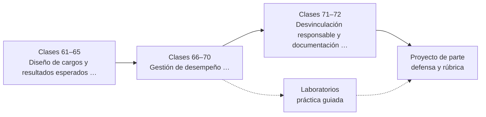

# Parte 05 — Gestión de talento y personas

<!-- parte:inicio -->

> ← [Parte 04 — Liderazgo de equipos](../04-team-leadership/README.md) · [Temario](../../SYLLABUS.md) · [Parte 06 — Proyectos, Agile y entrega](../06-projects-agile-delivery/README.md) →

*Contratar, desarrollar y evaluar personas con criterio y justicia*

**Etapa:** 2 — Liderazgo de equipos y ejecución  
**Duración:** 12 clases · 30 horas  
**Resultado de salida:** Diseñar roles, contratar, desarrollar, evaluar y gestionar desempeño con criterio y justicia.

🔵 [Ver las 6 etapas](../../SYLLABUS.md) · 12 clases (061–072) · 4 laboratorios · [proyecto de parte](project.md)

## 🎯 De qué trata esta parte

Las decisiones sobre personas son las de mayor consecuencia y las que más se toman por intuición. Esta parte las trata como decisiones con método, evidencia y trazabilidad, porque afectan a quien se contrata y a quien se desvincula.

El eje es **el cargo antes que la persona**: se diseña el rol, se selecciona con estructura, se evalúa con criterios conocidos y se desvincula con documentación. Incluye los límites legales y éticos que un gerente debe conocer.

## 🧱 Con qué hay que llegar

| Parte | Qué aporta |
|---|---|
| [04 — Liderazgo de equipos](../04-team-leadership/README.md) | Equipos, delegación y one-on-ones. |
| [01 — Pensamiento crítico y toma de decisiones](../01-critical-thinking-and-decisions/README.md) | Decisiones con evidencia y registro. |

Cada clase supone la anterior: el orden importa, y saltarse una deja sin base a las que vienen después.

## 📚 Resultados de la parte

Al terminar esta parte podrás:

1. **Diseñar** cargos con resultados esperados.
2. **Seleccionar** con entrevistas estructuradas y criterios previos.
3. **Gestionar** desempeño con feedback, coaching y planes de mejora.
4. **Plantear** compensación, aprendizaje y sucesión con coherencia.
5. **Conducir** una desvinculación responsable y documentada.

## 🗺️ Mapa de la parte

## 🧭 Cómo se encadenan las 12 clases

Las clases **61 a 65** cubren la entrada: diseño de cargo, dotación, selección, entrevistas y onboarding.

Las clases **66 a 70** cubren la permanencia: desempeño, feedback, compensación, aprendizaje y sucesión.

Las clases **71 y 72** cubren la salida y el cierre: desvinculación responsable y el capstone de un sistema de talento.

## 📘 Las 12 clases

| # | Clase | Qué se trabaja | Entregable | Min |
|---:|---|---|---|---:|
| 061 | [Diseño de cargos y resultados esperados](classes/061-diseno-de-cargos-y-resultados-esperados/README.md) | job architecture, outcome del cargo, competencia | [people-decision-brief](../../templates/people-decision-brief.md) | 150 |
| 062 | [Planificación de dotación](classes/062-planificacion-de-dotacion/README.md) | workforce planning, headcount, capacity gap | [leadership-decision-brief](../../templates/leadership-decision-brief.md) | 150 |
| 063 | [Atracción y selección](classes/063-atraccion-y-seleccion/README.md) | talent funnel, selection validity, job-relevant evidence | [people-decision-brief](../../templates/people-decision-brief.md) | 150 |
| 064 | [Entrevistas estructuradas](classes/064-entrevistas-estructuradas/README.md) | entrevista estructurada, behavioral question, situational question | [leadership-decision-brief](../../templates/leadership-decision-brief.md) | 150 |
| 065 | [Onboarding y primeros 90 días](classes/065-onboarding-y-primeros-90-dias/README.md) | onboarding, time-to-productivity, role clarity | [risk-governance-brief](../../templates/risk-governance-brief.md) | 150 |
| 066 | [Gestión de desempeño](classes/066-gestion-de-desempeno/README.md) | performance management, goal, behavior | [people-decision-brief](../../templates/people-decision-brief.md) | 150 |
| 067 | [Feedback, coaching y planes de mejora](classes/067-feedback-coaching-y-planes-de-mejora/README.md) | performance gap, PIP, support | [people-decision-brief](../../templates/people-decision-brief.md) | 150 |
| 068 | [Compensación e incentivos: fundamentos](classes/068-compensacion-e-incentivos-fundamentos/README.md) | total rewards, pay band, internal equity | [leadership-decision-brief](../../templates/leadership-decision-brief.md) | 150 |
| 069 | [Aprendizaje y upskilling](classes/069-aprendizaje-y-upskilling/README.md) | upskilling, reskilling, skill taxonomy | [leadership-decision-brief](../../templates/leadership-decision-brief.md) | 150 |
| 070 | [Sucesión y liderazgo interno](classes/070-sucesion-y-liderazgo-interno/README.md) | critical role, succession slate, readiness | [people-decision-brief](../../templates/people-decision-brief.md) | 150 |
| 071 | [Desvinculación responsable y documentación](classes/071-desvinculacion-responsable-y-documentacion/README.md) | causal de término, due process, finiquito | [leadership-decision-brief](../../templates/leadership-decision-brief.md) | 150 |
| 072 | [Capstone: construir un sistema de talento](classes/072-capstone-construir-un-sistema-de-talento/README.md) | talent system, employee lifecycle, talent philosophy | [people-decision-brief](../../templates/people-decision-brief.md) | 150 |

## ⚠️ Riesgos característicos

- Contratar por afinidad y no por criterios del cargo.
- Evaluar desempeño sin criterios previos ni registro.
- Desvincular sin documentación ni proceso.
- Aplicar normas laborales sin verificar la fuente vigente.

## 🔤 Glosario de la parte

59 conceptos definidos en las clases, con la definición operacional que usa cada una.

| Concepto | Definición operacional |
|---|---|
| **adverse impact** | efecto desproporcionado de un proceso sobre un grupo. |
| **behavior** | forma de actuar relevante para producir resultados y cultura. |
| **behavioral question** | pregunta sobre conducta pasada en contexto relevante. |
| **build-buy-borrow** | elección entre desarrollar, contratar o acceder temporalmente a una capacidad. |
| **calibration** | discusión entre managers para reducir inconsistencias de criterios. |
| **candidate experience** | experiencia del postulante que afecta reputación y aceptación. |
| **capacity gap** | diferencia entre capacidad requerida y disponible. |
| **causal de término** | fundamento legal o contractual del fin de relación según jurisdicción. |
| **competencia** | capacidad observable necesaria para producir el outcome. |
| **critical role** | rol cuya ausencia causa impacto material y difícil de cubrir. |
| **developmental assignment** | experiencia diseñada para cerrar una brecha. |
| **documentation** | registro factual de expectativas, feedback y resultados. |
| **due process** | procedimiento y oportunidad de respuesta exigible según caso. |
| **emergency successor** | persona capaz de sostener continuidad temporal. |
| **employee lifecycle** | secuencia desde atracción hasta salida. |
| **entrevista estructurada** | entrevista con preguntas, secuencia y scoring predeterminados. |
| **evidence** | datos, ejemplos y resultados que sustentan evaluación. |
| **finiquito** | documento de cierre de obligaciones laborales en sistemas donde aplica. |
| **goal** | resultado esperado con horizonte. |
| **governance** | roles y decisiones de managers, RR.HH. y ejecutivos. |
| **headcount** | número de personas, insuficiente sin skills y productividad. |
| **incentive risk** | conducta no deseada provocada por cómo se recompensa. |
| **inter-rater reliability** | consistencia entre evaluadores. |
| **internal equity** | coherencia de pago entre trabajos comparables. |
| **job architecture** | estructura de familias, niveles y expectativas de roles. |
| **job-relevant evidence** | evidencia directamente relacionada con tareas o competencias del rol. |
| **knowledge transfer** | traspaso planificado de información crítica. |
| **learning path** | secuencia de aprendizaje y práctica hacia un estándar. |
| **milestone** | evidencia intermedia de progreso. |
| **network building** | desarrollo de relaciones necesarias para ejecutar. |
| **nivel** | amplitud de complejidad, autonomía e impacto esperada. |
| **offboarding** | proceso de salida administrativa, operativa y de seguridad. |
| **onboarding** | proceso de integración hasta alcanzar contribución y pertenencia razonables. |
| **outcome del cargo** | resultado por el cual el rol existe. |
| **pay band** | rango de compensación para un nivel o rol. |
| **people analytics** | uso responsable de datos para observar patrones del sistema. |
| **performance gap** | diferencia entre estándar acordado y desempeño observado. |
| **performance management** | sistema continuo para alinear expectativas y mejorar desempeño. |
| **PIP** | plan formal de mejora con expectativas y horizonte definidos. |
| **quick win** | resultado temprano que produce aprendizaje y credibilidad sin riesgo excesivo. |
| **readiness** | tiempo y brechas estimadas para asumir el rol. |
| **reskilling** | desarrollo de capacidades para un rol distinto. |
| **role clarity** | comprensión de outcomes, autoridad y prioridades. |
| **scorecard** | conjunto corto de outcomes y competencias usados para seleccionar y evaluar. |
| **scoring anchor** | ejemplo que describe evidencias de cada puntuación. |
| **selection validity** | grado en que un método predice desempeño relevante. |
| **situational question** | escenario hipotético que evalúa razonamiento. |
| **skill taxonomy** | lenguaje común para describir capacidades. |
| **succession slate** | conjunto de candidatos posibles, no un ganador predeterminado. |
| **support** | recursos, coaching o entrenamiento razonablemente ofrecidos. |
| **talent funnel** | etapas desde awareness hasta oferta aceptada. |
| **talent philosophy** | principios explícitos sobre desarrollo, desempeño y recompensa. |
| **talent system** | conjunto interdependiente de prácticas que atrae, desarrolla, evalúa y retiene capacidades. |
| **time-to-productivity** | tiempo desde contratación hasta contribución esperada. |
| **total rewards** | conjunto de compensación monetaria, beneficios y elementos de experiencia. |
| **transferencia** | uso efectivo de la capacidad en trabajo real. |
| **upskilling** | profundización de capacidades para responsabilidades actuales o crecientes. |
| **variable pay** | compensación dependiente de desempeño o eventos. |
| **workforce planning** | proceso de proyectar demanda y oferta de capacidades. |

## 📦 Qué queda como evidencia

- Un diseño de cargo con resultados esperados.
- Una guía de entrevista estructurada.
- Un plan de desempeño y una desvinculación documentada.
- El capstone: sistema de talento.

## 🔗 Cómo se conecta

Alimenta la parte 14 (diseño organizacional) y 16 (sucesión del CEO). El marco laboral chileno se amplía en la parte 21.

## 🧪 Cómo se trabaja

Son **12 clases de 150 minutos** —30 horas— con **4 laboratorios** y un proyecto integrador. Cada clase trae su propósito, sus conceptos, un caso, práctica, errores frecuentes, preguntas de comprobación, entregable y fuentes, y se evalúa con su `assessment.md`. Los laboratorios se resuelven con datos propios o sintéticos, nunca con datos reales de terceros, y la parte se cierra con el proyecto y su defensa. Las reglas de recorrido están en [la guía de navegación](../../docs/NAVIGATION.md).

<!-- parte:fin -->

## Laboratorios

- [Lab 01 — Scorecard de rol](labs/lab-01.md)
- [Lab 02 — Guía de entrevista](labs/lab-02.md)
- [Lab 03 — Plan 30-60-90](labs/lab-03.md)
- [Lab 04 — Performance improvement case](labs/lab-04.md)

## Proyecto de parte

Diseñar el sistema de personas para una empresa que crece de 10 a 40 colaboradores.

## Bibliografía rectora

- Michael Armstrong & Stephen Taylor — *Armstrong's Handbook of Human Resource Management Practice* (RR.HH.)
- Raymond Noe et al. — *Human Resource Management* (RR.HH.)
- Marcus Buckingham & Curt Coffman — *First, Break All the Rules* (Management de personas)
- Kim Scott — *Radical Candor* (Feedback)
- Robert I. Sutton — *Good Boss, Bad Boss* (Management de personas)

## Criterio de aprobación

80/100 y entrega del proyecto integrador.
