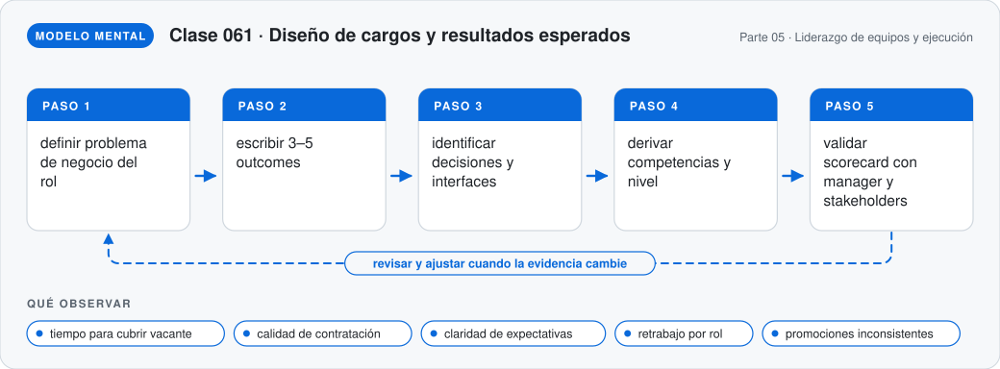

# Clase 061 — Diseño de cargos y resultados esperados

<!-- nav:inicio -->
> **Parte 05 · Gestión de talento y personas** — clase 1 de 12 · [índice de la parte](../../README.md) · [temario](../../../../SYLLABUS.md)
<!-- nav:fin -->

**Parte:** 05 — Gestión de talento y personas  
**Nivel:** Etapa 2 — Líder → Jefe / Team Lead  
**Duración sugerida:** 150–180 minutos · **Estándar:** deep-class-v2

## 🎯 Propósito

Casi todo problema de personas comienza en un cargo mal definido: una lista de tareas sin resultado, una mezcla de responsabilidades incompatibles, un puesto que nadie podría desempeñar bien. Contratar, evaluar y desarrollar sobre ese cargo produce frustración para todos. Diseñar el cargo es la primera decisión de talento, y la más barata de corregir antes de contratar.

Esta clase usa el modelo de características del puesto de Hackman y Oldham y el cuestionario de diseño del trabajo de Morgeson y Humphrey. Al terminar sabrás definir un cargo por **resultados esperados** y no solo por tareas, evaluar si está bien diseñado y rediseñarlo para que sea más significativo y más fácil de desempeñar.

## 📚 Resultados de aprendizaje

Al finalizar podrás:

1. **Distinguir** cargo, tarea y resultado esperado.
2. **Describir** las cinco características centrales de un puesto y su efecto motivacional.
3. **Redactar** un cargo con propósito, resultados, decisiones y relaciones.
4. **Detectar** cargos mal diseñados: sobrecarga, conflicto de rol, falta de autonomía.
5. **Rediseñar** un cargo sin romper el proceso del que forma parte.

## 🧭 Agenda

| Tramo | Qué se hace |
|---|---|
| 0–20 min | Recuperación: describe tu propio cargo en cinco líneas de resultados, no de tareas. |
| 20–60 min | El modelo de características del puesto y el diseño por resultados. |
| 60–105 min | Ejemplo trabajado: rediseñar un cargo de soporte. |
| 105–140 min | Caso ejecutivo: un cargo imposible. |
| 140–170 min | Límites y entregable. |

## 🧩 Conceptos centrales

| Concepto | Definición | Cómo se reconoce |
|---|---|---|
| **Cargo** | Conjunto de responsabilidades asignadas a una posición. | Tiene un propósito, resultados y relaciones. |
| **Resultado esperado** | Lo que debe lograrse en el cargo, medible y con plazo. | Se puede verificar si se cumplió. |
| **Características centrales del puesto** | Variedad de habilidades, identidad de la tarea, significado, autonomía y retroalimentación (Hackman y Oldham, 1976). | Se pueden evaluar en un cargo concreto. |
| **Estados psicológicos críticos** | Significado experimentado, responsabilidad experimentada y conocimiento de resultados (Hackman y Oldham, 1976). | La persona los reconoce en su trabajo. |
| **Diseño del trabajo** | Organización de las tareas y responsabilidades de un puesto (Morgeson y Humphrey, 2006). | Se decide, no ocurre solo. |
| **Role scorecard** | Documento que fija propósito, resultados y competencias de un cargo. | Se usa para contratar y evaluar. |

## 🧠 Modelo mental

**Cómo leer el diagrama.** De izquierda a derecha: las cinco características del cargo son lo que se diseña; los tres estados psicológicos son lo que la persona experimenta; los resultados son lo que obtiene la organización. El diseño actúa **antes** que cualquier incentivo: un cargo con significado, autonomía y retroalimentación motiva por sí mismo.

## 📖 Desarrollo

### 1. Del listado de tareas al resultado

Una descripción de cargo clásica enumera tareas: «prepara informes, atiende consultas, coordina reuniones». Dice qué se hace pero no para qué. Un cargo bien definido empieza por su **propósito** (qué valor crea y para quién), sigue con **resultados esperados** (qué debe lograrse, cómo se mide) y luego con las **decisiones** que puede tomar y las **relaciones** que necesita. Drucker insiste en que se responde por resultados, no por actividad; definir así el cargo permite delegar, evaluar y desarrollar con criterio.

### 2. El modelo de Hackman y Oldham

Proponen que cinco características hacen que un puesto motive: **variedad de habilidades**, **identidad de la tarea** (hacer una pieza identificable de principio a fin), **significado de la tarea** (efecto en otros), **autonomía** y **retroalimentación** del propio trabajo. Estas generan tres estados psicológicos —sentir el trabajo significativo, sentirse responsable de sus resultados y conocerlos— que a su vez favorecen motivación interna, desempeño de calidad y satisfacción. La relación es más fuerte en personas con alta necesidad de crecimiento.

### 3. Una versión ampliada

Morgeson y Humphrey desarrollaron un cuestionario con más dimensiones: además de las motivacionales, incluyen características **sociales** (interdependencia, apoyo, interacción con otros) y **del contexto** (condiciones físicas, uso de equipamiento). El mensaje práctico es que el diseño del trabajo es más amplio que la tarea: incluye con quién se trabaja y en qué condiciones. Su cuestionario puede usarse para diagnosticar un cargo y comparar versiones.

### 4. Señales de un cargo mal diseñado

Cuatro frecuentes. **Sobrecarga**: más resultados de los que una persona puede lograr. **Conflicto de rol**: responsabilidades que se contradicen (clase 051). **Falta de autonomía**: se responde por un resultado sin poder decidir cómo. **Fragmentación**: tareas sueltas sin una pieza reconocible. Un buen diagnóstico pregunta al ocupante qué parte de su trabajo le parece sin sentido, cuáles decisiones no puede tomar y qué resultado no puede influir.

### 5. Cómo se diseña

Un procedimiento sencillo: **1)** partir del proceso o del resultado que el cargo sirve; **2)** definir propósito y tres a cinco resultados medibles; **3)** agrupar tareas coherentes en el cargo, de modo que produzca una pieza identificable; **4)** acordar las decisiones que puede tomar solo, con consulta y las que no; **5)** definir cómo recibirá retroalimentación de su trabajo; **6)** verificar la carga con quien lo ocupa o lo ocuparía. Un *role scorecard* resume el resultado.

### 6. Rediseñar un cargo existente

Rediseñar es una intervención: cambia el trabajo de una persona. Conviene hacerlo con ella. Opciones: **ampliar** (más variedad), **enriquecer** (más autonomía y responsabilidad), **combinar tareas** para formar piezas completas, **dar contacto directo** con quien recibe el resultado y **abrir canales de retroalimentación**. Verifica que el cambio no rompa el proceso aguas arriba o abajo y que el cargo siga siendo desempeñable en la carga y en el tiempo disponibles.

### 7. Cargos y personas

El cargo no es la persona: un buen diseño reduce la dependencia de individuos excepcionales. Y el diseño no sustituye la conversación: aun con el mismo cargo, las personas difieren en sus intereses y necesidad de crecimiento. Preguntar qué parte del trabajo le da más sentido a cada una permite ajustar sin cambiar el cargo. Cuando el cargo se diseña, se piensa también en su sucesión: ¿quién podría ocuparlo y qué aprendería?

## 📚 Lectura comparada

| Obra | Qué aporta | Qué no resuelve | Pregunta para contrastar |
|---|---|---|---|
| Hackman y Oldham (1976) | Cinco características centrales y tres estados psicológicos. | Es un modelo de los años setenta, con resultados desiguales. | ¿Qué característica falta en tu cargo? |
| Morgeson y Humphrey (2006) | Un cuestionario más amplio, con dimensiones sociales y de contexto. | Mide percepciones. | ¿Con quién necesita trabajar quien ocupa el cargo? |
| Drucker (2006) | Responder por resultados y no por actividad. | No ofrece un formato de cargo. | ¿Cuál es el resultado de este cargo? |
| Bock (2015) | Cómo se piensa el diseño de cargos y la contratación en una empresa de tecnología. | Es un relato de una empresa. | ¿Cómo se parece o se diferencia de tu contexto? |
| Mankins y Garton (2017) | Cómo la asignación de trabajo consume la energía de una organización. | No trata del cargo individual. | ¿Cuánto del cargo es trabajo de bajo valor? |
| Buckingham y Coffman (1999) | Definir los resultados correctos y no los pasos correctos. | Se basa en encuestas de una consultora. | ¿Defines resultados o pasos? |

## 🧮 Ejemplo trabajado

**Situación (hipotética).** Una empresa tiene un cargo de «analista de soporte» con estas tareas: responder correos, cerrar tickets, actualizar un informe diario y atender llamadas escaladas. Hay rotación de 40 % en seis meses.

| Característica | Diagnóstico |
|---|---|
| **Variedad** | Alta repetición; casi la misma tarea todo el día. |
| **Identidad** | Fragmentada: cada ticket pasa por tres personas. |
| **Significado** | Nadie sabe qué ocurre con el cliente después. |
| **Autonomía** | Poca: todo se responde con guiones. |
| **Retroalimentación** | Solo se informa del número de tickets cerrados. |

**Rediseño.** (1) Cada analista se responsabiliza de un conjunto de clientes de principio a fin. (2) Puede decidir compensaciones hasta cierto monto. (3) Recibe cada mes la satisfacción de sus clientes y un caso en que su trabajo evitó una pérdida. (4) Rota una semana al mes por análisis de causas con producto. (5) Se elimina el informe diario, que nadie usa.

**Resultados esperados.** Satisfacción de sus clientes ≥ 4,3/5; resolución al primer contacto ≥ 75 %; al menos dos propuestas de mejora trimestrales.

**Qué muestra.** (1) El cargo se evaluó con las cinco características. (2) El rediseño aumentó identidad, autonomía y retroalimentación. (3) Los resultados se definieron por impacto y no por volumen de tareas.

## 🔀 Comparación y límites

**Cargo frente a rol.** El cargo es la posición formal; el rol, el conjunto de conductas esperadas. Uno puede cambiar sin que se modifique el otro (clase 051).

**Límites.** El modelo de Hackman y Oldham es de los años setenta, y los estudios posteriores encuentran efectos moderados y dependientes de la persona y del contexto. El enriquecimiento de cargos puede aumentar la carga si no se acompaña de recursos. Hay procesos —muy estandarizados o con riesgos de seguridad— donde la autonomía debe ser limitada. Y el diseño de cargos y la clasificación de puestos pueden estar sujetos a normas y a acuerdos colectivos que deben verificarse.

## 🪜 De profesional a owner

| Nivel | Cómo trabaja el diseño de cargos |
|---|---|
| **Profesional** | Describe su aporte en resultados y pide claridad sobre decisiones y retroalimentación. |
| **Jefe / Team Lead** | Redacta y ajusta los cargos de su equipo por resultados. |
| **Gerente** | Revisa la coherencia de los cargos de su área y evita solapes. |
| **CEO / Director** | Diseña los cargos de su equipo directivo en torno a decisiones y resultados de empresa. |
| **Founder / Owner** | Define los primeros cargos cuidando que no sean una mezcla de todo lo que él hacía. |

## 🏢 Caso ejecutivo

Una empresa de servicios busca un «gerente de operaciones y mejora continua». La descripción incluye: gestionar a 40 personas en tres sedes, reducir costos un 15 %, implementar un sistema nuevo, atender reclamos de clientes grandes, supervisar seguridad y participar en el comité de dirección. La última persona en el puesto renunció a los ocho meses, y la anterior a los doce. El director cree que «hace falta una persona excepcional».

Entrega un **rediseño del cargo** que contenga: (a) el diagnóstico con las cinco características y las señales de mal diseño; (b) un propósito en una frase; (c) tres a cinco resultados medibles; (d) las decisiones que puede tomar solo, con consulta y las que no; (e) qué responsabilidades se reasignarán y cómo; (f) cómo verificarás la carga con la persona que lo ocuparía.

## 🧪 Práctica

1. Redacta tu propio cargo con propósito y cuatro resultados medibles.
2. Evalúa un cargo de tu entorno con las cinco características.
3. Identifica un cargo con conflicto de rol y cómo lo reorganizarías.
4. Define cómo recibirá retroalimentación de su trabajo quien lo ocupa.
5. Verifica la carga estimada con quien lo desempeña.

## ⚠️ Errores frecuentes

| Error | Por qué ocurre | Cómo corregirlo |
|---|---|---|
| Listado de tareas | Es lo más fácil | Definir propósito y resultados. |
| Cargo para una «persona excepcional» | Se mezcla todo | Reorganizar las responsabilidades. |
| Resultado sin autonomía | Se centraliza | Alinear decisiones y responsabilidades. |
| Rediseñar sin consultar | Se supone el efecto | Hacerlo con quien ocupa el cargo. |
| Cargo sin feedback | No se piensa en información | Definir cómo se ve su resultado. |
| Ampliar sin recursos | Se busca motivar con más trabajo | Verificar carga y apoyo. |

## ❓ Preguntas de comprobación

1. ¿Qué diferencia hay entre tarea y resultado esperado?
2. ¿Cuáles son las cinco características centrales del puesto?
3. ¿Qué tres estados psicológicos generan y qué resultados favorecen?
4. Nombra tres señales de un cargo mal diseñado.
5. ¿Qué dimensiones añaden Morgeson y Humphrey?
6. ¿Por qué rediseñar un cargo con quien lo ocupa?
7. ¿Qué límite tiene el modelo de Hackman y Oldham?

Claves de respuesta

1. La tarea es lo que se hace; el resultado, lo que debe lograrse, medible y con plazo.
2. Variedad de habilidades, identidad de la tarea, significado, autonomía y retroalimentación.
3. Significado experimentado, responsabilidad experimentada y conocimiento de resultados; favorecen motivación interna, desempeño y satisfacción.
4. Sobrecarga, conflicto de rol, falta de autonomía o fragmentación.
5. Dimensiones sociales (interdependencia, apoyo, interacción) y del contexto de trabajo.
6. Porque el rediseño cambia su trabajo y ella conoce las restricciones reales.
7. Es de los años setenta; los efectos son moderados y dependen de la persona y del contexto.

## 📥 Entregable

Guarda en `portfolio/061-diseno-de-cargos-y-resultados-esperados/`:

- `role-scorecard.md` (plantilla [Role scorecard](../../../../templates/role-scorecard.md)) con el cargo rediseñado del caso ejecutivo;
- `people-decision-brief.md` (plantilla [People Decision Brief](../../../../templates/people-decision-brief.md)) con el diagnóstico;
- `decision-journal.md` con la verificación de carga y los cambios.

## 📗 Fuentes y verificación

- J. Richard Hackman & Greg R. Oldham — *Motivation through the design of work: test of a theory* (Organizational Behavior and Human Performance, 1976). **Uso en esta clase:** las cinco características del puesto y los tres estados psicológicos. Lectura selectiva sobre **diseño de cargos y resultados esperados**. **Localizador:** [DOI 10.1016/0030-5073(76)90016-7](https://doi.org/10.1016/0030-5073(76)90016-7).
- Frederick P. Morgeson & Stephen E. Humphrey — *The Work Design Questionnaire (WDQ): Developing and validating a comprehensive measure for assessing job design and the nature of work* (Journal of Applied Psychology, 2006). **Uso en esta clase:** un cuestionario amplio de diseño del trabajo con dimensiones sociales y de contexto. Lectura selectiva sobre **diseño de cargos y resultados esperados**. **Localizador:** [DOI 10.1037/0021-9010.91.6.1321](https://doi.org/10.1037/0021-9010.91.6.1321).
- Peter F. Drucker — *The Effective Executive* (Collins, 2002). **Uso en esta clase:** responder por resultados y no por actividad. Lectura selectiva sobre **diseño de cargos y resultados esperados**. **Localizador:** [ISBN-13 9780060516079](https://openlibrary.org/isbn/9780060516079).
- Laszlo Bock — *Work Rules!* (Twelve, 2015). **Uso en esta clase:** cómo se piensa el diseño de cargos y la contratación en una empresa de tecnología. Lectura selectiva sobre **diseño de cargos y resultados esperados**. **Localizador:** [ISBN-13 9781455554799](https://openlibrary.org/isbn/9781455554799).
- Michael C. Mankins & Eric Garton — *Time, Talent, Energy* (Harvard Business Review Press, 2017). **Uso en esta clase:** asignación de trabajo y energía de una organización. Lectura selectiva sobre **diseño de cargos y resultados esperados**. **Localizador:** [ISBN-13 9781633691766](https://openlibrary.org/isbn/9781633691766).
- Marcus Buckingham & Curt Coffman — *First, Break All the Rules* (Simon and Schuster, 1999). **Uso en esta clase:** definir resultados y no pasos en el cargo. Lectura selectiva sobre **diseño de cargos y resultados esperados**. **Localizador:** [ISBN-13 9780684852867](https://openlibrary.org/isbn/9780684852867).

> **Regla de fuentes para Diseño de cargos y resultados esperados:** las obras anteriores estructuran las perspectivas de esta materia; cualquier norma, ley o estándar vivo mencionado debe comprobarse nuevamente en su fuente primaria vigente, incluidas las normas sobre clasificación de puestos y acuerdos colectivos. Los ejemplos y casos son hipotéticos. El desarrollo es original y no reproduce capítulos protegidos.

<!-- pie:inicio -->
---

| Anterior | Índice | Siguiente |
|---|---|---|
| [← 060 · Capstone: recuperar un equipo disfuncional](../../../04-team-leadership/classes/060-capstone-recuperar-un-equipo-disfuncional/README.md) | [Parte 05](../../README.md) · [Programa](../../../../SYLLABUS.md) | [062 · Planificación de dotación →](../062-planificacion-de-dotacion/README.md) |
<!-- pie:fin -->
