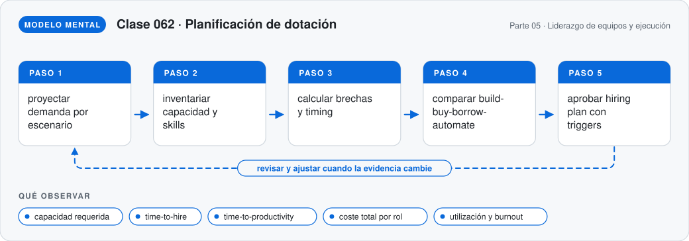

# Clase 062 — Planificación de dotación

<!-- nav:inicio -->
> **Parte 05 · Gestión de talento y personas** — clase 2 de 12 · [índice de la parte](../../README.md) · [temario](../../../../SYLLABUS.md)
<!-- nav:fin -->

**Parte:** 05 — Gestión de talento y personas  
**Nivel:** Etapa 2 — Líder → Jefe / Team Lead  
**Duración sugerida:** 150–180 minutos · **Estándar:** deep-class-v2

## 🎯 Propósito

Las organizaciones contratan por urgencia: cuando alguien renuncia, cuando un proyecto se atrasa, cuando una gerente dice que «no damos abasto». Esa dinámica produce dos males opuestos y frecuentes: dotación insuficiente que quema a las personas y dotación excesiva que consume margen. **Planificar la dotación** es decidir con anticipación cuántas personas y con qué capacidades se necesitan, y cómo se obtienen: formándolas, contratándolas, subcontratando, redistribuyendo o automatizando.

La clase usa el enfoque de Peter Cappelli, que propone gestionar el talento como un problema de incertidumbre y riesgo y no como un cálculo exacto, y la noción de Mankins y Garton de que lo escaso es a menudo la energía y no solo el número de personas. Al terminar sabrás estimar demanda, oferta y brecha, y elegir entre las opciones para cerrarla.

## 📚 Resultados de aprendizaje

Al finalizar podrás:

1. **Estimar** la demanda de trabajo a partir de la estrategia y los volúmenes esperados.
2. **Analizar** la oferta interna: capacidades, rotación y tiempos de reemplazo.
3. **Calcular** la brecha en cantidad y en capacidades, con escenarios.
4. **Elegir** entre desarrollar, contratar, subcontratar, redistribuir y automatizar.
5. **Construir** un plan de dotación con fechas, presupuesto y revisión.

## 🧭 Agenda

| Tramo | Qué se hace |
|---|---|
| 0–20 min | Recuperación: ¿cuántas contrataciones de tu área fueron urgentes en el último año? ¿Qué las habría anticipado? |
| 20–60 min | Demanda, oferta, brecha y opciones. |
| 60–105 min | Ejemplo trabajado: dotación de un equipo de atención en crecimiento. |
| 105–140 min | Caso ejecutivo: un área sobrecargada y una empresa que quiere congelar contrataciones. |
| 140–170 min | Límites y entregable. |

## 🧩 Conceptos centrales

| Concepto | Definición | Cómo se reconoce |
|---|---|---|
| **Planificación de dotación** | Proceso de determinar qué personas y capacidades necesita la organización, cuándo y cómo obtenerlas. | Existe un plan con escenarios y fechas. |
| **Demanda de trabajo** | Cantidad y tipo de trabajo que la estrategia exige. | Se expresa en volumen, capacidad o horas. |
| **Oferta interna** | Personas disponibles con sus capacidades, considerando rotación y jubilaciones. | Se proyecta por período. |
| **Brecha** | Diferencia entre demanda y oferta, en cantidad y en capacidades. | Se calcula por escenario. |
| **Hacer o comprar talento** | Decisión entre desarrollar internamente o contratar afuera (Cappelli, 2008). | Se compara costo, plazo y riesgo. |
| **Escenario** | Supuesto alternativo de demanda u oferta. | Se prevén al menos tres: bajo, base y alto. |

## 🧠 Modelo mental

**Cómo leer el diagrama.** Cinco pasos que se repiten: primero qué trabajo hay que hacer, luego quiénes pueden hacerlo, después la brecha. Solo entonces se eligen **opciones** para cerrarla, y se decide un plan con fecha y presupuesto. El retorno indica que el plan vive: se revisa cuando cambia la estrategia o la demanda.

## 📖 Desarrollo

### 1. Por qué planificar

Contratar por urgencia es caro: se paga más, se elige peor y la persona llega a un equipo ya sobrecargado. Cappelli observa que muchas empresas pasaron de una planificación rígida de largo plazo a una gestión reactiva, y propone un camino intermedio: **planes flexibles** que reconocen la incertidumbre, con anticipación para lo previsible y capacidad de reacción para lo imprevisto. Planificar no es predecir con exactitud; es reducir la sorpresa.

### 2. Demanda

La demanda sale de la estrategia y de los volúmenes: ventas esperadas, proyectos comprometidos, nuevos servicios, requisitos regulatorios. Se traduce a **capacidad necesaria**: horas, personas equivalentes, competencias. Se usan **ratios** razonables (clientes por ejecutivo, tickets por analista) con una advertencia: los ratios históricos incorporan las ineficiencias pasadas. Conviene estimar con tres escenarios —bajo, base, alto— y señalar qué supuestos los separan.

### 3. Oferta

La oferta interna es la dotación actual **más** lo que se espera que cambie: renuncias previstas (con la rotación histórica), jubilaciones, promociones, licencias, movimientos. Además de cuántos, importa **qué saben hacer**: una brecha de capacidades puede coexistir con exceso de personas. Mankins y Garton añaden una dimensión: no todas las horas pagadas son horas productivas; la energía y el tiempo realmente disponibles son menores que la dotación formal.

### 4. Brecha

La brecha se calcula **por período y por capacidad**: «faltan tres analistas de datos en el segundo trimestre» o «sobran dos coordinadores desde enero». Una brecha de personas se distingue de una de capacidades: la primera se cierra con volumen; la segunda, con formación o contratación específica. Y se calcula para cada escenario, con el costo de equivocarse en cada dirección: quedarse corto y sobrecargar, o pasarse y sostener un costo fijo.

### 5. Opciones para cerrarla

Cappelli enmarca la decisión como **hacer o comprar** talento. Las opciones: **desarrollar** internamente (más lento, retiene conocimiento); **contratar** (más rápido en capacidades nuevas, riesgo de ajuste); **subcontratar o usar capacidad externa** (flexible, menos control); **redistribuir** (mover trabajo o personas entre áreas); **automatizar o rediseñar** el trabajo (reduce la necesidad); o **no hacer** (priorizar menos). Se comparan por costo, plazo, riesgo y efecto en la cultura.

### 6. El plan

Un plan práctico incluye: la **brecha por escenario**, la **opción elegida** para cada brecha, las **fechas** de inicio del proceso (considerando que contratar y formar toman tiempo), el **presupuesto**, el **responsable** y los **disparadores** de revisión (por ejemplo, si las ventas superan un umbral, se activa la contratación). Los disparadores permiten reaccionar con orden ante lo imprevisto.

### 7. Cuidado con los efectos

Una congelación de contrataciones sin análisis traslada la carga a quienes quedan. Una expansión sin demanda firme crea costos fijos. Y los cambios de dotación afectan a personas: despidos, reubicaciones y contrataciones están sujetos a normas laborales que se verifican con asesoría. La clase 071 trata la desvinculación y la 065 el ingreso: la planificación define cuántas veces se recorrerán esos procesos.

## 📚 Lectura comparada

| Obra | Qué aporta | Qué no resuelve | Pregunta para contrastar |
|---|---|---|---|
| Cappelli (2008) | Gestión del talento bajo incertidumbre y decisión de hacer o comprar. | Su ejemplo es el mercado de Estados Unidos. | ¿Qué parte de tu dotación depende de supuestos inciertos? |
| Mankins y Garton (2017) | Energía y tiempo reales frente a dotación formal. | Es una obra de consultoría. | ¿Cuántas horas pagadas son productivas? |
| Drucker (2006) | La asignación del tiempo y de las personas a lo que importa. | No trae un método de proyección. | ¿Qué resultados justifican cada puesto? |
| Charan, Drotter y Noel (2001) | Cómo se prepara la oferta interna de líderes. | Se centra en líderes. | ¿Quiénes pueden ocupar los cargos críticos? |
| Bock (2015) | Reclutamiento y planificación en una empresa de tecnología. | Es un relato de una empresa. | ¿Qué parte de su enfoque aplica a tu escala? |

## 🧮 Ejemplo trabajado

**Situación (hipotética).** Una empresa de servicios espera crecer la cartera de clientes: el escenario bajo +10 %, el base +25 % y el alto +40 % en 12 meses. Su equipo de atención tiene 20 personas; la rotación histórica es de 20 % anual; cada persona atiende 80 clientes.

| Concepto | Bajo | Base | Alto |
|---|---|---|---|
| **Clientes proyectados** | 1.760 | 2.000 | 2.240 |
| **Dotación necesaria (80 clientes por persona)** | 22 | 25 | 28 |
| **Oferta a 12 meses (20 − 4 renuncias, reponibles)** | 16 + reposición | 16 + reposición | 16 + reposición |
| **Brecha, sin reposiciones** | 6 | 9 | 12 |

**Opciones.** (1) Reposición de las 4 renuncias esperadas: contratar con anticipación. (2) Aumentar la atención por persona con un portal de autoservicio: reduce la necesidad en 2 a 3 personas. (3) Subcontratar un tramo en temporada alta. (4) Formar a dos analistas internos de otra área.

**Plan.** Contratar 4 reposiciones y 2 personas adicionales en el primer semestre (cubre el escenario bajo y parte del base); autoservicio en el primer trimestre; **disparador**: si los clientes superan los 1.900, activar la contratación del segundo grupo y el contrato de subcontratación.

**Qué muestra.** (1) Se planificó con tres escenarios. (2) Se combinaron opciones. (3) Los disparadores permiten reaccionar sin decidir a ciegas.

## 🔀 Comparación y límites

**Planificar frente a presupuestar.** El presupuesto asigna dinero; la planificación de dotación decide capacidades y fechas. Deben alinearse, pero no son lo mismo.

**Límites.** Las proyecciones de demanda a más de un año son inciertas, y los ratios históricos arrastran ineficiencias. Los estudios de Cappelli reflejan la realidad de ciertos mercados. Una buena planificación no reemplaza el juicio sobre la cultura y el riesgo de sobrecarga. Y las medidas de dotación están sujetas a normas laborales y acuerdos colectivos que se verifican con asesoría.

## 🪜 De profesional a owner

| Nivel | Cómo trabaja la dotación |
|---|---|
| **Profesional** | Informa su carga real y los riesgos de capacidad. |
| **Jefe / Team Lead** | Anticipa necesidades de su equipo con datos de demanda y carga. |
| **Gerente** | Construye el plan de dotación de su área con escenarios. |
| **CEO / Director** | Alinea la dotación con la estrategia y decide entre hacer o comprar talento. |
| **Founder / Owner** | Decide cada contratación con caja limitada y la planifica con escenarios. |

## 🏢 Caso ejecutivo

Una empresa de servicios congeló las contrataciones por tres meses por «presión de costos». El área de operaciones perdió a dos personas y tiene 25 % más de trabajo por un contrato nuevo. Los plazos se incumplen, las horas extra suben y dos buenas personas amenazan con irse. El director financiero insiste en mantener la congelación; la gerente de operaciones pide cuatro contrataciones.

Entrega un **plan de dotación** que contenga: (a) la demanda de trabajo con escenarios; (b) la oferta proyectada con rotación; (c) la brecha en cantidad y capacidades; (d) las opciones comparadas con costo, plazo y riesgo; (e) la propuesta al director financiero con el costo de no actuar; (f) los disparadores de revisión.

## 🧪 Práctica

1. Estima la demanda de tu área para los próximos doce meses en tres escenarios.
2. Calcula la oferta con la rotación histórica y las salidas previstas.
3. Identifica una brecha de capacidades y una de cantidad, y cómo cerrarías cada una.
4. Compara dos opciones para una brecha con costo, plazo y riesgo.
5. Define dos disparadores que activarían una contratación.

## ⚠️ Errores frecuentes

| Error | Por qué ocurre | Cómo corregirlo |
|---|---|---|
| Contratar por urgencia | Falta de anticipación | Planificar con escenarios. |
| Usar ratios históricos sin crítica | Es fácil | Revisar eficiencias y cambios. |
| Ignorar la rotación | Se supone estabilidad | Proyectar salidas con datos. |
| Confundir cantidad con capacidad | Se cuenta personas | Analizar brechas por competencia. |
| Congelar sin analizar | Se busca recorte rápido | Medir el costo de no cubrir. |
| Plan sin revisión | Se archiva | Definir disparadores. |

## ❓ Preguntas de comprobación

1. ¿Qué pasos tiene la planificación de dotación?
2. ¿Por qué se usan escenarios?
3. ¿Qué diferencia hay entre una brecha de cantidad y una de capacidades?
4. Nombra cuatro opciones para cerrar una brecha.
5. ¿Qué es un disparador de revisión?
6. ¿Por qué los ratios históricos pueden engañar?
7. ¿Qué límite tienen las proyecciones de demanda?

Claves de respuesta

1. Demanda de trabajo, oferta interna, brecha, opciones y plan.
2. Porque la demanda es incierta y conviene preparar respuestas para el caso bajo, base y alto.
3. La de cantidad se cierra con volumen; la de capacidades, con formación o contratación específica.
4. Desarrollar, contratar, subcontratar, redistribuir o automatizar.
5. Una condición medible que activa una decisión prevista, como contratar si las ventas superan un umbral.
6. Porque arrastran las ineficiencias del pasado.
7. A más de un año son inciertas y dependen de supuestos.

## 📥 Entregable

Guarda en `portfolio/062-planificacion-de-dotacion/`:

- `leadership-decision-brief.md` (plantilla [Leadership Decision Brief](../../../../templates/leadership-decision-brief.md)) con el plan del caso ejecutivo;
- `reading-note.md` con una tensión entre Cappelli y Mankins y Garton;
- `decision-journal.md` con los supuestos de demanda y los disparadores.

## 📗 Fuentes y verificación

- Peter Cappelli — *Talent on Demand* (Harvard Business Press, 2008). **Uso en esta clase:** gestión del talento bajo incertidumbre y decisión de hacer o comprar talento. Lectura selectiva sobre **planificación de dotación**. **Localizador:** [ISBN-13 9781422104477](https://openlibrary.org/isbn/9781422104477).
- Michael C. Mankins & Eric Garton — *Time, Talent, Energy* (Harvard Business Review Press, 2017). **Uso en esta clase:** energía y tiempo reales frente a dotación formal. Lectura selectiva sobre **planificación de dotación**. **Localizador:** [ISBN-13 9781633691766](https://openlibrary.org/isbn/9781633691766).
- Peter F. Drucker — *The Effective Executive* (Collins, 2002). **Uso en esta clase:** asignación del tiempo y de las personas a lo que importa. Lectura selectiva sobre **planificación de dotación**. **Localizador:** [ISBN-13 9780060516079](https://openlibrary.org/isbn/9780060516079).
- Ram Charan, Stephen Drotter & James Noel — *The Leadership Pipeline* (Jossey-Bass, 2000). **Uso en esta clase:** preparación de la oferta interna de líderes. Lectura selectiva sobre **planificación de dotación**. **Localizador:** [ISBN-13 9780787951726](https://openlibrary.org/isbn/9780787951726).
- Laszlo Bock — *Work Rules!* (Twelve, 2015). **Uso en esta clase:** reclutamiento y planificación en una empresa de tecnología. Lectura selectiva sobre **planificación de dotación**. **Localizador:** [ISBN-13 9781455554799](https://openlibrary.org/isbn/9781455554799).

> **Regla de fuentes para Planificación de dotación:** las obras anteriores estructuran las perspectivas de esta materia; cualquier norma, ley o estándar vivo mencionado debe comprobarse nuevamente en su fuente primaria vigente, incluidas las normas laborales sobre contratación y término de la relación de trabajo. Los ejemplos y casos son hipotéticos, con cifras ilustrativas. El desarrollo es original y no reproduce capítulos protegidos.

<!-- pie:inicio -->
---

| Anterior | Índice | Siguiente |
|---|---|---|
| [← 061 · Diseño de cargos y resultados esperados](../061-diseno-de-cargos-y-resultados-esperados/README.md) | [Parte 05](../../README.md) · [Programa](../../../../SYLLABUS.md) | [063 · Atracción y selección →](../063-atraccion-y-seleccion/README.md) |
<!-- pie:fin -->
