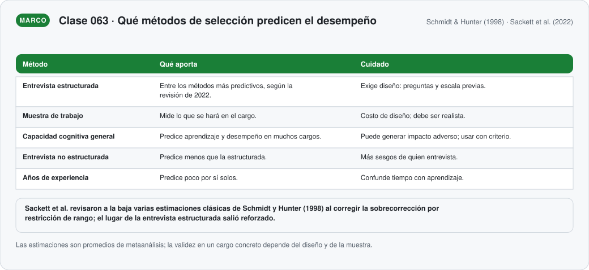

# Clase 063 — Atracción y selección

<!-- nav:inicio -->
> **Parte 05 · Gestión de talento y personas** — clase 3 de 12 · [índice de la parte](../../README.md) · [temario](../../../../SYLLABUS.md)
<!-- nav:fin -->

**Parte:** 05 — Gestión de talento y personas  
**Nivel:** Etapa 2 — Líder → Jefe / Team Lead  
**Duración sugerida:** 150–180 minutos · **Estándar:** deep-class-v2

## 🎯 Propósito

Contratar es la decisión de personas con más consecuencia y la que más se toma por intuición: «tuve una buena sensación», «encaja con el equipo», «se le ve capaz». La investigación sobre selección de personal lleva más de un siglo preguntándose qué métodos predicen realmente el desempeño futuro, y sus respuestas desafían varias costumbres: la entrevista libre predice menos de lo que creemos, los años de experiencia casi nada por sí solos, y las pruebas bien diseñadas bastante más.

Esta clase usa dos metaanálisis centrales: el de Schmidt y Hunter (1998), que resumió décadas de evidencia sobre la validez de distintos métodos, y la **revisión de Sackett y colegas (2022)**, que corrigió a la baja varias estimaciones clásicas. Al terminar sabrás atraer candidatos con un cargo claro, elegir métodos de selección con evidencia y reducir los sesgos del proceso.

## 📚 Resultados de aprendizaje

Al finalizar podrás:

1. **Explicar** qué significa la validez de un método de selección y cómo se estima.
2. **Comparar** métodos de selección según su capacidad predictiva y sus riesgos.
3. **Diseñar** un proceso con varias fuentes de información y criterios previos.
4. **Atraer** candidatos adecuados con un aviso claro y honesto.
5. **Reducir** sesgos y evitar discriminación en el proceso.

## 🧭 Agenda

| Tramo | Qué se hace |
|---|---|
| 0–20 min | Recuperación: recuerda una contratación que salió mal; ¿qué señal ignoraste o sobrevaloraste? |
| 20–60 min | Validez de los métodos y el cambio de la revisión de 2022. |
| 60–105 min | Ejemplo trabajado: diseño del proceso para un cargo de ventas. |
| 105–140 min | Caso ejecutivo: un candidato brillante que «cae bien». |
| 140–170 min | Límites y entregable. |

## 🧩 Conceptos centrales

| Concepto | Definición | Cómo se reconoce |
|---|---|---|
| **Validez predictiva** | Relación entre el puntaje en un método de selección y el desempeño posterior (Schmidt y Hunter, 1998). | Se estima comparando puntajes con desempeño. |
| **Metaanálisis** | Combinación estadística de muchos estudios para estimar un efecto promedio. | Los resultados son promedios, no garantías. |
| **Sobrecorrección por restricción de rango** | Error en que se ajustan al alza las validez al suponer que los contratados son más homogéneos de lo que son (Sackett et al., 2022). | Explica por qué se revisaron a la baja ciertas estimaciones. |
| **Entrevista estructurada** | Entrevista con preguntas, escala y criterios definidos de antemano (Levashina et al., 2014). | Todos los candidatos reciben las mismas preguntas. |
| **Muestra de trabajo** | Tarea representativa del cargo que el candidato realiza. | Se evalúa lo que se hará, no lo que se dice. |
| **Impacto adverso** | Efecto desigual de un método sobre grupos protegidos. | Se revisa por grupos. |

## 🧠 Modelo mental

**Cómo leer el diagrama.** Cada fila es un método con lo que se sabe de su capacidad predictiva y el cuidado que exige. Los dos primeros —entrevista estructurada y muestra de trabajo— combinan buena validez con relación directa con el cargo. Los dos últimos explican por qué la entrevista libre y los años de experiencia, por sí solos, pesan menos de lo que la costumbre les atribuye.

## 📖 Desarrollo

### 1. Qué quiere decir «validez»

Un método de selección es **válido** si quienes obtienen mejores puntajes tienden a desempeñarse mejor después. Se estima con estudios que relacionan puntajes de selección con medidas de desempeño. Un metaanálisis combina muchos estudios. Schmidt y Hunter (1998) reunieron resultados de décadas y concluyeron, entre otras cosas, que las muestras de trabajo, las pruebas de capacidad cognitiva general y las entrevistas estructuradas tenían las mayores validez, mientras la experiencia sin más y la entrevista libre predecían menos. Fue una de las referencias más citadas del campo.

### 2. La revisión de 2022

Sackett y colegas argumentaron que muchas estimaciones clásicas habían sido **sobrecorregidas** por un ajuste estadístico (la corrección por restricción de rango) que suponía una variación mayor entre candidatos de la que realmente existe. Al corregirlo, varias validez bajaron —en particular la de las pruebas cognitivas— y la **entrevista estructurada** pasó a ser el método con mayor validez estimada. La lección práctica es doble: la evidencia puede revisarse, y la conclusión de que **estructurar importa** sale reforzada.

### 3. Qué métodos usar

Una combinación sensata: **entrevista estructurada** (clase 064), una **muestra de trabajo** cuando el cargo la permite, y, según el cargo, pruebas de capacidad o de conocimiento específico con criterio sobre su impacto adverso. Las **referencias** aportan si se preguntan con estructura. La **experiencia** informa sobre lo que la persona ha hecho, pero conviene preguntar qué logró, no cuánto tiempo estuvo. Y ningún método debe usarse solo: la combinación ayuda a corregir los errores de cada uno.

### 4. Atraer antes de seleccionar

Se selecciona entre quienes se postulan: un aviso confuso atrae candidatos equivocados. Un buen aviso comunica el propósito del cargo, los resultados esperados, las condiciones (remuneración o rango, modalidad, ubicación) y el proceso. Conviene ser **honesto** sobre lo difícil: presentar un cargo de manera exagerada atrae a quienes se irán al descubrir la realidad. Bock describe cómo, en su experiencia, la calidad del flujo de candidatos importa tanto como la del proceso.

### 5. Criterios antes que candidatos

Antes de ver a la primera persona, se definen los **criterios**: qué resultados y competencias distinguen un buen desempeño en este cargo (clase 061), y cómo se evaluarán. Si los criterios se definen después de conocer a los candidatos, se ajustan para justificar la preferencia. Un puntaje por criterio, asignado con evidencia, permite comparar y documentar. Un *role scorecard* ordena esta tarea.

### 6. Sesgos y equidad

El proceso de selección es vulnerable a sesgos: afinidad («se parece a mí»), halo (una cualidad domina el juicio), primera impresión y confirmación. Se reducen con **estructura**, evaluaciones independientes antes de discutir, criterios previos y revisión de resultados por grupos. Además, las decisiones de selección están sujetas a normas contra la discriminación, que deben verificarse con asesoría. Evaluar rasgos no relacionados con el cargo —edad, género, origen, estado civil— es ilegítimo y, muchas veces, ilegal.

### 7. La experiencia del candidato

Un proceso es también una comunicación con las personas: la forma en que se trata a quienes no son elegidos afecta la reputación de la organización y la disposición de futuros candidatos. Buenas prácticas: informar plazos, responder a todos, dar feedback breve a quienes llegaron a la etapa final y cuidar la confidencialidad. Y se evalúa el proceso: ¿los contratados rinden?, ¿cuánto dura?, ¿quiénes abandonan y por qué?

## 📚 Lectura comparada

| Obra | Qué aporta | Qué no resuelve | Pregunta para contrastar |
|---|---|---|---|
| Schmidt y Hunter (1998) | Validez de métodos de selección y su utilidad. | Algunas estimaciones fueron revisadas. | ¿Qué método usas más y qué dice la evidencia? |
| Sackett et al. (2022) | Revisión de las estimaciones y reforzamiento de la entrevista estructurada. | Es un debate técnico en curso. | ¿Qué conclusión cambia con la revisión? |
| Levashina et al. (2014) | Qué hace estructurada una entrevista y su efecto. | No trata de otros métodos. | ¿Qué parte de tu entrevista es estructurada? |
| Bock (2015) | Selección y atracción en una empresa de tecnología. | Un relato de una empresa. | ¿Qué aprendes de su proceso? |
| Kahneman, Sibony y Sunstein (2021) | Ruido y variación entre evaluadores. | No se limita a selección. | ¿Cuánto varían tus evaluadores entre sí? |

## 🧮 Ejemplo trabajado

**Situación (hipotética).** Una empresa busca un ejecutivo de cuentas. Hasta ahora, el proceso fue: revisión de CV, una conversación con el gerente y una oferta. De los últimos seis contratados, dos se fueron antes de seis meses y tres rinden por debajo de lo esperado.

| Elemento | Proceso anterior | Proceso nuevo |
|---|---|---|
| **Aviso** | «Se busca vendedor dinámico.» | Propósito, resultados a 12 meses (cuota, retención), rango de remuneración y proceso. |
| **Criterios** | Informales. | Cuatro criterios con evidencia: descubrimiento del cliente, negociación, orden en el seguimiento, aprendizaje. |
| **Filtro** | CV. | Preguntas breves por escrito sobre un caso de ventas. |
| **Entrevista** | Libre, un entrevistador. | Estructurada, dos entrevistadores que puntúan por separado. |
| **Muestra de trabajo** | No. | Simulación de una llamada de descubrimiento y un plan de cuenta en 24 horas. |
| **Referencias** | Una llamada informal. | Dos referencias con las mismas preguntas. |
| **Decisión** | Impresión del gerente. | Puntajes por criterio, discusión y registro de la razón. |

**Resultado.** En el año siguiente, de seis contratados con el proceso nuevo, ninguno renuncia antes de los seis meses y cuatro superan la cuota del primer año.

**Qué muestra.** (1) Se combinaron métodos con evidencia. (2) Los criterios precedieron a los candidatos. (3) Se registró la razón de la decisión.

## 🔀 Comparación y límites

**Selección frente a atracción.** La atracción amplía el conjunto de candidatos; la selección escoge entre ellos. Ambas necesitan un cargo claro.

**Límites.** Los metaanálisis ofrecen promedios; la validez en un cargo concreto puede ser distinta, y la revisión de 2022 muestra que las estimaciones son discutibles. Las pruebas cognitivas pueden tener impacto adverso sobre ciertos grupos y su uso requiere criterio y asesoría. Las leyes sobre no discriminación y protección de datos personales de los candidatos deben verificarse en la fuente vigente. Y ningún método elimina el error: se reduce.

## 🪜 De profesional a owner

| Nivel | Cómo trabaja la selección |
|---|---|
| **Profesional** | Participa como entrevistador y puntúa con criterios. |
| **Jefe / Team Lead** | Define criterios y conduce un proceso estructurado. |
| **Gerente** | Diseña procesos de selección y revisa sus resultados. |
| **CEO / Director** | Se asegura de que las contrataciones críticas usen evidencia y evita decidir por afinidad. |
| **Founder / Owner** | Contrata a las primeras personas con criterios, sabiendo que cada error pesa. |

## 🏢 Caso ejecutivo

Una empresa busca un gerente comercial. Un candidato, muy carismático, lleva diez años en la industria y cae muy bien en la entrevista con el director. Sus referencias son entusiastas pero vagas. Otro candidato, más reservado, tiene resultados verificables y dio la mejor respuesta en la simulación. El director dice: «con el primero se me conectó el instinto». El proceso no tiene criterios por escrito.

Entrega un **diseño de proceso de selección** que contenga: (a) los criterios y cómo se evidenciarán; (b) los métodos a usar y su justificación según la evidencia; (c) cómo evitarás que la afinidad y el carisma sesguen la decisión; (d) cómo comparar a los dos candidatos con los mismos criterios; (e) las salvaguardas contra discriminación; (f) cómo evaluarás el proceso tras contratar.

## 🧪 Práctica

1. Redacta los cuatro criterios de un cargo y cómo los evidenciarías.
2. Evalúa tu último proceso: ¿qué métodos usó y cuáles no tuvieron evidencia?
3. Diseña una muestra de trabajo de una hora para un cargo.
4. Reescribe un aviso de empleo con propósito, resultados y condiciones.
5. Define cómo evaluarás a los entrevistadores y el proceso en seis meses.

## ⚠️ Errores frecuentes

| Error | Por qué ocurre | Cómo corregirlo |
|---|---|---|
| Decidir por «feeling» | Se confía en la intuición | Criterios previos y puntaje por criterio. |
| Entrevista libre | Es la costumbre | Entrevista estructurada. |
| Valorar los años de experiencia | Son fáciles de ver | Preguntar por logros y conductas. |
| Aviso confuso o exagerado | Se quiere atraer más | Propósito, resultados y condiciones honestos. |
| Un solo entrevistador | Se ahorra tiempo | Dos evaluaciones independientes. |
| No evaluar el proceso | Se da por bueno | Revisar el desempeño y la rotación de los contratados. |

## ❓ Preguntas de comprobación

1. ¿Qué significa validez predictiva?
2. ¿Qué corrigió la revisión de Sackett et al. y qué método salió reforzado?
3. ¿Por qué los años de experiencia predicen poco por sí solos?
4. ¿Por qué se definen los criterios antes de ver a los candidatos?
5. Nombra tres sesgos del proceso de selección y una forma de reducirlos.
6. ¿Qué debe contener un buen aviso?
7. ¿Qué límite tienen los metaanálisis?

Claves de respuesta

1. Que quienes obtienen mejores puntajes tienden a desempeñarse mejor después.
2. La sobrecorrección por restricción de rango; salió reforzada la entrevista estructurada.
3. Porque miden tiempo y no aprendizaje ni logros.
4. Para que los criterios no se ajusten después a la preferencia.
5. Afinidad, halo y confirmación; se reducen con estructura, evaluaciones independientes y criterios previos.
6. Propósito, resultados esperados, condiciones y proceso, con honestidad.
7. Ofrecen promedios, y la validez en un cargo concreto puede ser distinta; las estimaciones pueden revisarse.

## 📥 Entregable

Guarda en `portfolio/063-atraccion-y-seleccion/`:

- `people-decision-brief.md` (plantilla [People Decision Brief](../../../../templates/people-decision-brief.md)) con el diseño del caso ejecutivo;
- `role-scorecard.md` (plantilla [Role scorecard](../../../../templates/role-scorecard.md)) con los criterios;
- `decision-journal.md` con la evaluación del proceso.

## 📗 Fuentes y verificación

- Frank L. Schmidt & John E. Hunter — *The validity and utility of selection methods in personnel psychology: Practical and theoretical implications of 85 years of research findings* (Psychological Bulletin, 1998). **Uso en esta clase:** validez y utilidad de los métodos de selección. Lectura selectiva sobre **atracción y selección**. **Localizador:** [DOI 10.1037/0033-2909.124.2.262](https://doi.org/10.1037/0033-2909.124.2.262).
- Paul R. Sackett, Charlene Zhang, Christopher M. Berry & Filip Lievens — *Revisiting meta-analytic estimates of validity in personnel selection: Addressing systematic overcorrection for restriction of range* (Journal of Applied Psychology, 2022). **Uso en esta clase:** revisión de las estimaciones de validez y reforzamiento de la entrevista estructurada. Lectura selectiva sobre **atracción y selección**. **Localizador:** [DOI 10.1037/apl0000994](https://doi.org/10.1037/apl0000994).
- Julia Levashina, Christopher J. Hartwell, Frederick P. Morgeson & Michael A. Campion — *The Structured Employment Interview: Narrative and Quantitative Review of the Research Literature* (Personnel Psychology, 2013). **Uso en esta clase:** qué hace estructurada una entrevista y su efecto. Lectura selectiva sobre **atracción y selección**. **Localizador:** [DOI 10.1111/peps.12052](https://doi.org/10.1111/peps.12052).
- Laszlo Bock — *Work Rules!* (Twelve, 2015). **Uso en esta clase:** atracción y selección en una empresa de tecnología. **Localizador:** [ISBN-13 9781455554799](https://openlibrary.org/isbn/9781455554799).
- Daniel Kahneman, Olivier Sibony & Cass R. Sunstein — *Noise* (Little, Brown Spark, 2021). **Uso en esta clase:** ruido y variación entre evaluadores. Lectura selectiva sobre **atracción y selección**. **Localizador:** [ISBN-13 9780316451383](https://openlibrary.org/isbn/9780316451383).

> **Regla de fuentes para Atracción y selección:** las obras anteriores estructuran las perspectivas de esta materia; cualquier norma, ley o estándar vivo mencionado debe comprobarse nuevamente en su fuente primaria vigente, incluidas las normas contra la discriminación y de protección de datos personales. Los ejemplos y casos son hipotéticos. El desarrollo es original y no reproduce capítulos protegidos.

<!-- pie:inicio -->
---

| Anterior | Índice | Siguiente |
|---|---|---|
| [← 062 · Planificación de dotación](../062-planificacion-de-dotacion/README.md) | [Parte 05](../../README.md) · [Programa](../../../../SYLLABUS.md) | [064 · Entrevistas estructuradas →](../064-entrevistas-estructuradas/README.md) |
<!-- pie:fin -->
