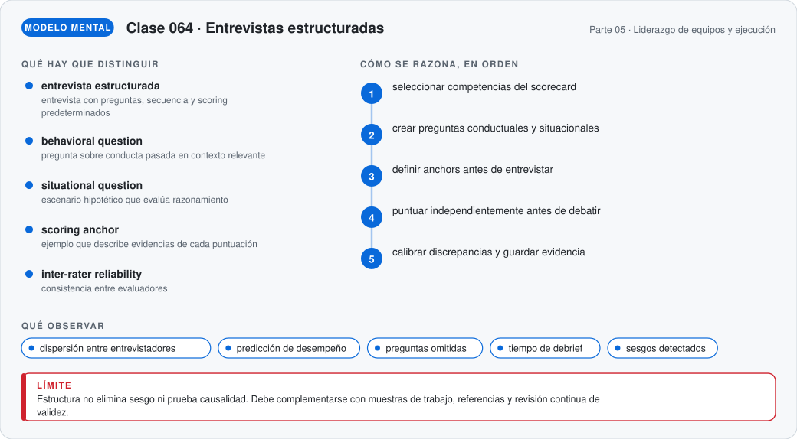

# Clase 064 — Entrevistas estructuradas

<!-- nav:inicio -->
> **Parte 05 · Gestión de talento y personas** — clase 4 de 12 · [índice de la parte](../../README.md) · [temario](../../../../SYLLABUS.md)
<!-- nav:fin -->

**Parte:** 05 — Gestión de talento y personas  
**Nivel:** Etapa 2 — Líder → Jefe / Team Lead  
**Duración sugerida:** 150–180 minutos · **Estándar:** deep-class-v2

## 🎯 Propósito

La entrevista es el método de selección más usado y el peor ejecutado. Quien entrevista suele decidir en los primeros minutos y dedica el resto a confirmar su impresión, pregunta distinto a cada candidato y recuerda mal lo que oyó. La entrevista **estructurada** corrige esto con un diseño: mismas preguntas, relacionadas con el cargo, con una escala de evaluación y con puntajes registrados antes de discutir.

Se apoya en la revisión de Levashina y colegas sobre la investigación en entrevistas estructuradas, en la experiencia que cuenta Laszlo Bock sobre su aplicación en una empresa de tecnología y en el análisis de Kahneman, Sibony y Sunstein sobre el **ruido**: la variación indeseada entre evaluadores que miran el mismo caso. Al terminar sabrás diseñar una entrevista estructurada, conducirla y combinar las evaluaciones.

## 📚 Resultados de aprendizaje

Al finalizar podrás:

1. **Describir** los componentes que hacen estructurada una entrevista.
2. **Diseñar** preguntas basadas en conductas pasadas y en situaciones hipotéticas.
3. **Construir** una escala de puntaje con descripciones ancla.
4. **Conducir** la entrevista y registrar evidencia sin interpretar.
5. **Combinar** evaluaciones independientes y documentar la decisión.

## 🧭 Agenda

| Tramo | Qué se hace |
|---|---|
| 0–20 min | Recuperación: toma tu última entrevista y anota qué preguntaste y qué decidió tu impresión. |
| 20–60 min | Componentes, tipos de pregunta y el problema del ruido. |
| 60–105 min | Ejemplo trabajado: guía de entrevista para un cargo de coordinación. |
| 105–140 min | Caso ejecutivo: tres entrevistadores con tres opiniones. |
| 140–170 min | Límites y entregable. |

## 🧩 Conceptos centrales

| Concepto | Definición | Cómo se reconoce |
|---|---|---|
| **Entrevista estructurada** | Entrevista con contenido y evaluación estandarizados: mismas preguntas, mismos criterios, puntaje por respuesta (Levashina et al., 2014). | Se puede comparar entre candidatos. |
| **Pregunta conductual** | Pide una situación pasada real: «cuéntame una vez en que…». | La respuesta es un hecho verificable. |
| **Pregunta situacional** | Plantea una situación hipotética del cargo y pregunta qué haría. | Se evalúa el razonamiento. |
| **Escala con anclas** | Puntaje con descripciones de respuestas débiles, medias y fuertes. | Dos evaluadores asignan el mismo puntaje. |
| **Ruido** | Variación indeseada en los juicios de distintos evaluadores ante el mismo caso (Kahneman et al., 2021). | Los evaluadores discrepan sin razón sistemática. |
| **Evaluación independiente** | Cada evaluador puntúa antes de conocer la opinión de los demás. | Los puntajes se registran por separado. |

## 🧠 Modelo mental

**Cómo leer el diagrama.** Cinco pasos que ocurren **antes y después** de la conversación: el diseño (analizar el cargo, escribir preguntas, construir la escala) y la decisión (evaluar por separado, combinar). La estructura vive en estas decisiones previas, no en un guion rígido durante la entrevista.

## 📖 Desarrollo

### 1. Por qué estructurar

Levashina y colegas revisaron décadas de investigación sobre entrevistas estructuradas y encontraron que se asocian con mejor predicción del desempeño y menos sesgos que las entrevistas libres. Identificaron componentes que pueden variar: la base de las preguntas (análisis del cargo), la estandarización de las preguntas, el uso de escalas de evaluación, la evaluación independiente y la documentación. A mayor estructura en estos elementos, mejores resultados en general. No es un método único sino un conjunto de decisiones de diseño.

### 2. El ruido

Kahneman, Sibony y Sunstein distinguen el **sesgo** (error sistemático en una dirección) del **ruido** (variación entre juicios que deberían ser iguales). Ante un mismo candidato, dos entrevistadores pueden puntuar muy distinto sin ninguna razón consistente: el humor del día, el orden de los candidatos, la primera impresión. Su recomendación general es la **higiene de decisiones**: evaluar por separado, estructurar el juicio en dimensiones y retrasar la intuición global hasta tener los datos. La entrevista estructurada es un ejemplo.

### 3. Analizar el cargo y fijar dimensiones

Se parte del cargo (clase 061): ¿qué resultados y qué conductas distinguen un buen desempeño? De ahí salen **de tres a cinco dimensiones** a evaluar, por ejemplo: resolución de problemas, colaboración, orientación al cliente, aprendizaje. Cada dimensión se evalúa con una o dos preguntas. Más dimensiones diluyen el juicio y alargan el proceso.

### 4. Preguntas conductuales y situacionales

La **pregunta conductual** parte de que el comportamiento pasado en situaciones similares predice el futuro: «cuéntame una situación en que tuviste que convencer a alguien con una visión opuesta; ¿qué hiciste?, ¿qué resultado hubo?». Se profundiza con sondeos estándar (situación, acción, resultado). La **situacional** plantea un caso: «si el cliente exige un plazo imposible, ¿qué harías?». Ambas funcionan; la primera suele ser más rica en evidencia, la segunda sirve cuando el candidato tiene poca experiencia.

### 5. Escala con anclas

Para cada pregunta se escribe, antes de entrevistar, **cómo se ve** una respuesta débil, media y fuerte, con ejemplos. «Fuerte: describe una situación concreta, su acción específica, el resultado medible y lo que aprendió.» «Débil: habla en general, atribuye el resultado al equipo sin explicar su rol.» Las anclas hacen comparables las evaluaciones y reducen la discrecionalidad. Se puntúa de 1 a 5, registrando evidencia textual.

### 6. Conducir la entrevista

Un procedimiento: **presentarse** y explicar el formato; **hacer las mismas preguntas** en el mismo orden; **sondear** con preguntas estándar; **tomar notas** de hechos y palabras, no de impresiones; **dejar espacio** para preguntas del candidato; y **no puntuar durante** la conversación, sino al terminar cada pregunta, sin discutir con los demás. Se evita opinar sobre el candidato delante de él y salirse del guion salvo para aclarar.

### 7. Combinar y decidir

Cada evaluador entrega sus puntajes **antes** de la reunión. Se comparan, se discuten las diferencias grandes con referencia a la evidencia y se llega a un puntaje por dimensión y total. La decisión final puede usar una **regla** (el mayor puntaje total sobre un mínimo) o un juicio informado por los puntajes; si el juicio se aparta del puntaje, se **documenta por qué**. Después, se revisa si los puntajes predijeron el desempeño: es la forma de mejorar el instrumento.

## 📚 Lectura comparada

| Obra | Qué aporta | Qué no resuelve | Pregunta para contrastar |
|---|---|---|---|
| Levashina et al. (2014) | Componentes y efectos de la estructura de la entrevista. | Es una revisión; los componentes se combinan de modos variados. | ¿Qué componente falta en tu entrevista? |
| Kahneman, Sibony y Sunstein (2021) | Ruido y higiene de decisiones. | Es un tratado general, no solo de selección. | ¿Cuánto varían tus entrevistadores? |
| Bock (2015) | Cómo aplicó una empresa de tecnología entrevistas estructuradas. | Relato de una empresa. | ¿Qué aplicaría tu organización? |
| Schmidt y Hunter (1998) | Validez de los métodos de selección. | Estimaciones revisadas después. | ¿Dónde se ubica la entrevista? |
| Sackett et al. (2022) | Revisión con la entrevista estructurada como el método de mayor validez. | Debate técnico en curso. | ¿Qué cambió respecto de la costumbre? |

## 🧮 Ejemplo trabajado

**Situación (hipotética).** Un equipo busca un coordinador de operaciones. Define cuatro dimensiones y prepara la guía.

| Dimensión | Pregunta | Anclas (resumen) |
|---|---|---|
| **Resolución de problemas** | «Cuéntame un problema operativo complejo que resolviste: ¿cómo lo diagnosticaste y qué resultado tuvo?» | 5: diagnóstico con datos, solución y resultado medido; 3: solución sin datos; 1: no describe una acción propia. |
| **Colaboración** | «Describe una vez en que dependías de otra área que no cumplía. ¿Qué hiciste?» | 5: aborda con hechos y logra un acuerdo; 3: escala sin conversar; 1: culpa a la otra área. |
| **Priorización** | «Si recibes tres pedidos urgentes y solo puedes hacer uno, ¿cómo decides?» | 5: criterios claros, consulta y comunica; 3: decide por intuición; 1: intenta hacer todo. |
| **Aprendizaje** | «Cuéntame un error tuyo reciente y qué cambiaste después.» | 5: error específico, causa reconocida, cambio verificable; 1: no reconoce errores. |

**Proceso.** Dos entrevistadores, que puntúan por separado. La candidata A obtiene 4, 5, 3, 4 (16/20) del primero y 4, 4, 3, 4 (15/20) del segundo; el candidato B, 5, 3, 4, 2 (14) y 5, 3, 3, 2 (13). La discusión se centra en las diferencias de evidencia en «priorización» de A.

**Decisión.** Se escoge a A, y se anota que las diferencias de puntaje en una dimensión se resolvieron con evidencia.

**Qué muestra.** (1) Mismas preguntas y anclas para todos. (2) Evaluación independiente. (3) Decisión con puntajes y razón registrada.

## 🔀 Comparación y límites

**Estructurada frente a rígida.** Estructurar no es leer un guion sin escuchar; permite sondear. Lo que se estandariza es lo que se evalúa y cómo.

**Límites.** La estructura mejora la predicción en promedio, pero no elimina el sesgo: las preguntas y las anclas pueden reflejar los valores de quien las escribe. Hay cargos donde un solo tipo de entrevista no es suficiente. Los candidatos con poca experiencia en entrevistas pueden verse perjudicados por preguntas conductuales. Y se debe verificar con asesoría que las preguntas no se refieran a rasgos protegidos por las normas contra la discriminación.

## 🪜 De profesional a owner

| Nivel | Cómo participa en entrevistas |
|---|---|
| **Profesional** | Entrevista con guía y puntúa por separado. |
| **Jefe / Team Lead** | Diseña la guía con dimensiones y anclas. |
| **Gerente** | Forma a entrevistadores y revisa la calidad de las decisiones. |
| **CEO / Director** | Entrevista a candidatos críticos con la misma disciplina. |
| **Founder / Owner** | Evita entrevistar solo por afinidad a quienes serán sus primeras personas. |

## 🏢 Caso ejecutivo

Tres entrevistadores —gerente, jefe de área y una colega— ven al mismo candidato. El gerente: «excelente, lo contrataría ya». El jefe: «no me convenció, muy vendedor». La colega: «bien, pero no sé». Nadie tomó notas y cada uno hizo preguntas distintas. El proceso debe cerrarse el viernes, y el candidato tiene otra oferta.

Entrega una **guía de entrevista estructurada** que contenga: (a) las dimensiones del cargo y su justificación; (b) las preguntas con sondeos; (c) la escala con anclas; (d) el protocolo de conducción y notas; (e) el método para combinar evaluaciones y documentar la decisión; (f) cómo manejarás el caso de los tres entrevistadores y el plazo.

## 🧪 Práctica

1. Redacta tres preguntas conductuales para un cargo y sus anclas.
2. Prueba la escala con otra persona: ¿puntúan igual?
3. Conduce una entrevista con tu guía y anota solo hechos.
4. Define cómo se combinarán dos evaluaciones y qué hacer si difieren mucho.
5. Revisa tus preguntas para que no refieran a rasgos protegidos.

## ⚠️ Errores frecuentes

| Error | Por qué ocurre | Cómo corregirlo |
|---|---|---|
| Preguntas distintas a cada candidato | Se improvisa | Las mismas preguntas y el mismo orden. |
| Puntuar sin anclas | Es más rápido | Describir respuestas débiles, medias y fuertes. |
| Discutir antes de puntuar | Se busca consenso | Evaluar por separado primero. |
| Notas con impresiones | Se interpreta | Registrar hechos y palabras. |
| Demasiadas dimensiones | Se quiere cubrirlo todo | De tres a cinco. |
| No revisar la predicción | Se da por bueno | Comparar puntajes con desempeño posterior. |

## ❓ Preguntas de comprobación

1. ¿Qué componentes hacen estructurada una entrevista?
2. ¿Qué es el ruido y por qué importa en la selección?
3. ¿Qué diferencia hay entre pregunta conductual y situacional?
4. ¿Qué es una escala con anclas?
5. ¿Por qué se puntúa antes de discutir con los demás?
6. ¿Qué haces si el juicio final se aparta del puntaje?
7. ¿Qué límite tiene la entrevista estructurada?

Claves de respuesta

1. Preguntas basadas en el cargo, estandarizadas, con escala de evaluación, evaluación independiente y documentación.
2. La variación indeseada entre evaluadores ante un mismo candidato; reduce la validez de la decisión.
3. La conductual pide una situación pasada real; la situacional plantea un caso hipotético y pregunta qué haría.
4. Un puntaje con descripciones de respuestas débiles, medias y fuertes.
5. Para evitar que unos influyan en otros y reducir el ruido.
6. Se documenta por qué.
7. Mejora la predicción en promedio, pero no elimina el sesgo y requiere cuidado con preguntas que afecten a grupos protegidos.

## 📥 Entregable

Guarda en `portfolio/064-entrevistas-estructuradas/`:

- `leadership-decision-brief.md` (plantilla [Leadership Decision Brief](../../../../templates/leadership-decision-brief.md)) con la guía y el plan del caso ejecutivo;
- `role-scorecard.md` (plantilla [Role scorecard](../../../../templates/role-scorecard.md)) con las dimensiones y anclas;
- `decision-journal.md` con los puntajes y la razón de la decisión.

## 📗 Fuentes y verificación

- Julia Levashina, Christopher J. Hartwell, Frederick P. Morgeson & Michael A. Campion — *The Structured Employment Interview: Narrative and Quantitative Review of the Research Literature* (Personnel Psychology, 2013). **Uso en esta clase:** componentes y efectos de la estructura de la entrevista. Lectura selectiva sobre **entrevistas estructuradas**. **Localizador:** [DOI 10.1111/peps.12052](https://doi.org/10.1111/peps.12052).
- Daniel Kahneman, Olivier Sibony & Cass R. Sunstein — *Noise* (Little, Brown Spark, 2021). **Uso en esta clase:** ruido en los juicios y higiene de decisiones. Lectura selectiva sobre **entrevistas estructuradas**. **Localizador:** [ISBN-13 9780316451383](https://openlibrary.org/isbn/9780316451383).
- Laszlo Bock — *Work Rules!* (Twelve, 2015). **Uso en esta clase:** aplicación de entrevistas estructuradas en una empresa de tecnología. **Localizador:** [ISBN-13 9781455554799](https://openlibrary.org/isbn/9781455554799).
- Frank L. Schmidt & John E. Hunter — *The validity and utility of selection methods in personnel psychology: Practical and theoretical implications of 85 years of research findings* (Psychological Bulletin, 1998). **Uso en esta clase:** validez de los métodos de selección. Lectura selectiva sobre **entrevistas estructuradas**. **Localizador:** [DOI 10.1037/0033-2909.124.2.262](https://doi.org/10.1037/0033-2909.124.2.262).
- Paul R. Sackett, Charlene Zhang, Christopher M. Berry & Filip Lievens — *Revisiting meta-analytic estimates of validity in personnel selection: Addressing systematic overcorrection for restriction of range* (Journal of Applied Psychology, 2022). **Uso en esta clase:** revisión de la validez con la entrevista estructurada como método de mayor validez. Lectura selectiva sobre **entrevistas estructuradas**. **Localizador:** [DOI 10.1037/apl0000994](https://doi.org/10.1037/apl0000994).

> **Regla de fuentes para Entrevistas estructuradas:** las obras anteriores estructuran las perspectivas de esta materia; cualquier norma, ley o estándar vivo mencionado debe comprobarse nuevamente en su fuente primaria vigente, incluidas las normas contra la discriminación. Los ejemplos y casos son hipotéticos, con puntajes ilustrativos. El desarrollo es original y no reproduce capítulos protegidos.

<!-- pie:inicio -->
---

| Anterior | Índice | Siguiente |
|---|---|---|
| [← 063 · Atracción y selección](../063-atraccion-y-seleccion/README.md) | [Parte 05](../../README.md) · [Programa](../../../../SYLLABUS.md) | [065 · Onboarding y primeros 90 días →](../065-onboarding-y-primeros-90-dias/README.md) |
<!-- pie:fin -->
